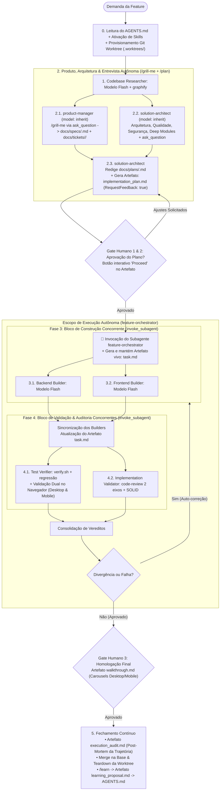

# Fábrica de Software Global (Feature Factory)

## Execução no Codex

No Codex, leia e siga [references/codex.md](references/codex.md). Essa referência define a esteira completa com os agentes e as ferramentas disponíveis no Codex. As seções abaixo são o fluxo do Antigravity e não se aplicam ao Codex: seus nomes de ferramentas, caminhos `.gemini/` e gates são específicos daquele ambiente.

## Execução no Antigravity

Orquestrador universal para desenvolvimento de software no modelo de **Fábrica de Software**. Totalmente **desacoplado de tecnologia ou linguagem**, adaptando-se a qualquer projeto ao consultar o `AGENTS.md` local e integrando o catálogo de **skills especializadas** instaladas no sistema.

Organiza o ciclo de vida de qualquer demanda em camadas estritas de **pesquisa**, **especificação**, **construção sequencial** e **validação independente**, intercaladas por pontos de aprovação e alinhamento humano.

---

## 1. Princípios de Governança Universal

1. **Adesão às Regras Locais**: O orquestrador nunca assume tecnologias por conta própria. A stack, padrões de pastas e comandos de teste são extraídos dinamicamente do `AGENTS.md` do projeto ativo.
2. **Potencialização por Skills Especializadas**: Cada fase da fábrica incorpora playbooks nativos (`graphify`, `/plan`, `/grill-me`, `tdd`, `solid`, `ponytail`, `shadcn`, `code-review`) para garantir excelência técnica em cada etapa.
3. **Resolução Proativa de Decisões (`/grill-me`)**: Nenhuma suposição crítica de design, UX ou regra de negócio é feita sem antes entrevistar o usuário de forma estruturada.
4. **Restrição Estrita de Ferramentas**:
   - Agentes de pesquisa e auditoria têm permissão **exclusiva de leitura** (`view_file`, `grep_search`, `find_by_name`, `list_dir`).
   - Modificações de código são permitidas apenas aos builders.
5. **Seleção de Modelos Otimizada (Cérebro Forte no Planejamento + Execução Rápida)**:
   - `inherit` (Modelo principal da conversa, ex.: Gemini Pro / Claude Opus / Sonnet): **`product-manager`**, **`solution-architect`** e **`feature-orchestrator`**, garantindo raciocínio profundo em regras de negócio, arquitetura, qualidade e segurança.
   - `flash`: **`codebase-researcher`**, **`backend-builder`**, **`frontend-builder`**, **`test-verifier`** e **`implementation-validator`**, combinando alta velocidade de execução e economia de cota guiados pela especificação detalhada do arquiteto.
6. **Paralelismo Duplo Inteligente (Construção e Validação)**:
   - **Bloco 1 (Construção Paralela)**: Devido ao desacoplamento estrito (*Zero Shared Package*), builders que atuam em diretórios ou serviços isolados (ex: backend em Go/Python/Node e frontend em React/Next/TanStack) **PODEM e DEVEM ser disparados em paralelo** na mesma chamada de `invoke_subagent`.
   - **Bloco 2 (Validação & Auditoria Paralelas)**: Concluída a construção, `test-verifier` (execução da suíte de testes do projeto) e `implementation-validator` (auditoria do diff contra Spec e SOLID) **são disparados simultaneamente** em uma única chamada de `invoke_subagent`. O validador é estritamente read-only e o verificador executa testes em processo isolado, eliminando qualquer contenção de arquivos e reduzindo o tempo de verificação pela metade.
   - Serialização é reservada apenas para modificações em arquivos compartilhados da raiz (`docker-compose.yml`, configurações compartilhadas).
7. **Governança Nativa de Git Worktrees (Isolamento Físico de Features)**:
   - Toda demanda complexa gerenciada pelo `/feature-factory` opera dentro de uma **Git Worktree dedicada** provisionada na Fase 0 (ex.: `.worktrees/<slug>` na branch `feat/<slug>`).
   - Isso garante **isolamento total**: a pasta principal e a branch `main` nunca sofrem com arquivos intermediários quebrados, stashes ou sujeira de desenvolvimento enquanto a esteira autônoma roda.
   - As dependências utilizam a store global do `pnpm` (hardlinks instantâneos sem consumo extra de disco).
   - Após o Gate 3, o orquestrador realiza o merge na branch principal e remove a worktree (`git worktree remove`), deixando zero resíduos.
8. **Matriz Canônica de Slash Commands Integrados**:
   - **`/grill-me`**: Executado autonomamente pelo `product-manager` e `solution-architect` na Fase 2 para entrevistar o usuário via modal (`ask_question`) e eliminar lacunas antes do código.
   - **`/plan`**: Formalização estruturada de `docs/specs/<slug>.md`, `docs/tickets/<slug>/` e emissão do artefato `implementation_plan.md`.
   - **`/compact`**: Execução recomendada na transição do Gate 1 & 2 para higienizar o histórico da conversa e focar a context window na implementação.
   - **`/goal` + `/boost`**: O motor autônomo da Fase 3 e 4. Mantém o `feature-orchestrator` focado até o objetivo ser cumprido com *extended thinking*, builders concorrentes, suíte de testes e loop de auto-cura (*self-healing*) sem pausas humanas intermediárias.
   - **`/browser`**: Motor de auditoria visual dual do `test-verifier` na Fase 4 (Mobile 390px + Desktop 1440px).
   - **`/schedule`**: Temporizador assíncrono para validação de fluxos com delay (webhooks Pix, jobs de IA do Gemini).
   - **`/learn`**: Ritual de fechamento contínuo na Fase 5 para atualizar o `AGENTS.md`.
9. **Zero Pre-work no Planejamento (Padrão Boost)**:
   - O planejamento utiliza o Grafo de Conhecimento (`graphify query`) e delega a descoberta de domínio e arquitetura aos subagentes `product-manager` e `solution-architect`.

---

## 2. A Cadeia de 7 Agentes & Matriz de Skills

| Papel | Tipo / Agente (`TypeName`) | Modelo | Permissão | Skills Integradas | Responsabilidade |
| :--- | :--- | :--- | :--- | :--- | :--- |
| **1. `codebase-researcher`** | `codebase-researcher` | `flash` | Leitura | **`graphify`**, **`research`** | Mapeia o grafo de dependências, pontos de impacto e interfaces afetadas sem alterar código. |
| **2. `product-manager`** | `product-manager` | `inherit` | Leitura / `ask_question` / Docs | **`domain-modeling`**, **`to-spec`**, **`to-tickets`**, **`roadmap-planning`** | Analisa `AGENTS.md`, `PRD.md` e `GLOSSARY.md`, entrevista o usuário via `ask_question` (`/grill-me`) para eliminar gaps de negócio, salva a Spec de Produto em `docs/specs/<slug>.md` e quebra em tickets verticais em `docs/tickets/<slug>/<NN>-<ticket>.md`. |
| **3. `solution-architect`** | `solution-architect` | `inherit` | Leitura / `ask_question` / Docs / Artifacts | **`plan`**, **`codebase-design`**, **`improve-codebase-architecture`**, **`solid`**, **`ponytail`**, **`graphify`** | Avalia arquitetura (*Deep Modules*), qualidade, isolamento de camadas/fronteiras e segurança; entrevista o usuário via `ask_question` (`/grill-me`), redige `docs/plans/<slug>.md` e emite o artefato interativo `implementation_plan.md` (`RequestFeedback: true`). |
| **4. `backend-builder`** | `backend-builder` | `flash` | Escrita | **`tdd`**, **`solid`**, **`ponytail`**, **`codebase-design`**, **`domain-modeling`**, **`improve-codebase-architecture`** | Constrói regras de negócio, módulos profundos, dados e APIs guiado pelo `AGENTS.md` com ciclo estrito Red → Green, aplicando SOLID e Deep Modules balanceados com YAGNI radical. |
| **5. `frontend-builder`** | `frontend-builder` | `flash` | Escrita | **`shadcn`**, **`frontend-design`**, **`modern-web-guidance`**, **`responsive-design`** | Constrói telas e componentes responsivos/mobile-first com o framework e design system definidos no `AGENTS.md` (ex.: React, Next.js, TanStack, Tailwind CSS, shadcn/ui) sem acoplar backend. |
| **6. `test-verifier`** | `test-verifier` | `flash` | Escrita / Cmd | **`tdd`**, **`chrome-devtools`**, **`a11y-debugging`** | Executa a suíte de testes e o pipeline de verificação do `AGENTS.md`, valida critérios BDD dos tickets e realiza **validação visual dual obrigatória no navegador (Desktop e Mobile)** para assegurar responsividade, ausência de overflow e acessibilidade. |
| **7. `implementation-validator`** | `implementation-validator` | `flash` | Leitura / Docs / Artifacts | **`code-review`**, **`codebase-design`**, **`solid`**, **`ponytail-review`**, **`efficient-swe-workflow`** | Audita o diff final em três eixos (Spec/Plan/Tickets vs. Padrões do `AGENTS.md` e SOLID vs. Anti-Bloat `ponytail-review`), caçando code smells e complexidade desnecessária; na Fase 5, gera o artefato de post-mortem **`execution_audit.md`** avaliando loops, eficiência e atrito da IA. |


---

## 3. Fluxo de Execução Passo a Passo



---

### Fase 0: Inicialização de Contexto, Ativação de Skills & Provisionamento de Git Worktree
Antes de qualquer interação:
1. Localize e leia o arquivo `AGENTS.md` na raiz do projeto.
2. **Carregamento Just-in-Time de Skills**: Consulte skills da lista `Available skills` estritamente sob demanda. É proibido carregar múltiplos playbooks de uma vez no início. Apenas consulte a skill específica quando for operar diretamente sob suas diretrizes.
3. **Provisionamento Automático da Git Worktree (Isolamento Físico de Features)**:
   - Toda feature complexa DEVE operar em uma Git Worktree isolada para garantir que o workspace principal e a branch `main` fiquem intocados:
     ```bash
     git worktree add .worktrees/<slug> -b feat/<slug>
     ```
   - Assegure que `.worktrees/` esteja registrado no `.gitignore`.
   - Na pasta da worktree, vincule as dependências via store do pnpm (`pnpm install --prefer-offline`). Toda a construção e validação subsequente ocorrerá no diretório isolado da worktree.

---

### Fase 1: Mapeamento Rápido (`codebase-researcher`)
- **TypeName**: `"codebase-researcher"` (`model: flash`)
- **Skills Ativas**: `graphify`, `research`.
- **Procedimento**:
  - Consulta o Grafo de Conhecimento (`graphify query`) para mapear pontos de entrada, interfaces existentes e blast radius em menos de 1 minuto sem varredura manual de arquivos.

---

### 🎙️ Fase 2: Descoberta de Produto, Arquitetura & Entrevista Autônoma (`product-manager` + `solution-architect`)
**Obrigatório em todas as fases/features não triviais** antes de iniciar a codificação:

#### 2.1. `product-manager` (Modelo: `inherit`) — Lente de Produto & Regras de Negócio
- **TypeName**: `"product-manager"`
- **Role**: `"Product Manager & Domain Strategist"`
- **Skills Ativas**: `domain-modeling`, `to-spec`, `to-tickets`, `roadmap-planning`.
- **Procedimento**:
  - Analisa `AGENTS.md`, `PRD.md` e `GLOSSARY.md` (se presentes) para extrair regras de domínio, limites/cotas, fluxos de erro e jornada do usuário (UX).
  - Possui **autonomia direta com `ask_question` (`/grill-me`)**: realiza quantas perguntas forem necessárias diretamente ao usuário (sempre com a melhor opção marcada com **`(Recommended)`**) até eliminar todas as lacunas de negócio.
  - Salva localmente a **Spec de Produto** em **`docs/specs/<slug>.md`** (`to-spec`) e os **Tracer-Bullet Tickets** numerados por ordem de dependência em **`docs/tickets/<slug>/<NN>-<ticket>.md`** (`to-tickets`).

#### 2.2. `solution-architect` (Modelo: `inherit`) — Lente de Arquitetura, Qualidade & Segurança
- **TypeName**: `"solution-architect"`
- **Role**: `"Principal Solution & Security Architect"`
- **Skills Ativas**: `plan`, `codebase-design`, `improve-codebase-architecture`, `solid`, `ponytail`, `graphify`.
- **Procedimento**:
  - Avalia os 4 pilares técnicos universais guiados pelo `AGENTS.md` do projeto:
    1. **Arquitetura & Deep Modules**: Interfaces concisas, costuras (*seams*) de TDD e isolamento estrito entre camadas/fronteiras (ex.: Client/Server ou Domínio/Infra).
    2. **Integridade de Negócio**: Regras e cálculos autoritativos no backend, transações atômicas e máquinas de estado.
    3. **Segurança por Design**: Validação de schemas nas bordas RPC/HTTP, verificação de assinaturas em webhooks, idempotência estrita, tokens/permissões com menor privilégio e sanitização de entradas.
    4. **Qualidade & Anti-Bloat**: SOLID equilibrado com `ponytail` (YAGNI).
  - Possui **autonomia direta com `ask_question` (`/grill-me`)** para alinhar decisões arquiteturais e de segurança com o usuário.
  - Consolida as definições do `product-manager` e as respostas do usuário redigindo a especificação técnica completa em **`docs/plans/<slug>.md`** e gerando obrigatoriamente o artefato interativo **`implementation_plan.md`** (com `ArtifactMetadata: { RequestFeedback: true, UserFacing: true, Summary: "..." }`) contendo diagramas Mermaid obrigatórios, modelos de dados, invariantes e interfaces públicas.

---

### 🛑 Gate Humano 1 & 2: Alinhamento de Requisitos e Arquitetura
- **PARE**. Apresente a especificação detalhada (`docs/plans/<slug>.md`) e o artefato interativo `implementation_plan.md` ao usuário.
- O usuário avalia a proposta e aciona o botão nativo **"Proceed"** no artefato ou solicita ajustes via chat.
- **Recomendação**: Antes de iniciar a Fase 3, execute o comando `/compact` para higienizar o histórico da conversa após a rodada de perguntas do `/grill-me`, focando o contexto nos artefatos aprovados.
- Não inicie nenhuma codificação até receber aprovação explícita.

---

### Fase 3: Despacho do Subagente Orquestrador (`feature-orchestrator`)
Aprovado o plano, o Chat Canvas invoca o subagente:
- **Role**: `"Feature Factory Orchestrator"`
- **TypeName**: `"feature-orchestrator"`
- **Prompt**: Contém o plano aprovado verbatim, links para os documentos autoritativos e a ordem de comandar a esteira.

O `feature-orchestrator` opera com carregamento cirúrgico de skills sob demanda (Just-in-Time), **cria e mantém o artefato vivo `task.md`** com a lista de tickets verticais e seus checkboxes (`- [ ]` / `- [x]`) atualizados em tempo real conforme cada builder entrega, e despacha os blocos em paralelo:

> [!IMPORTANT]
> **Identificadores Canônicos de Subagentes (`TypeName`)**:
> Ao invocar subagentes via `invoke_subagent`, utilize estritamente o `TypeName` correspondente ao identificador registrado em `.agents/agents/<name>.md`:
> - `codebase-researcher` para mapeamento rápido do grafo e codebase
> - `product-manager` para descoberta de produto, regras de negócio e `/grill-me`
> - `solution-architect` para arquitetura, segurança, qualidade, `/grill-me` técnico e escrita de `docs/plans/<slug>.md`
> - `backend-builder` para o construtor backend
> - `frontend-builder` para o construtor frontend
> - `test-verifier` para o verificador de testes
> - `implementation-validator` para o auditor de código
> **NUNCA use `TypeName: "self"`** ao despachar subagentes a partir do orquestrador. Conforme a documentação oficial do Antigravity, `"self"` é uma palavra-chave reservada do agente raiz para auto-clonagem; seu uso dentro de um subagente resulta em erro fatal (`subagent "self" not found or not allowed to be invoked`).

#### 📝 Template Canônico de Despacho (Padrão Boost)
Todo subagente DEVE receber um prompt estruturado contendo:
```markdown
**Task**: [Instrução do usuário verbatim]

**Skill Primária de Referência (Opcional — Máximo 1, Just-in-Time)**:
Se estritamente necessário para consulta da API ou padrão do ticket:
- `<workspace_root>/.agents/skills/<skill_primaria>/SKILL.md` (ou via `Available skills`)
*Nota: Proibido carregar skills em bloco. Demais playbooks da lista `Available skills` devem ser consultados estritamente sob demanda se surgir dúvida técnica específica.*

**Additional Context**:
- Repositório: <caminho> | Branch: <branch>
- Spec de Produto: docs/specs/<slug>.md
- Plano Técnico: docs/plans/<slug>.md (e implementation_plan.md)
- Ticket Ativo: docs/tickets/<slug>/<NN>-<ticket>.md
- Invariantes: AGENTS.md do projeto (Stack, Deep Modules, Isolamento de Camadas, Tipagem Estrita, CLI oficial)

**Escopo a Implementar**:
1. Arquivos, módulos profundos e contratos específicos do workspace.
2. Protocolos de qualidade (TDD Red-Green nas costuras públicas, validação nas bordas).
3. Comandos de verificação definidos no AGENTS.md do projeto.
```

#### 3.1. `backend-builder` (Modelo: `flash` com High Effort / `inherit`)
- **TypeName**: `"backend-builder"`
- **Carregamento Just-in-Time**: Proibido carregar skills em bloco upfront. Consulte playbooks da lista `Available skills` estritamente sob demanda se houver dúvida pontual (ex: `tdd` para testes ou `tanstack-start` para Server Functions).
- **Diretrizes**:
  - **Context Discovery**: Inspecione o `AGENTS.md` ou arquivos do projeto alvo para identificar linguagem (Go, Python, Node.js/NestJS, etc.), convenções de pastas e dependências.
  - **`tdd`**: Escreva testes apenas nas costuras pré-acordadas. Siga o ciclo *Red → Green*: um teste que falha por vez, seguido da menor implementação que passa.
  - **`solid`**: Aplique inversão de dependência (DIP/Hexagonal Ports & Adapters), responsabilidade única (SRP) e segregação de interfaces (ISP). Valide entradas nas bordas e utilize tipagem estrita sem vazamento de infraestrutura para o domínio.
  - **`ponytail`**: Aplique o princípio da menor solução viável (YAGNI). Prefira recursos padrão da linguagem antes de bibliotecas externas; evite classes de suporte especulativas e abstrações prematuras.
  - **Dependências via CLI**: Sempre instale novos pacotes via CLI nativo do projeto (`go get`, `uv add`/`poetry add`/`pip install`, `pnpm/npm add`). Nunca edite arquivos de manifesto manualmente para gerenciar dependências.

#### 3.2. `frontend-builder` (Modelo: `flash` com High Effort / `inherit`)
- **TypeName**: `"frontend-builder"`
- **Role**: `"Frontend Builder"`
- **Carregamento Just-in-Time**: Proibido carregar skills em bloco upfront. Consulte playbooks da lista `Available skills` estritamente sob demanda se houver dúvida pontual (ex: `shadcn` para UI ou `tanstack-router` para navegação).
- **Diretrizes**:
  - **Frameworks Mandatórios**: Construa exclusivamente utilizando **React, Next.js ou TanStack** (Router/Query/Start), alinhado ao setup do projeto ativo.
  - **`shadcn`**: Reutilize primitivos acessíveis e componentes existentes da base (Radix/Shadcn).
  - **`frontend-design`**: Aplique estética visual e tipografia distintas e intencionais.
  - **`modern-web-guidance`**: Siga boas práticas de performance, CSS moderno com Tailwind e preserve o isolamento total dos tipos do backend (contratos de consumo locais).
  - **Dependências via CLI**: Sempre instale novos pacotes ou componentes via CLI oficial (`pnpm add`, `npm install`, `npx shadcn@latest add`).

---

### Fase 4: Bloco de Validação & Auditoria Concorrentes (`test-verifier` || `implementation-validator`)
Concluída a construção, ambos os subagentes são disparados **simultaneamente no mesmo `invoke_subagent`**:

#### 4.1. `test-verifier` (Modelo: `flash` com High Effort / `inherit`)
- **TypeName**: `"test-verifier"`
- **Role**: `"Quality & Test Verifier"`
- **Carregamento Just-in-Time**: Proibido carregar skills em bloco upfront. Consulte playbooks da lista `Available skills` estritamente sob demanda (ex: `chrome-devtools` para auditoria no browser, `a11y-debugging` para acessibilidade).
- **Diretrizes**:
  - Execute a suíte de testes oficial do projeto alvo (`go test ./...`, `pytest`, `pnpm test`, `./.agents/scripts/verify.sh` ou `./scripts/verify.sh` se existir).
  - Verifique typecheck, linter, thresholds de cobertura e testes de regressão.
  - **Validação Dual Obrigatória no Navegador (Desktop e Mobile)**:
    - Onde houver interfaces web, execute o servidor local (`pnpm dev`) e utilize a automação de navegador (`/browser` / Chrome DevTools) inspecionando duas resoluções distintas:
      1. **Viewport Mobile (360px a 430px — padrão 390×844)**:
         - Validar estritamente a ausência de estouro/scroll horizontal (`zero horizontal overflow`).
         - Validar touch targets confortáveis (mínimo 44×44px para botões de ação e campos de formulário).
         - Testar formulários e modais em telas compactas.
      2. **Viewport Desktop (1280px a 1440px / 1920×1080)**:
         - Validar grids responsivos, alinhamento visual, legibilidade e distribuição harmoniosa dos componentes shadcn/ui.
         - Garantir que elementos não fiquem excessivamente esticados ou desalinhados em telas largas.
      3. **Acessibilidade e Console**:
         - Inspecionar a aba de Console para garantir **zero erros ou warnings de runtime**.
         - Auditar contraste e semântica ARIA via `a11y-debugging`.

#### 4.2. `implementation-validator` (Modelo: `flash` com High Effort / `inherit`)
- **TypeName**: `"implementation-validator"`
- **Role**: `"Implementation Validator"`
- **Carregamento Just-in-Time**: Proibido carregar skills em bloco upfront. Consulte playbooks da lista `Available skills` estritamente sob demanda (ex: `ponytail-review` para caçar complexidade acidental no diff ou `code-review` se necessário).
- **Diretrizes (Leitura Pura)**:
  - **Eixo 1 (Spec)**: Avalia se os critérios de aceite foram cumpridos à risca e se houve *scope creep*.
  - **Eixo 2 (Standards & SOLID)**: Avalia se o código respeita o `AGENTS.md` local, tipagem estrita, princípios SOLID e o catálogo de code smells (Bloaters, Couplers, Primitive Obsession).
  - **Auditoria de Complexidade (`ponytail-review`)**: Identifica abstrações mortas, duplicações e flexibilidade especulativa no diff.

#### 🔄 Loop Autônomo de Auto-Correção (Padrão `/boost`)
Se o validador ou os testes apontarem divergências, falha de cobertura ou code smells críticos, o orquestrador recebe ambos os relatórios consolidados em uma única rodada e re-injeta o diagnóstico nos builders responsáveis até a suíte de testes do projeto passar 100%.

---

### 🛑 Gate Humano 3: Homologação Final
- **Artefato Obrigatório**: Gere o artefato interativo **`walkthrough.md`** (com `ArtifactMetadata: { RequestFeedback: true, UserFacing: true, Summary: "..." }`) contendo:
  - Resumo das alterações e arquivos modificados com links clicáveis `file://`.
  - Prova de aprovação da suíte de testes e typecheck (`./.agents/scripts/verify.sh`).
  - Snippets de carousels (`carousel`) comparando a renderização visual **Mobile (390px)** vs. **Desktop (1440px)**.
- Aguarde o aval e aprovação do usuário para finalizar e commitar a alteração.

---

### 🔄 Fase 5: Auditoria de Execução, Merge na Base, Teardown & Fechamento Contínuo (`/learn`)
- Ao concluir a homologação no Gate 3 e realizar o commit final na branch `feat/<slug>`:
  1. **Auditoria de Execução Post-Mortem (Artefato Obrigatório: `execution_audit.md`)**:
     - O subagente **`implementation-validator`** realiza a auditoria profunda da trajetória do agente e do diff final, emitindo o artefato interativo **`execution_audit.md`** (com `ArtifactMetadata: { RequestFeedback: false, UserFacing: true, Summary: "..." }`) avaliando 4 eixos:
       - **Eixo 1: Eficiência de Ferramentas & Trajetória**: Inspeciona os logs de execução (`transcript.jsonl`), contando ferramentas chamadas, detectando loops de erro, comandos redundantes de terminal ou tempo excessivo em correções de tipagem.
       - **Eixo 2: Qualidade de Código & Anti-Bloat (`ponytail-review`)**: Caça complexidade acidental, duplicações de lógica, abstrações especulativas, helpers rasos e bibliotecas externas desnecessárias no diff.
       - **Eixo 3: Governança do `AGENTS.md`**: Audita adesão a Deep Modules, tipagem estrita (zero `any`), ausência de comentários de supressão (`eslint-disable`, `@ts-ignore`) e uso exclusivo do CLI oficial (`pnpm add`).
       - **Eixo 4: Oportunidades de Otimização do Processo**: Identifica pontos de atrito e formula recomendações acionáveis para tornar o próximo ciclo de desenvolvimento mais rápido, mais barato e mais autônomo.
  2. **Merge na Branch Base**:
     - Retorne ao repositório raiz e integre a branch da feature aprovada e auditada:
       ```bash
       git merge feat/<slug>
       ```
  3. **Teardown da Git Worktree**:
     - Remova a pasta isolada da worktree sem deixar resíduos:
       ```bash
       git worktree remove .worktrees/<slug>
       ```
  4. **Ritual de Aprendizado & Fechamento Contínuo (`/learn`)**:
     - Dispare o protocolo do **`/learn`** consumindo os achados e oportunidades do `execution_audit.md`:
       - Novas armadilhas técnicas superadas.
       - Decisões arquiteturais, visuais (Mobile/Desktop) ou de UX que devem virar regras perpétuas em `AGENTS.md`.
       - Ajustes de playbooks e skills especializadas.
     - Elabore a proposta de aprendizado no artefato **`learning_proposal.md`** para validação humana, garantindo que o conhecimento nunca se perca entre sessões.
