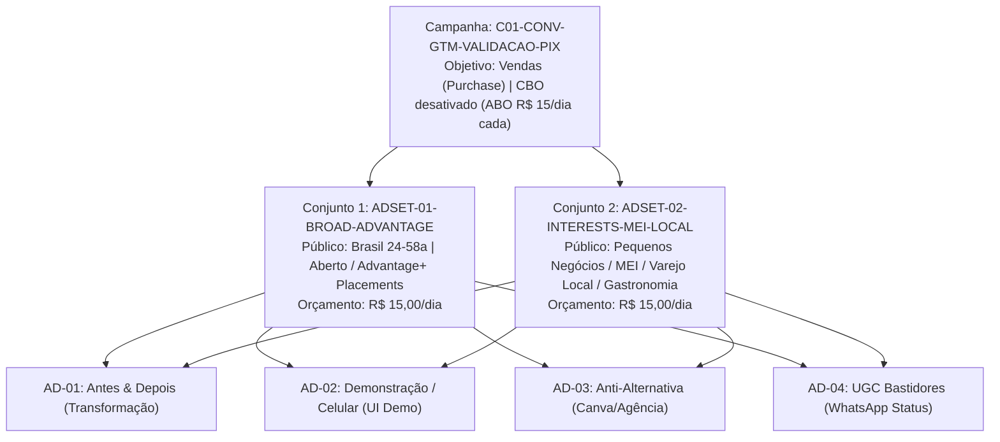

# Plano de Campanha Meta Ads: Validação Inicial de Aquisição (Go-to-Market)

- **Documento:** `docs/marketing/campaigns/validacao-meta-ads.md`
- **Responsável:** Performance Marketing Manager
- **Objetivo:** Aquisição de clientes pagantes pelo menor CPA no Meta Ads (Instagram/Facebook) validando vendas avulsas de R$ 9,90 via Pix.
- **Orçamento de Teste de Tração:** R$ 25,00 a R$ 30,00 por dia (~R$ 750 a R$ 900 / mês inicial).
- **Meta Primária:** CPA de Compra (`Purchase`) ≤ R$ 6,00 (Piso Break-even: R$ 7,90).
- **Status:** Pronto para Lançamento

---

## 1. Arquitetura da Campanha

A campanha adota uma estrutura ágil e enxuta de **2 Conjuntos de Anúncios** com 4 criativos idênticos em cada, isolando a eficiência da segmentação (Aberto vs. Nichado/Interesses) e permitindo que o algoritmo do Meta encontre o público com maior propensão de pagamento Pix imediato.



---

## 2. Configurações em Nível de Campanha

- **Nome da Campanha:** `OP-PROD | CONV-SALES | TRACTION-VALIDATION-PIX990 | 2026-Q4`
- **Objetivo da Campanha:** **Vendas** (*Sales*).
- **Categoria Especial de Anúncio:** Nenhuma (não se enquadra em crédito, emprego, moradia ou política).
- **Tipo de Compra:** Leilão (*Auction*).
- **Otimização do Orçamento da Campanha (Advantage Campaign Budget / CBO):** **Desativado** (ABO - Ad Set Budget Optimization) durante os primeiros 7 dias para garantir distribuição equitativa de orçamento entre os conjuntos e testar o público aberto sem viés algorítmico prematuro.
- **Divisão do Orçamento Diário:**
  - Conjunto 1 (Broad): R$ 15,00 / dia
  - Conjunto 2 (Interesses): R$ 15,00 / dia
  - **Orçamento Total Diário:** R$ 30,00 / dia

---

## 3. Configurações em Nível de Conjunto de Anúncios (Ad Sets)

### 3.1. Meta de Conversão & Evento de Otimização
- **Local de Conversão:** Site (*Website*).
- **Pixel / Conjunto de Dados:** Pixel Oficial OfertaPronta (`VITE_PUBLIC_META_PIXEL_ID`).
- **Evento de Conversão:**
  - **Primário:** `Purchase` (Compra confirmada via Pix).
  - *Plano de Contingência de Aprendizado:* Se nas primeiras 48 horas o conjunto registrar menos de 3 compras devido ao volume de teste inicial, mudar temporariamente o evento de otimização para `InitiateCheckout` (Início de Pagamento Pix) para destravar o volume de sinais para a IA do Meta, retornando para `Purchase` após 20 eventos registrados.
- **Estratégia de Lance:** Menor Custo / Maior Volume (*Lowest Cost*).
- **Janela de Atribuição:** 7 dias após o clique ou 1 dia após a visualização (*7-day click or 1-day view*).

---

### 3.2. Detalhamento dos Públicos

#### Conjunto 1: `ADSET-01-BROAD-ADVANTAGE` (Aberto / Segmentação pelo Criativo)
- **Racional:** Os algoritmos modernos do Meta utilizam o processamento semântico de imagem, texto e áudio do anúncio para encontrar automaticamente microempresários locais com interesse no produto. O público aberto maximiza o alcance com o menor CPM possível.
- **Localização:** Brasil (Todo o território nacional).
- **Idade:** 24 a 58 anos (faixa etária economicamente ativa de pequenos comerciantes e tomadores de decisão).
- **Gênero:** Todos (Homens e Mulheres).
- **Direcionamento Detalhado (Interesses):** Vazio / Sem interesses.
- **Advantage+ Audience:** Ativado.
- **Idiomas:** Português (Brasil).

#### Conjunto 2: `ADSET-02-INTERESTS-MEI-LOCAL` (Segmentado por Interesses Comerciais)
- **Racional:** Agrupa diretamente microempreendedores, lojistas e autônomos que enfrentam diariamente a dor de gerenciar seu próprio negócio sem equipe de marketing.
- **Localização:** Brasil (Todo o território nacional).
- **Idade:** 24 a 58 anos.
- **Gênero:** Todos.
- **Direcionamento Detalhado (Interesses Combinados):**
  - **Negócios & Gestão:** *Microempresa*, *Microempreendedor individual (MEI)*, *Pequenas e médias empresas*, *Proprietário de pequena empresa*, *Administrador de Páginas de Negócios no Facebook*.
  - **Varejo & Gastronomia:** *Restaurante*, *Pizzaria*, *Lanchonete*, *Padaria*, *Supermercado*, *Açougue*, *Salão de beleza*, *Barbearia*.
  - **Ferramentas de Substituição:** *Canva (software)*, *Design gráfico*.
- **Exclusões:**
  - *Designers gráficos profissionais*, *Diretores de arte*, *Agências de publicidade* (para evitar curiosos técnicos e anti-personas).

---

### 3.3. Posicionamentos (Placements)

Para a fase de validação, priorizamos onde o microempresário consome conteúdo visual no celular:

| Canal | Posicionamento | Proporção Recomendada | Justificativa |
| :--- | :--- | :---: | :--- |
| **Instagram** | Instagram Feed | `4:5` (1080×1350) ou `1:1` | Máxima área visual na timeline; excelente para Antes & Depois. |
| **Instagram** | Instagram Stories | `9:16` (1080×1920) | Ambiente natural onde o comerciante posta promoções diárias. |
| **Instagram** | Instagram Reels | `9:16` (1080×1920) | Menor CPM, alto engajamento em vídeos de tela e demonstração. |
| **Facebook** | Feed do Facebook | `4:5` (1080×1350) ou `1:1` | Forte adesão de comerciantes 40+ (ex.: donos de mercadinho/açougue). |
| **Audience Network** | Todos | — | **Desativar** (tráfego de baixa qualidade/cliques acidentais em jogos). |

---

## 4. Padrão de Nomenclatura & Parâmetros de Rastreamento (UTMs)

Para garantir atribuição precisa no Google Analytics 4, Mixpanel e banco de dados interno (`orders.metaData`), todos os links devem seguir o padrão estrito de UTMs dinâmicas do Meta:

### URL Base de Destino:
```
https://ofertapronta.com.br/
```

### Estrutura Completa de Parâmetros UTM:
```
?utm_source=meta
&utm_medium=paid-social
&utm_campaign={{campaign.name}}
&utm_content={{ad.name}}
&utm_term={{adset.name}}
&ad_id={{ad.id}}
&adset_id={{adset.id}}
&campaign_id={{campaign.id}}
&placement={{placement}}
```

### Tabela de Nomenclatura Padronizada:

| Nível | Padrão de Nomenclatura | Exemplo Real |
| :--- | :--- | :--- |
| **Campanha** | `[PROD]_[OBJ]_[TIPO]_[DATA]` | `OP_CONV_GTM-VALIDACAO-PIX_2026Q4` |
| **Conjunto** | `[ADSET]_[NUM]_[SEGMENTO]_[IDADE]` | `ADSET-01-BROAD-ADVANTAGE-24-58` |
| **Conjunto** | `[ADSET]_[NUM]_[INTERESSES]_[IDADE]` | `ADSET-02-INTERESTS-MEI-LOCAL-24-58` |
| **Anúncio 1** | `AD01-IMG-ANTES-DEPOIS-TRANSFORMACAO` | `AD01-IMG-ANTES-DEPOIS-TRANSFORMACAO` |
| **Anúncio 2** | `AD02-VID-DEMO-MOCKUP-CELULAR-90S` | `AD02-VID-DEMO-MOCKUP-CELULAR-90S` |
| **Anúncio 3** | `AD03-IMG-ANTI-CANVA-AGENCIA-DOR` | `AD03-IMG-ANTI-CANVA-AGENCIA-DOR` |
| **Anúncio 4** | `AD04-VID-UGC-STATUS-WHATSAPP-BASTIDORES` | `AD04-VID-UGC-STATUS-WHATSAPP-BASTIDORES` |

---

## 5. Checklist de Lançamento Passo a Passo no Meta Ads Manager

Execute rigorosamente as 12 etapas abaixo no **Gerenciador de Anúncios da Meta**:

- [ ] **Etapa 1:** Acessar o Gerenciador de Anúncios e verificar se a conta de anúncios, página do Facebook e perfil do Instagram do OfertaPronta estão devidamente conectados e verificados.
- [ ] **Etapa 2:** Confirmar no Gerenciador de Eventos se o Pixel do OfertaPronta e a API de Conversões (CAPI) estão ativos com status verde e recebendo eventos de `PageView` e `InitiateCheckout`.
- [ ] **Etapa 3:** Clicar no botão verde **"+ Criar Campanha"** e selecionar o objetivo **"Vendas"**.
- [ ] **Etapa 4:** Nomear a campanha como `OP_CONV_GTM-VALIDACAO-PIX_2026Q4` e manter o orçamento em nível de conjunto de anúncios (desativar CBO).
- [ ] **Etapa 5:** Criar o **Conjunto 1 (Broad)**:
  - Definir localização como *Brasil*, idade *24-58*, idiomas *Português*.
  - Deixar o direcionamento detalhado sem filtros.
  - Definir orçamento diário de **R$ 15,00**.
  - Selecionar posicionamentos manuais: Feeds e Stories/Reels (Instagram e Facebook); desmarcar Audience Network.
- [ ] **Etapa 6:** Criar o **Conjunto 2 (Interesses)**:
  - Duplicar o Conjunto 1 e renomear para `ADSET-02-INTERESTS-MEI-LOCAL-24-58`.
  - Inserir a lista de interesses comerciais validados (MEI, Pequenas empresas, Proprietários de páginas, Restaurantes, Barbearias, Salões).
  - Inserir a exclusão de *Designers gráficos* e *Agências de publicidade*.
  - Definir orçamento diário de **R$ 15,00**.
- [ ] **Etapa 7:** Fazer o upload dos 4 criativos oficiais (formatos 4:5 e 9:16) no Conjunto 1, inserindo os textos primários, headlines, descrições e URLs com UTMs especificadas em `docs/marketing/creatives/validacao-meta-ads/README.md`.
- [ ] **Etapa 8:** Selecionar o botão de CTA como **"Cadastre-se"** ou **"Saiba Mais"** (conforme diretriz de CRO, apontando para `/` com foco em *Gerar meu card grátis*).
- [ ] **Etapa 9:** Duplicar os 4 anúncios prontos para o Conjunto 2, garantindo que as tags e IDs fiquem sincronizados.
- [ ] **Etapa 10:** Testar os links de todos os anúncios no celular para validar se abrem a Landing Page com carregamento veloz (< 2s) e se o parâmetro de UTM é persistido na URL.
- [ ] **Etapa 11:** Conferir se o rastreamento do Pixel do Meta está selecionado na caixa "Rastreamento / Eventos do Site" de cada anúncio.
- [ ] **Etapa 12:** Clicar em **"Publicar"** no canto inferior direito e monitorar a aprovação da moderação do Meta (prazo médio de 1 a 4 horas).

---

## 6. Regras de Otimização e Escala (Protocolo de 72 Horas)

1. **Janela de Aprendizado Inicial (Primeiras 48-72h):**
   - **Não alterar orçamentos, públicos ou criativos** durante as primeiras 48 horas para não resetar a fase de aprendizado algorítmico.
2. **Pausa Imediata de Criativo Perdedor:**
   - Se um criativo atingir **R$ 15,00 de gasto** (2x o Break-even CPA) sem gerar nenhuma venda confirmada (`Purchase`), **pausar o criativo**.
   - Se o CTR no link estiver **abaixo de 0,80%** após 1.000 impressões, o gancho/hook falhou: substituir o criativo.
3. **Escala de Criativo Campeão:**
   - Se um criativo entregar **CPA ≤ R$ 5,00** com mais de 3 compras nos primeiros 3 dias, aumentar o orçamento do conjunto em **20% a cada 48 horas**.
4. **Alocação de Verba:**
   - Se o conjunto Broad apresentar CPA inferior ao conjunto de Interesses (comum no Meta Ads atual), migrar 70% da verba diária para o conjunto Broad.
