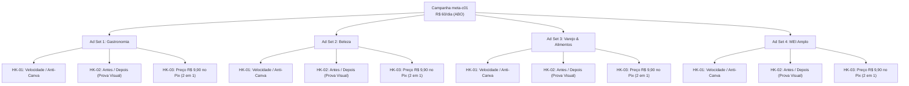

# Matriz de Testes Criativos — Lote Inaugural de Nichos

**Campanha:** `meta-c01-traffic-to-paid-niche-proof`  
**Objetivo de Campanha:** Vendas (`Conversions` / `Purchase` via CAPI + Pixel)  
**Orçamento Diário da Campanha:** R$ 60,00/dia (4 Ad Sets × R$ 15,00/dia em ABO)  
**Break-even CPA (Piso Máximo):** R$ 7,88 | **Target CPA:** R$ 4,50 – R$ 5,50  
**Data de Criação:** 2026-10-20 | **Status:** Pronto para Produção & Subida

---

## 1. Visão Geral da Estratégia de Criativos

O lote de criativos da campanha inaugural foi projetado para testar sistematicamente qual nicho comercial e qual gatilho psicológico convertem o microempresário brasileiro ao menor Custo por Aquisição (CPA).

A arquitetura de testes cruza **4 nichos comerciais** com **3 ganchos psicológicos fundamentais** e **2 formatos nativos do ecossistema Meta**:



---

## 2. Matriz Cruzada de Testes Criativos (Nicho × Gancho × Formato)

| Código do Criativo | Nicho Comercial | Ângulo Psicológico (Gancho) | Formato Primário | Formato Secundário | Arquivo de Especificação |
|---|---|---|---|---|---|
| **C01-GAS-HK01** | Gastronomia & Delivery | HK-01: Velocidade / Dor do Canva | Feed (1080×1350) | Story/Reels (1080×1920) | [`01-gastronomia-delivery.md`](file:///home/luis/repositories/OfertaPronta/docs/marketing/creatives/meta-c01-traffic-to-paid-niche-proof/01-gastronomia-delivery.md) |
| **C01-GAS-HK02** | Gastronomia & Delivery | HK-02: Prova Visual Antes/Depois | Feed (1080×1350) | Story/Reels (1080×1920) | [`01-gastronomia-delivery.md`](file:///home/luis/repositories/OfertaPronta/docs/marketing/creatives/meta-c01-traffic-to-paid-niche-proof/01-gastronomia-delivery.md) |
| **C01-GAS-HK03** | Gastronomia & Delivery | HK-03: Oferta Pix R$ 9,90 (2 em 1) | Feed (1080×1350) | Story/Reels (1080×1920) | [`01-gastronomia-delivery.md`](file:///home/luis/repositories/OfertaPronta/docs/marketing/creatives/meta-c01-traffic-to-paid-niche-proof/01-gastronomia-delivery.md) |
| **C01-BEL-HK01** | Beleza & Barbearia | HK-01: Velocidade / Dor do Canva | Feed (1080×1350) | Story/Reels (1080×1920) | [`02-beleza-barbearia.md`](file:///home/luis/repositories/OfertaPronta/docs/marketing/creatives/meta-c01-traffic-to-paid-niche-proof/02-beleza-barbearia.md) |
| **C01-BEL-HK02** | Beleza & Barbearia | HK-02: Prova Visual Antes/Depois | Feed (1080×1350) | Story/Reels (1080×1920) | [`02-beleza-barbearia.md`](file:///home/luis/repositories/OfertaPronta/docs/marketing/creatives/meta-c01-traffic-to-paid-niche-proof/02-beleza-barbearia.md) |
| **C01-BEL-HK03** | Beleza & Barbearia | HK-03: Oferta Pix R$ 9,90 (2 em 1) | Feed (1080×1350) | Story/Reels (1080×1920) | [`02-beleza-barbearia.md`](file:///home/luis/repositories/OfertaPronta/docs/marketing/creatives/meta-c01-traffic-to-paid-niche-proof/02-beleza-barbearia.md) |
| **C01-VAR-HK01** | Varejo & Supermercado | HK-01: Velocidade / Dor do Canva | Feed (1080×1350) | Story/Reels (1080×1920) | [`03-varejo-local-mercado.md`](file:///home/luis/repositories/OfertaPronta/docs/marketing/creatives/meta-c01-traffic-to-paid-niche-proof/03-varejo-local-mercado.md) |
| **C01-VAR-HK02** | Varejo & Supermercado | HK-02: Prova Visual Antes/Depois | Feed (1080×1350) | Story/Reels (1080×1920) | [`03-varejo-local-mercado.md`](file:///home/luis/repositories/OfertaPronta/docs/marketing/creatives/meta-c01-traffic-to-paid-niche-proof/03-varejo-local-mercado.md) |
| **C01-VAR-HK03** | Varejo & Supermercado | HK-03: Oferta Pix R$ 9,90 (2 em 1) | Feed (1080×1350) | Story/Reels (1080×1920) | [`03-varejo-local-mercado.md`](file:///home/luis/repositories/OfertaPronta/docs/marketing/creatives/meta-c01-traffic-to-paid-niche-proof/03-varejo-local-mercado.md) |
| **C01-MEI-HK01** | MEI & Comércio Amplo | HK-01: Velocidade / Dor do Canva | Feed (1080×1350) | Story/Reels (1080×1920) | [`04-mei-comercio-amplo.md`](file:///home/luis/repositories/OfertaPronta/docs/marketing/creatives/meta-c01-traffic-to-paid-niche-proof/04-mei-comercio-amplo.md) |
| **C01-MEI-HK02** | MEI & Comércio Amplo | HK-02: Prova Visual Antes/Depois | Feed (1080×1350) | Story/Reels (1080×1920) | [`04-mei-comercio-amplo.md`](file:///home/luis/repositories/OfertaPronta/docs/marketing/creatives/meta-c01-traffic-to-paid-niche-proof/04-mei-comercio-amplo.md) |
| **C01-MEI-HK03** | MEI & Comércio Amplo | HK-03: Oferta Pix R$ 9,90 (2 em 1) | Feed (1080×1350) | Story/Reels (1080×1920) | [`04-mei-comercio-amplo.md`](file:///home/luis/repositories/OfertaPronta/docs/marketing/creatives/meta-c01-traffic-to-paid-niche-proof/04-mei-comercio-amplo.md) |

---

## 3. Padrão Canônico de Nomenclatura (Naming Convention)

Para permitir que relatórios do Meta Ads sejam analisados com precisão e facilitem decisões automatizadas, use este padrão de nomes em todos os níveis:

### 3.1. Nível Campanha
```
OP_[PAÍS]_[OBJETIVO]_[SLUG]
Exemplo: OP_BR_CONV_c01-niche-proof
```

### 3.2. Nível Conjunto de Anúncios (Ad Set)
```
OP_C01_[NICHO]_[ORÇAMENTO]_[PÚBLICO]
Exemplos:
- OP_C01_ADSET01_GASTRONOMIA_ABO15_INTERESSES
- OP_C01_ADSET02_BELEZA_ABO15_INTERESSES
- OP_C01_ADSET03_VAREJO_ABO15_INTERESSES
- OP_C01_ADSET04_MEIAMPLO_ABO15_INTERESSES
```

### 3.3. Nível Anúncio (Ad)
```
OP_C01_[NICHO]_[GANCHO]_[FORMATO]_[VAR_COPY]
Exemplos:
- OP_C01_GAS_HK01_FEED_V1
- OP_C01_GAS_HK02_STORY_V2
- OP_C01_BEL_HK01_FEED_V1
- OP_C01_VAR_HK02_FEED_V1
- OP_C01_MEI_HK03_STORY_V3
```

---

## 4. Parâmetros UTM Oficiais para Rastreamento

Cada URL de destino no anúncio deve conter os parâmetros UTM padronizados para alimentar a atribuição no Google Analytics 4 e no banco de dados do OfertaPronta:

| Parâmetro | Valor Padrão | Exemplo Dinâmico no Meta Ads |
|---|---|---|
| `utm_source` | `meta` | `meta` |
| `utm_medium` | `paid_social` | `paid_social` |
| `utm_campaign` | `meta-c01-traffic-to-paid-niche-proof` | `meta-c01-traffic-to-paid-niche-proof` |
| `utm_content` | Nome do anúncio | `{{ad.name}}` |
| `utm_term` | Nome do conjunto | `{{adset.name}}` |

### URL Completa de Destino Recomendada:
```
https://ofertapronta.com.br/criar?utm_source=meta&utm_medium=paid_social&utm_campaign=meta-c01-traffic-to-paid-niche-proof&utm_content={{ad.name}}&utm_term={{adset.name}}
```

---

## 5. Regras de Decisão Operacional (Kill / Keep / Scale)

Com base no **Break-even CPA de R$ 7,88** definido no [`unit-economics.md`](file:///home/luis/repositories/OfertaPronta/docs/marketing/unit-economics.md):

1. **Pausa Rápida de Criativo Ruim:**
   - Se um anúncio gastar **R$ 20,00** sem registrar pelo menos 1 evento `InitiateCheckout`, pause o anúncio imediatamente.
2. **Pausa de Conjunto Ineficiente:**
   - Se um conjunto de anúncios acumular **R$ 30,00** de gasto sem nenhuma compra confirmada (`Purchase`), pause o conjunto para estancar sangria de caixa.
3. **Escala de Conjuntos Lucrativos:**
   - Se um conjunto mantiver **CPA $\le$ R$ 5,50** com pelo menos 3 compras confirmadas em uma janela de 48h a 72h, aumente o orçamento diário em 15% a 20% a cada 2 dias.
4. **Iteração de Criativos em Conjuntos Neutros:**
   - Se o CPA estiver entre **R$ 5,51 e R$ 7,88**, o conjunto se paga mas não dá margem suficiente. Mantenha o orçamento estável e substitua o anúncio de menor CTR pelo próximo gancho do lote.
