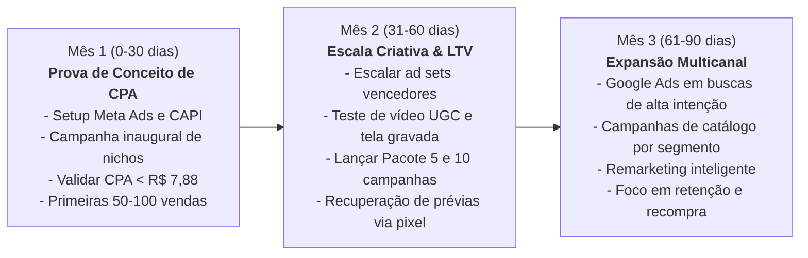
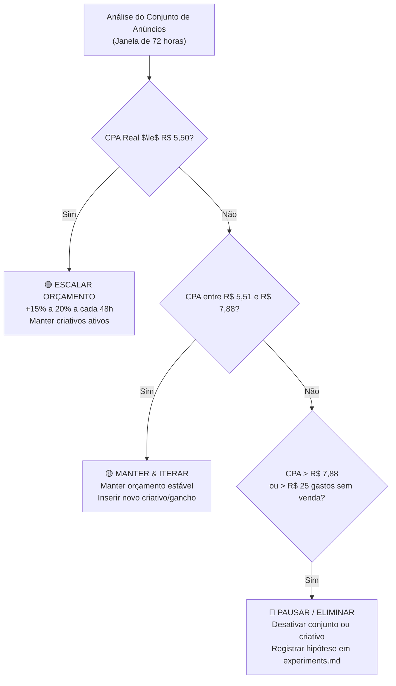

# Plano de Marketing e Go-To-Market — OfertaPronta

**Documento:** Plano Go-To-Market e Estratégia de Aquisição Paga  
**Última atualização:** 2026-10-20  
**Status:** V1 — Inicial (Fase de Lançamento do MVP)  
**Meta Primária:** Aquisição lucrativa de microempresários brasileiros via Meta Ads a um CPA inferior ao Break-even de **R$ 7,88**.

---

## 1. Visão Geral e Tese de Aquisição

O **OfertaPronta** soluciona a maior dor de marketing do comércio local brasileiro: a necessidade diária de postar ofertas atraentes nas redes sociais sem ter tempo, conhecimento em design ou orçamento para contratar agências.

### Tese Central de Go-To-Market
Ao remover todas as barreiras tradicionais de entrada:
1. **Sem cadastro obrigatório** (preenchimento direto no celular);
2. **Prévia gratuita com marca d'água** (o usuário só paga se aprovar a arte);
3. **Pagamento avulso via Pix de R$ 9,90** (sem assinatura no cartão de crédito);
4. **Entrega 2 em 1** (Feed Retrato 4:5 + Story 9:16 prontos para postar);

Conseguimos gerar uma taxa de conversão de topo/meio de funil expressivamente superior aos softwares tradicionais de assinatura, viabilizando a aquisição direta de clientes com lucro líquido no dia 1 (*day-one profitability*).

---

## 2. Prioridades de 30 / 60 / 90 Dias



### Dias 1 a 30: Prova de Conceito de CPA e Validação de Funil
- **Setup e Integridade de Dados:** Homologar o pipeline de eventos de conversão no Meta Ads com rastreamento duplo:
  - Meta Pixel no navegador (eventos `PageView`, `ViewContent`, `InitiateCheckout`);
  - Conversions API (CAPI) disparada diretamente pelo webhook do servidor TanStack Start no evento `PAID` da Pushin Pay com `event_id` compartilhado para deduplicação perfeita.
- **Lançamento da Campanha Inaugural:** Ativar a campanha `meta-c01-traffic-to-paid-niche-proof` com orçamento controlado de R$ 45,00 a R$ 60,00/dia.
- **Validação de Unit Economics em Produção:** Garantir que o CPA médio de compras confirmadas permaneça na faixa-alvo de **R$ 4,50 a R$ 5,50** e nunca ultrapasse o piso de **R$ 7,88**.
- **Alcançar as primeiras 50 transações pagas** para destravar a fase de aprendizado algorítmico do Meta Ads.

### Dias 31 a 60: Escala de Criativos e Expansão de LTV
- **Escala Vertical e Horizontal:** Aumentar em 20% a cada 48h o orçamento dos conjuntos de anúncios que mantiverem CPA $\le$ R$ 5,50.
- **Fábrica de Criativos:** Produzir e testar variações de vídeo vertical nativo (Reels):
  - Gravação de tela do celular preenchendo o briefing em 45 segundos;
  - Comparação "Antes e Depois" (foto feia sem tratamento vs arte profissional com selo);
  - Depoimentos reais de comerciantes locais.
- **Monetização de Volume:** Ativar no catálogo os planos de 5 campanhas (R$ 29,90) e 10 campanhas (R$ 49,90) ofertados estrategicamente na tela de entrega pós-pagamento (`/pedido/$orderId`), elevando o LTV médio sem custos de mídia adicionais.

### Dias 61 a 90: Expansão Multicanal e Retenção Orgânica
- **Google Search Ads:** Capturar demanda de alta intenção em termos transacionais (ex.: *"fazer encarte de supermercado online"*, *"arte para barbearia instagram"*, *"cardápio promoção delivery"*).
- **Loop de Retenção:** Implementar disparos automáticos de lembretes semanais via WhatsApp/e-mail para comerciantes que compraram, sugerindo novas artes para a "promoção da semana".
- **Remarketing de Abandono de Prévia:** Criar audiência personalizada no Meta Ads para usuários que visualizaram a prévia (`ViewContent` com marca d'água) mas não concluíram o Pix em até 24h.

---

## 3. Primeira Campanha de Tráfego Pago: `meta-c01-traffic-to-paid-niche-proof`

Esta é a campanha canônica de lançamento desenhada para validar qual segmento comercial apresenta o menor Custo de Aquisição (CPA) e o maior volume de conversão.

### 3.1. Ficha Técnica da Campanha

| Parâmetro | Definição Operacional |
|---|---|
| **Identificador Canônico** | `meta-c01-traffic-to-paid-niche-proof` |
| **Plataforma** | Meta Ads (Instagram Feed, Instagram Reels, Instagram Stories e Facebook Feed) |
| **Objetivo de Campanha** | **Vendas** (`Conversions`) |
| **Evento de Otimização** | `Purchase` (Valor: R$ 9,90 / Moeda: BRL via CAPI + Pixel) |
| **Orçamento** | ABO (Ad Set Budget Optimization) — R$ 15,00/dia por conjunto |
| **Orçamento Total Diário** | **R$ 60,00 / dia** (4 conjuntos de anúncios) |
| **Estratégia de Lances** | Volume Mais Alto (*Highest Volume*) |
| **Janela de Atribuição** | 7 dias após o clique ou 1 dia após a visualização |

---

### 3.2. Estrutura de Conjuntos de Anúncios (Segmentação por Nicho)

Dividimos a campanha em 4 conjuntos de anúncios isolados para comparar a performance de nicho sem dispersão de orçamento:

```
Campanha: meta-c01-traffic-to-paid-niche-proof
│
├── Ad Set 1: Gastronomia & Delivery (Pizzarias, Hamburguerias, Marmitarias)
├── Ad Set 2: Beleza & Estética (Barbearias, Salões, Manicures)
├── Ad Set 3: Varejo & Alimentos (Supermercados, Hortifrútis, Açougues)
└── Ad Set 4: Interesses Gerais em Pequenos Negócios (MEI, Comércio Local, Sebrae)
```

#### Ad Set 1: Gastronomia & Delivery
- **Público-alvo:** Proprietários e operadores de estabelecimentos gastronômicos.
- **Segmentação detalhada:**
  - *Interesses:* iFood, Restaurante, Hamburgueria, Pizzaria, Comida rápida, Fornecimento de refeições.
  - *Comportamento:* Administradores de Páginas de Negócios / Alimentos e Bebidas.
- **Idade:** 21 a 55 anos.
- **Gênero:** Todos.
- **Geolocalização:** Brasil (Todo o território nacional).
- **Posicionamentos:** Advantage+ Placements (com foco no Instagram Reels e Stories).

#### Ad Set 2: Beleza & Estética
- **Público-alvo:** Barbeiros, cabeleireiros, esteticistas e manicures.
- **Segmentação detalhada:**
  - *Interesses:* Barbearia, Salão de beleza, Cabeleireiro, Cuidados pessoais, Cosméticos, Estética.
  - *Comportamento:* Administradores de páginas de beleza / comércio local.
- **Idade:** 20 a 50 anos.
- **Gênero:** Todos.
- **Posicionamentos:** Advantage+ Placements.

#### Ad Set 3: Varejo Local, Açougues & Supermercados
- **Público-alvo:** Donos de mercadinhos, supermercados de bairro, casas de carnes e hortifrútis.
- **Segmentação detalhada:**
  - *Interesses:* Supermercado, Mercearia, Açougue, Comércio varejista, Hortifrúti.
  - *Comportamento:* Proprietários de pequenas empresas.
- **Idade:** 25 a 60 anos.
- **Gênero:** Todos.
- **Posicionamentos:** Advantage+ Placements.

#### Ad Set 4: Pequenos Negócios & MEI (Amplo)
- **Público-alvo:** Microempreendedores em geral buscando divulgação acessível.
- **Segmentação detalhada:**
  - *Interesses:* Microempreendedor individual (MEI), Sebrae, Pequenas empresas, Gestão comercial.
  - *Comportamento:* Administradores de páginas do Facebook / Contas comerciais do Instagram.
- **Idade:** 24 a 58 anos.
- **Posicionamentos:** Advantage+ Placements.

---

### 3.3. Matriz de Criativos e Ângulos de Cópia

Cada conjunto de anúncios conterá **3 criativos distintos**, combinando 3 ângulos psicológicos comprovados com exemplos visuais reais gerados pelo OfertaPronta:

| Criativo | Ângulo Psicológico | Formatos | Descrição Visual | Gancho Principal (Headline) |
|---|---|---|---|---|
| **CR-01** | **Velocidade & Anti-Canva** | 1080×1920 (Reels) e 1080×1350 (Feed) | Vídeo curto/gravação de tela: preenchendo o formulário no celular em 40s $\to$ card profissional brotando na tela. | *"Ainda perde 1 hora no Canva pra fazer um post simples? Crie em 90 segundos por R$ 9,90 no Pix."* |
| **CR-02** | **Contraste Antes/Depois (Prova Visual)** | 1080×1350 (Feed 4:5) e 1080×1920 (Story) | Imagem estática dividida: do lado esquerdo foto escura e amadora no balcão; do lado direito o Card Publicitário com iluminação 3D, selo de preço e tipografia comercial. | *"A diferença entre um post que ninguém vê e uma oferta que esgota seu estoque."* |
| **CR-03** | **Pacote 2 em 1 & Preço Popular** | 1080×1350 (Feed) e 1080×1920 (Story) | Carrossel ou imagem estática apresentando a arte nos 2 formatos oficiais lado a lado com selo Pix. | *"Feed + Story prontos para postar. Apenas R$ 9,90 no Pix, sem mensalidade e sem cadastro."* |

---

## 4. Rastreamento e Conversions API (CAPI)

A integridade do rastreamento é um pilar não-negociável. A atribuição de campanhas e a otimização de lances dependem de dados precisos.

### Mapeamento de Eventos do Funil

| Etapa do Usuário | URL / Ação | Evento Meta | Lado de Disparo | Parâmetros Chave |
|---|---|---|---|---|
| Acesso à Página Inicial | `/` | `PageView` | Browser (Pixel) | `url`, `utm_source`, `utm_campaign` |
| Entrada no Formulário | `/criar` | `ViewContent` | Browser (Pixel) | `content_name: "Offer Creation"` |
| Geração da Prévia com Marca d'Água | Ação de IA concluída | `GeneratePreview` (Custom) | Browser (Pixel) | `segment`, `has_product_image` |
| Abertura da Tela de Checkout Pix | `/checkout/$orderId` | `InitiateCheckout` | Browser (Pixel) | `value: 9.90`, `currency: "BRL"`, `order_id` |
| **Confirmação do Pagamento Pix** | **Webhook Pushin Pay (`PAID`)** | **`Purchase`** | **Servidor (CAPI)** | **`value: 9.90`, `currency: "BRL"`, `order_id`, `event_id`** |

> [!IMPORTANT]
> **Deduplicação de Eventos (`event_id`):**  
> O evento `Purchase` deve ser emitido via Conversions API a partir da rota de webhook do backend [`/api/webhooks/pix`](file:///home/luis/repositories/OfertaPronta/src/routes/api.webhooks.pix.ts) utilizando o identificador único do pedido (`orderId`) como `event_id`. Caso a tela de pedido no navegador também emita o evento, o Meta Ads deduplica com 100% de precisão.

---

## 5. Protocolo de Decisão e Governança Semanal

Toda análise de métricas exportadas do Ads Manager deve seguir este algoritmo de tomada de decisão baseado no Unit Economics:



### Regras Estritas de Pausa e Escala
1. **Regra de Pausa Rápida por Criativo:** Se um criativo gastar **R$ 20,00** sem gerar nenhuma inicialização de checkout (`InitiateCheckout`), ele deve ser pausado imediatamente.
2. **Regra de Pausa por Conjunto:** Se um conjunto de anúncios ultrapassar **R$ 30,00** de gasto acumulado sem nenhuma compra (`Purchase`), pause o conjunto para estancar perdas.
3. **Regra de Escala Segura:** Conjuntos com mais de 3 compras confirmadas a um CPA $\le$ R$ 5,50 podem ter seu orçamento incrementado em até 20% a cada 2 dias (evitando reiniciar a fase de aprendizado da máquina).

---

## 6. Próximos Passos Operacionais Imediatos

1. **Documentação de Rastreamento:** Criar `docs/marketing/tracking-plan.md` detalhando as tags do Meta Pixel, parâmetros UTM canônicos e a especificação da Conversions API.
2. **Geração do Lote de Criativos:** Criar a pasta `docs/marketing/creatives/meta-c01-traffic-to-paid-niche-proof/` com os roteiros e copys detalhadas dos criativos por nicho (Gastronomia, Beleza, Supermercado).
3. **Registro do Experimento Inicial:** Criar `docs/marketing/experiments.md` formalizando a hipótese inaugural de aquisição do `meta-c01-traffic-to-paid-niche-proof`.
4. **Briefing Técnico para Engenharia:** Formalizar a solicitação técnica de injeção dos scripts do Meta Pixel e do webhook CAPI via Feature Factory.
