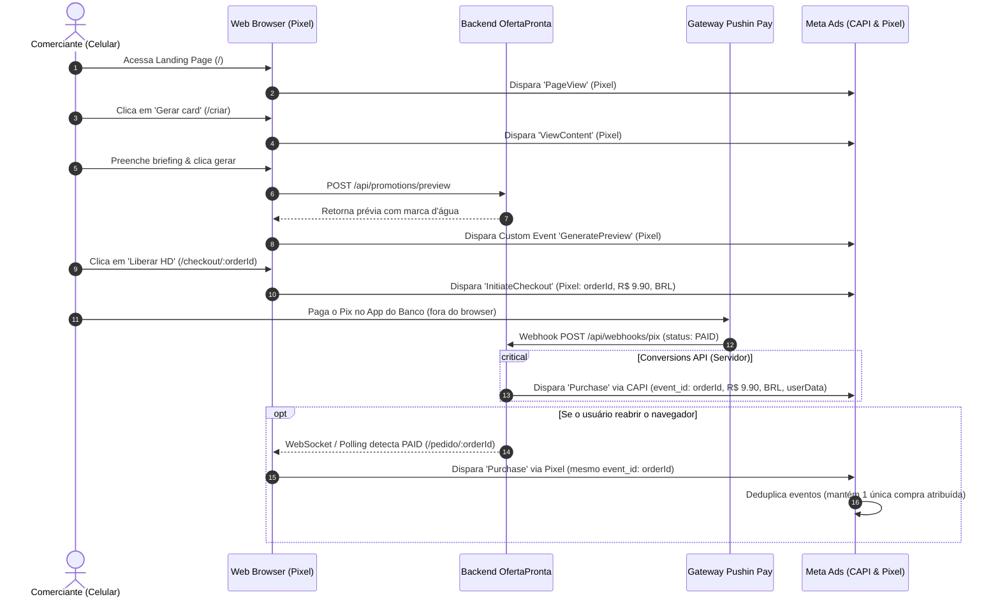

# Plano de Rastreamento & Atribuição de Conversão (Tracking Plan) — OfertaPronta

- **Documento:** `docs/marketing/tracking-plan.md`
- **Responsável:** Performance Marketing Manager
- **Objetivo:** Rastreamento determinístico e à prova de perdas do funil de conversão no Meta Ads e Google Ads, combinando Meta Pixel no navegador com Conversions API (CAPI) no servidor via webhook Pix Pushin Pay.
- **Status:** Baseline de Produção
- **Data:** 2026-10-27
- **Versão:** 1.0

---

## 1. Arquitetura Híbrida de Rastreamento (Browser + Server-side CAPI)

Devido às restrições do iOS 14.5+ (ATT), bloqueadores de anúncios e à particularidade do comportamento do consumidor de **pagar o Pix fora do navegador** (o comerciante copia o código, minimiza o browser, abre o aplicativo bancário e conclui o pagamento), o OfertaPronta adota uma **arquitetura híbrida redundante com deduplicação determinística**.



---

## 2. Dicionário de Eventos do Funil de Conversão

| Evento | Gatilho na Aplicação | Canal de Disparo | Parâmetros Obrigatórios | Finalidade Algorítmica |
| :--- | :--- | :---: | :--- | :--- |
| **`PageView`** | Carregamento de qualquer rota do site (`/`, `/criar`, `/checkout/*`, `/pedido/*`) | Browser (Pixel / gtag) | `page_location`, `page_title` | Auditoria de tráfego e volume de visitantes. |
| **`ViewContent`** | Entrada na tela de criação de oferta (`/criar`) | Browser (Pixel / gtag) | `content_name: 'criar_briefing'`, `content_category: 'onboarding'` | Diagnóstico de transição da LP para o briefing. |
| **`GeneratePreview`** | Exibição bem-sucedida do card gerado com marca d'água na tela | Browser (Pixel Custom Event) | `content_name: 'ad_card_preview'`, `segment: 'gastronomia|mercado|salao...'` | Validação de engajamento com o produto antes do pagamento. |
| **`InitiateCheckout`** | Carregamento da página de pagamento Pix com QR Code (`/checkout/:orderId`) | Browser (Pixel / gtag) | `value: 9.90`, `currency: 'BRL'`, `content_name: orderId`, `content_ids: [orderId]` | Monitoramento de intenção de compra e abandono de checkout. |
| **`Purchase`** | Confirmação do pagamento Pix (`orders.status === "PAID"`) | **Server (CAPI via Webhook)** + Browser (Redundante) | `value: 9.90`, `currency: 'BRL'`, `transaction_id: orderId`, `event_id: orderId` | **Evento Primário de Otimização e Lances da Campanha no Meta Ads**. |

---

## 3. Implementação Técnica Detalhada

### 3.1. Deduplicação Determinística (`event_id`)
Para evitar contagem dupla de compras quando o usuário paga no banco e retorna à tela de sucesso `/pedido/:orderId`, o Meta exige que ambos os disparos (Browser e Server) compartilhem rigorosamente o mesmo identificador exclusivo:

- **Identificador de Deduplicação:** `event_id = order.id` (UUID único gerado na criação do pedido no banco de dados).
- **Nome do Evento:** Exatamente idêntico (`Purchase`).

```typescript
// Exemplo de payload enviado via Meta CAPI (Server-side)
{
  "event_name": "Purchase",
  "event_time": Math.floor(Date.now() / 1000),
  "event_id": order.id, // Chave determinística de deduplicação
  "user_data": {
    "em": hashSha256(order.customerEmail), // se disponível
    "ph": hashSha256(order.customerPhone), // se disponível (WhatsApp)
    "client_ip_address": order.clientIp,
    "client_user_agent": order.userAgent,
    "fbc": parseFbcCookie(req),
    "fbp": parseFbpCookie(req)
  },
  "custom_data": {
    "currency": "BRL",
    "value": 9.90,
    "content_type": "product",
    "contents": [
      {
        "id": order.id,
        "quantity": 1,
        "item_price": 9.90
      }
    ]
  },
  "action_source": "website",
  "event_source_url": `https://ofertapronta.com.br/pedido/${order.id}`
}
```

---

### 3.2. Captura & Persistência de UTMs e Parâmetros de Cliques (First-Party Attribution)

Ao carregar qualquer página inicial, a aplicação deve capturar parâmetros de tráfego pago da URL e gravá-los em `sessionStorage` e no payload do pedido:

1. **Parâmetros Capturados na Entrada:**
   - `utm_source` (ex.: `meta`)
   - `utm_medium` (ex.: `paid-social`)
   - `utm_campaign` (ex.: `OP_CONV_GTM-VALIDACAO-PIX_2026Q4`)
   - `utm_content` (ex.: `AD01-IMG-ANTES-DEPOIS-TRANSFORMACAO`)
   - `utm_term` (ex.: `ADSET-01-BROAD-ADVANTAGE-24-58`)
   - `fbclid` (Identificador exclusivo de clique do Meta)
   - `ad_id`, `adset_id`, `campaign_id`

2. **Persistência no Banco de Dados (`orders.metaData`):**
   No momento em que o usuário clica em "Liberar Card HD" e a API cria a ordem na tabela `orders`, os dados de rastreamento são gravados em JSON no campo `orders.metaData`. Isso permite gerar relatórios de LTV e ROAS direto no painel administrativo sem depender de cookies de terceiros.

---

### 3.3. Disparos no Cliente (Client-side / `src/lib/tracking.ts`)

A biblioteca interna [`src/lib/tracking.ts`](file:///home/luis/repositories/OfertaPronta/src/lib/tracking.ts) implementa proteções defensivas contra recargas de página:

```typescript
// Disparo de InitiateCheckout no carregamento da tela de Pix
trackInitiateCheckout(order.id, 990); // 990 centavos = R$ 9,90

// Disparo de Purchase na tela de sucesso (/pedido/:orderId)
// Protegido por chave em sessionStorage para evitar duplicações em F5
trackPurchase(order.id, 990, order.pixTransactionId);
```

---

## 4. Guia de Teste e Validação no Meta Events Manager

Antes de ativar o tráfego pago, execute o protocolo de validação na ferramenta **Test Events (Eventos de Teste)** do Meta:

1. Acesse o **Gerenciador de Eventos da Meta** ➔ Selecione o Pixel do OfertaPronta ➔ Aba **"Testar Eventos"**.
2. Insira a URL do site com o parâmetro de teste:
   ```
   https://ofertapronta.com.br/?test_event_code=TEST_OFERTAPRONTA
   ```
3. Realize a jornada completa no celular ou navegador:
   - Visualização da Home ➔ Conferir evento `PageView` verde recebido.
   - Navegação para `/criar` ➔ Conferir evento `ViewContent`.
   - Preenchimento e geração da prévia ➔ Conferir evento `GeneratePreview`.
   - Clique em pagar e abertura do QR Code Pix ➔ Conferir evento `InitiateCheckout` com valor `9.90` e moeda `BRL`.
   - Conclusão do pagamento Pix no ambiente de sandbox/produção ➔ Conferir chegada do evento `Purchase` com:
     - Origem: **Servidor** (via webhook) e **Navegador** (via Pixel).
     - Status: **Deduplicado com Sucesso** (*Deduplicated*).
     - Valor verificado: `9.90 BRL`.

---

## 5. Matriz de Governança e Métricas de Rastreamento (Health Score)

| Métrica no Meta Ads Manager | Meta Esperada | Ação se Fora da Meta |
| :--- | :---: | :--- |
| **Event Match Quality (EMQ) no Purchase** | **8.0 a 10.0 (Ótimo)** | Validar se IP, User-Agent, telefone e cookies `_fbp`/`_fbc` estão sendo enviados pelo CAPI. |
| **Taxa de Deduplicação de Purchase** | **100% dos eventos repetidos** | Verificar se o `event_id` do Pixel browser corresponde exatamente ao `order.id` do webhook CAPI. |
| **Latência de Disparo do Webhook** | **< 3 segundos** | Monitorar logs de execução da rota `/api/webhooks/pix` para garantir resposta HTTP 200 instantânea. |
| **Taxa de Perda de InitiateCheckout para Purchase** | **< 55%** | Se mais de 60% dos checkouts não converterem, revisar legibilidade do QR Code e instruções de copiar e colar. |
