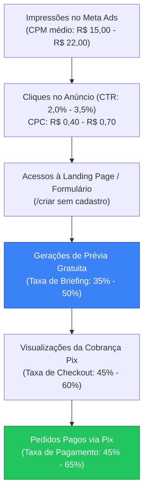

# Unit Economics — OfertaPronta

**Última atualização:** 2026-10-20  
**Versão:** 1.0  
**Status:** Oficial — Alinhado aos contratos do MVP e do Catálogo de Planos (`src/lib/campaign-catalog.ts`)

---

## 1. Resumo Executivo & Indicadores-Chave

O modelo de negócio do OfertaPronta foi desenhado com foco estrito em **aquisição lucrativa desde o primeiro pedido** (*first-order profitability*). O cliente paga sob demanda via Pix instantâneo, sem custos de setup e sem atrito de cadastro prévio.

| Métrica | Cenário Conservador (Estresse) | Cenário Base (Esperado) | Cenário Otimista (Alta Eficiência) |
|---|---|---|---|
| **Preço de Venda (Bruto)** | R$ 9,90 | **R$ 9,90** | R$ 9,90 |
| **Impostos (Simples Nacional ~6%)** | -R$ 0,59 | **-R$ 0,59** | -R$ 0,59 |
| **Taxa Gateway Pix (Pushin Pay)** | -R$ 0,35 | **-R$ 0,35** | -R$ 0,35 |
| **Custos de IA Multimodal (Gemini)** | -R$ 1,92 | **-R$ 1,03** | -R$ 0,73 |
| **Infraestrutura / Storage S3 / CDN** | -R$ 0,05 | **-R$ 0,05** | -R$ 0,05 |
| **Total de Custos Variáveis (COGS)** | **-R$ 2,91** | **-R$ 2,02** | **-R$ 1,72** |
| **Margem de Contribuição Unitária (MCU)** | **R$ 6,99 (70,6%)** | **R$ 7,88 (79,6%)** | **R$ 8,18 (82,6%)** |
| **BREAK-EVEN CPA (Teto Máximo)** | **R$ 6,99** | **R$ 7,88** | **R$ 8,18** |
| **Target CPA (Meta de Aquisição)** | R$ 4,00 | **R$ 4,50 – R$ 5,50** | R$ 5,50 |
| **Target ROAS (Meta de Campanha)** | 2,48x | **1,80x – 2,20x** | 1,80x |
| **Piso Mínimo de ROAS (Hard Floor)** | 1,42x | **1,26x** | 1,21x |

> [!IMPORTANT]
> **A Regra de Ouro da Aquisição:**  
> O **Break-even CPA oficial é de R$ 7,88**. Qualquer campanha cujo CPA de pedido pago (`Purchase`) supere R$ 7,88 está gerando prejuízo no primeiro pedido. Toda otimização de tráfego pago no Meta Ads deve perseguir o **Target CPA de R$ 4,50 a R$ 5,50**, garantindo entre R$ 2,38 e R$ 3,38 de lucro líquido por cliente adquirido já no primeiro pedido.

---

## 2. Catálogo Oficial de Planos de Campanha

A plataforma comercializa campanhas publicitárias completas compostas por 2 peças gráficas em alta resolução:
- **Instagram Feed (1080 × 1350 px — Proporção 4:5)**
- **Instagram Story & Status WhatsApp (1080 × 1920 px — Proporção 9:16)**

Os planos governados canonicamente por [`src/lib/campaign-catalog.ts`](file:///home/luis/repositories/OfertaPronta/src/lib/campaign-catalog.ts) são:

| Plano | Preço Bruto | Preço / Campanha | Prévias Gratuitas | Regenerações por Campanha | Status no MVP |
|---|---|---|---|---|---|
| **Campanha Avulsa** | **R$ 9,90** | **R$ 9,90** | 1 com marca d'água | Até 3 pós-pagamento | **Ativo (P0)** |
| **Pacote 5 Campanhas** | **R$ 29,90** | R$ 5,98 *(40% desconto)* | 1 com marca d'água | Até 3 pós-pagamento | Previsto (Fase 2) |
| **Pacote 10 Campanhas** | **R$ 49,90** | R$ 4,99 *(50% desconto)* | 1 com marca d'água | Até 3 pós-pagamento | Previsto (Fase 2) |

---

## 3. Decomposição Analítica dos Custos Variáveis (COGS)

### 3.1. Gateway de Pagamento Pix (Pushin Pay)
- **Modelo:** Pix Dinâmico com QR Code e Copia e Cola gerado por transação.
- **Custo fixo por Pix liquidado:** **R$ 0,35** (cobrado exclusivamente em transações cujo webhook retorna `PAID`; transações abandonadas ou expiradas têm custo zero).
- **Percentual sobre a receita bruta (R$ 9,90):** 3,53%.

### 3.2. Custo de IA Multimodal (Google Gemini API)
- **Modelos integrados:** `gemini-nano-banana-2.1` / `gemini-3.1-flash-image` via SDK `@google/genai`.
- **Custo de geração por imagem de saída:**
  - Preço médio oficial de saída de imagem multimodal: **US$ 0,030** por imagem gerada.
  - Câmbio de referência: **US$ 1,00 = R$ 5,70**.
  - Custo em Reais por chamada de IA: **R$ 0,171** (adotamos **R$ 0,18** para modelagem prudente).

#### A. Alocação do Custo da Prévia Gratuita Não Paga
A prévia gratuita protegida por marca d'água consome 1 chamada de IA antes do pagamento. O custo das prévias geradas por usuários que desistem no checkout deve ser absorvido pela margem dos usuários que pagam.

$$\text{Custo de Prévia Alocado por Comprador} = \frac{\text{Custo da Chamada (R\$ 0,18)}}{\text{Taxa de Conversão (Prévia } \to \text{ Pago)}}$$

- **Cenário Base (Conversão Prévia $\to$ Pago de 25%):**  
  A cada 4 prévias geradas, 1 é paga $\implies 4 \times R\$\,0,18 = \mathbf{R\$\,0,72}$.
- **Cenário Conservador / Estresse (Conversão de 15%):**  
  A cada 6,67 prévias geradas, 1 é paga $\implies 6,67 \times R\$\,0,18 = \mathbf{R\$\,1,20}$.
- **Cenário Otimista (Conversão de 40%):**  
  A cada 2,5 prévias geradas, 1 é paga $\implies 2,5 \times R\$\,0,18 = \mathbf{R\$\,0,45}$.

#### B. Custo da Entrega e Regenerações Pós-Pagamento
Após o pagamento, o cliente recebe os arquivos definitivos e possui direito a até 3 regenerações por IA em até 30 minutos:
- **Geração base do card em alta resolução:** R$ 0,18 (ou reaproveitamento determinístico do buffer original redimensionado via Sharp sem custo de API).
- **Consumo real de regenerações:**
  - 55% dos clientes não solicitam regeneração (0 chamadas adicionais).
  - 30% dos clientes solicitam 1 regeneração (1 chamada adicional).
  - 10% dos clientes solicitam 2 regenerações (2 chamadas adicionais).
  - 5% dos clientes esgotam as 3 regenerações (3 chamadas adicionais).
  - **Média ponderada por comprador:** $(0,55 \times 0) + (0,30 \times 1) + (0,10 \times 2) + (0,05 \times 3) = \mathbf{0,65 \text{ regenerações}}$.
  - **Custo médio ponderado de regenerações:** $0,65 \times R\$\,0,18 = \mathbf{R\$\,0,12}$.
- **Pior caso absoluto (100% dos compradores esgotam 3 regenerações):**  
  $3 \times R\$\,0,18 = \mathbf{R\$\,0,54}$.

#### C. Custo Total Consolidado de IA por Pedido Pago
- **Cenário Base:** $R\$\,0,72 \text{ (prévias)} + R\$\,0,18 \text{ (base)} + R\$\,0,13 \text{ (regenerações)} = \mathbf{R\$\,1,03}$.
- **Cenário Conservador:** $R\$\,1,20 \text{ (prévias)} + R\$\,0,18 \text{ (base)} + R\$\,0,54 \text{ (regenerações)} = \mathbf{R\$\,1,92}$.
- **Cenário Otimista:** $R\$\,0,45 \text{ (prévias)} + R\$\,0,18 \text{ (base)} + R\$\,0,10 \text{ (regenerações)} = \mathbf{R\$\,0,73}$.

### 3.3. Infraestrutura, Sharp e Armazenamento (S3/Cloudinary)
- Processamento determinístico de imagem no servidor (`Sharp` + `@resvg/resvg-js`) para redimensionamento 4:5 e 9:16 e aplicação de marca d'água vetorial: processamento em memória Node.js (~150ms de CPU).
- Armazenamento em bucket S3 com expiração programada de 7 dias via ciclo de vida: ~5 MB por pedido = **R$ 0,05** por pedido pago.

### 3.4. Carga Tributária
- Enquadramento ME / Simples Nacional (Anexo III — Desenvolvimento de programas de computador e serviços de tecnologia sob encomenda):
- Alíquota efetiva média da 1ª faixa: **6,0%** sobre o faturamento bruto.
- $6,0\% \times R\$\,9,90 = \mathbf{R\$\,0,59}$.

---

## 4. Demonstração de Resultado Unitário (P&L por Pedido)

```
========================================================================
OFERTAPRONTA — DEMONSTRATIVO DE RESULTADO UNITÁRIO (PLANO AVULSO R$ 9,90)
========================================================================
(+) RECEITA BRUTA .................................... R$ 9,90   (100,0%)
(-) Tributos s/ Faturamento (Simples Nacional 6%) .... -R$ 0,59   ( -6,0%)
------------------------------------------------------------------------
(=) RECEITA LÍQUIDA .................................. R$ 9,31   ( 94,0%)
(-) Taxa Gateway Pix (Pushin Pay) .................... -R$ 0,35   ( -3,5%)
(-) Custo IA Gemini (Base + Prévias + Regenerações) .. -R$ 1,03   (-10,4%)
(-) Infraestrutura, Sharp & Storage S3 (7 dias) ...... -R$ 0,05   ( -0,5%)
------------------------------------------------------------------------
(=) MARGEM DE CONTRIBUIÇÃO UNITÁRIA (MCU) ............  R$ 7,88   ( 79,6%)
========================================================================
```

---

## 5. Matriz de Break-Even CPA e Sensibilidade

O Break-even CPA define o valor exato no qual $Lucro = 0$.

$$\text{Break-even CPA} = \text{Receita Líquida} - \text{Custos Variáveis Unitários} = \mathbf{R\$\,7,88}$$

A tabela a seguir demonstra o lucro líquido por pedido adquirido em função do CPA real pago no Meta Ads:

| CPA Real de Aquisição | ROAS Equivalente | Lucro Líquido no 1º Pedido | Margem Líquida (%) | Classificação Operacional |
|---|---|---|---|---|
| **R$ 3,50** | 2,83x | **+R$ 4,38** | 44,2% | **Superavitário (Escala Agressiva)** |
| **R$ 4,50** | 2,20x | **+R$ 3,38** | 34,1% | **Excelente (Faixa-Alvo Ideal)** |
| **R$ 5,50** | 1,80x | **+R$ 2,38** | 24,0% | **Saudável (Faixa-Alvo Superior)** |
| **R$ 6,50** | 1,52x | **+R$ 1,38** | 13,9% | Aceitável (Necessita refinamento criativo) |
| **R$ 7,88** | **1,26x** | **R$ 0,00** | **0,0%** | **BREAK-EVEN (Piso Inegociável)** |
| **R$ 9,00** | 1,10x | **-R$ 1,12** | -11,3% | Déficit no 1º pedido (Depende de LTV) |
| **R$ 11,00** | 0,90x | **-R$ 3,12** | -31,5% | Crítico / Desligamento Imediato |

---

## 6. Modelagem do Funil de Aquisição no Meta Ads (Tráfego $\to$ Pix Pago)

Para que o time de performance compreenda os benchmarks de taxas de conversão necessários para atingir o Target CPA de R$ 5,00, modelamos o funil completo a partir de custos de mídia típicos no Instagram Brasil para microempresários:



### Calibração de Taxas do Funil (Cenário Alvo)
- **CPC Médio (Custo por Clique):** R$ 0,50
- **Taxa de Conversão Geral (`Clique -> Pedido Pago`):** 10,0%
  - Taxa `Visitante -> Prévia Gerada`: 40,0%
  - Taxa `Prévia Gerada -> Pix Aberto`: 50,0%
  - Taxa `Pix Aberto -> Pix Pago`: 50,0%
  - Taxa Composta: $40\% \times 50\% \times 50\% = 10,0\%$
- **CPA Resultante:** $\frac{R\$\,0,50}{10,0\%} = \mathbf{R\$\,5,00}$  
- **Lucro Líquido no 1º Pedido:** $R\$\,7,88 - R\$\,5,00 = \mathbf{+R\$\,2,88}$ por comprador.

---

## 7. Alavancagem por Pacotes de Volume (LTV & Recorrência)

Embora o marketing seja desenhado para ser lucrativo já no primeiro pedido de R$ 9,90, o modelo de negócios ganha escala exponencial na recompra e na futura introdução dos pacotes de 5 e 10 campanhas:

| Métrica | Campanha Avulsa (1) | Pacote 5 Campanhas | Pacote 10 Campanhas |
|---|---|---|---|
| **Preço de Venda** | R$ 9,90 | R$ 29,90 | R$ 49,90 |
| **Impostos (6%)** | -R$ 0,59 | -R$ 1,79 | -R$ 2,99 |
| **Taxa Pushin Pay** | -R$ 0,35 | -R$ 0,35 *(1 Pix apenas)* | -R$ 0,35 *(1 Pix apenas)* |
| **Custo de IA (Base + Prévias + Regens)** | -R$ 1,03 | -R$ 2,80 | -R$ 5,20 |
| **Infra / Storage** | -R$ 0,05 | -R$ 0,20 | -R$ 0,35 |
| **Total de Custos Variáveis** | **-R$ 2,02** | **-R$ 5,14** | **-R$ 8,89** |
| **Margem de Contribuição Líquida** | **R$ 7,88 (79,6%)** | **R$ 24,76 (82,8%)** | **R$ 41,01 (82,2%)** |
| **BREAK-EVEN CPA MÁXIMO** | **R$ 7,88** | **R$ 24,76** | **R$ 41,01** |

> [!TIP]
> **Estratégia de Expansão de LTV:**  
> Ao capturar o microempresário no pedido de R$ 9,90, a comunicação pós-entrega (tela de download e link assinado) pode sugerir o upgrade de pacote para as promoções das semanas seguintes, elevando o LTV médio para ~R$ 35,00 a R$ 50,00 por cliente retido sem custo de tráfego adicional (CAC zero na recompra).

---

## 8. Diretrizes de Decisão para Gestão de Tráfego Pago

Qualquer gestor de tráfego ou agente autônomo analisando relatórios do Meta Ads deve aplicar estritamente as seguintes regras:

1. **CPA $\le$ R$ 5,50 (ROAS $\ge$ 1,80x):** Conjunto verde. **Ação:** Escalar orçamento em 15% a 20% a cada 48h.
2. **R$ 5,51 $\le$ CPA $\le$ R$ 7,88 (1,26x $\le$ ROAS < 1,80x):** Conjunto em observação. **Ação:** Manter orçamento estável; duplicar conjunto para testar novos ganchos criativos.
3. **CPA > R$ 7,88 com pelo menos 15 cliques ou 2 prévias geradas sem venda:** Conjunto vermelho. **Ação:** Pausar imediatamente para evitar sangria de margem.
