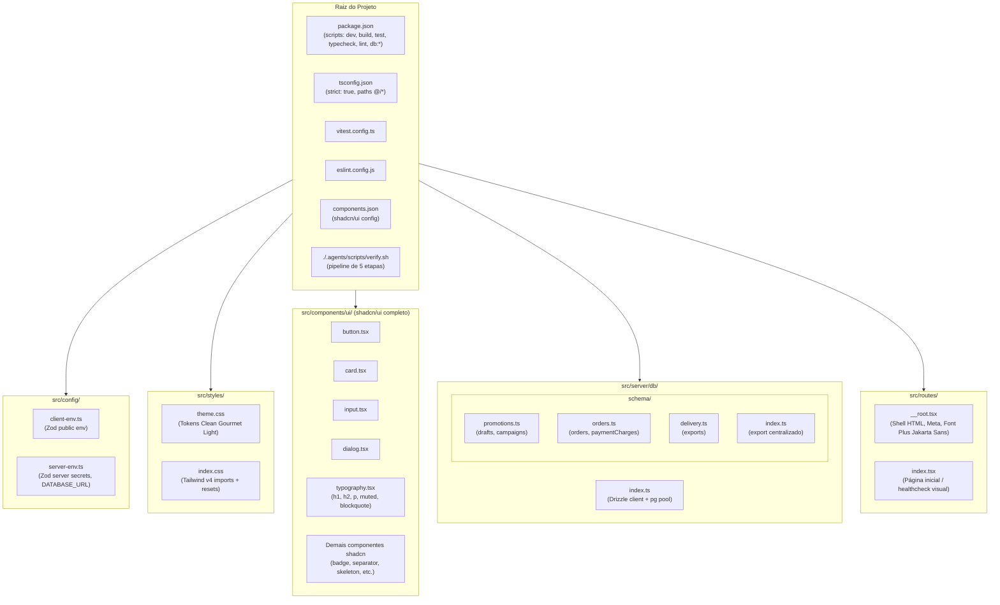
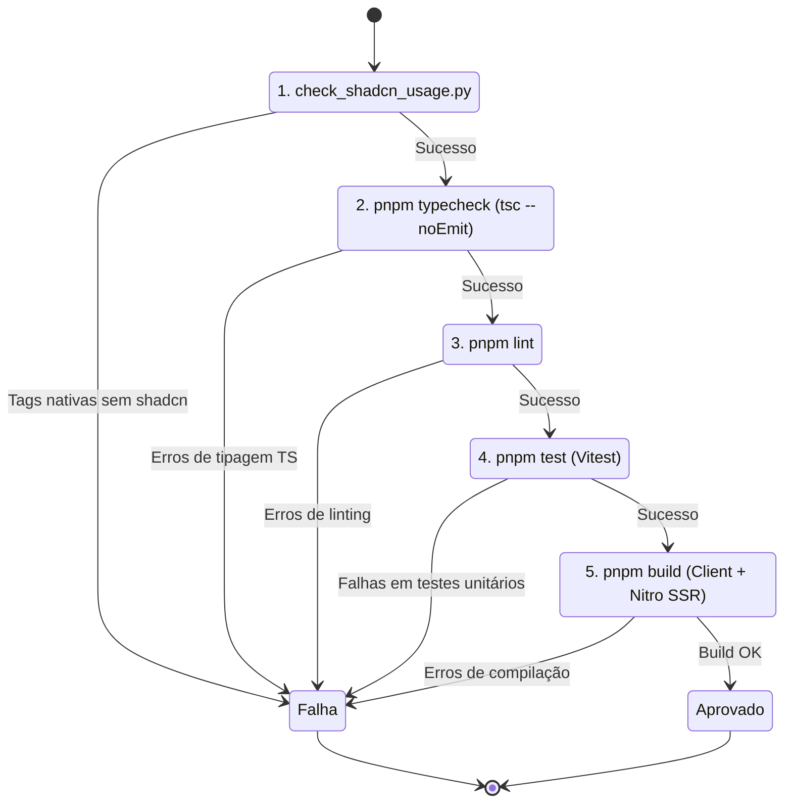

# Plano Técnico — Setup do Projeto OfertaPronta

**Slug:** `01-project-setup`  
**Data:** 15/10/2026  
**Status:** Aguardando Aprovação (Gate Humano 1 & 2)  
**Alinhamento:** `AGENTS.md`, `PRD.md`, `docs/roadmap.md`, `docs/design-system.md`

---

## 1. Visão Geral e Objetivos do Setup

Inicializar a fundação técnica completa do **OfertaPronta**, configurando o framework full-stack TanStack Start, o sistema de estilos Tailwind CSS v4 com design system "Clean Gourmet Light", a suíte completa de componentes primitivos shadcn/ui com tipografia obrigatória (`Typography`), a camada de persistência com PostgreSQL + Drizzle ORM, e as ferramentas de qualidade estrita (TypeScript strict, ESLint, Vitest e pipeline `./.agents/scripts/verify.sh`).

### Decisões do Gate 0 (/grill-me):
1. **Inicialização do TanStack Start:** Gerado via CLI oficial (`@tanstack/create-start` / `@tanstack/cli`) e podado cirurgicamente para espelhar a árvore de arquivos de *deep modules* do `AGENTS.md`.
2. **Camada de Banco de Dados:** Drizzle ORM configurado para conexão direta a PostgreSQL externo via `DATABASE_URL` no `.env.local` (sem dependência obrigatória de Docker local), com fakes in-memory para testes isolados.
3. **Catálogo de Componentes:** Instalação completa de todos os componentes do shadcn/ui utilizando a skill `/shadcn`, incluindo o primitivo `@/components/ui/typography` e utilitários auditados pelo `check_shadcn_usage.py`.

---

## 2. Diagramas de Arquitetura e Fluxo

### 2.1 Topologia Estrutural do Setup



### 2.2 Ciclo de Verificação de Qualidade (`verify.sh`)



---

## 3. Arquivos e Modificações Propostas

### 3.1 Arquivos de Configuração na Raiz
- `[NEW]` `package.json`: Definido com scripts canônicos (`dev`, `build`, `preview`, `test`, `typecheck`, `lint`, `db:generate`, `db:migrate`, `db:push`, `db:studio`), dependências de TanStack Start (`@tanstack/react-start`, `@tanstack/react-router`, `@tanstack/react-query`), React 19, Tailwind CSS v4, Lucide React, Radix UI, Drizzle ORM (`drizzle-orm`, `pg`, `drizzle-kit`), Zod, e devDependencies (`typescript`, `vitest`, `eslint`, `@types/*`).
- `[NEW]` `tsconfig.json`: TypeScript com `strict: true`, `noImplicitAny: true`, moduleResolution `bundler`, target `ES2022`, JSX `react-jsx`, paths `@/*` -> `./src/*`.
- `[NEW]` `app.config.ts` (ou `vite.config.ts` conforme convenção TanStack Start): Configuração de inicialização com plugin do TanStack Start e Tailwind CSS.
- `[NEW]` `components.json`: Configuração oficial do shadcn/ui apontando aliases para `@/components`, `@/lib/utils`, `@/styles/index.css`.
- `[NEW]` `eslint.config.js`: Regras ESLint 9 flat config com suporte a TypeScript e React Hooks.
- `[NEW]` `vitest.config.ts`: Configuração do Vitest com suporte a TypeScript e alias `@/*`.
- `[NEW]` `drizzle.config.ts`: Configuração do Drizzle Kit apontando para `src/server/db/schema.ts` e saída em `drizzle/`.
- `[NEW]` `.env.example`: Exemplo de variáveis de ambiente (`DATABASE_URL`, `PORT`, etc.).

### 3.2 Estilos e Design System (`src/styles/`)
- `[NEW]` `src/styles/theme.css`: Definição de tokens de cor do "Clean Gourmet Light" (`#FFF8F3`, `#C62828`, `#4E7D63`, `#1E1B17`, etc.), fontes e sombras.
- `[NEW]` `src/styles/index.css`: Import do `@import "tailwindcss";`, carregamento do `theme.css` e resets mobile-first.

### 3.3 Utilitários e Infraestrutura Base (`src/lib/` & `src/config/`)
- `[NEW]` `src/lib/utils.ts`: Utilitário `cn()` (clsx + tailwind-merge) e helpers de formatação.
- `[NEW]` `src/lib/query-client.ts`: Instância do `QueryClient` do TanStack Query com defaults otimizados.
- `[NEW]` `src/config/client-env.ts`: Schema Zod para variáveis públicas `VITE_PUBLIC_*`.
- `[NEW]` `src/config/server-env.ts`: Schema Zod restrito ao servidor (`DATABASE_URL`, etc.).

### 3.4 Catálogo Shadcn UI Completo (`src/components/ui/`)
- `[NEW]` Componentes shadcn/ui adicionados via CLI:
  `button.tsx`, `card.tsx`, `input.tsx`, `label.tsx`, `dialog.tsx`, `badge.tsx`, `separator.tsx`, `skeleton.tsx`, `select.tsx`, `textarea.tsx`, `tabs.tsx`, `avatar.tsx`, `alert.tsx`, `progress.tsx`, `scroll-area.tsx`, `table.tsx`, etc.
- `[NEW]` `src/components/ui/typography.tsx`: Componente padronizado exigido pelo `check_shadcn_usage.py` com variantes `h1`, `h2`, `h3`, `h4`, `p`, `muted`, `blockquote`, `lead`.

### 3.5 Camada de Persistência Drizzle ORM (`src/server/db/`)
- `[NEW]` `src/server/db/index.ts`: Conexão singleton com `pg.Pool` e instância `drizzle(pool)`.
- `[NEW]` `src/server/db/schema/index.ts`: Export consolidado de todos os schemas Drizzle.
- `[NEW]` `src/server/db/schema/promotions.ts`: Definição de `drafts` e `campaigns`.
- `[NEW]` `src/server/db/schema/orders.ts`: Definição de `orders` e `payment_charges`.
- `[NEW]` `src/server/db/schema/delivery.ts`: Definição de `exports`.
- `[NEW]` `src/server/db/db.test.ts`: Testes unitários do cliente Drizzle e integridade dos schemas.

### 3.6 Rotas e Shell da Aplicação (`src/routes/`)
- `[NEW]` `src/routes/__root.tsx`: Shell raiz com HTML5 semântico, import de fontes (Plus Jakarta Sans), meta tags viewport mobile-first (`width=device-width, initial-scale=1, maximum-scale=1`) e container principal.
- `[NEW]` `src/routes/index.tsx`: Landing page inicial com demonstração visual dos componentes shadcn/ui e design system ativo, 100% conforme o linter.

---

## 4. Plano de Verificação e Critérios de Sucesso

1. **Pipeline de Verificação:**
   Execução do script oficial do projeto:
   ```bash
   ./.agents/scripts/verify.sh
   ```
   Critérios de aprovação:
   - [x] `[1/5] Shadcn UI Compliance`: 0 violações de tags HTML nativas ou anti-patterns.
   - [x] `[2/5] TypeScript Typecheck`: 0 erros de tipo com `strict: true`.
   - [x] `[3/5] ESLint`: 0 advertências ou erros no lint.
   - [x] `[4/5] Vitest`: Execução e aprovação de teste unitário de sanidade (`utils.test.ts` e conexão Drizzle).
   - [x] `[5/5] TanStack Start Production Build`: Compilação limpa do bundle client e server Nitro.

2. **Verificação de Inicialização:**
   - O comando `pnpm dev` sobe sem avisos nem falhas na porta 3000.
   - Atualização do Grafo de Conhecimento com `graphify update .`.
