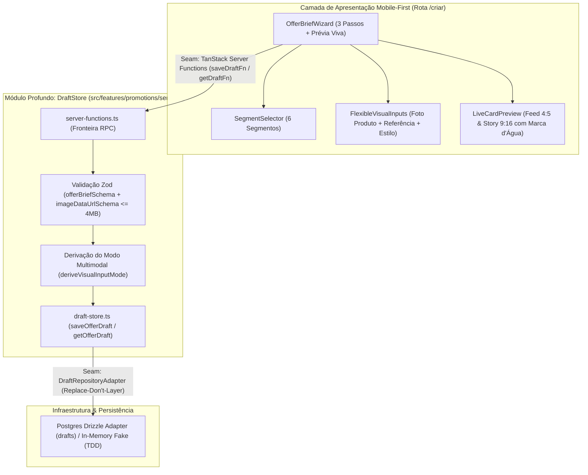
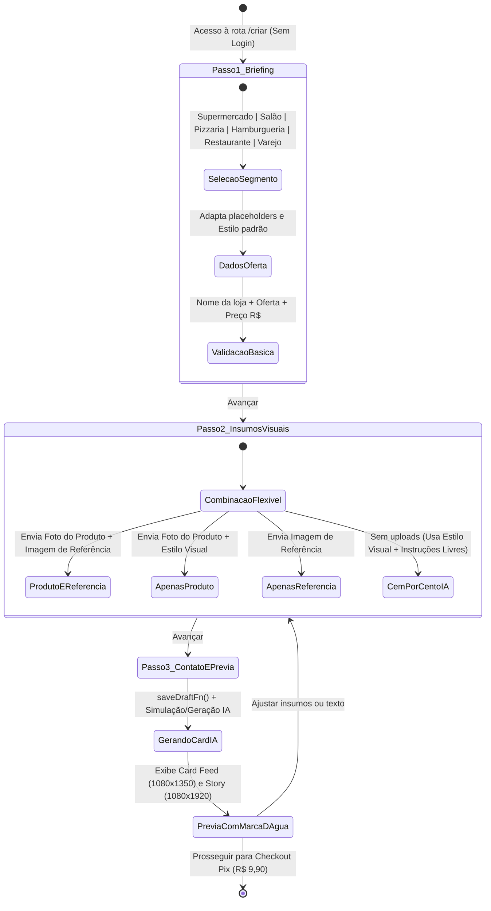
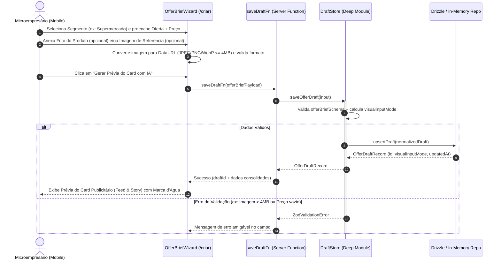

# Plano Técnico — Épico 1: Briefing Multisegmento & Upload Flexível de Insumos (Rota `/criar`)

- **Status:** Em Revisão (Gate Humano 1 & 2)
- **Data:** 15/10/2026
- **Decisores:** Luis Carvalho & Antigravity Assistant
- **Contexto:** OfertaPronta — Consolidação do fluxo oficial de criação de Cards Publicitários por IA para Microempresários (Multisegmento)

---

## 1. Descrição do Objetivo (Goal Description)

Substituir o antigo protótipo restrito a "comida/delivery" na rota `/criar` pelo **fluxo oficial Mobile-First do Épico 1**, alinhado ao novo domínio do **OfertaPronta**:
1. **Suporte a 6 Segmentos de Microempresários (`Business Segment`):** *Supermercado & Hortifrúti*, *Salão de Beleza & Barbearia*, *Pizzaria*, *Hamburgueria*, *Restaurante* e *Comércio & Serviços Locais*, com adaptação automática de exemplos, placeholders e estilos sugeridos.
2. **Insumos Visuais Combináveis para a IA (`Product Image` + `Reference Image` + `Style Preset`):** O usuário pode enviar opcionalmente a **Foto do Produto**, a **Imagem de Referência**, **ambas** ou **nenhuma** (escolhendo um Estilo Visual do seu segmento e/ou digitando instruções livres para a IA).
3. **Processamento Base64/DataURL Validado (YAGNI):** As imagens enviadas são processadas e validadas (JPEG, PNG ou WebP até 4MB) como Data URLs, prontas para persistência no rascunho e envio direto ao motor Gemini Multimodal no Épico 2 sem necessidade de bucket S3 externo nesta etapa.
4. **Módulo Profundo de Rascunhos (`DraftStore`) + Server Functions (`saveDraftFn`, `getDraftFn`):** Persistência tipada ponta a ponta com Drizzle ORM e Zod, testada via TDD com repositório in-memory (*replace-don't-layer*).

---

## 2. Diagramas de Arquitetura (Mermaid)

### 2.1. Fronteiras de Componentes, Camadas e Costuras (`flowchart TD`)

### 2.2. Máquina de Estados do Rascunho e Insumos Visuais (`stateDiagram-v2`)

### 2.3. Fluxo de Execução e Persistência do Rascunho (`sequenceDiagram`)

---

## 3. Decisões de Design & Alinhamento do Gate 0

1. **Consolidação em Fluxo Único Oficial (Fim do Switcher de Protótipo):**
   - Removemos `prototype-switcher.tsx` e as variantes legadas `A/B/C` que refletiam o modelo descartado de comida.
   - A rota `/criar` passa a renderizar diretamente o `OfferBriefWizard` com indicador de progresso de 3 passos no topo e prévia viva do Card Publicitário.
2. **Upload Flexível com Base64/DataURL (Máx. 4MB):**
   - As imagens de Produto e de Referência são opcionais e independentes entre si.
   - O schema `imageDataUrlSchema` valida o cabeçalho MIME (`image/jpeg`, `image/png`, `image/webp`) e o tamanho em bytes decodificados ($\le 4\text{ MB}$), garantindo compatibilidade imediata com o payload `inlineData` / `image` da Gemini API no Épico 2.
3. **Catálogo Multisegmento com 6 Nichos + Instruções Livres:**
   - Cada um dos 6 segmentos possui metadados próprios (ícone, rótulo, placeholders contextuais de produto/preço, 3 `Style Presets` com paleta e atmosfera publicitária e imagens de demonstração em 1 toque para facilitar testes rápidos).

---

## 4. Mudanças Propostas por Arquivo (Proposed Changes)

### 4.1. Banco de Dados, Schemas Zod & Backend (`backend-builder`)

- **`[MODIFY]` [promotions.ts](file:///home/luis/repositories/OfertaPronta/src/server/db/schema/promotions.ts)**
  - Atualizar a tabela `drafts` com as colunas do domínio multisegmento: `businessSegment`, `businessName`, `offerTitle`, `promoPrice`, `originalPrice`, `callToAction`, `whatsapp`, `productImageDataUrl`, `referenceImageDataUrl`, `stylePresetId`, `customStyleInstructions`, `previewCardImageUrl` e `aiGenerationCount`.
- **`[NEW]` `src/features/promotions/data/offer-brief.schema.ts`**
  - Definir `BUSINESS_SEGMENTS` (6 segmentos), `STYLE_PRESETS_BY_SEGMENT`, `imageDataUrlSchema`, `offerBriefSchema`, `saveOfferDraftSchema`, tipos inferidos (`OfferBrief`, `BusinessSegment`, `VisualInputMode`) e a função pura `deriveVisualInputMode()`.
- **`[NEW]` `src/features/promotions/data/offer-brief.schema.test.ts`**
  - Testes unitários validando schemas, limites de tamanho de DataURL (4MB), obrigatoriedade de campos e derivação correta dos 4 modos visuais (`product-and-reference`, `product-only`, `reference-only`, `style-preset-only`).
- **`[NEW]` `src/features/promotions/server/draft-store.ts`**
  - Módulo profundo com `saveOfferDraft`, `getOfferDraft` e adaptador `createInMemoryDraftRepo()` para testes rápidos e fallback seguro.
- **`[NEW]` `src/features/promotions/server/draft-store.test.ts`**
  - Testes TDD da interface pública do `DraftStore` cobrindo criação, atualização de rascunho existente e validação de erros.
- **`[NEW]` `src/features/promotions/server/server-functions.ts`**
  - Server Functions `saveDraftFn` e `getDraftFn` usando `createServerFn` do `@tanstack/react-start` com `.inputValidator(zodSchema)`.

### 4.2. Componentes de UI Mobile-First & Rota `/criar` (`frontend-builder`)

- **`[NEW]` `src/features/promotions/components/segment-selector.tsx`**
  - Seletor visual responsivo com os 6 segmentos comerciais usando primitivos `shadcn/ui` (`Button`, `Badge`, `Typography`).
- **`[NEW]` `src/features/promotions/components/flexible-visual-inputs.tsx`**
  - Uploader duplo e independente para **Foto do Produto (`Product Image`)** e **Imagem de Referência (`Reference Image`)** + seletor de **Estilo Visual (`Style Preset`)** + `Textarea` para instruções livres de estilo + botões de preenchimento rápido de exemplo por segmento.
- **`[MODIFY]` [live-card-preview.tsx](file:///home/luis/repositories/OfertaPronta/src/features/promotions/components/live-card-preview.tsx)**
  - Atualizar a prévia do Card Publicitário (`Ad Card`) para suportar os 6 segmentos comerciais, exibir a fusão visual da Foto do Produto + atmosfera da Imagem de Referência / Estilo Visual + textos/preços integrados + Marca d'Água diagonal nos formatos Feed (`1080×1350`) e Story (`1080×1920`).
- **`[NEW]` `src/features/promotions/components/offer-brief-wizard.tsx`**
  - Wizard Mobile-First oficial em 3 etapas com barra de progresso, validação em tempo real, integração com `saveDraftFn` e visualização da prévia gerada.
- **`[NEW]` `src/features/promotions/hooks/use-offer-brief-draft.ts`**
  - Hook de gerenciamento do estado do `OfferBrief`, leitura de arquivos de imagem para DataURL, troca inteligente de defaults ao mudar de segmento e persistência via `saveDraftFn`.
- **`[MODIFY]` [criar.tsx](file:///home/luis/repositories/OfertaPronta/src/routes/criar.tsx)**
  - Renderizar a experiência oficial consolidada com `OfferBriefWizard` sem parâmetros de protótipo legados.
- **`[MODIFY]` [index.tsx](file:///home/luis/repositories/OfertaPronta/src/routes/index.tsx)**
  - Atualizar os textos da Landing Page para refletir o posicionamento multisegmento (Supermercados, Cabeleireiros, Pizzarias, Hamburguerias, Restaurantes e Comércio Local) e a geração do Card Publicitário completo por IA.
- **`[DELETE]` Arquivos legados do protótipo antigo:**
  - `src/components/shared/prototype-switcher.tsx`
  - `src/features/promotions/components/variant-a-wizard.tsx`
  - `src/features/promotions/components/variant-b-accordion.tsx`
  - `src/features/promotions/components/variant-c-focus-card.tsx`
  - `src/features/promotions/components/dual-image-selector.tsx`
  - `src/features/promotions/data/mock-food-photos.ts`
  - `src/features/promotions/data/promotion-prototype-state.ts`

---

## 5. Plano de Verificação e Qualidade (Verification Plan)

1. **Testes Automatizados (Vitest — TDD Red → Green):**
   - `pnpm test` executando `offer-brief.schema.test.ts` e `draft-store.test.ts` (validando os 6 segmentos, as 4 combinações de insumos visuais e limites de 4MB para imagens).
2. **Conformidade Shadcn UI & Tipografia:**
   - `./.agents/scripts/verify.sh --shadcn` garantindo zero tags HTML nativas proibidas e uso estrito dos primitivos `shadcn/ui`.
3. **Pipeline Oficial Completo:**
   - `./.agents/scripts/verify.sh` validando Shadcn UI + `pnpm typecheck` (zero `any`) + `pnpm lint` + `pnpm test` + `pnpm build`.
