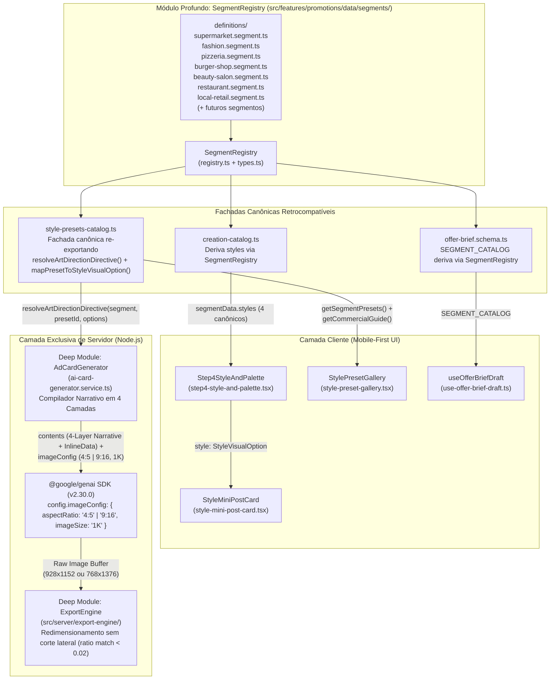
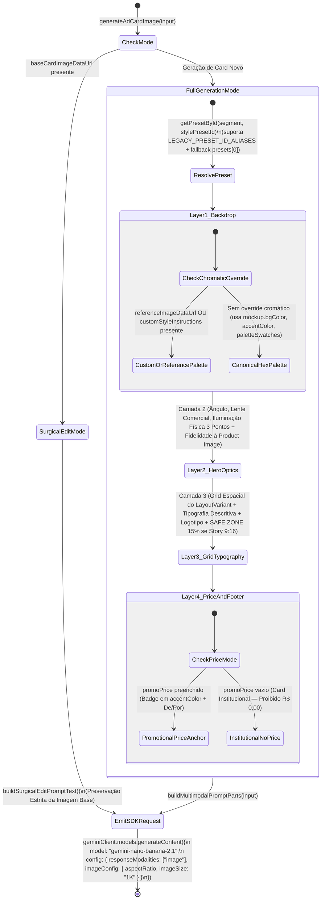
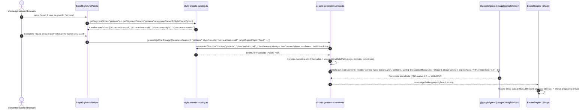

# Plano Técnico e Arquitetural: Aprofundamento do `AdCardGenerator` e Unificação Canônica de `StylePreset` (Deep Modules)

- **Slug**: `ad-card-prompt-architecture-deepening`
- **Data**: 20 de Outubro de 2026
- **Status**: Pronto para Execução (`ready-for-agent`)
- **Autor**: Principal Solution & Security Architect
- **Spec de Produto**: [`docs/specs/ad-card-prompt-architecture-deepening.md`](../specs/ad-card-prompt-architecture-deepening.md)
- **Relatório de Pesquisa**: [`docs/research/ai-card-design-quality-and-prompt-engineering.md`](../research/ai-card-design-quality-and-prompt-engineering.md)
- **Macro-Tickets de Execução**:
  1. [`docs/tickets/ad-card-prompt-architecture-deepening/01-canonical-style-catalog-and-art-direction-blueprint.md`](../tickets/ad-card-prompt-architecture-deepening/01-canonical-style-catalog-and-art-direction-blueprint.md) _(Stream 1: Catálogo Canônico Unificado, Derivação em `creation-catalog.ts` e Blueprints por `LayoutVariant`)_
  2. [`docs/tickets/ad-card-prompt-architecture-deepening/02-deep-narrative-ad-card-generator-and-sdk-seam.md`](../tickets/ad-card-prompt-architecture-deepening/02-deep-narrative-ad-card-generator-and-sdk-seam.md) _(Stream 2: Costura `imageConfig` no SDK `@google/genai` e Compilador Narrativo de 4 Camadas no `AdCardGenerator`)_

---

## 1. Visão Geral Arquitetural e Princípios de Design (`Deep Modules`)

Seguindo os princípios de **Módulos Profundos (`codebase-design`)**, **SOLID** e **YAGNI (`ponytail`)**, este plano resolve as 3 causas raiz da baixa fidelidade visual e deriva de estilos sem adicionar custo de inferência (`gemini-nano-banana-2.1`, 1 chamada por card, tier base `1K` = 1120 tokens):

1. **Módulo Profundo `SegmentRegistry` e Desacoplamento Modular por Segmento (`codebase-design`)**:
   - Criação da arquitetura modular desacoplada em [`src/features/promotions/data/segments/`](../../src/features/promotions/data/segments/):
     - `types.ts`: Interfaces canônicas (`SegmentDefinition`, `CuratedStylePreset`, `LayoutVariant`, `StyleMockupSpec`, `ArtDirectionDirective`, `CommercialGuide`).
     - `registry.ts`: Implementação profunda do registro singleton com indexação O(1), validação e fallbacks graciosos.
     - `definitions/<segment>.segment.ts`: **1 arquivo coeso e isolado por segmento** (`supermarket.segment.ts`, `fashion.segment.ts`, `beauty-salon.segment.ts`, `pizzeria.segment.ts`, `burger-shop.segment.ts`, `restaurant.segment.ts`, `local-retail.segment.ts`). Cada arquivo encapsula metadados, placeholders do wizard, diretriz cênica de IA e seus 4 presets.
     - **Extensibilidade Custo Zero**: Adicionar novos segmentos no futuro (ex: _Pet Shop_, _Farmácia_, _Padaria_) requer apenas criar um novo arquivo em `definitions/` sem tocar em nenhum código existente!
   - `style-presets-catalog.ts` torna-se a fachada canônica retrocompatível consumindo `SegmentRegistry`, expondo `mapPresetToStyleVisualOption(preset)` e `LEGACY_PRESET_ID_ALIASES`.
   - `creation-catalog.ts` e `offer-brief.schema.ts` (`SEGMENT_CATALOG`) derivam seus dados diretamente do `SegmentRegistry`, garantindo 100% de sincronia entre o Wizard e o backend sem quebrar nenhum import existente.
2. **Aprofundamento da Direção de Arte e Blueprints por `LayoutVariant`**:
   - Em vez de descartar `preset.mockup` (`layoutVariant`, `bgColor`, `textColor`, `accentColor`, `badgeText`), `preset.paletteSwatches` e `preset.commercialGuide`, `resolveArtDirectionDirective` passa a sintetizar um **Blueprint de Direção de Arte e Geometria Espacial** completo a partir de `LAYOUT_VARIANT_BLUEPRINTS[preset.mockup.layoutVariant]`.
   - Suporta opções adaptativas (`ResolveArtDirectionOptions`) para ceder prioridade cromática quando o microempresário envia um Print de Referência (`referenceImageDataUrl`) ou escolhe uma Paleta da Loja (`customStyleInstructions`), e para adaptar o selo quando o card é institucional (`hasPromoPrice === false`).
3. **Compilador Narrativo em 4 Camadas e Costura `imageConfig` no `AdCardGenerator`**:
   - Corrige o bug silencioso de serialização no SDK `@google/genai` v2.30.0 trocando `config.responseFormat` (ignorado pelo serializador `generateContentConfigToMldev`) por `config.imageConfig = { aspectRatio: geminiAspectRatio, imageSize: "1K" }`.
   - Substitui a lista desconectada de tópicos em `buildPromptText()` por uma narrativa estruturada em **4 Camadas Progressivas** (Fundo Full-Bleed -> Sujeito Hero & Óptica -> Grid, Safe Zone & Tipografia Descritiva -> Ancoragem de Preço/Institucional & Rodapé), preservando 100% das substrings de contrato validadas pela suíte de testes existente.

---

## 2. Diagramas Estruturais (Mermaid)

### 2.1. Topologia de Módulos Profundos e Derivação Canônica (`flowchart TD`)



### 2.2. Fluxo de Decisão e Adaptação do Compilador de 4 Camadas (`stateDiagram-v2`)



### 2.3. Sequência End-to-End da Seleção no Wizard até o `ExportEngine` (`sequenceDiagram`)



---

## 3. Contratos de Interface e Especificações Técnicas Detalhadas

### 3.1. Unificação Canônica e Blueprints em `src/features/promotions/data/style-presets-catalog.ts`

1. **Tipos de Layout e Opção Visual Unificados**:
   Exportar diretamente de `style-presets-catalog.ts` (e re-exportar em `creation-catalog.ts` para manter 100% de compatibilidade com imports existentes):

   ```ts
   import type { BusinessSegment, CardIntent } from "./offer-brief.schema";

   export type LayoutVariant =
     | "retail-burst"
     | "fresh-organic"
     | "dark-luxury"
     | "rustic-wood"
     | "clean-minimal"
     | "neon-urban";

   export type LayoutType =
     "bold-offer" | "clean-frame" | "dark-premium" | "vibrant-pop";

   export interface StyleVisualOption {
     id: string;
     name: string;
     tag: string;
     color: string;
     bgPreview: string;
     badgeBg: string;
     badgeText: string;
     textColor: string;
     paletteSwatches: [string, string, string];
     layoutType: LayoutType;
   }
   ```

2. **Blueprints Arquiteturais e Fotográficos por `LayoutVariant`**:
   Definir e exportar `LayoutVariantBlueprint` e `LAYOUT_VARIANT_BLUEPRINTS`:

   ```ts
   export interface LayoutVariantBlueprint {
     layoutVariant: LayoutVariant;
     layoutType: LayoutType;
     spatialGrid: string;
     descriptiveTypography: string;
     priceBadgeStyle: string;
     cameraAndLightingSetup: string;
     defaultTailwindPreview: {
       color: string;
       bgPreview: string;
       badgeBg: string;
       textColor: string;
     };
   }

   export const LAYOUT_VARIANT_BLUEPRINTS: Record<
     LayoutVariant,
     LayoutVariantBlueprint
   > = {
     "retail-burst": {
       layoutVariant: "retail-burst",
       layoutType: "bold-offer",
       spatialGrid:
         "Cabeçalho vibrante em faixa superior; produto hero ocupando 55% centrais em primeiro plano; selo explosivo de oferta ancorado no quadrante inferior direito; barra sólida de rodapé para contato.",
       descriptiveTypography:
         "Sans-serif geométrica condensada ultra-bold (peso Black/900) em caixa alta com contorno nítido de alto contraste.",
       priceBadgeStyle:
         "Selo estrelado ou circular de alto impacto promocional com borda dupla vibrante na cor de acento.",
       cameraAndLightingSetup:
         "Lente comercial 50mm f/4, ângulo frontal levemente elevado (15°), iluminação de estúdio three-point softbox brilhante e uniforme, sombras de contato nítidas.",
       defaultTailwindPreview: {
         color: "from-red-600 to-orange-600",
         bgPreview: "bg-gradient-to-b from-red-600 to-orange-700",
         badgeBg: "bg-yellow-400 text-red-950",
         textColor: "text-white",
       },
     },
     "fresh-organic": {
       layoutVariant: "fresh-organic",
       layoutType: "vibrant-pop",
       spatialGrid:
         "Composição orgânica arejada com moldura suave; produto central banhado por luz matinal ocupando 50% da área; pill badge arredondado fluindo junto à base do produto.",
       descriptiveTypography:
         "Sans-serif humanista arredondada de peso bold combinada com subtítulo orgânico leve e altamente legível.",
       priceBadgeStyle:
         "Cápsula (pill badge) de cantos totalmente arredondados com acabamento fosco natural e tipografia limpa.",
       cameraAndLightingSetup:
         "Lente macro 85mm f/2.8, ângulo de 30° tabletop, luz solar matinal difusa lateral com bokeh suave de fundo e gotículas de frescor realistas.",
       defaultTailwindPreview: {
         color: "from-emerald-600 to-teal-700",
         bgPreview: "bg-gradient-to-b from-emerald-700 to-teal-900",
         badgeBg: "bg-lime-300 text-emerald-950",
         textColor: "text-white",
       },
     },
     "dark-luxury": {
       layoutVariant: "dark-luxury",
       layoutType: "dark-premium",
       spatialGrid:
         "Composição editorial escura com amplo respiro negativo (30% livre); moldura fina metálica interna; sujeito central iluminado por luz de recorte; tipografia alinhada ao eixo central.",
       descriptiveTypography:
         "Serifada editorial de alto contraste (estilo Didone/Bodoni) para títulos combinada com sans-serif geométrica fina espaçada (tracking amplo).",
       priceBadgeStyle:
         "Bloco retangular minimalista de luxo com filete metálico/dourado na cor de acento, sem poluição visual.",
       cameraAndLightingSetup:
         "Lente prime 85mm f/1.8 de estúdio, ângulo eye-level imponente, iluminação chiaroscuro (low-key) de 3 pontos com rim light dourada destacando contornos e texturas.",
       defaultTailwindPreview: {
         color: "from-zinc-900 to-stone-950",
         bgPreview: "bg-zinc-950",
         badgeBg: "bg-amber-500 text-black",
         textColor: "text-white",
       },
     },
     "rustic-wood": {
       layoutVariant: "rustic-wood",
       layoutType: "dark-premium",
       spatialGrid:
         "Cenário gastronômico/artesanal em superfície de madeira nobre ou pedra ardósia; faixa superior rústica para marca; produto fumegante no centro; selo tipo carimbo artesanal.",
       descriptiveTypography:
         "Slab-serif robusta de inspiração artesanal combinada com numerais bold de presença calorosa.",
       priceBadgeStyle:
         "Selo circular tipo carimbo artesanal ou etiqueta rústica preenchida na cor de acento com alto contraste.",
       cameraAndLightingSetup:
         "Lente macro gastronômica 85mm f/2.8 em ângulo elevado de 45° (tabletop), luz lateral quente (3200K) realçando brilho, suculência, vapor natural e sombras de contato suaves.",
       defaultTailwindPreview: {
         color: "from-stone-900 to-amber-950",
         bgPreview: "bg-gradient-to-b from-amber-900 to-stone-950",
         badgeBg: "bg-amber-400 text-stone-950",
         textColor: "text-white",
       },
     },
     "clean-minimal": {
       layoutVariant: "clean-minimal",
       layoutType: "clean-frame",
       spatialGrid:
         "Estética lookbook/revista com amplo espaço negativo (35% livre) e grade suíça; enquadramento limpo e simétrico; tipografia editorial equilibrada no topo e base.",
       descriptiveTypography:
         "Sans-serif grotesca moderna (peso médio no título, peso black nos numerais) com kerning equilibrado e leitura cristalina.",
       priceBadgeStyle:
         "Tag geométrica retangular limpa e discreta ancorada com elegância na lateral inferior do produto.",
       cameraAndLightingSetup:
         "Lente editorial 50mm f/2.8, ângulo frontal neutro, luz difusa suave de janela de estúdio (softbox amplo) sem sombras duras sobre superfície fosca.",
       defaultTailwindPreview: {
         color: "from-stone-200 to-rose-100",
         bgPreview: "bg-stone-100",
         badgeBg: "bg-rose-700 text-white",
         textColor: "text-stone-900",
       },
     },
     "neon-urban": {
       layoutVariant: "neon-urban",
       layoutType: "vibrant-pop",
       spatialGrid:
         "Atmosfera noturna urbana dinâmica; contrastes de luz neon nas bordas do sujeito central; cabeçalho angular moderno; badge geométrico vibrante para ação rápida.",
       descriptiveTypography:
         "Display sans-serif condensada de corte esportivo/urbano em caixa alta com forte impacto visual.",
       priceBadgeStyle:
         "Placa geométrica angular com brilho externo sutil (glow) na cor de acento e texto de contraste máximo.",
       cameraAndLightingSetup:
         "Lente 35mm f/2.0 close-up dinâmico, iluminação cruzada de estúdio com key light nítida e rim light colorida neon recortando a silhueta do sujeito.",
       defaultTailwindPreview: {
         color: "from-purple-700 to-indigo-950",
         bgPreview: "bg-gradient-to-br from-purple-800 to-slate-950",
         badgeBg: "bg-amber-400 text-slate-950",
         textColor: "text-white",
       },
     },
   };
   ```

3. **Mapeamento Determinístico `mapPresetToStyleVisualOption` e Aliases Legados**:
   - Cada um dos 28 `CuratedStylePreset` é convertido para `StyleVisualOption` via `mapPresetToStyleVisualOption(preset: CuratedStylePreset): StyleVisualOption`, usando um mapa de classes Tailwind customizadas por `preset.id` (para refletir fielmente as cores de cada estilo, ex.: `fashion-boutique` com `bg-stone-100` e `text-stone-900`, `market-discount` com `bg-gradient-to-b from-red-600 to-red-800`, etc.) ou fallback para `LAYOUT_VARIANT_BLUEPRINTS[preset.mockup.layoutVariant].defaultTailwindPreview`.
   - `LEGACY_PRESET_ID_ALIASES` mapeia eventuais IDs legados (ex.: `"market-red": "market-discount"`, `"market-clean": "market-fresh"`, `"market-dark": "market-premium"`, `"market-orange": "market-daily"`, `"pizza-rustic": "pizza-rustic-wood"`, `"pizza-italian": "pizza-artisan-craft"`, `"pizza-party": "pizza-promo-combo"`, `"burger-dark": "burger-dark-bold"`, `"burger-fire": "burger-smash-fire"`, `"burger-retro": "burger-urban-pop"`, `"beauty-rose": "salon-glamour"`, `"beauty-gold": "barber-vintage"`, `"rest-homestyle": "restaurant-homestyle"`, `"rest-dark": "restaurant-gourmet"`, `"rest-buffet": "restaurant-buffet"`, `"retail-clean": "retail-clean-modern"`, `"retail-promo": "retail-vibrant"`) dentro de `getPresetById` e `resolveArtDirectionDirective`.

4. **Assinatura Enriquecida de `resolveArtDirectionDirective`**:
   ```ts
   export interface ResolveArtDirectionOptions {
     hasReferenceImage?: boolean;
     hasCustomPalette?: boolean;
     cardIntent?: CardIntent | null;
     hasPromoPrice?: boolean;
   }

   export function resolveArtDirectionDirective(
     segment: BusinessSegment,
     presetId?: string | null,
     options?: ResolveArtDirectionOptions,
   ): string;
   ```
   - **Garantia Estrita de Compatibilidade com Testes**: O texto retornado **DEVE** continuar contendo exatamente as linhas que `style-presets-catalog.test.ts` e `ai-card-generator.service.test.ts` verificam:
     - `--- DIRETRIZ DE DIREÇÃO DE ARTE PROFISSIONAL: "${preset.label}" ---`
     - `- Paleta de Cores: ${preset.artDirection.palette}`
     - `- Composição e Layout: ${preset.artDirection.composition}`
     - `- Iluminação e Texturas: ${preset.artDirection.lighting}`
     - `- Atmosfera Visual: ${preset.artDirection.atmosphere}`
   - **Enriquecimento Profundo Adicional**: Abaixo dessas linhas, `resolveArtDirectionDirective` injeta os metadados antes descartados:
     - `- Variante de Arquitetura Gráfica (LayoutVariant): ${preset.mockup.layoutVariant}`
     - `- Grid Espacial e Posicionamento: ${blueprint.spatialGrid}`
     - `- Família e Estilo Tipográfico: ${blueprint.descriptiveTypography}`
     - `- Óptica Fotográfica e Setup de Estúdio: ${blueprint.cameraAndLightingSetup}`
     - `- Especificação Cromática HEX: Fundo ${preset.mockup.bgColor} | Texto ${preset.mockup.textColor} | Destaque/Acento ${preset.mockup.accentColor} | Swatches (${swatchesJoined})` (ou nota de adaptação cromática caso `options?.hasReferenceImage` ou `options?.hasCustomPalette` seja `true`, instruindo a preservar o grid e tipografia do preset mas priorizar as cores da referência/paleta customizada).
     - `- Estilo de Badge / Ancoragem: ${options?.hasPromoPrice === false ? "Selo institucional editorial discreto sem conotação de preço" : `${blueprint.priceBadgeStyle} (Selo sugerido: "${preset.mockup.badgeText}")`}`
     - `- Percepção Comercial para o Cliente: ${guide.appearance} ${guide.customerVibe}`

---

### 3.2. Derivação em `src/features/promotions/data/creation-catalog.ts`

1. Importar `getSegmentPresets`, `mapPresetToStyleVisualOption`, `type LayoutType`, `type StyleVisualOption` de `./style-presets-catalog` e re-exportar `LayoutType` e `StyleVisualOption`.
2. Em `CREATION_CATALOG`, substituir todos os 7 arrays literais `styles: [...]` por:
   - `fashion`: `styles: getSegmentPresets("fashion").map(mapPresetToStyleVisualOption)`
   - `supermarket`: `styles: getSegmentPresets("supermarket").map(mapPresetToStyleVisualOption)`
   - `pizzeria`: `styles: getSegmentPresets("pizzeria").map(mapPresetToStyleVisualOption)`
   - `"burger-shop"`: `styles: getSegmentPresets("burger-shop").map(mapPresetToStyleVisualOption)`
   - `"beauty-salon"`: `styles: getSegmentPresets("beauty-salon").map(mapPresetToStyleVisualOption)`
   - `restaurant`: `styles: getSegmentPresets("restaurant").map(mapPresetToStyleVisualOption)`
   - `"local-retail"`: `styles: getSegmentPresets("local-retail").map(mapPresetToStyleVisualOption)`
3. Em `getCreationStyleById(styleId: string)`, buscar nos estilos derivados (e suportar fallback pelos aliases legados se necessário).
4. Assim, `CREATION_CATALOG[segment].styles` passa a conter exatamente os **4 estilos canônicos por segmento (28 estilos únicos no total)**, em sincronia 100% com `style-presets-catalog.ts` e `SEGMENT_CATALOG` de `offer-brief.schema.ts`.

---

### 3.3. Costura `imageConfig` e Compilador Narrativo de 4 Camadas em `src/features/promotions/server/services/ai-card-generator.service.ts`

1. **Correção da Costura do SDK `@google/genai` (`imageConfig`)**:
   - Atualizar a interface `GoogleGenAIClient`:
     ```ts
     export interface GoogleGenAIClient {
       models: {
         generateContent(params: {
           model: string;
           contents: Array<string | InlineDataPart>;
           config?: {
             responseModalities?: string[];
             imageConfig?: {
               aspectRatio?: string;
               imageSize?: string;
             };
             responseFormat?: {
               image?: {
                 aspectRatio?: string;
                 imageSize?: string;
               };
             };
             [key: string]: unknown;
           };
         }): Promise<GeminiGenerateContentResponse>;
       };
     }
     ```
   - Em `generateAdCardImage`:
     ```ts
     const response = await geminiClient.models.generateContent({
       model: GEMINI_IMAGE_MODEL,
       contents: promptParts,
       config: {
         responseModalities: ["image"],
         imageConfig: {
           aspectRatio: geminiAspectRatio,
           imageSize: "1K",
         },
       },
     });
     ```

2. **Compilador Narrativo de 4 Camadas em `buildPromptText(input, segmentConfig)`**:
   - Resolver o preset e a diretriz enriquecida chamando:
     ```ts
     const hasPrice = Boolean(
       input.promoPrice && input.promoPrice.trim().length > 0,
     );
     const hasReferenceImage = Boolean(
       input.referenceImageDataUrl &&
       input.referenceImageDataUrl.trim().length > 0,
     );
     const hasCustomPalette = Boolean(
       input.customStyleInstructions &&
       input.customStyleInstructions.trim().length > 0,
     );
     const preset =
       getPresetById(input.businessSegment, input.stylePresetId) ??
       getSegmentPresets(input.businessSegment)[0];
     const blueprint = LAYOUT_VARIANT_BLUEPRINTS[preset.mockup.layoutVariant];
     const artDirectiveText = resolveArtDirectionDirective(
       input.businessSegment,
       input.stylePresetId,
       {
         hasReferenceImage,
         hasCustomPalette,
         cardIntent: input.cardIntent,
         hasPromoPrice: hasPrice,
       },
     );
     ```
   - Construir a narrativa progressiva nas **4 Camadas** mantendo todas as strings de invariantes contratuais:
     - **Cabeçalho & Dados da Oferta**: Mantém `- Segmento do Negócio:`, `- Nome do Estabelecimento:`, `- Item ou Oferta Anunciada:`, `- ${priceInstructions}`, `${ctaInstruction}`, `${whatsappInstruction}`, `- ${intentDirectiveText}`.
     - **Diretrizes de Direção de Arte e Design Gráfico**: Mantém `${proportionDirectives}` (incluindo `"SAFE ZONE OBRIGATÓRIA"` e `"15% da altura no topo e 15% na base"` quando `isStory`), `- Estilo Visual do Segmento: ${segmentConfig.visualStyle}`, `- Clima e Atmosfera Geral: ${segmentConfig.atmosphere}`, `${artDirectiveText}`, e as notas multimodais (`logoNote`, `productNote`, `referenceNote`, `customInstructions`).
     - **Blueprint Narrativo Passo a Passo em 4 Camadas (`--- ARQUITETURA DE COMPOSIÇÃO EM 4 CAMADAS (STEP-BY-STEP) ---`)**:
       - `CAMADA 1 — FUNDO FULL-BLEED & ATMOSFERA:` Descreve positivamente a composição gráfica _full-bleed edge-to-edge_ preenchendo 100% do canvas até as 4 extremidades (sem molduras externas, bordas ou barras vazias), aplicando a atmosfera do segmento e a paleta cromática (cedendo prioridade às cores da `referenceImageDataUrl` ou de `customStyleInstructions` quando presentes, ou aplicando os códigos HEX exatos `bgColor: ${preset.mockup.bgColor}`, `accentColor: ${preset.mockup.accentColor}` e `textColor: ${preset.mockup.textColor}`).
       - `CAMADA 2 — SUJEITO HERO & ÓPTICA FOTOGRÁFICA COMERCIAL:` Especifica o setup óptico e físico (`${blueprint.cameraAndLightingSetup}`), sombras de contato realistas na superfície de apoio e destaque absoluto ao produto/serviço anunciado (`"${input.offerTitle}"`), preservando com máxima fidelidade a `FOTO DO PRODUTO` quando anexada.
       - `CAMADA 3 — GEOMETRIA DE GRID, SAFE ZONE & TIPOGRAFIA DESCRITIVA:` Posiciona os elementos conforme o grid espacial (`${blueprint.spatialGrid}`), renderizando o título `"${input.offerTitle}"` e o estabelecimento `"${input.businessName}"` com a família tipográfica descritiva (`${blueprint.descriptiveTypography}`), incorporando o logotipo (`LOGOTIPO DA LOJA FORNECIDO`) quando anexo e respeitando estritamente a zona segura vertical central.
       - `CAMADA 4 — ANCORAGEM DE PREÇO & RODAPÉ COMERCIAL:` Quando `hasPrice === true`, ancora o preço promocional `"${input.promoPrice}"` (`${input.originalPrice ? `com preço anterior "${input.originalPrice}" tachado menor e valor promocional "${input.promoPrice}" gigante`:`em tamanho dominante`}`) dentro do container `${blueprint.priceBadgeStyle}` destacado em `${preset.mockup.accentColor}`; quando `hasPrice === false`, aplica layout editorial institucional sem nenhum container de preço e sem `"R$ 0,00"`, finalizando com a barra de rodapé para CTA e WhatsApp.
     - **Hierarquia Visual Obrigatória (`--- HIERARQUIA VISUAL OBRIGATÓRIA ---`)**: Mantida para compatibilidade estrita com contratos existentes, usando linguagem afirmativa _full-bleed_.

---

## 4. Checklist de Segurança, Qualidade e Invariantes (`AGENTS.md`)

- [x] **Isolamento Estrito Client/Server (`Zero Server Code Leaks`)**:
  - `src/features/promotions/data/style-presets-catalog.ts`, `creation-catalog.ts` e `offer-brief.schema.ts` permanecem 100% puros e isomórficos, sem importar nada de `src/server/` ou `src/features/*/server/`.
  - `src/features/promotions/server/services/ai-card-generator.service.ts` permanece estritamente isolado na camada `server/`.
- [x] **Custo Zero Adicional de Inferência**:
  - Modelo mantido em `gemini-nano-banana-2.1`.
  - Uma única chamada `generateContent` por card gerado.
  - `imageConfig.imageSize` configurado em `"1K"` (1120 tokens — tier base da API Gemini).
- [x] **Compatibilidade Total de Interface Pública e Testes**:
  - Todos os componentes React existentes (`Step4StyleAndPalette`, `StyleMiniPostCard`, `StylePresetGallery`, `OfferCreationWizard`) continuam funcionando sem necessidade de alterar suas assinaturas de props.
  - Substrings contratuais validadas em `ai-card-generator.service.test.ts` e `style-presets-catalog.test.ts` são 100% preservadas.
- [x] **Tipagem Estrita e Qualidade (`strict: true`, Zero `any`)**:
  - Zero uso de `any`, `@ts-ignore` ou `eslint-disable`.

---

## 5. Plano de Costuras TDD e Escopo Paralelo dos Builders

As duas Macro-Streams atuam em arquivos de código e de teste distintos, com contratos congelados neste plano:

| Macro-Ticket                                                                                  | Agente Builder                            | Arquivos no Escopo                                                                                                                                                                                                                                                                                         | Comando Cirúrgico de Verificação TDD                                                                                                                                                                         |
| --------------------------------------------------------------------------------------------- | ----------------------------------------- | ---------------------------------------------------------------------------------------------------------------------------------------------------------------------------------------------------------------------------------------------------------------------------------------------------------- | ------------------------------------------------------------------------------------------------------------------------------------------------------------------------------------------------------------ |
| **01: Catálogo Canônico Unificado e Blueprints de Direção de Arte**                           | `backend-builder` (ou `frontend-builder`) | - `src/features/promotions/data/style-presets-catalog.ts`<br>- `src/features/promotions/data/creation-catalog.ts`<br>- `src/features/promotions/data/offer-brief.schema.ts`<br>- `src/features/promotions/data/style-presets-catalog.test.ts`<br>- `src/features/promotions/data/creation-catalog.test.ts` | `pnpm vitest run src/features/promotions/data/style-presets-catalog.test.ts src/features/promotions/data/creation-catalog.test.ts src/features/promotions/data/offer-brief.schema.test.ts && pnpm typecheck` |
| **02: Compilador Narrativo de 4 Camadas no `AdCardGenerator` e Costura `imageConfig` do SDK** | `backend-builder`                         | - `src/features/promotions/server/services/ai-card-generator.service.ts`<br>- `src/features/promotions/server/services/ai-card-generator.service.test.ts`                                                                                                                                                  | `pnpm vitest run src/features/promotions/server/services/ai-card-generator.service.test.ts && pnpm typecheck`                                                                                                |
