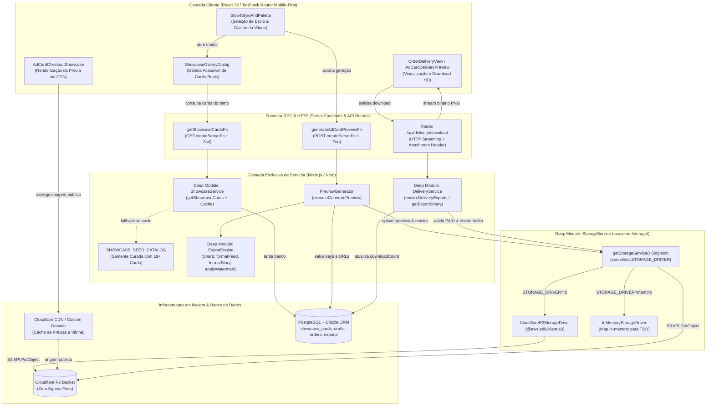
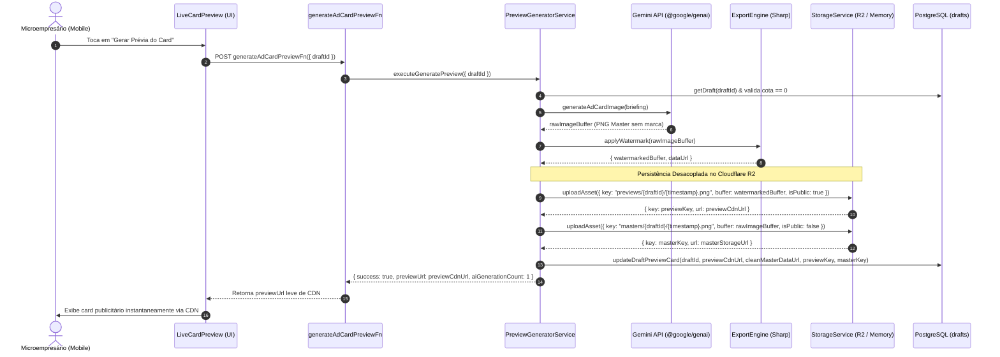
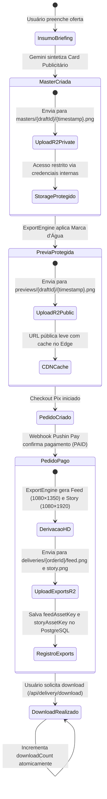

# Plano Técnico e Arquitetural: Cloudflare R2 Storage & Vitrine de Exemplos no Passo 4

- **Slug**: `cloudflare-r2-storage`
- **Data**: 21 de Outubro de 2026
- **Status**: Pronto para Execução (`ready-for-agent`)
- **Autor**: Principal Solution & Security Architect
- **Spec de Produto**: [`docs/specs/cloudflare-r2-storage.md`](../specs/cloudflare-r2-storage.md)
- **Macro-Tickets de Execução**:
  1. [`docs/tickets/cloudflare-r2-storage/01-backend-storage-stream.md`](../tickets/cloudflare-r2-storage/01-backend-storage-stream.md)
  2. [`docs/tickets/cloudflare-r2-storage/02-showcase-and-delivery-stream.md`](../tickets/cloudflare-r2-storage/02-showcase-and-delivery-stream.md) *(Execução Concorrente)*

---

## 1. Visão Geral Arquitetural e Auditoria dos 4 Pilares de Engenharia

O **OfertaPronta** atualmente persiste imagens (prévias com marca d'água, artes mestres sem marca d'água e arquivos finais Feed 1080×1350 e Story 1080×1920) diretamente no banco de dados relacional PostgreSQL como strings Base64 gigantescas (`data:image/png;base64,...`). Com arquivos entre 2MB e 5MB cada, o banco sofre com sobrecarga de tabelas TOAST, serializações lentas de JSON no servidor e degradação de conexões móveis no frontend. Além disso, no Passo 4 (`Step4StyleAndPalette`), o microempresário visualiza apenas miniaturas simuladas por CSS e SVG, sem conseguir antecipar o realismo da arte que a IA multimodal gerará para o seu ramo de atuação (Supermercado, Salão/Beleza, Pizzaria, Hamburgueria, Restaurante, Varejo).

Esta feature introduz uma **camada de armazenamento de objetos desacoplada e de alta performance baseada em Cloudflare R2** com API compatível com S3, complementada por uma **Vitrine de Exemplos Reais Criados por IA (`Showcase`)** integrada ao Passo 4.

A solução foi concebida sob os **4 Pilares Universais de Engenharia**:

### 1.1. Arquitetura & Módulos Profundos (`codebase-design`)
- **Módulo Profundo `StorageService` (`src/server/storage/`)**: Centraliza em uma interface pública concisa (`uploadAsset`, `getAsset`, `deleteAsset`, `getPublicUrl`) todas as operações de persistência e leitura de binários. Toda a complexidade de autenticação AWS S3 v4, endpoint Cloudflare R2, streaming assíncrono de buffers e resolução de domínios públicos fica encapsulada e isolada do restante da aplicação.
- **Costura Determinística via `InMemoryStorageDriver` (Replace-Don't-Layer)**: Em vez de espalhar mocks frágeis ou criar portas com múltiplos adaptadores hipotéticos, o módulo possui dois drivers canônicos: `CloudflareR2StorageDriver` (produção/staging usando `@aws-sdk/client-s3`) e `InMemoryStorageDriver` (desenvolvimento offline e suíte de testes Vitest com velocidade de 1-2s).
- **Isolamento Estrito Client/Server**: A SDK da AWS (`@aws-sdk/client-s3`), segredos de acesso (`R2_ACCESS_KEY_ID`, `R2_SECRET_ACCESS_KEY`) e processamento de imagem rodam exclusivamente no Node.js/Nitro. O frontend acessa assets públicos diretamente por URLs HTTPS de CDN e assets protegidos via Server Functions e rotas de streaming HTTP.
- **Módulo Profundo `ShowcaseService` (`src/features/promotions/server/services/showcase.service.ts`)**: Encapsula a recuperação e filtragem de exemplos curados de cards por segmento e estilo, com fallback transparente para o catálogo de semente estático (`SHOWCASE_SEED_CATALOG`), eliminando telas em branco e acoplamentos espalhados.

### 1.2. Integridade das Regras de Negócio
- **Imutabilidade e Congelamento de Pedido (`Frozen Snapshot`)**: As chaves e URLs de assets mestre e prévias são registradas no snapshot congelado do pedido (`orders.frozenSnapshot`), garantindo que o cliente sempre receba exatamente os insumos contratados, mesmo após eventuais regenerações.
- **Controle Estrito de Cotas**: A cota gratuita de 1 prévia por rascunho (`drafts.aiGenerationCount`) e a cota pós-pagamento de até 3 regenerações (`orders.aiRegenerationCount`) continuam protegidas por transações atômicas no banco de dados.
- **Retrocompatibilidade Universal (Zero-Regressão)**: Pedidos e rascunhos legados gravados como Data URLs Base64 continuam funcionando sem necessidade de migrações em lote no banco. O `DeliveryService` e a rota `/api/delivery/download` inspecionam o prefixo do payload e servem tanto buffers baixados do R2 quanto buffers decodificados de Base64.

### 1.3. Segurança por Design (`Security by Design`)
- **Arquitetura de Balde Híbrido (Público vs. Privado)**:
  - *Público:* Prévias com marca d'água (`previews/*`) e cards da vitrine (`showcase/*`) são distribuídos via CDN global da Cloudflare com cache no edge, eliminando carga no servidor da aplicação.
  - *Privado:* Artes mestres limpas (`masters/*`) e arquivos finais pagos (`deliveries/*`) são armazenados em diretórios privados, inacessíveis diretamente pelo browser.
- **Entrega Autoritativa e Streaming Seguro (`/api/delivery/download`)**: Apenas pedidos com `status === "PAID"` têm permissão para acessar os arquivos em alta resolução. O endpoint valida o pedido, incrementa atomicamente a métrica `downloadCount` e envia o binário com cabeçalhos de segurança (`Content-Disposition: attachment`, `Content-Type: image/png`, `Cache-Control: private, no-transform`).
- **Anonimização e Conformidade LGPD na Vitrine**: A vitrine expõe exclusivamente exemplos curados com dados comerciais e visuais fictícios, sem expor nomes de clientes reais, números de WhatsApp ou logotipos proprietários.

### 1.4. Qualidade, Simplicidade & Costuras TDD (`SOLID` + `YAGNI`)
- **Zero Egress Fees com Cloudflare R2**: A escolha pelo Cloudflare R2 elimina taxas de transferência de saída (diferente da AWS S3 tradicional), garantindo viabilidade econômica para distribuição em massa de imagens HD.
- **Sem Bloat de CMS Administrativo (YAGNI/Ponytail)**: Sem painéis administrativos ou formulários de upload para gerenciar a vitrine no MVP. O gerenciamento é feito via seed de dados versionado no Git e migrações Drizzle.
- **Testes Ultrarrápidos em Memória**: Com o `InMemoryStorageDriver`, toda a suíte de testes unitários roda em memória sem tocar a rede, mantendo tempo de execução inferior a 2 segundos.

---

## 2. Diagramas Estruturais da Arquitetura (Mermaid)

### 2.1. Topologia de Módulos e Isolamento de Camadas (`flowchart TD`)



---

### 2.2. Sequência de Geração de Prévia e Upload R2 (`sequenceDiagram`)



---

### 2.3. Sequência de Checkout, Entrega e Download HD com Retrocompatibilidade (`sequenceDiagram`)

```mermaid
sequenceDiagram
    autonumber
    actor Customer as Cliente Pagador
    participant DeliveryUI as OrderDeliveryView (UI)
    participant DownloadRoute as /api/delivery/download
    participant DeliverySvc as DeliveryService
    participant Storage as StorageService (R2 / Memory)
    participant DB as PostgreSQL (orders, exports)

    Customer->>DeliveryUI: Acessa tela de entrega pós-Pix (/pedido/$orderId)
    DeliveryUI->>DeliverySvc: getDeliveryDetails(orderId)
    DeliverySvc->>DB: Busca order (valida status === PAID)
    
    alt Exports ainda não derivados (Primeiro Acesso)
        DeliverySvc->>Storage: getAsset(order.cleanMasterAssetKey)
        alt Chave R2 existe
            Storage-->>DeliverySvc: masterBuffer
        else Fallback Base64 Legado
            DeliverySvc->>DeliverySvc: parseDataUrlBuffer(order.cleanMasterImageDataUrl)
        end
        DeliverySvc->>DeliverySvc: formatFeedCard(masterBuffer) & formatStoryCard(masterBuffer)
        DeliverySvc->>Storage: uploadAsset("deliveries/{orderId}/feed.png", feedBuffer, isPublic: false)
        DeliverySvc->>Storage: uploadAsset("deliveries/{orderId}/story.png", storyBuffer, isPublic: false)
        DeliverySvc->>DB: INSERT deliveryExports (feedAssetKey, storyAssetKey, downloadCount: 0)
    end

    Customer->>DeliveryUI: Clica em "Baixar Feed (1080×1350)"
    DeliveryUI->>DownloadRoute: GET /api/delivery/download?orderId=...&format=feed
    DownloadRoute->>DeliverySvc: getExportBinary(orderId, "feed")
    DeliverySvc->>DB: Busca exportRecord (valida orderId)
    
    alt Asset armazenado no R2 (Novo Padrão)
        DeliverySvc->>Storage: getAsset(exportRecord.feedAssetKey)
        Storage-->>DeliverySvc: { buffer, contentType: "image/png" }
    else Registro Base64 Legado (Retrocompatibilidade)
        DeliverySvc->>DeliverySvc: parseDataUrlBuffer(exportRecord.feedUrl)
    end

    DeliverySvc->>DB: UPDATE deliveryExports SET downloadCount = downloadCount + 1
    DeliverySvc-->>DownloadRoute: { buffer, contentType, filename: "ofertapronta-feed-1080x1350-{id}.png" }
    DownloadRoute-->>DeliveryUI: HTTP 200 (Content-Disposition: attachment; filename="...")
    DeliveryUI->>Customer: Download automático do arquivo HD sem perdas
```

---

### 2.4. Ciclo de Vida e Estados de Assets (`stateDiagram-v2`)



---

## 3. Design do Módulo Profundo `StorageService` (`src/server/storage/`)

### 3.1. Superfície da Interface Pública (`src/server/storage/index.ts`)

```typescript
export interface AssetUploadOptions {
  key: string;
  buffer: Buffer;
  contentType: string;
  isPublic?: boolean;
  metadata?: Record<string, string>;
}

export interface AssetUploadResult {
  key: string;
  url: string;
}

export interface StorageAsset {
  buffer: Buffer;
  contentType: string;
}

export interface StorageService {
  /**
   * Faz upload de um buffer binário para o storage.
   * Retorna a chave canônica e a URL de acesso correspondente.
   */
  uploadAsset(options: AssetUploadOptions): Promise<AssetUploadResult>;

  /**
   * Recupera os bytes e o tipo MIME de um asset armazenado através de sua chave.
   * Retorna null caso o arquivo não seja encontrado.
   */
  getAsset(key: string): Promise<StorageAsset | null>;

  /**
   * Remove permanentemente um asset do storage.
   */
  deleteAsset(key: string): Promise<void>;

  /**
   * Resolve a URL pública de um asset a partir de sua chave.
   */
  getPublicUrl(key: string): string;
}

export function getStorageService(): StorageService;
export function setStorageServiceForTesting(service: StorageService | null): void;
```

### 3.2. Driver Cloudflare R2 (`src/server/storage/r2-driver.ts`)

- **Biblioteca Oficial:** `@aws-sdk/client-s3` (`S3Client`, `PutObjectCommand`, `GetObjectCommand`, `DeleteObjectCommand`).
- **Configuração do Cliente:**
  ```typescript
  const client = new S3Client({
    region: "auto",
    endpoint: `https://${serverEnv.R2_ACCOUNT_ID}.r2.cloudflarestorage.com`,
    credentials: {
      accessKeyId: serverEnv.R2_ACCESS_KEY_ID!,
      secretAccessKey: serverEnv.R2_SECRET_ACCESS_KEY!,
    },
  });
  ```
- **Resolução de URL Pública:**
  - Se `R2_PUBLIC_URL` estiver configurado: `${serverEnv.R2_PUBLIC_URL.replace(/\/$/, "")}/${key}`.
  - Caso contrário: `https://${serverEnv.R2_ACCOUNT_ID}.r2.cloudflarestorage.com/${serverEnv.R2_BUCKET_NAME}/${key}`.
- **Conversão de Stream:** Converte `response.Body` (ReadableStream) para `Buffer` com segurança de chunks e tipagem estrita TypeScript.

### 3.3. Driver em Memória (`src/server/storage/memory-driver.ts`)

- **Objetivo:** Zero dependências de rede e velocidade de 1 a 2 segundos para testes unitários e desenvolvimento offline.
- **Armazenamento:** `Map<string, { buffer: Buffer; contentType: string; isPublic: boolean; metadata?: Record<string, string> }>`.
- **URL Pública Simulada:** `https://storage.local.fake/${key}` ou Data URL compatível.
- **Isolamento de Testes:** Método `clear()` para purgar registros entre testes no `beforeEach`.

### 3.4. Fábrica Singleton & Chaveamento Resiliente (`src/server/storage/index.ts`)

- A fábrica inspeciona `serverEnv`:
  - Se `serverEnv.STORAGE_DRIVER === "r2"` e as variáveis `R2_ACCOUNT_ID`, `R2_ACCESS_KEY_ID` e `R2_SECRET_ACCESS_KEY` estiverem preenchidas, instancia `CloudflareR2StorageDriver`.
  - Caso contrário, instancia e reutiliza `InMemoryStorageDriver` emitindo log informativo via `createServerLogger("storage.service")`.

---

## 4. Atualizações de Schemas Drizzle e Migrações de Banco de Dados

### 4.1. Nova Tabela `showcase_cards` (`src/server/db/schema/showcase.ts`)

```typescript
import {
  pgTable,
  uuid,
  text,
  boolean,
  integer,
  jsonb,
  timestamp,
  index,
} from "drizzle-orm/pg-core";

export const showcaseCards = pgTable(
  "showcase_cards",
  {
    id: uuid("id").defaultRandom().primaryKey(),
    businessSegment: text("business_segment").notNull(),
    stylePresetId: text("style_preset_id").notNull(),
    cardIntent: text("card_intent").notNull().default("promo"),
    title: text("title").notNull(),
    description: text("description"),
    imageUrl: text("image_url").notNull(),
    aspectRatio: text("aspect_ratio").notNull().default("feed"),
    isFeatured: boolean("is_featured").notNull().default(true),
    displayOrder: integer("display_order").notNull().default(0),
    metadata: jsonb("metadata").$type<{
      businessName?: string;
      promoPrice?: string;
      originalPrice?: string;
      highlights?: string[];
    }>(),
    createdAt: timestamp("created_at", { withTimezone: true })
      .defaultNow()
      .notNull(),
    updatedAt: timestamp("updated_at", { withTimezone: true })
      .defaultNow()
      .notNull(),
  },
  (table) => [
    index("showcase_cards_segment_style_idx").on(
      table.businessSegment,
      table.stylePresetId,
    ),
    index("showcase_cards_featured_order_idx").on(
      table.businessSegment,
      table.isFeatured,
      table.displayOrder,
    ),
  ],
);

export type ShowcaseCard = typeof showcaseCards.$inferSelect;
export type NewShowcaseCard = typeof showcaseCards.$inferInsert;
```

### 4.2. Atualização da Tabela `drafts` (`src/server/db/schema/promotions.ts`)

Adição de colunas para referências de chaves no storage:
```typescript
previewAssetKey: text("preview_asset_key"),
cleanMasterAssetKey: text("clean_master_asset_key"),
```

### 4.3. Atualização da Tabela `orders` (`src/server/db/schema/orders.ts`)

Adição da coluna para persistência da chave da arte mestre limpa:
```typescript
cleanMasterAssetKey: text("clean_master_asset_key"),
```

### 4.4. Tabela `deliveryExports` (`src/server/db/schema/delivery.ts`)

A tabela já conta com as colunas estruturais `feedAssetKey` e `storyAssetKey` (`feed_asset_key`, `story_asset_key`), que passarão a ser preenchidas ativamente pelo `DeliveryService`.

### 4.5. Consolidação e Migração SQL

1. Exportar `export * from "./showcase";` em `src/server/db/schema/index.ts`.
2. Executar `pnpm db:generate` gerando a migração SQL `drizzle/0008_...sql`.
3. Executar `pnpm db:migrate` aplicando as alterações na base de dados PostgreSQL.

---

## 5. Pipeline de Prévia, Entrega e Download de Arquivos

### 5.1. Orquestração de Prévia (`preview-generator.service.ts` e `drafts.service.ts`)

1. O sintetizador de IA gera o `rawImageBuffer` da arte mestre.
2. O `ExportEngine` aplica a marca d'água gerando o buffer protegido `watermarkedBuffer`.
3. O `StorageService` armazena ambos os assets:
   - Prévia pública: `previews/${draftId}/${timestamp}.png` (`isPublic: true`)
   - Arte mestre privada: `masters/${draftId}/${timestamp}.png` (`isPublic: false`)
4. O `drafts.service.ts` atualiza as colunas `preview_card_image_url`, `preview_asset_key`, `clean_master_asset_key` e mantém `clean_master_image_data_url` durante o período de transição.
5. Retorno para o frontend contendo a URL pública leve de CDN: `{ success: true, previewUrl, aiGenerationCount: 1 }`.

### 5.2. Persistência de Entrega (`delivery.service.ts`)

1. Ao confirmar o pagamento Pix (`status === "PAID"`), `ensureDeliveryExports` é acionado.
2. Recuperação da arte mestre:
   - Se `order.cleanMasterAssetKey` estiver preenchido, recupera via `storageService.getAsset(key)`.
   - Caso contrário (pedido legado), decodifica o Base64 via `parseDataUrlBuffer(order.cleanMasterImageDataUrl)`.
3. O `ExportEngine` formata as versões finais Feed (1080×1350) e Story (1080×1920) e aplica assinatura de co-branding caso aceita.
4. Upload dos binários HD em chaves privadas:
   - `deliveries/${order.id}/feed.png`
   - `deliveries/${order.id}/story.png`
5. URLs de visualização e download seguro:
   - As colunas `feedUrl` e `storyUrl` da tabela `deliveryExports` recebem as rotas seguras `/api/delivery/download?orderId=${order.id}&format=feed&inline=true` e `/api/delivery/download?orderId=${order.id}&format=story&inline=true`.
   - Desta forma, a tela de entrega renderiza a arte diretamente em tags `` sem expor o bucket privado R2 e sem carregar megabytes de Base64.

### 5.3. Rota de Streaming de Download (`src/routes/api.delivery.download.ts`)

- **Validação de Entrada:** Valida `orderId` (UUID) e `format` (`"feed"` | `"story"`) via `recordDownloadInputSchema`.
- **Modos de Exibição:**
  - Parâmetro `inline=true`: Responde com `Content-Disposition: inline` para exibição direta em tags de imagem no navegador, sem incrementar o contador de downloads.
  - Parâmetro `inline=false` ou omitido: Responde com `Content-Disposition: attachment; filename="ofertapronta-${format}-1080x...png"`, incrementando atomicamente a métrica `downloadCount`.
- **Retrocompatibilidade com Base64:** Se o registro contiver `data:image/png;base64,...`, decodifica o buffer em memória e serve o streaming idêntico, com zero falhas para compras antigas.

---

## 6. Vitrine de Exemplos no Passo 4 (`Step4StyleAndPalette`)

### 6.1. Catálogo de Semente Resiliente (`src/features/promotions/data/showcase-catalog.ts`)

- Contém pelo menos 18 cards curados de altíssima qualidade visual, distribuídos uniformemente entre os 6 segmentos:
  - **Supermercado (`supermarket`):** Encartes de ofertas da semana, festival de carnes e feirão de hortifrúti.
  - **Salão / Barbearia (`beauty_salon`):** Procedimentos estéticos, dia da noiva e corte premium.
  - **Pizzaria (`pizzeria`):** Promoções de pizza em dobro, combos familiares e sabores artesanais.
  - **Hamburgueria (`burger`):** Smash burgers suculentos, combos com fritas e promoções de terça-feira.
  - **Restaurante (`restaurant`):** Almoço executivo gourmet, feijoada aos sábados e festivais gastronômicos.
  - **Varejo Local (`retail`):** Queima de estoque, liquidação de calçados e novidades da estação.
- **Anonimização Total:** Todos os nomes de estabelecimentos, ofertas, preços e imagens são estritamente fictícios para estrita conformidade com a LGPD e privacidade.

### 6.2. Showcase Service & Server Function (`showcase.service.ts` e `showcase.functions.ts`)

- **Serviço de Negócio:**
  ```typescript
  export async function getShowcaseCards(input: GetShowcaseCardsInput): Promise<ShowcaseCardItem[]> {
    // 1. Tenta consulta ao banco Drizzle showcase_cards filtrado por segmento e ordenado por displayOrder
    // 2. Se a tabela estiver vazia (banco local sem seed ou ambiente de teste), retorna o fallback de SHOWCASE_SEED_CATALOG
  }
  ```
- **Fronteira RPC (`showcase.functions.ts`):**
  Server Function tipada `getShowcaseCardsFn = createServerFn({ method: "GET" })` com validação Zod de entrada e saída.

### 6.3. Componente `ShowcaseGalleryDialog` (`src/features/promotions/components/wizard/showcase-gallery-dialog.tsx`)

- **Design System Mobile-First:** Construído com primitivos do shadcn/ui (`Dialog`, `DialogContent`, `DialogHeader`, `DialogTitle`, `DialogDescription`, `Button`, `Badge`, `AspectRatio`).
- **Gatilho no Passo 4:** Botão com destaque visual e ícone `Sparkles` posicionado acima da grade de estilos rápidos: *"Ver Exemplos Reais Criados por IA"*.
- **Ação de 1 Toque ("Usar este Estilo"):**
  - Cada card exibe imagem ampliada, título da oferta, preço promocional e estilo correspondente.
  - Ao tocar em *"Usar este Estilo"*, aciona `onSelectStyle(card.stylePresetId)`, fecha o diálogo modal e destaca o estilo selecionado no formulário.
- **Acessibilidade & A11y:**
  - Gerenciamento de foco do Radix UI.
  - Fechamento via tecla `Escape` e clique no backdrop.
  - Alvos de toque com altura mínima de 44px (`min-h-[44px]`).
  - Totalmente em conformidade com o linter `./.agents/scripts/check_shadcn_usage.py`.

---

## 7. Estratégia de Retrocompatibilidade e Raio de Impacto (Blast Radius)

| Ponto de Integração | Comportamento com Chaves R2 (Novo) | Comportamento com Data URLs (Legado) |
|---|---|---|
| **Exibição da Prévia (`LiveCardPreview`, `AdCardCheckoutShowcase`)** | Renderiza `` via CDN de alta velocidade. | Renderiza `` nativamente. Zero alteração no componente. |
| **Geração de Formatos HD (`DeliveryService.ensureDeliveryExports`)** | Lê master de `storageService.getAsset(order.cleanMasterAssetKey)`. | Lê master de `order.cleanMasterImageDataUrl` via `parseDataUrlBuffer()`. |
| **Download de Arquivos (`/api/delivery/download`)** | Recupera bytes de `storageService.getAsset(key)`. | Decodifica `data:image/png;base64,...` para buffer em memória. |
| **Consultas de Vitrine (`ShowcaseService.getShowcaseCards`)** | Lê registros persistidos da tabela `showcase_cards`. | Recorre automaticamente ao catálogo estático `SHOWCASE_SEED_CATALOG`. |

---

## 8. Checklist de Segurança e Qualidade

- [x] **Zero Server Code Leaks:** `@aws-sdk/client-s3`, segredos de bucket e manipulação de buffers restritos à pasta `src/server/storage/` e subpastas de serviços.
- [x] **Proteção de Credenciais:** Variáveis `R2_*` validadas por Zod em `src/config/server-env.ts` com tipagem estrita e ausência de hardcoding.
- [x] **Fallback Gracioso para Memória:** Caso credenciais do R2 estejam ausentes ou `STORAGE_DRIVER=memory`, ativa automaticamente o `InMemoryStorageDriver` sem quebrar builds ou testes.
- [x] **Idempotência de Downloads:** A rota `/api/delivery/download` com `inline=true` não inflaciona o contador de downloads, reservando o incremento para downloads reais de arquivos.
- [x] **Conformidade LGPD:** Vitrine 100% anonimizada com insumos sintéticos e curados.
- [x] **Dual Browser Audit:** Interface do diálogo modal e exibição de imagens auditadas em Mobile (390×844) e Desktop (1440×900).

---

## 9. Plano de Costuras TDD e Escopo dos Builders Paralelos

### 9.1. Stream 1: Backend Storage Stream (`backend-builder` — Ticket 01)
- **Dependência:** Instalar `@aws-sdk/client-s3` via `pnpm add @aws-sdk/client-s3`.
- **Arquivos a Criar/Editar:**
  - `src/config/server-env.ts` (adicionar `STORAGE_DRIVER`, `R2_ACCOUNT_ID`, `R2_ACCESS_KEY_ID`, `R2_SECRET_ACCESS_KEY`, `R2_BUCKET_NAME`, `R2_PUBLIC_URL`).
  - `src/server/storage/index.ts` (interfaces públicas e fábrica singleton).
  - `src/server/storage/r2-driver.ts` (driver S3/R2).
  - `src/server/storage/memory-driver.ts` (driver em memória para TDD).
  - `src/server/storage/storage.service.test.ts` (testes unitários com 100% de cobertura).
  - `src/server/db/schema/showcase.ts` (tabela `showcase_cards` com índices).
  - `src/server/db/schema/promotions.ts` (adicionar `preview_asset_key`, `clean_master_asset_key`).
  - `src/server/db/schema/orders.ts` (adicionar `clean_master_asset_key`).
  - `src/server/db/schema/index.ts` (exportar `showcase`).
  - `src/features/promotions/server/services/preview-generator.service.ts` e `drafts.service.ts` (upload de prévia e master no storage).
  - `src/features/checkout/server/services/pix-checkout.service.ts` (persistência de `clean_master_asset_key` em `orders`).
  - `src/features/delivery/server/services/delivery.service.ts` (persistência e leitura de assets no storage + retrocompatibilidade Base64).
  - `src/routes/api.delivery.download.ts` (suporte a streaming do storage e parâmetro `inline`).
  - `src/features/delivery/server/services/delivery.service.test.ts` (testes unitários atualizados).
- **Comandos de Verificação TDD do Builder:**
  - `pnpm db:generate && pnpm db:migrate`
  - `pnpm vitest run src/server/storage/storage.service.test.ts`
  - `pnpm vitest run src/features/delivery/server/services/delivery.service.test.ts`
  - `pnpm typecheck`

### 9.2. Stream 2: Showcase & Delivery Stream (`frontend-builder` — Ticket 02)
- **Arquivos a Criar/Editar:**
  - `src/features/promotions/data/showcase-catalog.ts` (catálogo com 18+ cards curados para 6 segmentos).
  - `src/features/promotions/server/services/showcase.service.ts` (serviço de consulta e fallback).
  - `src/features/promotions/server/services/showcase.service.test.ts` (testes do serviço de vitrine).
  - `src/features/promotions/server/functions/showcase.functions.ts` (Server Function `getShowcaseCardsFn`).
  - `src/features/promotions/components/wizard/showcase-gallery-dialog.tsx` (diálogo modal da vitrine).
  - `src/features/promotions/components/wizard/step4-style-and-palette.tsx` (integração do botão e modal de vitrine).
  - `src/features/promotions/components/wizard/step4-style-and-palette.test.tsx` (testes de UI e seleção em 1 toque).
- **Comandos de Verificação TDD do Builder:**
  - `pnpm vitest run src/features/promotions/server/services/showcase.service.test.ts`
  - `pnpm vitest run src/features/promotions/components/wizard/step4-style-and-palette.test.tsx`
  - `./.agents/scripts/verify.sh --shadcn`
  - `pnpm typecheck`
