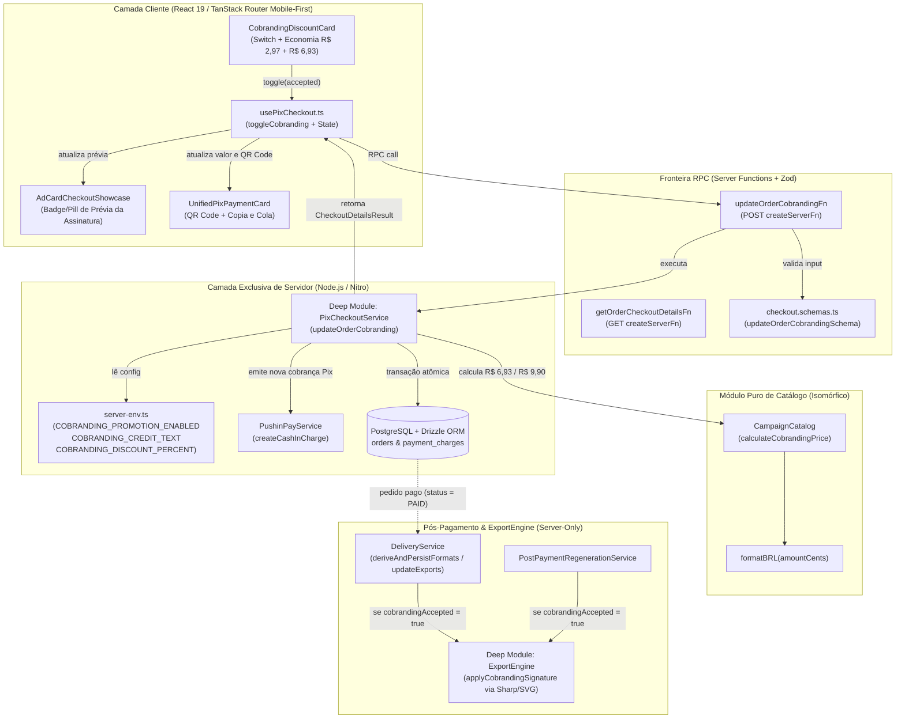
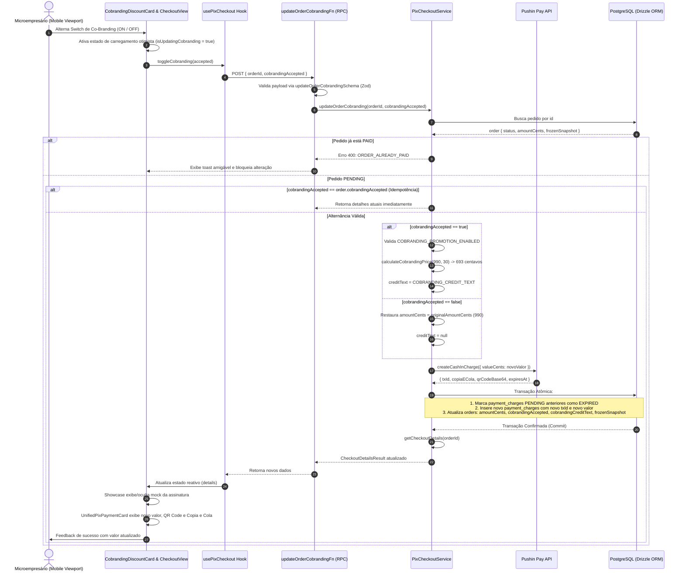

# Plano Técnico e Arquitetural: Desconto de Co-Branding / Assinatura de Marca no Checkout

- **Slug**: `cobranding-discount`
- **Data**: 20 de Outubro de 2026
- **Status**: Pronto para Execução (`ready-for-agent`)
- **Autor**: Principal Solution & Security Architect
- **Spec de Produto**: [`docs/specs/cobranding-discount.md`](../specs/cobranding-discount.md)
- **Macro-Tickets de Execução**:
  1. [`docs/tickets/cobranding-discount/01-backend-and-export-stream.md`](../tickets/cobranding-discount/01-backend-and-export-stream.md)
  2. [`docs/tickets/cobranding-discount/02-frontend-checkout-stream.md`](../tickets/cobranding-discount/02-frontend-checkout-stream.md) _(Execução Concorrente com Stream 1)_

---

## 1. Visão Geral Arquitetural e Auditoria dos 4 Pilares de Engenharia

O **OfertaPronta** opera sob o modelo de aquisição orgânica orientada a produto (Product-Led Growth - PLG). A funcionalidade de **Desconto de Co-Branding / Assinatura de Marca** viabiliza um incentivo econômico direto ao microempresário (30% de desconto na Campanha Avulsa, reduzindo o valor de R$ 9,90 para **R$ 6,93**, com economia visível de R$ 2,97) em troca da inclusão de uma assinatura sutil e de alta elegância visual no rodapé da arte final: `"Design por @ofertapronta"` (ou texto configurado no servidor).

A arquitetura foi submetida à auditoria dos **4 Pilares Universais de Engenharia**:

### 1.1. Arquitetura & Módulos Profundos (`codebase-design`)

- **Fronteira Hermética e Isolamento Estrito Client/Server**: O processamento de imagem (`sharp`), a persistência PostgreSQL (`drizzle-orm`) e as credenciais (`server-env.ts`) rodam exclusivamente no Node.js. A camada cliente consome a funcionalidade estritamente via Server Functions (`createServerFn`) tipadas com Zod.
- **Módulo Profundo `ExportEngine`**: Adiciona o método `applyCobrandingSignature(imageBuffer, options)` ocultando a complexidade de cálculo de aspect ratio (Feed 1080×1350 vs Story 1080×1920), layout de margens seguras (safe zones) e renderização vetorial SVG com alto contraste.
- **Módulo Profundo `CampaignCatalog`**: Módulo puro e isomórfico (`src/lib/campaign-catalog.ts`), compartilhado com segurança entre cliente e servidor sem vazar segredos ou imports nativos.
- **Módulo Profundo `PixCheckoutService`**: Orquestra a transição de cobrança e a máquina de estados Pix quando o desconto é alternado, garantindo atomicidade e cancelamento de cobranças obsoletas.

### 1.2. Integridade das Regras de Negócio

- **Preços e Descontos Autoritativos do Backend**: O cliente jamais envia o valor a ser cobrado. O backend determina o preço a partir do catálogo e do percentual configurado no servidor (`COBRANDING_DISCOUNT_PERCENT = 30`).
- **Matemática Financeira em Centavos**: Todos os cálculos utilizam centavos inteiros (`amountCents`). Para a base de 990 centavos com 30% de desconto:
  $$\text{desconto} = \text{round}(990 \times 0.3) = 297 \text{ centavos (R\$ 2,97)}$$
  $$\text{preço com desconto} = 990 - 297 = 693 \text{ centavos (R\$ 6,93)}$$
- **Congelamento Imutável (`Frozen Snapshot`)**: A decisão do comerciante (`cobrandingAccepted`, `cobrandingDiscountPercent`, `cobrandingCreditText`, `originalAmountCents`) é congelada na tabela `orders` e persiste de forma indelével mesmo em regenerações pós-compra.

### 1.3. Segurança por Design (`Security by Design`)

- **Validação de Fronteira com Zod**: Toda entrada via RPC (`updateOrderCobrandingSchema`) é rigorosamente sanitizada (UUID v4 no `orderId` e booleano no `cobrandingAccepted`).
- **Bloqueio de Mutação em Pedidos Pagos (`ORDER_ALREADY_PAID`)**: Rejeição imediata de qualquer tentativa de alternar o co-branding se `order.status === "PAID"`.
- **Reconciliação e Idempotência Anti-Spoofing no Webhook Pix**: O webhook da Pushin Pay valida o secret e o identificador `txId`. Se o pagamento recebido referir-se a uma cobrança emitida anteriormente (ex: cliente pagou o QR Code de R$ 9,90 antes da alternância para R$ 6,93), o sistema honra o valor efetivamente pago e ajusta `cobrandingAccepted` de acordo com a cobrança liquidada.

### 1.4. Qualidade, Simplicidade & Costuras TDD (`SOLID` + `YAGNI`)

- **Zero Bloat de Admin (YAGNI/Ponytail)**: Sem tabelas dinâmicas ou painéis administrativos complexos para cupons manuais. A promoção é governada por variáveis de ambiente simples (`COBRANDING_PROMOTION_ENABLED`, `COBRANDING_CREDIT_TEXT`, `COBRANDING_DISCOUNT_PERCENT`).
- **Renderização 100% Determinística (Zero Gemini Text Ingestion)**: A IA multimodal do Gemini **NUNCA** é utilizada para renderizar a assinatura de marca, eliminando riscos de alucinação de texto, artefatos ou fontes deformadas. A assinatura é aplicada como camada vetorial SVG via Sharp.
- **Costuras de Teste Limpas (Replace-Don't-Layer)**: Testes com mocks e fakes in-memory (`FakePushinPayService`), testando a superfície da interface pública sem acoplamento a implementações internas.

---

## 2. Diagramas Estruturais da Arquitetura (Mermaid)

### 2.1. Topologia de Módulos e Isolamento Client/Server (`flowchart TD`)



---

### 2.2. Diagrama de Sequência: Alternância do Switch de Co-Branding (`sequenceDiagram`)



---

### 2.3. Diagrama de Fluxo: Pipeline de Exportação no `ExportEngine` (`flowchart TD`)

```mermaid
flowchart TD
    StartMaster["Arte Mestre Limpa (Master Buffer)
    Gerada pela IA Multimodal Gemini"]

    BranchPreOrPost{"O Pedido foi Pago?"}

    StartMaster --> BranchPreOrPost

    BranchPreOrPost -->|NÃO (Prévia Gratuita)| WatermarkProc["ExportEngine.applyWatermark()
    - Padrão diagonal semitransparente
    - 'PRÉVIA OFERTAPRONTA'
    - Formato WebP otimizado (85%)"]
    WatermarkProc --> PreviewOut["previewCardImageUrl (Data URL)
    Exibida no Showcase do Checkout"]

    BranchPreOrPost -->|SIM (Pedido PAID)| DeliveryDerive["DeliveryService.deriveAndPersistFormats()
    - formatFeedCard() -> 1080×1350 (4:5)
    - formatStoryCard() -> 1080×1920 (9:16) com barras harmônicas"]

    DeliveryDerive --> CheckCobranding{"order.cobrandingAccepted == true?"}

    CheckCobranding -->|NÃO (Preço Integral)| CleanExport["Exports Limpos 100% Anônimos
    - Feed 1080×1350 sem assinatura
    - Story 1080×1920 sem assinatura"]

    CheckCobranding -->|SIM (Preço com Desconto)| CobrandingProc["ExportEngine.applyCobrandingSignature()
    Renderização Vetorial SVG via Sharp:
    - Feed: Posicionado em y=1315 (centro/rodapé)
    - Story: Posicionado em y=1840 (acima do input do Instagram)
    - Pill semitransparente com texto nítido em branco"]

    CobrandingProc --> CobrandedExport["Exports Finais com Assinatura Elegante
    - Feed 1080×1350 com 'Design por @ofertapronta'
    - Story 1080×1920 com 'Design por @ofertapronta'"]

    CleanExport --> PersistDB[("deliveryExports no PostgreSQL
    (feedUrl e storyUrl em PNG HD)")]
    CobrandedExport --> PersistDB

    PersistDB --> MerchantDownload["Download do Microempresário
    na tela /pedido/$orderId"]
```

---

## 3. Especificações Técnicas de Módulos Profundos e Contratos de Dados

### 3.1. Variáveis de Ambiente do Servidor (`src/config/server-env.ts`)

Adicionar ao `serverEnvSchema`:

```typescript
COBRANDING_PROMOTION_ENABLED: z.coerce.boolean().default(true),
COBRANDING_CREDIT_TEXT: z.string().default("Design por @ofertapronta"),
COBRANDING_DISCOUNT_PERCENT: z.coerce.number().int().min(1).max(90).default(30),
```

_Garantia_: Segredos e flags de backend nunca são acessíveis no bundle do navegador (`client-env.ts`).

---

### 3.2. Catálogo e Cálculo Financeiro Isomórfico (`src/lib/campaign-catalog.ts`)

Estender o catálogo com o utilitário puro e determinístico:

```typescript
export interface CobrandingPriceCalculation {
  originalAmountCents: number;
  discountAmountCents: number;
  amountCents: number;
  discountPercent: number;
  formattedOriginalPrice: string;
  formattedDiscountedPrice: string;
  formattedSavings: string;
}

export function calculateCobrandingPrice(
  baseAmountCents: number,
  discountPercent: number = 30,
): CobrandingPriceCalculation {
  const safeDiscountPercent = Math.max(
    1,
    Math.min(90, Math.round(discountPercent)),
  );
  const discountAmountCents = Math.round(
    baseAmountCents * (safeDiscountPercent / 100),
  );
  const amountCents = Math.max(100, baseAmountCents - discountAmountCents);

  return {
    originalAmountCents: baseAmountCents,
    discountAmountCents,
    amountCents,
    discountPercent: safeDiscountPercent,
    formattedOriginalPrice: formatBRL(baseAmountCents),
    formattedDiscountedPrice: formatBRL(amountCents),
    formattedSavings: formatBRL(discountAmountCents),
  };
}
```

_Garantia_: Testado com base `990` e `30%`, retornando rigorosamente `693` centavos, `297` centavos de economia, `"R$ 6,93"` e `"R$ 2,97"`.

---

### 3.3. Schema Drizzle & Migração SQL (`src/server/db/schema/orders.ts`)

Adicionar as colunas na tabela `orders`:

```typescript
cobrandingAccepted: boolean("cobranding_accepted").notNull().default(false),
cobrandingCreditText: text("cobranding_credit_text"),
```

Atualizar o tipo e estrutura do `frozenSnapshot`:

```typescript
export interface OrderFrozenSnapshot {
  // Dados de briefing existentes...
  draftId: string;
  businessSegment: string;
  targetAspectRatio: string;
  businessName?: string;
  offerTitle: string;
  promoPrice?: string;
  originalPrice?: string;
  callToAction?: string;
  whatsapp?: string | null;
  productImageDataUrl?: string | null;
  referenceImageDataUrl?: string | null;
  previewCardImageUrl?: string | null;
  cleanMasterImageDataUrl?: string | null;

  // Metadados comerciais e co-branding
  planId: string;
  planName: string;
  amountCents: number;
  originalAmountCents: number;
  cobrandingAccepted: boolean;
  cobrandingDiscountPercent: number | null;
  cobrandingCreditText: string | null;
  maxPostPaymentRegenerations: number;
  frozenAt: string;
}
```

_Comando de migração mandatório_:

```bash
pnpm db:generate && pnpm db:migrate
```

---

### 3.4. Schemas Zod e Contratos RPC (`src/features/checkout/data/checkout.schemas.ts`)

Adicionar schema de mutação e enriquecer o schema de saída:

```typescript
export const updateOrderCobrandingSchema = z.object({
  orderId: z.string().uuid("orderId deve ser um UUID válido"),
  cobrandingAccepted: z.boolean(),
});
export type UpdateOrderCobrandingInput = z.infer<
  typeof updateOrderCobrandingSchema
>;

export const checkoutDetailsOutputSchema = z.object({
  orderId: z.string(),
  draftId: z.string(),
  status: z.enum(["PENDING", "PAID", "EXPIRED", "CANCELLED"]),
  amountCents: z.number().int(),
  originalAmountCents: z.number().int().optional(),
  cobrandingAccepted: z.boolean().default(false),
  cobrandingPromotionAvailable: z.boolean().default(true),
  cobrandingCreditText: z.string().optional(),
  cobrandingDiscountPercent: z.number().int().default(30),
  customerWhatsapp: z.string().optional(),
  customerEmail: z.string().optional(),
  isDevMode: z.boolean().optional(),
  frozenSnapshot: z.record(
    z.union([z.string(), z.number(), z.boolean(), z.null(), z.undefined()]),
  ),
  charge: z
    .object({
      txId: z.string(),
      copiaECola: z.string(),
      qrCodeBase64: z.string(),
      expiresAt: z.string(),
      status: z.string(),
    })
    .nullable(),
});
```

---

### 3.5. Lógica no Módulo Profundo `PixCheckoutService` (`src/features/checkout/server/services/pix-checkout.service.ts`)

Implementar o método:

```typescript
async updateOrderCobranding(
  orderId: string,
  cobrandingAccepted: boolean,
): Promise<CheckoutDetailsResult> {
  const [order] = await this.database
    .select()
    .from(orders)
    .where(eq(orders.id, orderId))
    .limit(1);

  if (!order) {
    throw new Error("Pedido não encontrado");
  }

  if (order.status === "PAID") {
    throw new Error("Pedido já está pago; não é possível alterar opção de co-branding (ORDER_ALREADY_PAID)");
  }

  // Idempotência: se a opção já estiver idêntica, retorna estado atual
  if (order.cobrandingAccepted === cobrandingAccepted) {
    return this.getCheckoutDetails(orderId);
  }

  const snapshot = order.frozenSnapshot as Record<string, unknown>;
  const originalAmountCents =
    typeof snapshot.originalAmountCents === "number"
      ? snapshot.originalAmountCents
      : getCampaignPlanById(order.planId, this.catalogEnv).amountCents;

  let newAmountCents = originalAmountCents;
  let creditText: string | null = null;
  let discountPercent: number | null = null;

  if (cobrandingAccepted) {
    const isPromotionEnabled = serverEnv.COBRANDING_PROMOTION_ENABLED ?? true;
    if (!isPromotionEnabled) {
      throw new Error("A promoção de co-branding não está disponível no momento (PROMOTION_DISABLED)");
    }

    discountPercent = serverEnv.COBRANDING_DISCOUNT_PERCENT ?? 30;
    const calc = calculateCobrandingPrice(originalAmountCents, discountPercent);
    newAmountCents = calc.amountCents;
    creditText = serverEnv.COBRANDING_CREDIT_TEXT ?? "Design por @ofertapronta";
  }

  // Emite nova cobrança Pix na Pushin Pay com o novo valor
  const newCharge = await this.pushinPay.createCashInCharge({
    valueCents: newAmountCents,
  });

  const updatedSnapshot: Record<string, unknown> = {
    ...snapshot,
    originalAmountCents,
    amountCents: newAmountCents,
    cobrandingAccepted,
    cobrandingDiscountPercent: discountPercent,
    cobrandingCreditText: creditText,
    updatedAt: new Date().toISOString(),
  };

  const now = new Date();

  // Transação Atômica Drizzle
  await this.database.transaction(async (tx) => {
    // Expira cobranças PENDING anteriores
    await tx
      .update(paymentCharges)
      .set({ status: "EXPIRED", updatedAt: now })
      .where(
        and(
          eq(paymentCharges.orderId, orderId),
          eq(paymentCharges.status, "PENDING"),
        ),
      );

    // Insere nova cobrança com o novo valor
    await tx.insert(paymentCharges).values({
      orderId: order.id,
      txId: newCharge.txId,
      status: "PENDING",
      qrCodeImageUrl: newCharge.qrCodeBase64,
      copiaECola: newCharge.copiaECola,
      amountCents: newAmountCents,
      expiresAt: newCharge.expiresAt,
      rawPayload: newCharge as unknown as Record<string, unknown>,
    });

    // Atualiza pedido
    await tx
      .update(orders)
      .set({
        amountCents: newAmountCents,
        cobrandingAccepted,
        cobrandingCreditText: creditText,
        frozenSnapshot: updatedSnapshot,
        updatedAt: now,
      })
      .where(eq(orders.id, orderId));
  });

  log.info("Co-branding do pedido atualizado com sucesso", {
    orderId,
    cobrandingAccepted,
    newAmountCents,
    newTxId: newCharge.txId,
  });

  return this.getCheckoutDetails(orderId);
}
```

#### Reconciliação no Webhook (`handleWebhookPayment`)

Quando a Pushin Pay notifica pagamento de uma cobrança `charge`:

1. O valor recebido `payload.value` é validado contra `charge.amountCents`.
2. Se a cobrança paga for a de valor integral (`originalAmountCents`), garante que `orders.cobrandingAccepted` seja `false`.
3. Se a cobrança paga for a com desconto, garante que `orders.cobrandingAccepted` seja `true`.
   Essa reconciliação garante anti-spoofing e integridade mesmo em condições de corrida entre troca de switch e pagamento instantâneo.

---

### 3.6. Assinatura Vetorial no Módulo Profundo `ExportEngine` (`src/server/export-engine/image-processor.ts`)

Adicionar a função de aplicação de assinatura vetorial SVG de alto contraste:

```typescript
export interface CobrandingOptions {
  creditText: string;
  aspectRatio?: "feed" | "story";
}

export async function applyCobrandingSignature(
  imageBuffer: Buffer,
  options: CobrandingOptions,
): Promise<Buffer> {
  const metadata = await sharp(imageBuffer).metadata();
  const width = metadata.width ?? 1080;
  const height = metadata.height ?? 1350;
  const isStory = options.aspectRatio === "story" || height > 1600;

  const creditText = options.creditText.trim() || "Design por @ofertapronta";
  const escapedText = escapeXml(creditText);

  // Calibração de dimensões e posições
  // Feed (1080×1350): Y centralizado em 1315px (margem inferior de 35px)
  // Story (1080×1920): Y centralizado em 1835px (acima da barra de resposta do Instagram)
  const posY = isStory ? 1835 : 1315;
  const fontSize = isStory ? 24 : 22;
  const pillPaddingX = 20;
  const pillHeight = 36;
  const pillRadius = 18;

  // Largura estimada do container pill com base na contagem de caracteres
  const charWidth = fontSize * 0.58;
  const estimatedTextWidth = Math.ceil(creditText.length * charWidth);
  const pillWidth = estimatedTextWidth + pillPaddingX * 2;
  const pillX = Math.round((width - pillWidth) / 2);
  const pillY = posY - Math.round(pillHeight / 2);
  const textBaselineY = posY + Math.round(fontSize * 0.35);

  const svgOverlay = Buffer.from(`
    <svg width="${width}" height="${height}" xmlns="http://www.w3.org/2000/svg">
      <defs>
        <filter id="shadow" x="-10%" y="-10%" width="120%" height="120%">
          <feDropShadow dx="0" dy="2" stdDeviation="3" flood-opacity="0.5"/>
        </filter>
      </defs>
      <!-- Pill translúcido de alto contraste que garante legibilidade sobre qualquer fundo -->
      <rect
        x="${pillX}"
        y="${pillY}"
        width="${pillWidth}"
        height="${pillHeight}"
        rx="${pillRadius}"
        ry="${pillRadius}"
        fill="rgba(0, 0, 0, 0.55)"
        stroke="rgba(255, 255, 255, 0.22)"
        stroke-width="1"
        filter="url(#shadow)"
      />
      <!-- Texto vetorial nítido -->
      <text
        x="${Math.round(width / 2)}"
        y="${textBaselineY}"
        text-anchor="middle"
        font-family="system-ui, -apple-system, BlinkMacSystemFont, 'Segoe UI', Roboto, Helvetica, Arial, sans-serif"
        font-size="${fontSize}"
        font-weight="600"
        letter-spacing="0.4"
        fill="#FFFFFF"
      >${escapedText}</text>
    </svg>
  `);

  return sharp(imageBuffer)
    .composite([
      {
        input: svgOverlay,
        blend: "over",
      },
    ])
    .png()
    .toBuffer();
}
```

_Garantias do Design Gráfico_:

1. **Pill Translúcido Calibrado (`rgba(0, 0, 0, 0.55)`)**: Cria separação visual imediata contra fundos brancos (ofertas de encarte), pretos (hamburguerias/barbearias) ou coloridos, com borda sutil em branco translúcido.
2. **Safe Zones Respeitadas**: No Feed (1080×1350), fica a 35px da borda inferior (não corta no carrossel do Instagram). No Story (1080×1920), fica a 85px do fundo, flutuando acima da barra de resposta ("Enviar mensagem") do Instagram.

---

### 3.7. Integração no `DeliveryService` e `PostPaymentRegenerationService`

No `DeliveryService`:

- Em `deriveAndPersistFormats(order, masterDataUrl)`:
  ```typescript
  let feedBuffer = await this.formatFeed(masterBuffer);
  let storyBuffer = await this.formatStory(masterBuffer);

  if (order.cobrandingAccepted && order.cobrandingCreditText) {
    feedBuffer = await applyCobrandingSignature(feedBuffer, {
      creditText: order.cobrandingCreditText,
      aspectRatio: "feed",
    });
    storyBuffer = await applyCobrandingSignature(storyBuffer, {
      creditText: order.cobrandingCreditText,
      aspectRatio: "story",
    });
  }
  ```
- Em `updateExports(orderId, masterBuffer)`:
  Consulta `orders.cobrandingAccepted` e `orders.cobrandingCreditText` e aplica `applyCobrandingSignature` aos buffers de Feed e Story antes de persistir o update em `deliveryExports`.
- Isso garante automaticamente que regenerações via `PostPaymentRegenerationService` preservam a assinatura contratada sem duplicar regras.

---

### 3.8. Componente Frontend: `CobrandingDiscountCard` (`src/features/checkout/components/cobranding-discount-card.tsx`)

Componente mobile-first acessível construído estritamente com **Tailwind CSS v4** e primitivos do **shadcn/ui** (`Card`, `Switch`, `Badge`, `Typography`):

```typescript
export interface CobrandingDiscountCardProps {
  orderId: string;
  isAccepted: boolean;
  discountPercent?: number;
  originalAmountCents?: number;
  discountedAmountCents?: number;
  creditText?: string;
  isUpdating?: boolean;
  onToggle: (accepted: boolean) => void;
  className?: string;
}
```

Elementos de UX:

- **Badge Promocional**: `30% OFF` ou `Economize R$ 2,97` em destaque (verde esmeralda / primary).
- **Headline Convidativo**: _"Ativar Desconto com Assinatura"_.
- **Subtexto Explicativo**: _"Adicione a assinatura discreta 'Design por @ofertapronta' no rodapé do seu card e pague apenas R$ 6,93."_
- **Switch Radix UI**: Com acessibilidade (`aria-label`), desabilitado durante `isUpdating` e feedback háptico/visual.

---

### 3.9. Showcase Visual: `AdCardCheckoutShowcase` (`src/features/checkout/components/ad-card-checkout-showcase.tsx`)

Adicionar props:

```typescript
cobrandingAccepted?: boolean;
cobrandingCreditText?: string;
```

Quando `cobrandingAccepted === true`:
Renderizar uma prévia visual translúcida flutuando no rodapé da imagem do card:

```tsx
{
  cobrandingAccepted && (
    <div className="pointer-events-none absolute bottom-3 left-1/2 -translate-x-1/2 z-10">
      <div className="flex items-center gap-1.5 rounded-full border border-white/20 bg-black/60 px-2.5 py-0.5 shadow-sm backdrop-blur-sm">
        <Sparkles className="size-2.5 text-primary" />
        <span className="text-[10px] font-semibold text-white/95">
          {cobrandingCreditText || "Design por @ofertapronta"}
        </span>
      </div>
    </div>
  );
}
```

_Valor para o Comerciante_: O microempresário enxerga exatamente o quão discreta e bonita é a assinatura antes de pagar, eliminando qualquer medo de que ela estrague a promoção.

---

## 4. Checklist de Segurança e Qualidade de Engenharia

| Invariante                               | Requisito Técnico                                                                               | Onde é Garantido                                                             |
| ---------------------------------------- | ----------------------------------------------------------------------------------------------- | ---------------------------------------------------------------------------- |
| **Zero Server Code Leaks**               | Sem imports de `sharp`, `drizzle-orm` ou `server-env.ts` no cliente                             | `src/features/checkout/server/server-isolation.test.ts` auditado             |
| **Backend-Authoritative Pricing**        | Preço calculado estritamente no servidor via `calculateCobrandingPrice`                         | `PixCheckoutService.updateOrderCobranding`                                   |
| **Imutabilidade Pós-Pagamento**          | Rejeição de mutação com erro `ORDER_ALREADY_PAID`                                               | `order.status === "PAID"` verificado antes de qualquer mutação               |
| **Anti-Spoofing & Reconciliação**        | Se cliente pagar cobrança antiga de R$ 9,90, libera sem assinatura                              | `handleWebhookPayment` reconcilia `cobrandingAccepted` com o valor liquidado |
| **Idempotência no Switch**               | Toggle para mesmo estado não emite cobrança redundante na Pushin Pay                            | Checagem de `order.cobrandingAccepted === cobrandingAccepted`                |
| **Cancelamento de Cobranças Anteriores** | Cobranças pendentes obsoletas marcadas como `EXPIRED`                                           | Transação atômica Drizzle ao alternar valor                                  |
| **Preservação em Regenerações**          | Novas gerações de IA pós-compra mantêm assinatura se pedido foi pago com desconto               | `PostPaymentRegenerationService` delega a `DeliveryService.updateExports`    |
| **Mobile-First & Acessibilidade**        | Zero elementos nativos não estilizados, conformidade com `./.agents/scripts/verify.sh --shadcn` | `CobrandingDiscountCard` auditado com linter Shadcn                          |

---

## 5. Plano de Costuras TDD (`TDD Seams`) & Escopo das Macro-Streams Paralelas

Seguindo o padrão arquitetural do OfertaPronta, a implementação é dividida em **2 Macro-Streams Concorrentes**:

```mermaid
flowchart LR
    subgraph Stream1["Stream 1: Backend & Export (01-backend-and-export-stream.md)"]
        S1_Env["server-env.ts"]
        S1_Cat["campaign-catalog.ts & tests"]
        S1_DB["schema/orders.ts & db:generate"]
        S1_RPC["checkout.functions.ts & schemas"]
        S1_Svc["pix-checkout.service.ts & tests"]
        S1_Exp["image-processor.ts (SVG) & tests"]
        S1_Del["delivery.service.ts & tests"]
    end

    subgraph Stream2["Stream 2: Frontend & UX (02-frontend-checkout-stream.md)"]
        S2_Card["cobranding-discount-card.tsx & tests"]
        S2_Show["ad-card-checkout-showcase.tsx"]
        S2_Hook["use-pix-checkout.ts & tests"]
        S2_View["checkout-view.tsx & tests"]
    end

    Stream1 -.->|Contratos Zod e DTOs Congelados| Stream2
```



### 5.1. Macro-Stream 1: Backend & Export Stream (`01-backend-and-export-stream.md`)

**Agente**: `backend-builder`  
**Arquivos de Escopo**:

- `src/config/server-env.ts`
- `src/lib/campaign-catalog.ts` & `src/lib/campaign-catalog.test.ts`
- `src/server/db/schema/orders.ts` & migração SQL em `drizzle/`
- `src/features/checkout/data/checkout.schemas.ts`
- `src/features/checkout/server/services/pix-checkout.service.ts` & `pix-checkout.service.test.ts`
- `src/features/checkout/server/services/checkout-runners.service.ts`
- `src/features/checkout/server/functions/checkout.functions.ts` & `checkout.functions.test.ts`
- `src/features/checkout/server/index.ts` & `src/features/checkout/server/server-isolation.test.ts`
- `src/server/export-engine/image-processor.ts`, `index.ts` & `export-engine.test.ts`
- `src/features/delivery/server/services/delivery.service.ts` & `delivery.service.test.ts`
- `src/features/delivery/server/services/post-payment-regeneration.service.ts` & `post-payment-regeneration.service.test.ts`

**Comandos Cirúrgicos de Validação TDD**:

```bash
# Execuções rápidas de 1-2s durante o ciclo Red-Green-Refactor
pnpm vitest run src/lib/campaign-catalog.test.ts
pnpm vitest run src/server/export-engine/export-engine.test.ts
pnpm vitest run src/features/checkout/server/services/pix-checkout.service.test.ts
pnpm vitest run src/features/checkout/server/server-isolation.test.ts
pnpm vitest run src/features/delivery/server/services/delivery.service.test.ts
pnpm vitest run src/features/delivery/server/services/post-payment-regeneration.service.test.ts

# Geração e aplicação de migração SQL Drizzle
pnpm db:generate && pnpm db:migrate

# Checagem estrita de tipos
pnpm typecheck
```

---

### 5.2. Macro-Stream 2: Frontend & UX Stream (`02-frontend-checkout-stream.md`)

**Agente**: `frontend-builder`  
**Arquivos de Escopo**:

- `src/features/checkout/components/cobranding-discount-card.tsx`
- `src/features/checkout/components/cobranding-discount-card.test.tsx`
- `src/features/checkout/components/index.ts`
- `src/features/checkout/components/ad-card-checkout-showcase.tsx`
- `src/features/checkout/hooks/use-pix-checkout.ts` & `use-pix-checkout.test.ts`
- `src/features/checkout/views/checkout-view.tsx`
- `src/features/checkout/views/checkout-view.test.tsx`

**Comandos Cirúrgicos de Validação TDD**:

```bash
# Execuções rápidas de componentes e views
pnpm vitest run src/features/checkout/components/cobranding-discount-card.test.tsx
pnpm vitest run src/features/checkout/hooks/use-pix-checkout.test.ts
pnpm vitest run src/features/checkout/views/checkout-view.test.tsx

# Validação mobile-first e regras de Shadcn UI
./.agents/scripts/verify.sh --shadcn

# Checagem estrita de tipos
pnpm typecheck
```

---

## 6. Critérios de Homologação Final (Gate 3)

Antes do merge final na branch `main`:

1. **Pipeline Oficial Completo**: `./.agents/scripts/verify.sh` executado pelo `test-verifier` com 100% de sucesso (Shadcn + Typecheck + ESLint + Vitest + Nitro Build).
2. **Dual Browser Audit**: Verificação visual e responsiva em Viewport Mobile (390×844) e Desktop (1440×900) na rota `/checkout/$orderId`.
3. **Auditoria Independente**: `implementation-validator` confirmando aderência estrita à Spec, ausência de código desnecessário (`ponytail-review`) e conformidade com os princípios SOLID.
