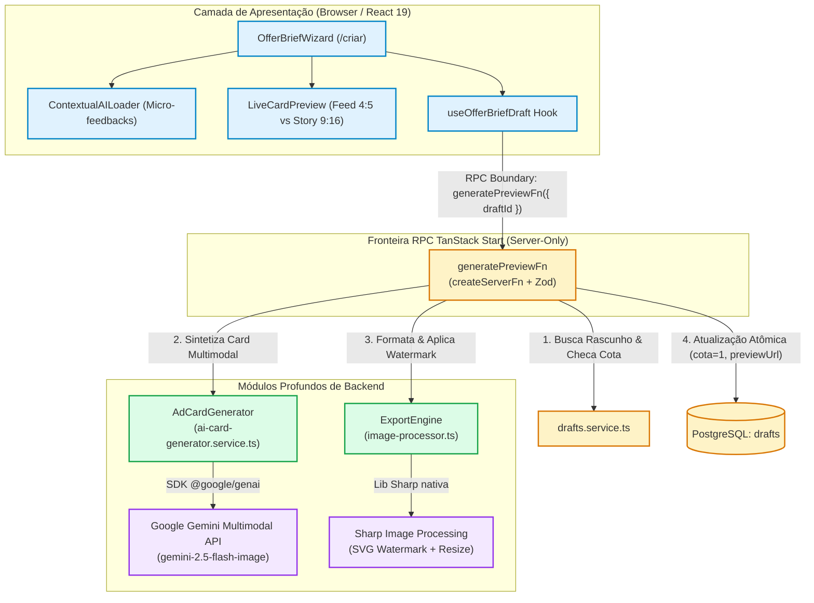
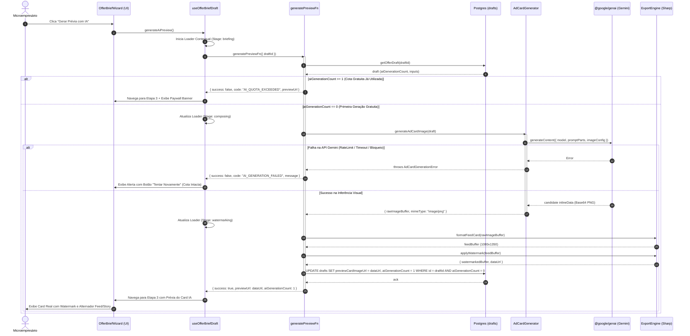
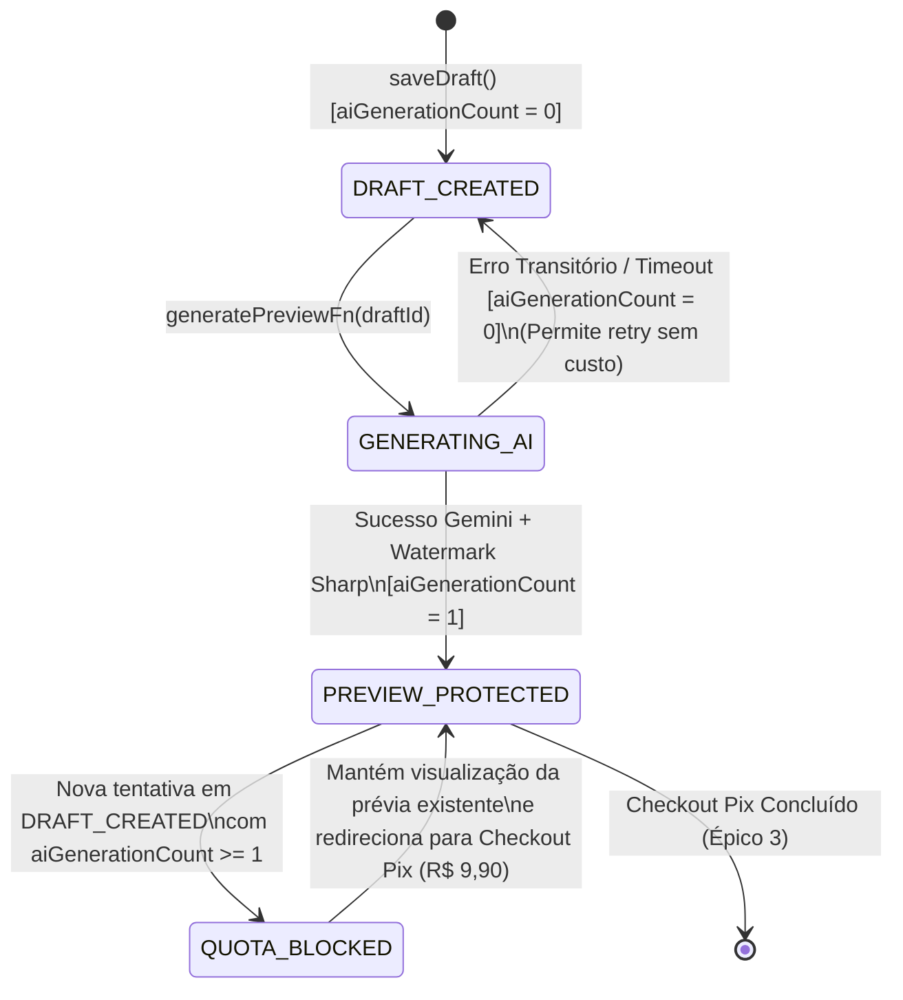

# Plano Técnico: Motor de Geração de Card Publicitário por IA Multimodal (AdCardGenerator & ExportEngine)

- **Slug**: `epico-2-ai-generation-export`
- **Spec de Produto**: [`docs/specs/epico-2-ai-generation-export.md`](../specs/epico-2-ai-generation-export.md)
- **Tickets de Execução**: [`docs/tickets/epico-2-ai-generation-export/`](../tickets/epico-2-ai-generation-export/)
- **Status**: `ready-for-review`

---

## 1. Visão Geral e Objetivos de Arquitetura

O **Épico 2** implementa o núcleo gerador do OfertaPronta, transformando o rascunho preenchido pelo microempresário (`Draft`) em um Card Publicitário completo (`Ad Card`) de alta conversão visual, combinando briefing textual, foto do produto e imagem de referência em proporção 4:5 (Feed) e 9:16 (Story).

### Invariantes e Pilares Técnicos
1. **Módulos Profundos com Superfície Mínima (`codebase-design`)**:
   - `ExportEngine` (`src/server/export-engine/`): Oculta todas as transformações de matrizes de pixels, redimensionamento estrito (1080×1350 e 1080×1920), desfoque gaussiano de extensão e aplicação indelével de marca d'água SVG.
   - `AdCardGenerator` (`src/features/promotions/server/services/ai-card-generator.service.ts`): Oculta a engenharia de prompts por segmento comercial, formatação multimodal de imagens em base64 (`inlineData`), chamadas ao SDK `@google/genai` e tradução de erros de API/segurança em exceções de domínio.
2. **Isolamento Estrito Server-Only**:
   - As dependências nativas `sharp` e `@google/genai` rodam estritamente no runtime Node.js do servidor.
   - A comunicação frontend ↔ backend dá-se exclusivamente via Server Function TanStack Start (`generatePreviewFn`), com validação Zod de entrada e saída.
3. **Integridade de Negócio e Controle de Cotas Atômico**:
   - Exatamente **1 geração gratuita de prévia por rascunho** (`ai_generation_count < 1`).
   - A cota só é consumida em caso de geração bem-sucedida confirmada e persistida no banco com marca d'água (`preview_card_image_url`).
   - Falhas transitórias da IA (timeout, erro 429, bloqueio de segurança) NÃO incrementam o contador, permitindo retry imediato.
   - Modo estrito: ausência de `GEMINI_API_KEY` resulta em erro explícito amigável no servidor sem geração silenciosa.
4. **Economia de Cota e Eficiência (Ponytail / YAGNI)**:
   - A arte de Story (1080×1920 / 9:16) é derivada a partir da arte mestre 4:5 pelo `ExportEngine` via extensão adaptativa com blur harmônico, economizando 50% de custo de inferência de IA e reduzindo o tempo de resposta em 60%.
   - Armazenamento de prévias diretamente como Data URL comprimido no PostgreSQL, postergando o setup de bucket S3 para a entrega de alta resolução (Épico 4).

---

## 2. Diagramas Estruturais Mermaid

### 2.1. Topologia de Módulos e Isolamento de Camadas (`flowchart TD`)



### 2.2. Sequência de Execução de Geração de Prévia (`sequenceDiagram`)



### 2.3. Máquina de Estados da Cota do Rascunho (`stateDiagram-v2`)



---

## 3. Interfaces de Módulos Profundos e Contratos de Fronteira

### 3.1. `ExportEngine` (`src/server/export-engine/`)

```typescript
export interface WatermarkOptions {
  watermarkText?: string;
  subText?: string;
  opacity?: number;
}

export interface ApplyWatermarkResult {
  watermarkedBuffer: Buffer;
  dataUrl: string;
  width: number;
  height: number;
}

export interface ExportEngineService {
  /**
   * Garante as dimensões exatas de 1080×1350 (4:5) na imagem fornecida.
   */
  formatFeedCard(imageBuffer: Buffer): Promise<Buffer>;

  /**
   * Deriva dimensões exatas de 1080×1920 (9:16) a partir da imagem mestre 4:5,
   * gerando fundo estendido com desfoque gaussiano suave da própria imagem.
   */
  formatStoryCard(imageBuffer: Buffer): Promise<Buffer>;

  /**
   * Aplica a marca d'água diagonal indelével (SVG composite) em 1080×1350.
   */
  applyWatermark(
    imageBuffer: Buffer,
    options?: WatermarkOptions,
  ): Promise<ApplyWatermarkResult>;
}
```

### 3.2. `AdCardGenerator` (`src/features/promotions/server/services/ai-card-generator.service.ts`)

```typescript
export interface GenerateAdCardInput {
  businessSegment: BusinessSegment;
  businessName: string;
  offerTitle: string;
  promoPrice: string;
  originalPrice?: string | null;
  callToAction?: string | null;
  whatsapp?: string | null;
  productImageDataUrl?: string | null;
  referenceImageDataUrl?: string | null;
  stylePresetId?: string | null;
  customStyleInstructions?: string | null;
}

export interface GenerateAdCardResult {
  rawImageBuffer: Buffer;
  mimeType: string;
}

export type AdCardErrorCode =
  | "AI_NOT_CONFIGURED"
  | "AI_QUOTA_EXCEEDED"
  | "AI_SAFETY_BLOCKED"
  | "AI_RATE_LIMIT"
  | "AI_TIMEOUT"
  | "AI_GENERATION_FAILED";

export class AdCardGenerationError extends Error {
  constructor(
    message: string,
    public readonly code: AdCardErrorCode,
    public readonly originalError?: unknown,
  ) {
    super(message);
    this.name = "AdCardGenerationError";
  }
}

/**
 * Seam para TDD: permite injeção de fake client nos testes unitários sem acoplamento a rede.
 */
export interface GoogleGenAIClientLike {
  models: {
    generateContent(params: any): Promise<any>;
  };
}

export async function generateAdCardImage(
  input: GenerateAdCardInput,
  client?: GoogleGenAIClientLike,
): Promise<GenerateAdCardResult>;
```

### 3.3. Server Function `generatePreviewFn` (`generator.functions.ts`)

```typescript
export const generatePreviewInputSchema = z.object({
  draftId: z.string().min(1, "draftId é obrigatório"),
});

export type GeneratePreviewInput = z.infer<typeof generatePreviewInputSchema>;

export type GeneratePreviewResponse =
  | {
      success: true;
      previewUrl: string;
      aiGenerationCount: number;
    }
  | {
      success: false;
      code: "AI_QUOTA_EXCEEDED" | "AI_NOT_CONFIGURED" | "AI_GENERATION_FAILED" | "NOT_FOUND";
      message: string;
      previewUrl?: string | null;
      aiGenerationCount?: number;
    };
```

---

## 4. Checklist de Segurança e Qualidade

- [x] **Zero Server Code Leaks**: `sharp` e `@google/genai` constam estritamente no backend. Os arquivos de UI e rotas cliente importam apenas as Server Functions (`generator.functions.ts`) e tipos DTO.
- [x] **Prevenção de Pirataria da Prévia**: A marca d'água diagonal é estampada nos pixels do buffer via Sharp no servidor. Nenhuma imagem sem marca d'água trafega pela rede antes da confirmação do Pix (Épico 3).
- [x] **Transição de Estados e Cota Atômica**: A cota só é incrementada de 0 para 1 no banco se a inferência da IA e a aplicação da marca d'água forem bem-sucedidas. Falhas de rede ou timeout mantêm a cota em 0.
- [x] **Sanitização de Insumos Visuais**: A extração de base64 de Data URLs valida o cabeçalho MIME (`image/png`, `image/jpeg`, `image/webp`).
- [x] **Validação nas Bordas RPC com Zod**: Validação estrita do parâmetro `draftId` na entrada da Server Function.
- [x] **Conformidade Mobile-First**: O componente de loader contextual e o alternador Feed/Story são otimizados para viewports de 360px a 430px sem estouro horizontal.
- [x] **Tipagem Estrita**: TypeScript em modo estrito, sem supressões (`@ts-ignore`) e com zero `any` no código de produção.

---

## 5. Estratégia de Testes (TDD Red → Green → Refactor)

1. **`ExportEngine` (`src/server/export-engine/export-engine.test.ts`)**:
   - Cria buffers sintéticos em memória via Sharp (sem dependência de arquivos em disco).
   - Valida redimensionamento Feed para 1080×1350.
   - Valida adaptação Story para 1080×1920 com margens e fundo estendido.
   - Valida composição de marca d'água e retorno de Data URL compatível.
2. **`AdCardGenerator` (`src/features/promotions/server/services/ai-card-generator.service.test.ts`)**:
   - Testa a construção de prompts para cada um dos 6 segmentos comerciais.
   - Testa a inclusão de partes `inlineData` para imagem de produto e referência estética.
   - Testa o tratamento de erros e tradução de códigos de erro (`AI_SAFETY_BLOCKED`, `AI_NOT_CONFIGURED`, etc.) com Fake Gemini Client (*replace-don't-layer*).
3. **`generatePreviewFn` (`src/features/promotions/server/functions/generator.functions.test.ts`)**:
   - Rascunho com cota 0 gera card, atualiza banco e incrementa contador para 1.
   - Rascunho com cota 1 é bloqueado com `AI_QUOTA_EXCEEDED` sem invocar a IA.
   - Simulação de falha da IA mantém rascunho com cota 0 e retorna mensagem amigável.
4. **UI & Wizard (`src/features/promotions/components/offer-brief-wizard.test.tsx`)**:
   - Exibição das mensagens progressivas de carregamento contextual.
   - Exibição da arte mestre gerada no canvas.
   - Exibição de alerta informativo e botão Pix quando a cota estiver esgotada.

---

## 6. Mapeamento de Tickets e Escopo dos Agentes Concorrentes

```
Ordem de Execução:
[Ticket 01: ExportEngine] (backend-builder) ──┐
                                             ├─► [Ticket 03: RPC & Quota] (backend-builder) ─► [Ticket 04: UI UX Flow] (frontend-builder)
[Ticket 02: AdCardGenerator] (backend-builder)┘
```

| Ticket | Responsável | Arquivos Criados / Modificados | Comandos de Verificação |
|---|---|---|---|
| **01** | `backend-builder` | `src/server/export-engine/index.ts`<br>`src/server/export-engine/image-processor.ts`<br>`src/server/export-engine/export-engine.test.ts` | `pnpm add sharp && pnpm add -D @types/sharp`<br>`pnpm test src/server/export-engine` |
| **02** | `backend-builder` | `src/features/promotions/server/services/ai-card-generator.service.ts`<br>`src/features/promotions/server/services/ai-card-generator.service.test.ts`<br>`src/config/server-env.ts` | `pnpm add @google/genai`<br>`pnpm test src/features/promotions/server/services` |
| **03** | `backend-builder` | `src/features/promotions/server/functions/generator.functions.ts`<br>`src/features/promotions/server/functions/generator.functions.test.ts`<br>`src/features/promotions/server/index.ts` | `pnpm test src/features/promotions/server/functions`<br>`pnpm typecheck` |
| **04** | `frontend-builder` | `src/features/promotions/hooks/use-offer-brief-draft.ts`<br>`src/features/promotions/components/offer-brief-wizard.tsx`<br>`src/features/promotions/components/live-card-preview.tsx`<br>`src/features/promotions/components/card-art-canvas.tsx`<br>`src/features/promotions/components/offer-brief-wizard.test.tsx` | `./.agents/scripts/verify.sh --quick` |
