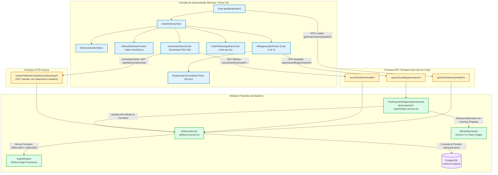
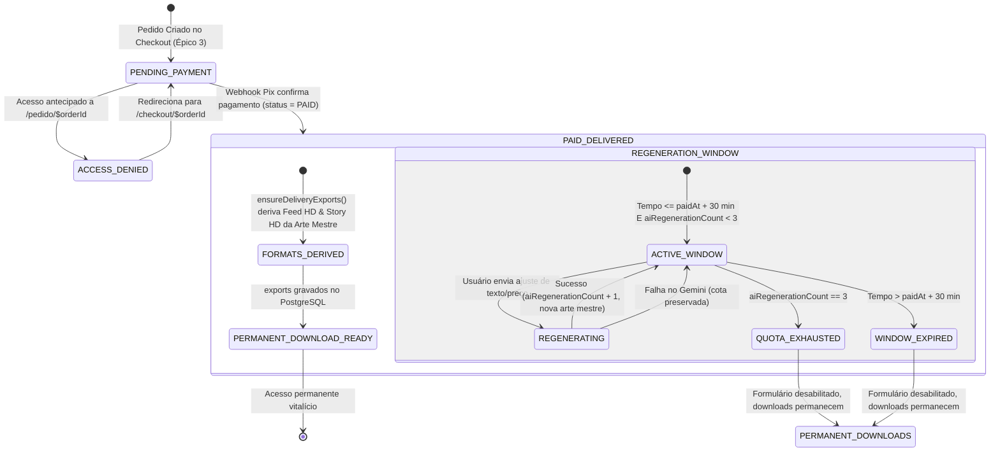
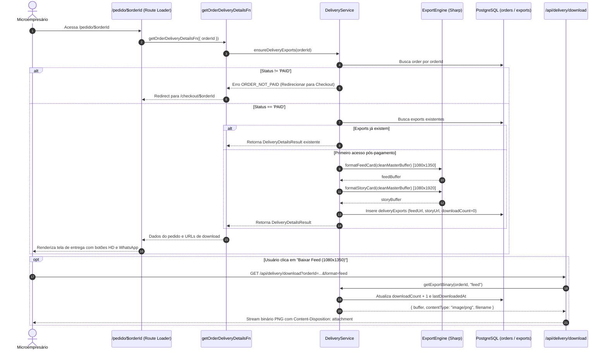
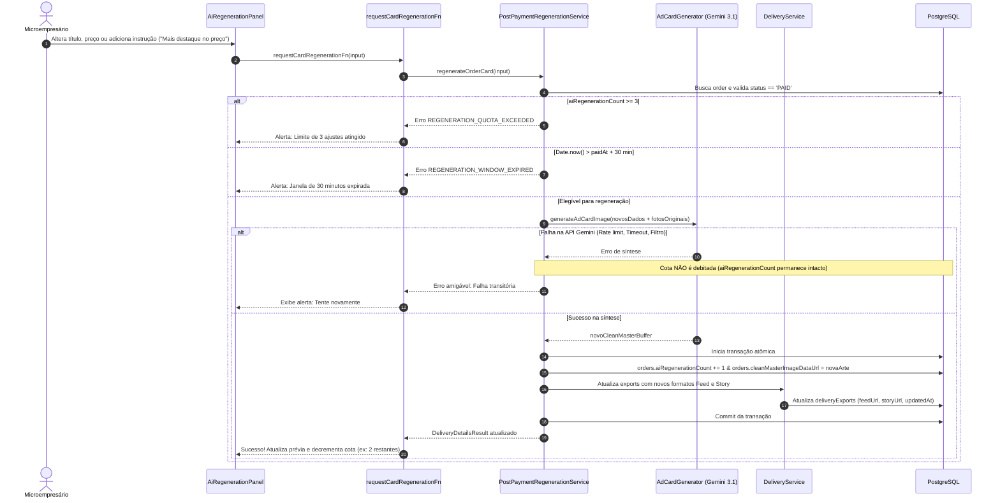

# Plano Técnico: Entrega sem Marca d'Água & Regeneração IA Pós-Compra (`DeliveryEngine`)

- **Slug**: `epico-4-entrega-e-regeneracao`
- **Spec de Produto**: [`docs/specs/epico-4-entrega-e-regeneracao.md`](../specs/epico-4-entrega-e-regeneracao.md)
- **Tickets de Execução**: [`docs/tickets/epico-4-entrega-e-regeneracao/`](../tickets/epico-4-entrega-e-regeneracao/)
  - `01-clean-master-art-and-delivery-service.md`: Persistência da Arte Mestre Limpa e Módulo Profundo `DeliveryService`
  - `02-delivery-server-functions-and-download-endpoint.md`: Server Functions RPC e Rota HTTP de Download de PNGs HD
  - `03-post-payment-ai-regeneration-service.md`: Módulo Profundo `PostPaymentRegenerationService` (Cota de 3 Ajustes em 30 min)
  - `04-mobile-delivery-view-and-regeneration-ui.md`: View Mobile-First de Entrega (`/pedido/$orderId`), Visualizador HD e Painel de Refinamento
- **Status**: `ready-for-review`

---

## 1. Visão Geral e Invariantes de Engenharia

O **Épico 4** representa o ápice da jornada do comerciante no OfertaPronta: após preencher o briefing (Épico 1), validar a prévia com marca d'água (Épico 2) e efetuar o pagamento via Pix de R$ 9,90 (Épico 3), o microempresário tem acesso **imediato, permanente e descomplicado** às suas artes publicitárias em alta resolução (Feed 1080×1350 e Story 1080×1920) sem nenhuma marca d'água, com direito a até **3 regenerações/ajustes por IA** em uma janela de 30 minutos pós-pagamento.

### 4 Pilares de Engenharia do Projeto

1. **Arquitetura & Módulos Profundos (`codebase-design`)**:
   - `DeliveryService` (`src/features/delivery/server/services/delivery.service.ts`): módulo profundo que encapsula a verificação de elegibilidade do pagamento (`order.status === 'PAID'`), a geração determinística dos formatos HD (Feed e Story) via `ExportEngine`, a persistência dos exports no PostgreSQL e a entrega binária segura com rastreamento de métricas (`downloadCount`, `lastDownloadedAt`).
   - `PostPaymentRegenerationService` (`src/features/delivery/server/services/post-payment-regeneration.service.ts`): módulo profundo que orquestra o refinamento da arte pela IA multimodal (`AdCardGenerator` / Gemini), assegurando a reutilização dos insumos visuais originais (foto do produto e referência), controle atômico de cotas (máx 3) e bloqueio gracioso após 30 minutos corridos pós-Pix (`paidAt + 30m`).
   - Costura de Testes (_replace-don't-layer_): injeção direta de dependências nos construtores dos serviços (`database`, `generateAdCard`, `exportEngine`), permitindo testes unitários e de integração ultrarrápidos e determinísticos sem dependência de rede ou serviços externos.

2. **Integridade de Regras de Negócio & Resolução da Arte Mestre Limpa**:
   - **Fidelidade Visual Absoluta**: para evitar que o cliente pague por uma arte e receba outra diferente, o buffer limpo puro gerado pelo Gemini na prévia do Épico 2 é preservado no servidor em `drafts.cleanMasterImageDataUrl` e congelado no pedido em `orders.cleanMasterImageDataUrl`. Ao aprovar o Pix, os formatos Feed e Story são derivados instantaneamente da arte original sem re-renderização surpresa.
   - **Autoridade Estrita de Pagamento**: qualquer tentativa de acesso aos arquivos sem marca d'água em pedidos com status `PENDING`, `EXPIRED` ou `CANCELLED` é sumariamente bloqueada com exceção `ORDER_NOT_PAID`.
   - **Regra de Cota e Janela de Tempo**: cota limitada a exatamente 3 regenerações por pedido (`aiRegenerationCount < 3`) durante os primeiros 30 minutos pós-pagamento (`Date.now() <= paidAt + 30m`). Após 30 minutos ou ao esgotar a cota, o formulário de regeneração é desativado graciosamente, preservando o acesso permanente aos downloads.
   - **Resiliência Financeira**: se a chamada à API Gemini falhar durante um ajuste, a cota do usuário **NÃO** é debitada (`aiRegenerationCount` permanece intacto).

3. **Segurança por Design & Isolamento de Camadas (Zero Server Code Leaks)**:
   - **Validação de Fronteira com Zod**: todas as Server Functions e endpoints validam rigorosamente entradas e saídas (`getOrderDeliveryDetailsInputSchema`, `deliveryDetailsResultSchema`, `requestRegenerationInputSchema`, `recordDownloadInputSchema`).
   - **Endpoint Binário Protegido (`/api/delivery/download`)**: valida a existência e status `PAID` do pedido antes de transmitir os bytes do PNG, injeta cabeçalhos HTTP de segurança (`Content-Type: image/png`, `Content-Disposition: attachment; filename="ofertapronta-<format>-<orderId>.png"` e `Cache-Control: private, no-transform`) e registra o download.
   - **Isolamento Estrito**: dependências de backend (`sharp`, `@google/genai`, `drizzle-orm`, `pg`) permanecem restritas a diretórios `server/`. O arquivo `src/features/delivery/server/index.ts` expõe exclusivamente Server Functions RPC, schemas Zod e DTOs, verificado pelo teste `server-isolation.test.ts`.

4. **Qualidade, Simplicidade & Anti-Bloat (KISS / Ponytail)**:
   - **Downloads Permanentes sem Overhead de S3 no MVP**: para o volume do MVP, os PNGs e arte mestre são persistidos como data URLs / buffers no PostgreSQL ou servidos dinamicamente pelo endpoint local de download. Elimina complexidade acidental de credenciais AWS IAM, buckets S3, políticas de CORS e URLs pré-assinadas com expiração indesejada.
   - **Conveniência Mobile em 1 Toque**: botão _"Enviar artes para meu WhatsApp"_ gera link direto `wa.me` com mensagem contendo o link permanente da rota `/pedido/$orderId`, permitindo resgatar a campanha no celular a qualquer momento.

---

## 2. Diagramas Estruturais Mermaid

### 2.1. Topologia de Módulos e Isolamento de Camadas (`flowchart TD`)



---

### 2.2. Máquina de Estados da Entrega e Ciclo de Vida (`stateDiagram-v2`)



---

### 2.3. Diagrama de Sequência: Carregamento do Pedido e Download do Arquivo (`sequenceDiagram`)



---

### 2.4. Diagrama de Sequência: Regeneração e Refinamento com IA (`sequenceDiagram`)



---

## 3. Interfaces dos Módulos Profundos, Schemas Zod e Banco de Dados

### 3.1. Alterações nos Schemas Drizzle ORM (`src/server/db/schema/`)

#### 1. `drafts` (`src/server/db/schema/promotions.ts`)

Adicionar a coluna para preservar a arte limpa gerada pelo Gemini antes da marca d'água:

```typescript
export const drafts = pgTable("drafts", {
  // ... campos existentes ...
  cleanMasterImageDataUrl: text("clean_master_image_data_url"), // NOVO
  previewCardImageUrl: text("preview_card_image_url"),
  aiGenerationCount: integer("ai_generation_count").notNull().default(0),
  // ...
});
```

#### 2. `orders` (`src/server/db/schema/orders.ts`)

Adicionar a coluna para armazenar a arte limpa oficial do pedido:

```typescript
export const orders = pgTable("orders", {
  // ... campos existentes ...
  cleanMasterImageDataUrl: text("clean_master_image_data_url"), // NOVO
  aiRegenerationCount: integer("ai_regeneration_count").notNull().default(0), // já existe
  paidAt: timestamp("paid_at", { withTimezone: true }), // já existe
  // ...
});
```

#### 3. `deliveryExports` (`src/server/db/schema/delivery.ts`)

Tornar `expiresAt` opcional (ou com valor sentinela perpétuo), garantindo que downloads nunca sejam bloqueados por expiração:

```typescript
export const deliveryExports = pgTable("exports", {
  id: uuid("id").defaultRandom().primaryKey(),
  orderId: uuid("order_id")
    .notNull()
    .references(() => orders.id),
  feedUrl: text("feed_url").notNull(),
  storyUrl: text("story_url").notNull(),
  feedAssetKey: text("feed_asset_key"),
  storyAssetKey: text("story_asset_key"),
  expiresAt: timestamp("expires_at", { withTimezone: true }), // Tornado opcional para downloads permanentes
  downloadCount: integer("download_count").notNull().default(0),
  lastDownloadedAt: timestamp("last_downloaded_at", { withTimezone: true }),
  createdAt: timestamp("created_at", { withTimezone: true })
    .defaultNow()
    .notNull(),
  updatedAt: timestamp("updated_at", { withTimezone: true })
    .defaultNow()
    .notNull(),
});
```

---

### 3.2. Contratos Zod e DTOs (`src/features/delivery/data/delivery.schemas.ts`)

```typescript
import { z } from "zod";

export const downloadFormatEnum = z.enum(["feed", "story"]);
export type DownloadFormat = z.infer<typeof downloadFormatEnum>;

export const getOrderDeliveryDetailsInputSchema = z.object({
  orderId: z.string().uuid("ID de pedido inválido"),
});
export type GetOrderDeliveryDetailsInput = z.infer<
  typeof getOrderDeliveryDetailsInputSchema
>;

export const recordDownloadInputSchema = z.object({
  orderId: z.string().uuid("ID de pedido inválido"),
  format: downloadFormatEnum,
});
export type RecordDownloadInput = z.infer<typeof recordDownloadInputSchema>;

export const requestRegenerationInputSchema = z.object({
  orderId: z.string().uuid("ID de pedido inválido"),
  offerTitle: z
    .string()
    .min(2, "Título deve ter pelo menos 2 caracteres")
    .optional(),
  promoPrice: z.string().min(1, "Preço promocional é obrigatório").optional(),
  originalPrice: z.string().optional().nullable(),
  callToAction: z.string().optional().nullable(),
  customAdjustmentPrompt: z
    .string()
    .max(500, "Instrução não pode exceder 500 caracteres")
    .optional()
    .nullable(),
});
export type RequestRegenerationInput = z.infer<
  typeof requestRegenerationInputSchema
>;

export const deliveryDetailsResultSchema = z.object({
  orderId: z.string().uuid(),
  status: z.literal("PAID"),
  offerTitle: z.string(),
  businessName: z.string(),
  businessSegment: z.string(),
  paidAt: z.string(), // ISO 8601
  regenerationWindowEndsAt: z.string(), // ISO 8601 (paidAt + 30 min)
  canRegenerate: z.boolean(),
  regenerationsUsed: z.number().int().min(0).max(3),
  maxRegenerations: z.number().int().default(3),
  remainingRegenerations: z.number().int().min(0).max(3),
  feedCardUrl: z.string(),
  storyCardUrl: z.string(),
  downloadCount: z.number().int().min(0),
  customerWhatsapp: z.string().optional().nullable(),
  permanentOrderUrl: z.string(),
});
export type DeliveryDetailsResult = z.infer<typeof deliveryDetailsResultSchema>;
```

---

### 3.3. Interface Pública do `DeliveryService`

```typescript
export interface DeliveryBinaryResult {
  buffer: Buffer;
  contentType: string;
  filename: string;
}

export interface DeliveryServiceDependencies {
  database?: AppDatabase;
  formatFeed?: (buffer: Buffer) => Promise<Buffer>;
  formatStory?: (buffer: Buffer) => Promise<Buffer>;
}

export class DeliveryService {
  constructor(deps?: DeliveryServiceDependencies);

  /**
   * Garante a derivação dos exports em alta resolução a partir da arte mestre limpa
   * e persiste o registro deliveryExports no PostgreSQL com idempotência estrita.
   */
  async ensureDeliveryExports(orderId: string): Promise<DeliveryDetailsResult>;

  /**
   * Obtém os detalhes completos de entrega do pedido para a view.
   */
  async getDeliveryDetails(orderId: string): Promise<DeliveryDetailsResult>;

  /**
   * Registra incremento na contagem de downloads de forma atômica.
   */
  async recordDownload(
    orderId: string,
    format: DownloadFormat,
  ): Promise<{ success: boolean; downloadCount: number }>;

  /**
   * Recupera os bytes do PNG HD para download via endpoint HTTP com cabeçalhos de attachment.
   */
  async getExportBinary(
    orderId: string,
    format: DownloadFormat,
  ): Promise<DeliveryBinaryResult>;
}
```

---

### 3.4. Interface Pública do `PostPaymentRegenerationService`

```typescript
export interface RegenerationDependencies {
  database?: AppDatabase;
  deliveryService?: DeliveryService;
  generateAdCard?: (
    input: GenerateAdCardInput,
  ) => Promise<GenerateAdCardResult>;
}

export class PostPaymentRegenerationService {
  constructor(deps?: RegenerationDependencies);

  /**
   * Executa novo ciclo de síntese IA preservando insumos originais (foto e estilo)
   * e mesclando com novos dados de texto/preço/instrução, sob controle rígido de cota e prazo.
   */
  async regenerateOrderCard(
    input: RequestRegenerationInput,
  ): Promise<DeliveryDetailsResult>;
}
```

---

## 4. Checklist de Segurança e Qualidade

- [x] **Prevenção de Acesso Não Pago**: Pedidos `PENDING`, `EXPIRED` ou `CANCELLED` lançam `ORDER_NOT_PAID` com código HTTP 403 e são redirecionados automaticamente para `/checkout/$orderId`.
- [x] **Controle Rígido de Cota de IA**: Validação no banco impede que `aiRegenerationCount` ultrapasse 3. A 4ª tentativa lança `REGENERATION_QUOTA_EXCEEDED`.
- [x] **Janela Temporal Restrita**: O cálculo `Date.now() <= paidAt + 30 * 60 * 1000` é autoritativo no backend. Ajustes pós-30min lançam `REGENERATION_WINDOW_EXPIRED`.
- [x] **Proteção de Custos de API**: Em caso de erro na API do Gemini durante a regeneração, a cota de regeneração do usuário não é consumida.
- [x] **Downloads Nativos Permanentes**: Headers `Content-Disposition: attachment; filename="..."` e `Content-Type: image/png` com URLs perpétuas sem dependência de expiração de token AWS.
- [x] **Idempotência**: Chamadas repetidas a `ensureDeliveryExports` não reprocessam a imagem pelo Sharp; reutilizam o registro existente.
- [x] **Zero Server Leaks**: Verificado via teste unitário `server-isolation.test.ts` (apenas Server Functions e Schemas Zod exportados).

---

## 5. Plano de Seams para TDD & Escopo dos Builders Paralelos

### Bloco de Construção Concorrente

#### Builder Backend (`backend-builder`) — Tickets 01, 02 e 03

1. **Ticket 01 (`01-clean-master-art-and-delivery-service.md`)**:
   - Modificar schemas Drizzle: `drafts.cleanMasterImageDataUrl`, `orders.cleanMasterImageDataUrl` e `deliveryExports.expiresAt` (opcional).
   - Ajustar `updateDraftPreviewCard` e `executeGeneratePreview` em `promotions` para salvar `cleanMasterImageDataUrl`.
   - Ajustar `buildFrozenSnapshot` e `persistOrderAndCharge` em `pix-checkout.service.ts` para transferir a arte limpa para `orders`.
   - Implementar `DeliveryService` em `src/features/delivery/server/services/delivery.service.ts`.
   - Testar com TDD em `src/features/delivery/server/services/delivery.service.test.ts` (validação de pagamento, derivação determinística Feed/Story, idempotência, downloads).
2. **Ticket 02 (`02-delivery-server-functions-and-download-endpoint.md`)**:
   - Criar schemas Zod em `src/features/delivery/data/delivery.schemas.ts`.
   - Criar runners e Server Functions em `src/features/delivery/server/functions/delivery.functions.ts` (`getOrderDeliveryDetailsFn`, `recordCardDownloadFn`).
   - Criar rota HTTP binária `src/routes/api.delivery.download.ts` com handlers GET.
   - Criar barrel seguro `src/features/delivery/server/index.ts` e validar isolamento em `src/features/delivery/server/server-isolation.test.ts`.
3. **Ticket 03 (`03-post-payment-ai-regeneration-service.md`)**:
   - Implementar `PostPaymentRegenerationService` em `src/features/delivery/server/services/post-payment-regeneration.service.ts`.
   - Criar Server Function `requestCardRegenerationFn` em `src/features/delivery/server/functions/delivery.functions.ts`.
   - Testar exaustivamente com TDD em `src/features/delivery/server/services/post-payment-regeneration.service.test.ts` (cota máx 3, janela 30m, preservação de foto, resiliência de falha).

#### Builder Frontend (`frontend-builder`) — Ticket 04

1. **Ticket 04 (`04-mobile-delivery-view-and-regeneration-ui.md`)**:
   - Criar hooks TanStack Query: `use-delivery-order.ts` e `use-card-regeneration.ts` em `src/features/delivery/hooks/`.
   - Criar componentes mobile-first em `src/features/delivery/components/`:
     - `delivery-header-status.tsx`: Banner de celebração ("Pagamento Confirmado!").
     - `ad-card-delivery-preview.tsx`: Visualizador de card com tabs "Feed (1080×1350)" e "Story (1080×1920)".
     - `download-actions-card.tsx`: Botões de download direto em PNG HD.
     - `order-whatsapp-share-card.tsx`: Botão "Enviar artes para meu WhatsApp" via link `wa.me`.
     - `regeneration-countdown-timer.tsx`: Cronômetro regressivo da janela de 30 minutos.
     - `ai-regeneration-panel.tsx`: Card retrátil com badge "X de 3 restantes", formulário de ajuste e estado de loading amigável.
   - Criar view orquestradora `order-delivery-view.tsx` em `src/features/delivery/views/`.
   - Criar rota TanStack Start `src/routes/pedido.$orderId.tsx` com loader protegido e tratamento de pedidos não pagos/inexistentes.
   - Testes de UI em `order-delivery-view.test.tsx` e `ai-regeneration-panel.test.tsx`.

---

## 6. Plano de Verificação e Homologação

```bash
# 1. Verificação Rápida de Testes TDD durante a construção
pnpm test src/features/delivery

# 2. Verificação de Isolamento Client/Server
pnpm test src/features/delivery/server/server-isolation.test.ts

# 3. Pipeline Completo de Qualidade (Shadcn UI + Typecheck + ESLint + Vitest + Build)
./.agents/scripts/verify.sh

# 4. Auditoria Dual Browser no Dev Server Ativo
# - Mobile Viewport: 390x844 (toque fluido, zero overflow horizontal, touch targets >= 44px)
# - Desktop Viewport: 1440x900 (composição harmônica e responsiva)
```
