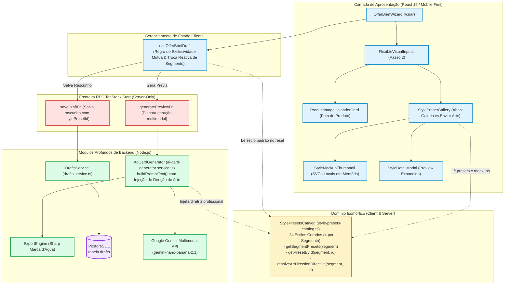
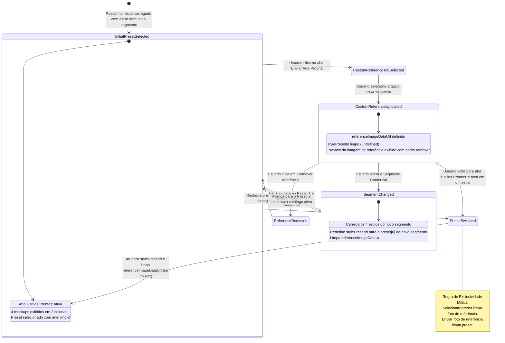
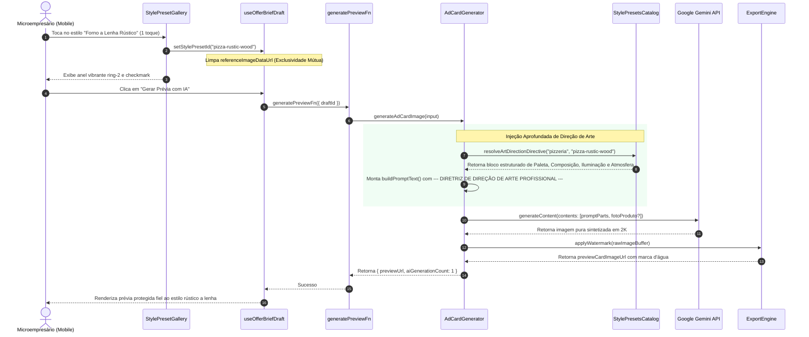
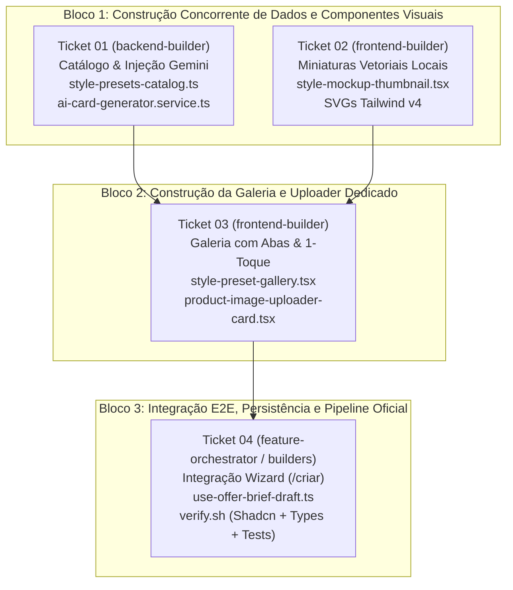

# Plano Técnico: Galeria de Estilos Visuais e Referências por Segmento (`StylePresetGallery`)

- **Slug**: `epico-5-galeria-estilos`
- **Spec de Produto**: [`docs/specs/epico-5-galeria-estilos.md`](../specs/epico-5-galeria-estilos.md)
- **Tickets de Execução**: [`docs/tickets/epico-5-galeria-estilos/`](../tickets/epico-5-galeria-estilos/)
  - `01-catalogo-estilos-e-diretriz-de-arte-gemini.md`: Catálogo Canônico de Estilos Curados e Injeção de Direção de Arte no Gemini
  - `02-miniaturas-mockup-vetoriais-locais.md`: Miniaturas Vetoriais Locais dos Mockups e Componente de Thumbnail
  - `03-galeria-visual-com-selecao-em-1-toque.md`: Galeria Visual Mobile-First com Seleção de 1 Toque e Abas de Referência
  - `04-integracao-wizard-persistencia-e-validacao-e2e.md`: Integração do Fluxo do Rascunho, Troca Reativa de Segmento e Validação E2E
- **Status**: `ready-for-implementation`

---

## 1. Visão Geral e Invariantes de Engenharia

O **Épico 5** eleva a qualidade da direção de arte e a taxa de conversão na rota `/criar` do OfertaPronta. Substitui o seletor textual simplório por uma **Galeria de Estilos Visuais Curados por Segmento** (`StylePresetGallery`), oferecendo amostras gráficas ricas selecionáveis em 1 toque no celular, integrada a um motor de **Diretriz de Direção de Arte de Agência** injetado diretamente no prompt do Gemini Multimodal (`AdCardGenerator`).

### 4 Pilares de Engenharia do Projeto

1. **Arquitetura & Módulos Profundos (`codebase-design`)**:
   - `StylePresetsCatalog` (`src/features/promotions/data/style-presets-catalog.ts`): módulo profundo isomórfico que centraliza a fonte única da verdade para os 24 estilos visuais (4 por segmento comercial). Apresenta uma interface concisa (`getSegmentPresets`, `getPresetById`, `resolveArtDirectionDirective`) ocultando centenas de linhas de diretrizes de design de agência (paletas exatas, proporções, tipografia publicitária, iluminação de estúdio e atmosfera) e especificações declarativas de renderização visual.
   - `StyleMockupThumbnail` (`src/features/promotions/components/style-mockup-thumbnail.tsx`): componente profundo de apresentação que encapsula a renderização gráfica de 6 variantes visuais de nicho comercial (`retail-burst`, `fresh-organic`, `dark-luxury`, `rustic-wood`, `clean-minimal`, `neon-urban`) em proporção 4:5.
   - `StylePresetGallery` (`src/features/promotions/components/style-preset-gallery.tsx`): componente visual mobile-first que substitui o antigo `StylePresetsCard`. Organiza os estilos em abas (_"Estilos Prontos (Galeria)"_ vs _"Enviar Arte Própria"_), grid compacto de 2 colunas no celular (`grid-cols-2`), touch targets generosos (≥ 44px) e seleção instantânea em 1 toque.
   - Disciplina de Costuras (_replace-don't-layer_): o catálogo é uma estrutura de dados e funções puras em memória; o gerador consome a diretriz via função pura, permitindo testes unitários ultra-rápidos sem mocks externos ou rede.

2. **Integridade de Negócio & Regras Autoritativas no Backend**:
   - **Exclusividade Mútua de Insumos Visuais**: a escolha de um estilo pronto da galeria limpa automaticamente qualquer imagem de referência manual (`referenceImageDataUrl = undefined`) e vice-versa. Isso elimina conflitos estéticos no modelo multimodal (ex.: enviar foto de pizza artesanal enquanto seleciona estilo de encarte de supermercado).
   - **Autoridade e Fallback Gracioso**: se um rascunho for submetido com `stylePresetId` ausente, nulo ou inválido, o backend não falha nem gera exceção: `resolveArtDirectionDirective` aplica graciosamente o primeiro estilo padrão daquele segmento comercial (`getSegmentPresets(segment)[0]`).
   - **Preços e Identidade Imutáveis**: o estilo selecionado é persistido de forma segura em `drafts.stylePresetId` no PostgreSQL e congelado no `Frozen Snapshot` do pedido no momento do checkout Pix.

3. **Segurança por Design & Isolamento de Camadas (Zero Server Code Leaks)**:
   - **Isomorfismo Estrito**: o catálogo `style-presets-catalog.ts` é 100% puro e isomórfico (TypeScript puro). Não importa nenhuma dependência nativa de Node.js (`sharp`, `pg`) nem segredos de backend (`serverEnv`), podendo ser executado com total segurança no cliente React e no servidor TanStack Start.
   - **Validação de Fronteiras com Zod**: o schema `offerBriefSchema` e `saveOfferDraftSchema` validam estritamente o formato e tamanho de qualquer insumo complementar, prevenindo payloads maliciosos ou excedentes (limite de 4MB por imagem).
   - **Higienização de Prompts**: o texto de instruções customizadas (`customStyleInstructions`) é sanitizado e delimitado como texto puro no prompt do Gemini, prevenindo prompt injection ou corrupção da estrutura de direção de arte.

4. **Qualidade, Simplicidade & Anti-Bloat (KISS / Ponytail)**:
   - **Zero Dependência de Rede para Miniaturas (SVGs Locais)**: as miniaturas dos mockups utilizam exclusivamente SVGs leves e gradientes Tailwind CSS v4 embutidos no bundle da aplicação. Não há upload de assets para S3, nem requisições HTTP adicionais, nem tempo de espera de download de imagens no 3G/4G.
   - **Layout Otimizado para Mobile**: grid de 2 colunas (`grid-cols-2`) permitindo escanear os 4 estilos simultaneamente sem rolagem horizontal ou gestos de swipe complexos.
   - **Desacoplamento Limpo**: especialização do card anterior para `ProductImageUploaderCard` (focado exclusivamente na Foto do Produto/Serviço), eliminando a duplicidade confusa de uploaders.

---

## 2. Diagramas Estruturais Mermaid

### 2.1. Topologia de Módulos e Isolamento Isomórfico (`flowchart TD`)



---

### 2.2. Máquina de Estados da Seleção de Insumos Visuais (`stateDiagram-v2`)



---

### 2.3. Fluxo de Injeção de Direção de Arte de Agência no Gemini (`sequenceDiagram`)



---

## 3. Interfaces Públicas dos Módulos Profundos

### 3.1. `StylePresetsCatalog` (`src/features/promotions/data/style-presets-catalog.ts`)

Módulo profundo isomórfico responsável por encapsular todo o conhecimento publicitário e as amostras visuais dos 6 segmentos.

```typescript
import type { BusinessSegment } from "./offer-brief.schema";

export type LayoutVariant =
  | "retail-burst"
  | "fresh-organic"
  | "dark-luxury"
  | "rustic-wood"
  | "clean-minimal"
  | "neon-urban";

export interface StyleMockupSpec {
  layoutVariant: LayoutVariant;
  badgeText: string;
  bgColor: string;
  textColor: string;
  accentColor: string;
}

export interface ArtDirectionDirective {
  palette: string;
  composition: string;
  lighting: string;
  atmosphere: string;
}

export interface CuratedStylePreset {
  id: string;
  segment: BusinessSegment;
  label: string;
  description: string;
  tags: string[];
  previewBadgeColor: string;
  accentColor: string;
  mockup: StyleMockupSpec;
  artDirection: ArtDirectionDirective;
}

/**
 * Retorna exatamente os 4 estilos visuais curados para o segmento comercial informado.
 */
export function getSegmentPresets(
  segment: BusinessSegment,
): CuratedStylePreset[];

/**
 * Busca um estilo específico dentro do catálogo de um segmento.
 */
export function getPresetById(
  segment: BusinessSegment,
  presetId?: string | null,
): CuratedStylePreset | undefined;

/**
 * Resolve a diretriz formatada de Direção de Arte para injeção no prompt do Gemini.
 * Se o presetId for nulo, indefinido ou inexistente, aplica graciosamente o primeiro
 * estilo padrão do segmento sem falhar.
 */
export function resolveArtDirectionDirective(
  segment: BusinessSegment,
  presetId?: string | null,
): string;
```

#### Catálogo dos 24 Estilos Visuais Curados (4 por Segmento)

| Segmento              | ID do Estilo           | Nome Comercial                   | Variante Mockup | Paleta Principal     | Foco Estético                                               |
| --------------------- | ---------------------- | -------------------------------- | --------------- | -------------------- | ----------------------------------------------------------- |
| **Supermercado**      | `market-discount`      | Super Encarte Amarelo & Vermelho | `retail-burst`  | `#EF4444`, `#FBBF24` | Varejo agressivo, selos explosivos, preço gigante           |
| **Supermercado**      | `market-fresh`         | Feira & Hortifrúti Natural       | `fresh-organic` | `#10B981`, `#047857` | Verde folha, madeira clara, frescor e saúde                 |
| **Supermercado**      | `market-premium`       | Empório Gourmet & Carnes Nobres  | `dark-luxury`   | `#1F2937`, `#F59E0B` | Fundo escuro texturizado, luz quente em carnes nobres       |
| **Supermercado**      | `market-daily`         | Ofertas do Dia & Sacolão         | `retail-burst`  | `#F97316`, `#FDE047` | Laranja vibrante, direto ao ponto para hortifrúti diário    |
| **Salão & Barbearia** | `barber-vintage`       | Barber Club Retrô & Couro        | `rustic-wood`   | `#78350F`, `#D97706` | Madeira escura, couro, luz quente e navalha clássica        |
| **Salão & Barbearia** | `salon-glamour`        | Glamour Rose Gold & Editorial    | `clean-minimal` | `#EC4899`, `#F43F5E` | Rose gold suave, tipografia fina, elegância feminina        |
| **Salão & Barbearia** | `beauty-clean`         | Clean Estética & Spa             | `clean-minimal` | `#6366F1`, `#06B6D4` | Tons menta/ciano, sensação de pureza e bem-estar            |
| **Salão & Barbearia** | `barber-modern`        | Urban Fade & Neon Barber         | `neon-urban`    | `#0F172A`, `#8B5CF6` | Fundo grafite com brilhos neon roxo/azul moderno            |
| **Pizzaria**          | `pizza-rustic-wood`    | Forno a Lenha Rústico            | `rustic-wood`   | `#B45309`, `#DC2626` | Madeira rústica, chamas, queijo borbulhante e apetite       |
| **Pizzaria**          | `pizza-artisan-craft`  | Forneria Artesanal Italiana      | `rustic-wood`   | `#DC2626`, `#15803D` | Toalha xadrez sutil, manjericão fresco, azeite dourado      |
| **Pizzaria**          | `pizza-neon-night`     | Delivery Noturno Quente          | `neon-urban`    | `#18181B`, `#EA580C` | Contraste escuro com luz âmbar/alaranjada de delivery       |
| **Pizzaria**          | `pizza-promo-combo`    | Super Combo & Borda Recheada     | `retail-burst`  | `#EA580C`, `#FACC15` | Composição de pizza + refrigerante com destaque de combo    |
| **Hamburgueria**      | `burger-dark-bold`     | Dark Burger & Fumaça             | `dark-luxury`   | `#111827`, `#F59E0B` | Fundo carvão dramático, fumaça quente, cheddar escorrendo   |
| **Hamburgueria**      | `burger-smash-fire`    | Smash na Chapa & Fogo            | `rustic-wood`   | `#B45309`, `#EF4444` | Tons de brasa, luz lateral na crostinha caramelizada        |
| **Hamburgueria**      | `burger-urban-pop`     | Street Food Pop & Grafite        | `retail-burst`  | `#F59E0B`, `#DC2626` | Diner americano, amarelo e vermelho com tipografia ousada   |
| **Hamburgueria**      | `burger-artisan-wood`  | Gourmet na Tábua Artesanal       | `rustic-wood`   | `#78350F`, `#10B981` | Tábua de corte rústica, molhos artesanais e textura         |
| **Restaurante**       | `restaurant-homestyle` | Comidinha Caseira & Aconchego    | `rustic-wood`   | `#D97706`, `#15803D` | Panela de ferro, aroma de fazenda, comida afetiva           |
| **Restaurante**       | `restaurant-buffet`    | Prato Feito Executivo Farto      | `fresh-organic` | `#059669`, `#D97706` | Arroz brilhante, feijão suculento, carne e salada colorida  |
| **Restaurante**       | `restaurant-gourmet`   | Bistrô & Empratado Fino          | `dark-luxury`   | `#334155`, `#E2E8F0` | Louça clara impecável, iluminação difusa sofisticada        |
| **Restaurante**       | `restaurant-delivery`  | Marmita Express do Dia           | `retail-burst`  | `#EA580C`, `#F59E0B` | Visual prático e apetitoso para entrega rápida de almoço    |
| **Comércio Local**    | `retail-vibrant`       | Varejo Dinâmico & Amigável       | `retail-burst`  | `#3B82F6`, `#FBBF24` | Azul e amarelo convidativo para lojas de bairro e pet shops |
| **Comércio Local**    | `retail-dynamic`       | Liquidação & Black Week          | `retail-burst`  | `#EAB308`, `#18181B` | Faixas de impacto, preto e amarelo com urgência de compra   |
| **Comércio Local**    | `retail-clean-modern`  | Moderno & Tecnológico            | `clean-minimal` | `#0EA5E9`, `#64748B` | Geometrias limpas e tons neutros para óticas e informática  |
| **Comércio Local**    | `retail-service-pro`   | Serviço Profissional & Confiança | `clean-minimal` | `#1E40AF`, `#F8FAFC` | Azul profundo institucional com selo de garantia de serviço |

---

### 3.2. `StyleMockupThumbnail` (`src/features/promotions/components/style-mockup-thumbnail.tsx`)

Renderizador vetorial de miniaturas 100% em memória no bundle:

```typescript
export interface StyleMockupThumbnailProps {
  mockup: StyleMockupSpec;
  className?: string;
  ariaLabel?: string;
}
```

- **Proporção**: container com `aspect-[4/5]`, bordas arredondadas e overflow oculto.
- **Renderização por Variante**:
  - `retail-burst`: gradiente radial/linear em tons quentes, badge explosiva com `badgeText`, estrelas geométricas e barra de preço ilustrativa.
  - `fresh-organic`: gradiente verde folha a verde escuro, linhas curvas suaves simulando frescor natural, folhas estilizadas e badge arredondada.
  - `dark-luxury`: fundo escuro grafite/preto (`#111827`), linhas geométricas finas douradas/rose gold, iluminação sutil de holofote superior e badge premium.
  - `rustic-wood`: ripas de madeira simuladas por linhas horizontais sutis, gradiente de fogo âmbar na base e badge com efeito rústico.
  - `clean-minimal`: fundo arejado com linhas finas elegantes, moldura sutil, tipografia serifada/editorial e badge minimalista.
  - `neon-urban`: fundo preto azulado, brilho difuso simulado via `drop-shadow` neon, linhas angulares modernas e badge vibrante.
- **Desempenho**: zero chamadas de rede, zero requisições a imagens externas, renderização instantânea (0ms de latência) em qualquer dispositivo.

---

### 3.3. `ProductImageUploaderCard` (`src/features/promotions/components/product-image-uploader-card.tsx`)

Especialização limpa para upload da Foto do Produto/Serviço:

```typescript
export interface ProductImageUploaderCardProps {
  productImageDataUrl?: string;
  imageError?: string | null;
  onProductImageChange: (dataUrl: string | undefined) => void;
  onFileUpload: (
    e: React.ChangeEvent<HTMLInputElement>,
    onSuccess: (dataUrl: string | undefined) => void,
  ) => void;
}
```

- Exibe informações claras: _"Foto do Produto / Serviço (Opcional)"_.
- Se carregada: exibe imagem com botão de remoção rápida (`Trash2`).
- Se vazia: botão de upload estilizado acessível com touch target ≥ 44px.

---

### 3.4. `StylePresetGallery` (`src/features/promotions/components/style-preset-gallery.tsx`)

Substitui o antigo `StylePresetsCard` por uma galeria visual rica com abas:

```typescript
export interface StylePresetGalleryProps {
  segment: BusinessSegment;
  stylePresetId?: string | null;
  referenceImageDataUrl?: string | null;
  customStyleInstructions?: string;
  imageError?: string | null;
  onStylePresetChange: (presetId: string | undefined) => void;
  onReferenceImageChange: (dataUrl: string | undefined) => void;
  onCustomStyleInstructionsChange: (instructions: string) => void;
  onFileUpload: (
    e: React.ChangeEvent<HTMLInputElement>,
    onSuccess: (dataUrl: string | undefined) => void,
  ) => void;
}
```

- **Abas de Navegação (Tabs)**:
  - Aba 1: _"Estilos Prontos (Galeria)"_ (ativa por padrão se houver preset selecionado ou rascunho novo).
  - Aba 2: _"Enviar Arte Própria"_ (ativa se houver `referenceImageDataUrl` preenchido).
- **Grid Mobile-First**: 2 colunas (`grid grid-cols-2 gap-3 sm:grid-cols-4 sm:gap-4`) exibindo os 4 estilos do segmento.
- **Cartão do Estilo**:
  - Miniatura `StyleMockupThumbnail`.
  - Título comercial em tipografia em negrito (`text-xs font-bold leading-tight`).
  - Tags de estilo em micro-badges (`text-[10px]`).
  - Anel de seleção vibrante (`ring-2 ring-primary ring-offset-2`) e ícone `Check` quando ativo.
  - Toque único (`1-tap selection`) que seleciona o estilo e limpa `referenceImageDataUrl`.
  - Botão discreto de informação (`Info`) abrindo modal/dialog acessível com descrição detalhada do estilo e diretrizes visuais.
- **Aba de Referência Customizada**:
  - Uploader tradicional de imagem (JPG, PNG, WebP até 4MB).
  - Ao carregar a imagem, limpa automaticamente `stylePresetId`.
- **Instruções Adicionais Expansíveis**:
  - Acordeão sanfona _"Instruções extras de estilo para a IA (opcional)"_, permitindo refinar o clima (ex.: _"Quero fundo com fumaça escura"_).

---

### 3.5. Atualização do `AdCardGenerator` (`ai-card-generator.service.ts`)

Substitui a antiga descrição genérica por uma diretriz estruturada de agência:

```typescript
// No método buildPromptText:
const artDirectiveText = resolveArtDirectionDirective(
  input.businessSegment,
  input.stylePresetId,
);

// Injetado nas diretrizes do prompt:
`
--- DIRETRIZES DE DIREÇÃO DE ARTE E DESIGN GRÁFICO ---
${proportionDirectives}
- Estilo Visual do Segmento: ${segmentConfig.visualStyle}
- Clima e Atmosfera Geral: ${segmentConfig.atmosphere}
${artDirectiveText ? `\n${artDirectiveText}\n` : ""}
${productNote ? `${productNote}\n` : ""}${referenceNote ? `${referenceNote}\n` : ""}${customInstructions ? `- ${customInstructions}` : ""}
`.trim();
```

---

## 4. Disciplina de Costuras e Estratégia de Testes TDD

Seguindo os princípios de `codebase-design` e `solid` (_replace-don't-layer_ com _fakes in-memory_):

### 4.1. `src/features/promotions/data/style-presets-catalog.test.ts`

- **Validação de Cobertura**: testa os 6 segmentos comerciais (`supermarket`, `beauty-salon`, `pizzeria`, `burger-shop`, `restaurant`, `local-retail`).
- **Completude Estrutural**: garante que cada segmento possui exatamente 4 presets com `id`, `label`, `description`, `tags` (mínimo 2), `previewBadgeColor`, `accentColor`, `mockup` e `artDirection`.
- **Unicidade de Identificadores**: garante que os 24 `id` de estilos são globalmente únicos no catálogo.
- **Fallback Gracioso**:
  - `resolveArtDirectionDirective("pizzeria", undefined)` retorna a diretriz do primeiro preset (`pizza-rustic-wood`).
  - `resolveArtDirectionDirective("pizzeria", "estilo-fantasma")` retorna a diretriz do primeiro preset sem disparar exceção.

### 4.2. `src/features/promotions/components/style-mockup-thumbnail.test.tsx`

- **Renderização de Variantes**: testa a renderização sem erros das 6 variantes visuais (`retail-burst`, `fresh-organic`, `dark-luxury`, `rustic-wood`, `clean-minimal`, `neon-urban`).
- **Estrutura SVG**: verifica a presença de nós `<svg>`, retângulos e gradientes correspondentes.
- **Desempenho**: assegura zero chamadas a endpoints externos ou tags `` remotas.

### 4.3. `src/features/promotions/components/style-preset-gallery.test.tsx`

- **Renderização da Galeria**: verifica a exibição dos 4 cartões de estilo para o segmento informado.
- **Seleção em 1 Toque**: clica em um cartão e valida o disparo de `onStylePresetChange` com o `id` correspondente.
- **Exclusividade Mútua**:
  - Clicar em um estilo quando há imagem de referência prévia dispara `onReferenceImageChange(undefined)`.
  - Enviar uma imagem de referência na aba própria dispara `onStylePresetChange(undefined)`.
- **Acessibilidade & Mobile**: verifica atributos `role="tab"`, `aria-selected`, `aria-pressed`, e ausência de elementos com touch target < 44px.

### 4.4. `src/features/promotions/server/services/ai-card-generator.service.test.ts`

- **Injeção de Direção de Arte**: testa que ao chamar `generateAdCardImage` com `stylePresetId: "market-discount"`, o prompt passado ao cliente Gemini contém a seção `--- DIRETRIZ DE DIREÇÃO DE ARTE PROFISSIONAL: "Super Encarte Amarelo & Vermelho" ---` com a paleta de cores e atmosfera do preset.
- **Comportamento com Preset Inexistente**: testa que um preset inválido utiliza o fallback de direção de arte do segmento sem lançar erro.

### 4.5. `src/features/promotions/components/offer-brief-wizard.test.tsx` & `use-offer-brief-draft.test.ts`

- **Troca Reativa de Segmento**: no Passo 1, trocar de _"Supermercado"_ para _"Pizzaria"_ atualiza a galeria do Passo 2 para os 4 estilos de pizza e redefine o `stylePresetId` para `"pizza-rustic-wood"`.
- **Persistência**: rascunho com `stylePresetId` selecionado envia o ID correto na chamada RPC `saveDraftFn`.

---

## 5. Escopo dos Builders Concorrentes e Ordem de Dependências



### Detalhamento por Especialista:

- **`backend-builder` (Ticket 01)**:
  - Arquivos:
    - `src/features/promotions/data/style-presets-catalog.ts` (Novo)
    - `src/features/promotions/data/style-presets-catalog.test.ts` (Novo)
    - `src/features/promotions/server/services/ai-card-generator.service.ts` (Atualização)
    - `src/features/promotions/server/services/ai-card-generator.service.test.ts` (Atualização)
    - `src/features/promotions/data/offer-brief.schema.ts` (Compatibilidade e export dos 4 presets por segmento)
    - `src/features/promotions/data/offer-brief.schema.test.ts` (Atualização do teste de catálogo)
  - Comando de Validação: `pnpm vitest run src/features/promotions/data/style-presets-catalog.test.ts src/features/promotions/server/services/ai-card-generator.service.test.ts`

- **`frontend-builder` (Tickets 02 e 03)**:
  - Arquivos Ticket 02:
    - `src/features/promotions/components/style-mockup-thumbnail.tsx` (Novo)
    - `src/features/promotions/components/style-mockup-thumbnail.test.tsx` (Novo)
  - Arquivos Ticket 03:
    - `src/features/promotions/components/product-image-uploader-card.tsx` (Novo)
    - `src/features/promotions/components/style-preset-gallery.tsx` (Novo)
    - `src/features/promotions/components/style-preset-gallery.test.tsx` (Novo)
  - Comando de Validação: `pnpm vitest run src/features/promotions/components/style-mockup-thumbnail.test.tsx src/features/promotions/components/style-preset-gallery.test.tsx`

- **Orquestração & Integração Final (Ticket 04)**:
  - Arquivos:
    - `src/features/promotions/components/flexible-visual-inputs.tsx` (Conexão com `ProductImageUploaderCard` e `StylePresetGallery`)
    - `src/features/promotions/hooks/use-offer-brief-draft.ts` (Exclusividade mútua e reset reativo no `handleSegmentChange`)
    - `src/features/promotions/hooks/use-offer-brief-draft.test.ts`
    - `src/features/promotions/components/offer-brief-wizard.tsx`
    - `src/features/promotions/components/offer-brief-wizard.test.tsx`
  - Comando de Validação: `./.agents/scripts/verify.sh`

---

## 6. Matriz de Rastreabilidade

| Ticket | Entregáveis Técnicos                                                               | Critérios de Aceite BDD Atendidos                                                                                                                                                                                                                                                                                            | Testes Automatizados                                                                                |
| ------ | ---------------------------------------------------------------------------------- | ---------------------------------------------------------------------------------------------------------------------------------------------------------------------------------------------------------------------------------------------------------------------------------------------------------------------------- | --------------------------------------------------------------------------------------------------- |
| **01** | `style-presets-catalog.ts`, `ai-card-generator.service.ts`                         | - 24 estilos curados para os 6 segmentos (4 por segmento).<br/>- `resolveArtDirectionDirective` injeta paleta, iluminação e atmosfera no prompt Gemini.<br/>- Fallback gracioso para presets inválidos/nulos.                                                                                                                | `style-presets-catalog.test.ts`<br/>`ai-card-generator.service.test.ts`                             |
| **02** | `style-mockup-thumbnail.tsx`                                                       | - Renderização das 6 variantes visuais em proporção 4:5.<br/>- Zero chamadas de rede ou assets externos (100% SVG em memória).<br/>- Performance instantânea em redes móveis.                                                                                                                                                | `style-mockup-thumbnail.test.tsx`                                                                   |
| **03** | `style-preset-gallery.tsx`, `product-image-uploader-card.tsx`                      | - Galeria mobile-first em grid de 2 colunas com seleção em 1 toque.<br/>- Abas _"Estilos Prontos"_ vs _"Enviar Arte Própria"_ com exclusividade mútua estrita.<br/>- Modal de detalhes visuais e campo expansível de instruções extras.<br/>- Touch targets ≥ 44px e atributos de acessibilidade.                            | `style-preset-gallery.test.tsx`                                                                     |
| **04** | `flexible-visual-inputs.tsx`, `use-offer-brief-draft.ts`, `offer-brief-wizard.tsx` | - Troca reativa de segmento no Passo 1 redefine estilos e seleção no Passo 2.<br/>- Persistência e recarga transparente de `stylePresetId` via `saveDraftFn` e `getDraftFn`.<br/>- Geração de prévia com marca d'água refletindo a direção de arte.<br/>- Aprovação total no pipeline oficial `./.agents/scripts/verify.sh`. | `offer-brief-wizard.test.tsx`<br/>`use-offer-brief-draft.test.ts`<br/>`./.agents/scripts/verify.sh` |

---

## 7. Checklist de Qualidade e Segurança (Gate 0 Técnico)

- [x] **Deep Modules**: O catálogo `StylePresetsCatalog` expõe 3 funções puras simples e esconde o mapeamento de 24 estilos de agência e mockups.
- [x] **Client/Server Isolation**: Catálogo isomórfico sem vazamento de segredos ou dependências de Node.js (`sharp`, `pg`).
- [x] **YAGNI / Ponytail**: Zero dependência de S3 para miniaturas; SVGs vetoriais locais e determinísticos.
- [x] **Regra de Exclusividade Mútua**: Previne ruído multimodal e comandos contraditórios para o Gemini.
- [x] **Fallback Gracioso**: Falhas de ID no cliente caem suavemente no preset padrão sem erros de servidor.
- [x] **Acessibilidade Mobile-First**: Viewports 360px a 430px auditados, touch targets ≥ 44px, contraste de cores e suporte a leitor de telas.
- [x] **TDD Seams Claros**: Cada ticket vertical possui sua superfície pública de testes com asserções BDD explícitas.
