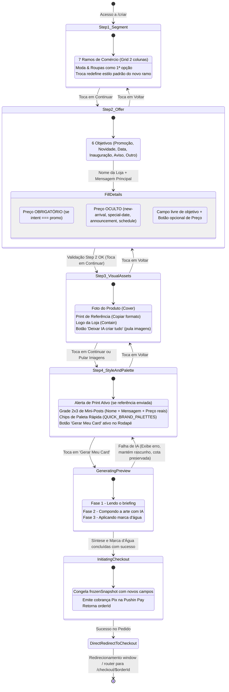
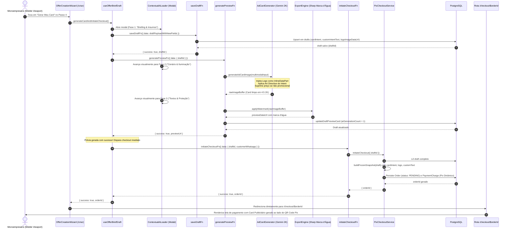
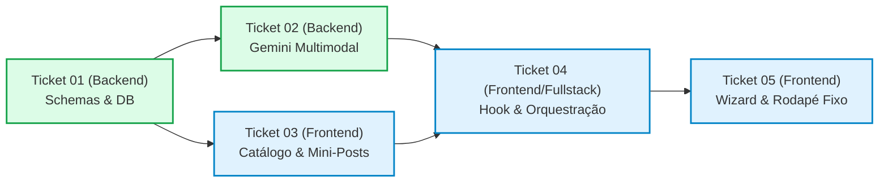

# Plano Técnico: Redesign do Fluxo de Criação em Micro-Passos (`MicroStepCreationFlow`)

- **Slug**: `epico-6-redesign-criacao-micro-passos`
- **Spec de Produto**: [`docs/specs/epico-6-redesign-criacao-micro-passos.md`](../specs/epico-6-redesign-criacao-micro-passos.md)
- **Tickets de Execução**: [`docs/tickets/epico-6-redesign-criacao-micro-passos/`](../tickets/epico-6-redesign-criacao-micro-passos/)
  - `01-db-schemas-and-conditional-price-validation.md`: Schemas de Banco, Zod e Snapshot Congelado com Preço Condicional
  - `02-gemini-multimodal-logo-and-intent-prompting.md`: Prompting Multimodal Gemini com Logotipo, Objetivos e Preço Opcional
  - `03-extensible-catalog-and-mini-post-components.md`: Catálogo Isomórfico Extensível e Componentes de Mini-Posts
  - `04-hook-state-and-generation-checkout-orchestration.md`: Hook de Estado e Orquestração de Geração com Redirecionamento ao Checkout
  - `05-micro-steps-wizard-and-fixed-footer-ui.md`: Componentes do Wizard em Micro-Passos, Rodapé Fixo e Integração na Rota `/criar`
- **Status**: `ready-for-implementation`

---

## 1. Visão Geral e Invariantes de Engenharia

O **Épico 6** implementa oficialmente o **Fluxo de Criação de Card em Micro-Passos** (`MicroStepCreationFlow`), aposentando o antigo formulário vertical longo que sobrecarregava cognitivamente os microempresários no celular. O novo fluxo reorganiza a jornada em 4 micro-etapas focadas e táteis, integra a logomarca da loja ao card, oficializa o nicho de **Moda & Roupas** (`fashion`), suporta 6 objetivos comerciais (`cardIntent`) com preços condicionais (ocultando campos de preço em anúncios institucionais/avisos), e orquestra a transição contínua da geração de arte com IA (`ContextualAiLoader`) para o checkout Pix dinâmico (`/checkout/$orderId`).

### 4 Pilares de Engenharia do Projeto

1. **Arquitetura & Módulos Profundos (`codebase-design`)**:
   - `CreationCatalog` (`src/features/promotions/data/creation-catalog.ts`): módulo profundo de dados isomórfico que centraliza metadados dos 7 ramos comerciais, 6 objetivos com exemplos dinâmicos, paletas de cores populares (`QUICK_BRAND_PALETTES`) e 42 estilos visuais completos com layout types (`bold-offer`, `clean-frame`, `dark-premium`, `vibrant-pop`).
   - `AdCardGenerator` (`src/features/promotions/server/services/ai-card-generator.service.ts`): módulo profundo que sintetiza prompts multimodais enriquecidos para o modelo `gemini-nano-banana-2.1`, incorporando até 3 insumos visuais em base64 (`productImage`, `referenceImage`, `logoImage`), aplicando diretrizes estritas de marca, clima comercial do segmento e suppressão assertiva de preços quando não aplicáveis.
   - `useOfferBriefDraft` (`src/features/promotions/hooks/use-offer-brief-draft.ts`): hook de estado coeso que gerencia rascunhos, validação dinâmica por passo (`validateStep2`), e orquestra o encadeamento RPC atômico: salvar rascunho (`saveDraftFn`) → sintetizar prévia (`generatePreviewFn`) → criar pedido Pix (`initiateCheckoutFn`) → redirecionar para `/checkout/$orderId`.
   - `CreationFixedFooter` (`src/features/promotions/components/wizard/creation-fixed-footer.tsx`): barra de navegação móvel colada na base com touch target generoso (≥ 48px), feedback de validação em tempo real e prevenção de scroll cansativo.

2. **Integridade de Negócio & Regras Autoritativas no Backend**:
   - **Preço Condicional por Objetivo**: o frontend oculta completamente o preço nos 4 objetivos não-promocionais (`new-arrival`, `special-date`, `announcement`, `schedule`). O backend valida via Zod que `promoPrice` só é obrigatório quando `cardIntent === "promo"`. Para cards institucionais, a IA é instruída expressamente a não exibir preços nem inventar "R$ 0,00".
   - **Snapshot Congelado Imutável (`orders.frozenSnapshot`)**: ao acionar `initiateCheckout`, todos os novos metadados (`cardIntent`, `customIntentText`, `logoImageDataUrl`) são persistidos de forma indelével no snapshot do pedido, garantindo que regenerações pós-compra mantenham fidelidade ao briefing original.
   - **Controle de Cotas de Prévia**: a geração gratuita de 1 prévia é auditada atomicamente no PostgreSQL (`updateDraftPreviewCard`). Se a cota já tiver sido consumida anteriormente para o rascunho (`AI_QUOTA_EXCEEDED`), o fluxo aproveita com resiliência a prévia já existente e prossegue para a emissão do pedido Pix sem travar o usuário.

3. **Segurança por Design & Isolamento de Camadas (Zero Server Code Leaks)**:
   - **Isolamento Server-Only Estrito**: serviços que consomem `@google/genai`, `sharp` e pooling PostgreSQL residem estritamente em `src/server/` e subpastas `server/` das features. Componentes cliente importam apenas Server Functions tipadas (`drafts.functions.ts`, `generator.functions.ts`, `checkout.functions.ts`).
   - **Higienização e Limite Estrito de Uploads**: insumos em base64 Data URL são validados pelo schema `imageDataUrlSchema` (MIME types permitidos `image/jpeg`, `image/png`, `image/webp` e tamanho máximo estrito de 4MB). Arquivos que excederem o limite são rejeitados no cliente com alerta claro e acessível ao comerciante (decisão de simplicidade YAGNI confirmada pelo usuário).
   - **Sanitização de Entradas Textuais**: nomes de estabelecimentos, mensagens e objetivos customizados passam por `.trim()` e sanitização contra injeção de instruções de quebra de prompt no Gemini.

4. **Qualidade, Simplicidade & Anti-Bloat (KISS / Ponytail)**:
   - **Eliminação de Código Morto (Clean Deletion Test)**: ao concluir a implementação e validação dos módulos oficiais, os arquivos de protótipo em `src/features/promotions/components/prototype/` são integralmente removidos do repositório, garantindo zero redundância ou código zumbi.
   - **Mini-Posts Vetoriais Interativos sem Assets Externos**: o componente `StyleMiniPostCard` utiliza tokens CSS e componentes nativos leves com interpolação de dados em tempo real, sem downloads adicionais de mockups ou latência de CDN.
   - **Fluxo Contínuo Direto ao Checkout**: a tela intermediária de prévia com botões redundantes foi eliminada: a geração da prévia desemboca diretamente na tela `/checkout/$orderId`, exibindo o card gerado com marca d'água em tamanho expressivo ao lado do QR Code Pix.

---

## 2. Diagramas Estruturais Mermaid

### 2.1. Topologia de Módulos e Isolamento Isomórfico (`flowchart TD`)

```mermaid
flowchart TD
    subgraph Client_Presentation["Camada de Apresentação (React 19 / Mobile-First)"]
        UI_RouteCriar["Rota /criar (src/routes/criar.tsx)"]
        UI_Wizard["OfferCreationWizard (src/features/promotions/components/offer-creation-wizard.tsx)"]
        UI_Step1["Step1SegmentSelect (wizard/step1-segment-select.tsx)"]
        UI_Step2["Step2OfferDetails (wizard/step2-offer-details.tsx)"]
        UI_Step3["Step3VisualAssets (wizard/step3-visual-assets.tsx)"]
        UI_Step4["Step4StyleAndPalette (wizard/step4-style-and-palette.tsx)"]
        UI_Footer["CreationFixedFooter (wizard/creation-fixed-footer.tsx)"]
        UI_MiniPost["StyleMiniPostCard (wizard/style-mini-post-card.tsx)"]
        UI_PhotoCard["PhotoOptionCard (wizard/photo-option-card.tsx)"]
        UI_Loader["ContextualAiLoader (contextual-ai-loader.tsx)"]

        UI_RouteCriar --> UI_Wizard
        UI_Wizard --> UI_Step1
        UI_Wizard --> UI_Step2
        UI_Wizard --> UI_Step3
        UI_Wizard --> UI_Step4
        UI_Wizard --> UI_Footer
        UI_Wizard --> UI_Loader
        UI_Step3 --> UI_PhotoCard
        UI_Step4 --> UI_MiniPost
    end

    subgraph Client_State["Gerenciamento de Estado do Fluxo"]
        Hook_Draft["useOfferBriefDraft (use-offer-brief-draft.ts)\n- cardIntent, customIntentText, logoImageDataUrl\n- validateStep2()\n- generateCardAndInitiateCheckout()"]
        UI_Wizard --> Hook_Draft
    end

    subgraph Isomorphic_Domain["Domínio Isomórfico (Client & Server)"]
        Catalog["CreationCatalog (creation-catalog.ts)\n- 7 Segmentos Comerciais (com Fashion)\n- 6 Objetivos de Card (CARD_INTENTS)\n- QUICK_BRAND_PALETTES\n- 42 Estilos Visuais"]
        Schema["OfferBriefSchema (offer-brief.schema.ts)\n- saveOfferDraftSchema\n- Validação Condicional de Preço"]
        UI_Step1 -.->|"Lê ramos"| Catalog
        UI_Step2 -.->|"Lê objetivos e placeholders"| Catalog
        UI_Step4 -.->|"Lê estilos e paletas"| Catalog
        Hook_Draft -.->|"Valida regras"| Schema
    end

    subgraph Server_RPC_Boundary["Fronteira RPC TanStack Start (Server-Only)"]
        RPC_SaveDraft["saveDraftFn (drafts.functions.ts)"]
        RPC_GeneratePreview["generatePreviewFn (generator.functions.ts)"]
        RPC_InitiateCheckout["initiateCheckoutFn (checkout.functions.ts)"]
    end

    Hook_Draft -->|"1. Salva rascunho atualizado"| RPC_SaveDraft
    Hook_Draft -->|"2. Dispara geração de prévia"| RPC_GeneratePreview
    Hook_Draft -->|"3. Cria pedido Pix com frozen snapshot"| RPC_InitiateCheckout

    subgraph Server_Deep_Modules["Módulos Profundos de Backend (Node.js)"]
        Service_Drafts["DraftsService (drafts.service.ts)"]
        Service_Preview["PreviewGeneratorService (preview-generator.service.ts)"]
        Service_Gemini["AdCardGenerator (ai-card-generator.service.ts)\n- Injeção de Logo Multimodal\n- Diretrizes por Objetivo\n- Supressão de Preço"]
        Service_Watermark["ExportEngine (applyWatermark / Sharp)"]
        Service_Checkout["PixCheckoutService (pix-checkout.service.ts)\n- buildFrozenSnapshot com novos campos"]
        PushinPay["Pushin Pay Gateway (Pix R$ 0,35)"]
        DB_Postgres[("PostgreSQL\nTabelas: drafts, orders, payment_charges")]

        RPC_SaveDraft --> Service_Drafts
        Service_Drafts --> DB_Postgres

        RPC_GeneratePreview --> Service_Preview
        Service_Preview --> Service_Gemini
        Service_Preview --> Service_Watermark
        Service_Preview --> Service_Drafts

        RPC_InitiateCheckout --> Service_Checkout
        Service_Checkout --> PushinPay
        Service_Checkout --> DB_Postgres
    end

    subgraph Destination_View["Destino Pós-Geração"]
        UI_Checkout["Rota /checkout/$orderId (OrderSummaryCard com Card Gerado)"]
    end

    Hook_Draft -.->|"Navega com orderId"| UI_Checkout

    classDef client fill:#e0f2fe,stroke:#0284c7,stroke-width:2px;
    classDef domain fill:#fef3c7,stroke:#d97706,stroke-width:2px;
    classDef rpc fill:#fee2e2,stroke:#dc2626,stroke-width:2px;
    classDef deep fill:#dcfce7,stroke:#16a34a,stroke-width:2px;
    classDef db fill:#f3e8ff,stroke:#9333ea,stroke-width:2px;

    class UI_RouteCriar,UI_Wizard,UI_Step1,UI_Step2,UI_Step3,UI_Step4,UI_Footer,UI_MiniPost,UI_PhotoCard,UI_Loader,Hook_Draft,UI_Checkout client;
    class Catalog,Schema domain;
    class RPC_SaveDraft,RPC_GeneratePreview,RPC_InitiateCheckout rpc;
    class Service_Drafts,Service_Preview,Service_Gemini,Service_Watermark,Service_Checkout,PushinPay deep;
    class DB_Postgres db;
```



---

### 2.2. Máquina de Estados do Wizard em Micro-Passos (`stateDiagram-v2`)



---

### 2.3. Sequência de Geração e Redirecionamento Contínuo ao Checkout Pix (`sequenceDiagram`)



---

## 3. Interfaces de Módulos Profundos e Contratos de Fronteira

### 3.1. Drizzle Schema & Migração de Banco (`src/server/db/schema/promotions.ts`)

A tabela `drafts` recebe 3 novas colunas não-bloqueantes com valores default seguros para manter total retrocompatibilidade:

```typescript
// src/server/db/schema/promotions.ts
export const drafts = pgTable("drafts", {
  id: text("id").primaryKey(),
  businessSegment: text("business_segment").notNull().default("supermarket"),
  targetAspectRatio: text("target_aspect_ratio").notNull().default("feed"),
  businessName: text("business_name").notNull().default(""),
  offerTitle: text("offer_title").notNull().default(""),
  promoPrice: text("promo_price").notNull().default(""),
  originalPrice: text("original_price"),
  callToAction: text("call_to_action"),
  whatsapp: text("whatsapp"),
  productImageDataUrl: text("product_image_data_url"),
  referenceImageDataUrl: text("reference_image_data_url"),
  stylePresetId: text("style_preset_id"),
  customStyleInstructions: text("custom_style_instructions"),
  cleanMasterImageDataUrl: text("clean_master_image_data_url"),
  previewCardImageUrl: text("preview_card_image_url"),
  aiGenerationCount: integer("ai_generation_count").notNull().default(0),

  // === NOVAS COLUNAS DO ÉPICO 6 ===
  cardIntent: text("card_intent").notNull().default("promo"),
  customIntentText: text("custom_intent_text"),
  logoImageDataUrl: text("logo_image_data_url"),

  createdAt: timestamp("created_at", { withTimezone: true })
    .defaultNow()
    .notNull(),
  updatedAt: timestamp("updated_at", { withTimezone: true })
    .defaultNow()
    .notNull(),
});
```

### 3.2. Snapshot Congelado Imutável (`src/features/checkout/server/services/pix-checkout.service.ts`)

O método privado `buildFrozenSnapshot` no módulo profundo `PixCheckoutService` congela os novos parâmetros estruturais:

```typescript
// src/features/checkout/server/services/pix-checkout.service.ts
private buildFrozenSnapshot(
  draft: Draft,
  plan: CampaignPlan,
  customerWhatsapp?: string,
): Record<string, unknown> {
  return {
    draftId: draft.id,
    businessSegment: draft.businessSegment,
    targetAspectRatio: draft.targetAspectRatio,
    businessName: draft.businessName,
    offerTitle: draft.offerTitle,
    promoPrice: draft.promoPrice,
    originalPrice: draft.originalPrice,
    callToAction: draft.callToAction,
    whatsapp: customerWhatsapp || draft.whatsapp,
    productImageDataUrl: draft.productImageDataUrl,
    referenceImageDataUrl: draft.referenceImageDataUrl,
    stylePresetId: draft.stylePresetId,
    customStyleInstructions: draft.customStyleInstructions,
    previewCardImageUrl: draft.previewCardImageUrl,
    cleanMasterImageDataUrl: draft.cleanMasterImageDataUrl,

    // Metadados do Épico 6 congelados para regenerações idênticas
    cardIntent: draft.cardIntent || "promo",
    customIntentText: draft.customIntentText || null,
    logoImageDataUrl: draft.logoImageDataUrl || null,

    planId: plan.id,
    planName: plan.name,
    amountCents: plan.amountCents,
    maxPostPaymentRegenerations: plan.maxPostPaymentRegenerations,
    frozenAt: new Date().toISOString(),
  };
}
```

### 3.3. Schemas Zod & Validação Condicional de Preço (`src/features/promotions/data/offer-brief.schema.ts`)

Oficialização do segmento `fashion`, novos enums e refinamento condicional estrito:

```typescript
// src/features/promotions/data/offer-brief.schema.ts
export const BUSINESS_SEGMENTS = [
  "fashion",
  "supermarket",
  "beauty-salon",
  "pizzeria",
  "burger-shop",
  "restaurant",
  "local-retail",
] as const;

export type BusinessSegment = (typeof BUSINESS_SEGMENTS)[number];

export const CARD_INTENTS = [
  "promo",
  "new-arrival",
  "special-date",
  "announcement",
  "schedule",
  "custom",
] as const;

export type CardIntent = (typeof CARD_INTENTS)[number];

/**
 * Schema flexível para rascunhos com suporte aos novos campos e validação de 4MB.
 */
export const saveOfferDraftSchema = z.object({
  id: z.string().optional(),
  businessSegment: z.enum(BUSINESS_SEGMENTS).default("fashion"),
  targetAspectRatio: z.enum(CARD_ASPECT_RATIOS).default("feed"),
  businessName: z.string().default(""),
  offerTitle: z.string().default(""),
  promoPrice: z.string().default(""),
  originalPrice: z.string().optional().nullable(),
  callToAction: z.string().optional().nullable(),
  whatsapp: z.string().optional().nullable(),
  productImageDataUrl: imageDataUrlSchema.optional().nullable(),
  referenceImageDataUrl: imageDataUrlSchema.optional().nullable(),
  stylePresetId: z.string().optional().nullable(),
  customStyleInstructions: z.string().optional().nullable(),
  cleanMasterImageDataUrl: z.string().optional().nullable(),
  previewCardImageUrl: z.string().optional().nullable(),

  // Novos campos
  cardIntent: z.enum(CARD_INTENTS).default("promo"),
  customIntentText: z.string().optional().nullable(),
  logoImageDataUrl: imageDataUrlSchema.optional().nullable(),
});

/**
 * Validação rigorosa do briefing para geração com verificação condicional de preço.
 */
export const offerBriefSchema = z
  .object({
    businessSegment: z.enum(BUSINESS_SEGMENTS),
    targetAspectRatio: z.enum(CARD_ASPECT_RATIOS).default("feed"),
    cardIntent: z.enum(CARD_INTENTS).default("promo"),
    customIntentText: z.string().trim().optional(),
    businessName: z
      .string()
      .trim()
      .min(1, "Nome do estabelecimento é obrigatório"),
    offerTitle: z
      .string()
      .trim()
      .min(1, "Título ou mensagem da oferta é obrigatório"),
    promoPrice: z.string().trim().optional(),
    originalPrice: z.string().trim().optional(),
    callToAction: z.string().trim().optional(),
    whatsapp: z.string().trim().optional(),
    productImageDataUrl: imageDataUrlSchema.optional(),
    referenceImageDataUrl: imageDataUrlSchema.optional(),
    logoImageDataUrl: imageDataUrlSchema.optional(),
    stylePresetId: z.string().trim().optional(),
    customStyleInstructions: z.string().trim().optional(),
  })
  .superRefine((data, ctx) => {
    // 1. Preço obrigatório exclusivamente se intent === "promo"
    if (
      data.cardIntent === "promo" &&
      (!data.promoPrice || data.promoPrice.trim().length === 0)
    ) {
      ctx.addIssue({
        code: z.ZodIssueCode.custom,
        path: ["promoPrice"],
        message: "Preço promocional é obrigatório para anúncios de promoção",
      });
    }

    // 2. Se intent === "custom", texto do objetivo personalizado é obrigatório
    if (
      data.cardIntent === "custom" &&
      (!data.customIntentText || data.customIntentText.trim().length === 0)
    ) {
      ctx.addIssue({
        code: z.ZodIssueCode.custom,
        path: ["customIntentText"],
        message: "Descreva o tipo de card que você deseja criar",
      });
    }
  });
```

### 3.4. Motor de Prompting Multimodal Gemini (`src/features/promotions/server/services/ai-card-generator.service.ts`)

A assinatura e construção de prompt em `ai-card-generator.service.ts` são estendidas para:

```typescript
// Assinatura pública estendida
export interface GenerateAdCardInput {
  businessSegment: BusinessSegment;
  targetAspectRatio?: CardAspectRatio;
  businessName: string;
  offerTitle: string;
  promoPrice?: string | null;
  originalPrice?: string | null;
  callToAction?: string | null;
  whatsapp?: string | null;
  productImageDataUrl?: string | null;
  referenceImageDataUrl?: string | null;
  baseCardImageDataUrl?: string | null;
  stylePresetId?: string | null;
  customStyleInstructions?: string | null;

  // Novos campos Épico 6
  cardIntent?: CardIntent | null;
  customIntentText?: string | null;
  logoImageDataUrl?: string | null;
}
```

#### Tratamento Multimodal de Logotipo & Preço:

1. **Logotipo da Loja**:
   ```typescript
   if (input.logoImageDataUrl) {
     appendInlineInputPart(
       parts,
       input.logoImageDataUrl,
       "LOGOTIPO DA LOJA FORNECIDO: Incorpore fielmente este logotipo no anúncio (posicionado no topo, canto superior ou no rodapé do card). Preserve rigorosamente suas cores, proporção, contraste e legibilidade sem distorções.",
     );
   }
   ```
2. **Diretiva de Objetivo (`cardIntent`)**:
   - `promo`: _"Foco absoluto em apelo promocional marcante, senso de oportunidade e alto contraste no preço."_
   - `new-arrival`: _"Foco editorial em sofisticação, novidade e apresentação impecável de coleção ou lançamento ('Chegou Novidade!', 'Nova Coleção')."_
   - `special-date`: _"Foco em atmosfera temática e emotiva da data comemorativa anunciada."_
   - `announcement`: _"Foco em clareza institucional, impacto visual de evento/inauguração e destaque para data/local."_
   - `schedule`: _"Foco em legibilidade máxima da mensagem informativa de horário de atendimento ou feriado."_
   - `custom`: _"Foco na mensagem personalizada informada pelo cliente: [customIntentText]."_
3. **Ausência de Preço**:
   - Quando `!input.promoPrice || input.promoPrice.trim().length === 0`:
     ```text
     ESTE É UM CARD INSTITUCIONAL / INFORMATIVO: Não exiba nenhum preço, cifrão ou valor monetário na arte gráfica. É expressamente proibido inserir 'R$ 0,00' ou valores inventados.
     ```

### 3.5. Orquestração no Hook `useOfferBriefDraft` (`src/features/promotions/hooks/use-offer-brief-draft.ts`)

O hook central é aprimorado para fornecer uma interface reativa limpa ao wizard:

```typescript
export interface FormFieldsState {
  targetAspectRatio: CardAspectRatio;
  businessName: string;
  offerTitle: string;
  promoPrice: string;
  originalPrice: string;
  callToAction: string;
  whatsapp: string;
  productImageDataUrl?: string;
  referenceImageDataUrl?: string;
  stylePresetId?: string;
  customStyleInstructions: string;

  // Novos estados Épico 6
  cardIntent: CardIntent;
  customIntentText: string;
  logoImageDataUrl?: string;
  customStyleNote: string;
}

// Método orquestrador contínuo
async function generateCardAndInitiateCheckout(): Promise<
  | { success: true; orderId: string }
  | { success: false; error: GenerationError }
> {
  // 1. Salva rascunho com todos os campos atuais
  const currentDraftId = await saveDraft();
  if (!currentDraftId) {
    return {
      success: false,
      error: { code: "SAVE_FAILED", message: "Falha ao salvar rascunho" },
    };
  }

  // 2. Dispara geração de prévia multimodal
  const previewResult = await triggerAiPreview(currentDraftId);
  if (!previewResult.success && previewResult.code !== "AI_QUOTA_EXCEEDED") {
    return {
      success: false,
      error: { code: previewResult.code, message: previewResult.message },
    };
  }

  // 3. Em caso de sucesso ou cota já consumida (reaproveitando prévia), inicia checkout
  try {
    const checkoutRes = await initiateCheckoutFn({
      data: {
        draftId: currentDraftId,
        customerWhatsapp: fields.whatsapp || undefined,
      },
    });
    return { success: true, orderId: checkoutRes.orderId };
  } catch (err) {
    return {
      success: false,
      error: {
        code: "CHECKOUT_INIT_FAILED",
        message:
          err instanceof Error ? err.message : "Falha ao criar cobrança Pix",
      },
    };
  }
}
```

---

## 4. Checklist de Segurança e Qualidade

- [x] **Boundary Isolation (Zero Server Leaks)**: Arquivos de componentes e catálogo isomórfico NUNCA importam Node SDKs (`sharp`, `pg`, `@google/genai`).
- [x] **Validação nas Bordas RPC com Zod**: `saveDraftFn`, `generatePreviewFn` e `initiateCheckoutFn` validam 100% dos dados de entrada via `.validator()`.
- [x] **Regras de Preço Autoritativas**: O valor cobrado na cobrança Pix é 100% determinado no backend (`plan.amountCents = 990`). O frontend não envia preços de checkout.
- [x] **Proteção de Uploads (4MB Estrito)**: Imagens maiores que 4MB são rejeitadas com erro explícito de validação na UI, sem complexidade de canvas ou processamento oculto.
- [x] **Idempotência no Início de Checkout**: `initiateCheckout` reutiliza pedidos pendentes ativos com cobrança válida para o mesmo `draftId`, evitando gerar cobranças Pix órfãs na Pushin Pay.
- [x] **Atomicidade na Atualização de Cota de IA**: `updateDraftPreviewCard` utiliza `where(and(eq(drafts.id, id), eq(drafts.aiGenerationCount, 0)))` para garantir concorrência segura.
- [x] **Acessibilidade & Mobile-First**: Touch targets ≥ 44px nos 4 passos, conformidade auditada pelo linter `check_shadcn_usage.py`, `role="button"`, `aria-label` e contraste visual auditado.
- [x] **Anti-Bloat & Deletion Rule**: Limpeza total dos arquivos em `src/features/promotions/components/prototype/` após a validação oficial do fluxo.

---

## 5. Plano de Costuras de Teste (TDD) e Escopo dos Construtores Paralelos

A execução respeita a esteira vertical guiada pelos tickets em `docs/tickets/epico-6-redesign-criacao-micro-passos/`.



### Ticket 01 — Schemas de Banco, Zod e Snapshot Congelado com Preço Condicional

- **Ator**: `backend-builder`
- **Arquivos a Modificar/Criar**:
  - `src/server/db/schema/promotions.ts` (adicionar `cardIntent`, `customIntentText`, `logoImageDataUrl` em `drafts`).
  - `src/features/promotions/data/offer-brief.schema.ts` (adicionar `fashion`, enums de intents, schemas Zod com validação condicional).
  - `src/features/promotions/server/services/drafts.service.ts` (persistir e recuperar os novos campos).
  - `src/features/checkout/server/services/pix-checkout.service.ts` (congelar novos campos no `frozenSnapshot`).
- **TDD Seams & Testes**:
  - `src/features/promotions/data/offer-brief.schema.test.ts`: testar aceitação de `fashion`, obrigatoriedade de `promoPrice` em `promo` e relaxamento nos outros 4 intents; obrigatoriedade de `customIntentText` em `custom`.
  - `src/features/promotions/server/services/drafts.service.test.ts`: testar upsert e select com os 3 novos campos.
  - `src/features/checkout/server/services/pix-checkout.service.test.ts`: testar inclusão dos novos campos no snapshot congelado.
- **Comando de Verificação**: `pnpm test src/features/promotions/data/offer-brief.schema.test.ts src/features/promotions/server/services/drafts.service.test.ts src/features/checkout/server/services/pix-checkout.service.test.ts`

---

### Ticket 02 — Prompting Multimodal Gemini com Logotipo, Objetivos e Preço Opcional

- **Ator**: `backend-builder`
- **Arquivos a Modificar/Criar**:
  - `src/features/promotions/server/services/ai-card-generator.service.ts` (estender `GenerateAdCardInput`, injeção multimodal de logo, diretrizes por `cardIntent`, supressão de preço quando vazio e diretriz de arte para `fashion`).
  - `src/features/promotions/server/services/preview-generator.service.ts` (repassar novos campos de `draft` para `buildAdCardInput`).
- **TDD Seams & Testes**:
  - `src/features/promotions/server/services/ai-card-generator.service.test.ts`: testar montagem dos prompt parts com logotipo (`inlineData`), verificar diretrizes textuais de cada um dos 6 intents, e validar instrução explícita de ausência de preço quando `promoPrice` for omitido.
- **Comando de Verificação**: `pnpm test src/features/promotions/server/services/ai-card-generator.service.test.ts`

---

### Ticket 03 — Catálogo Isomórfico Extensível e Componentes de Mini-Posts

- **Ator**: `frontend-builder`
- **Arquivos a Modificar/Criar**:
  - `src/features/promotions/data/creation-catalog.ts` (catálogo oficial consolidado com 7 segmentos, 6 intents, 42 estilos com layouts types e `QUICK_BRAND_PALETTES`).
  - `src/features/promotions/components/wizard/style-mini-post-card.tsx` (cartão de mini-post 4:5 interativo com interpolação dinâmica).
  - `src/features/promotions/components/wizard/photo-option-card.tsx` (cartão de upload acessível com preview `cover`/`contain`).
- **TDD Seams & Testes**:
  - `src/features/promotions/data/creation-catalog.test.ts`: validar unicidade de IDs, cobertura dos 7 segmentos e integridade das paletas.
  - `src/features/promotions/components/wizard/style-mini-post-card.test.tsx`: testar renderização com dados reais do comerciante e swatches visuais.
  - `src/features/promotions/components/wizard/photo-option-card.test.tsx`: testar estados vazio, preenchido, botão de remoção e labels acessíveis.
- **Comando de Verificação**: `pnpm test src/features/promotions/data/creation-catalog.test.ts src/features/promotions/components/wizard/`

---

### Ticket 04 — Hook de Estado e Orquestração de Geração com Redirecionamento ao Checkout

- **Ator**: `frontend-builder` (ou fullstack)
- **Arquivos a Modificar/Criar**:
  - `src/features/promotions/hooks/use-offer-brief-draft.ts` (gerenciamento dos novos estados, método `validateStep2()`, orquestração `generateCardAndInitiateCheckout()`, resiliência a erros e quota).
- **TDD Seams & Testes**:
  - `src/features/promotions/hooks/use-offer-brief-draft.test.ts`: testar validação de cada objetivo, persistência dos novos campos, transição dos estados de loader e resolução de orderId para navegação.
- **Comando de Verificação**: `pnpm test src/features/promotions/hooks/use-offer-brief-draft.test.ts`

---

### Ticket 05 — Componentes do Wizard em Micro-Passos, Rodapé Fixo e Integração na Rota `/criar`

- **Ator**: `frontend-builder`
- **Arquivos a Modificar/Criar**:
  - `src/features/promotions/components/wizard/step1-segment-select.tsx`
  - `src/features/promotions/components/wizard/step2-offer-details.tsx`
  - `src/features/promotions/components/wizard/step3-visual-assets.tsx`
  - `src/features/promotions/components/wizard/step4-style-and-palette.tsx`
  - `src/features/promotions/components/wizard/creation-fixed-footer.tsx`
  - `src/features/promotions/components/offer-creation-wizard.tsx`
  - `src/routes/criar.tsx` (atualização da rota oficial para usar `OfferCreationWizard`).
  - Remoção de `src/features/promotions/components/prototype/` (Princípio Ponytail/YAGNI).
- **TDD Seams & Testes**:
  - `src/features/promotions/components/offer-creation-wizard.test.tsx`: teste de integração do fluxo completo dos 4 passos, navegação pelo rodapé fixo, disparo do loader de IA e transição direta para `/checkout/$orderId`.
- **Comando de Verificação**:
  - `pnpm test src/features/promotions/components/offer-creation-wizard.test.tsx`
  - `./.agents/scripts/check_shadcn_usage.py`
  - `pnpm typecheck`
  - `./.agents/scripts/verify.sh`
