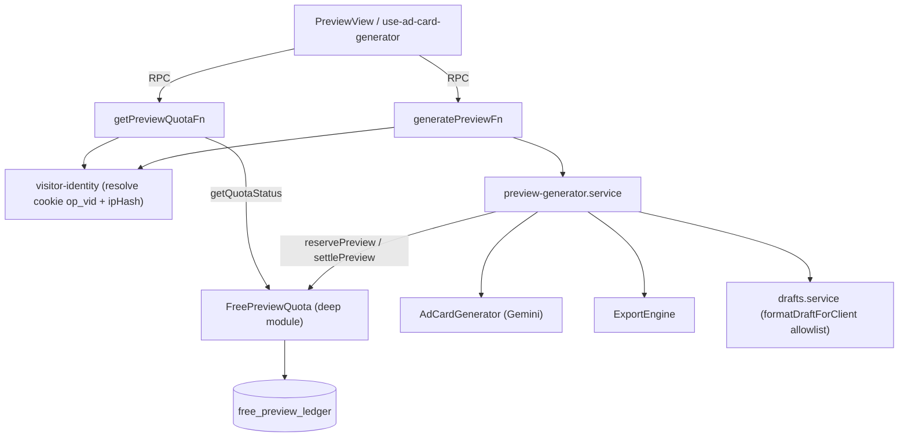
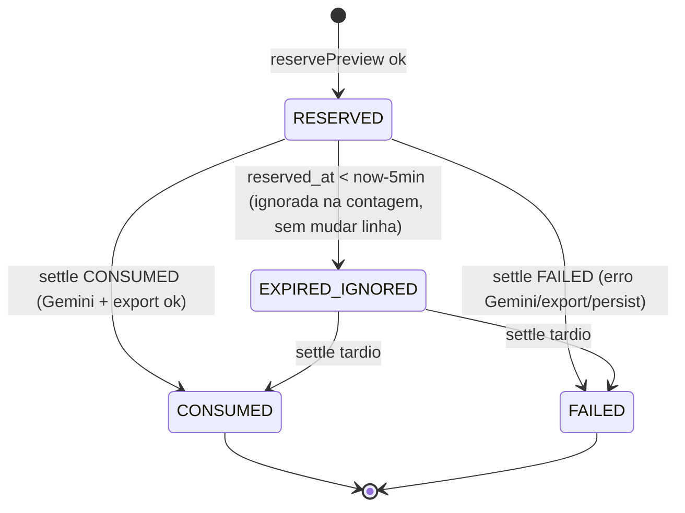
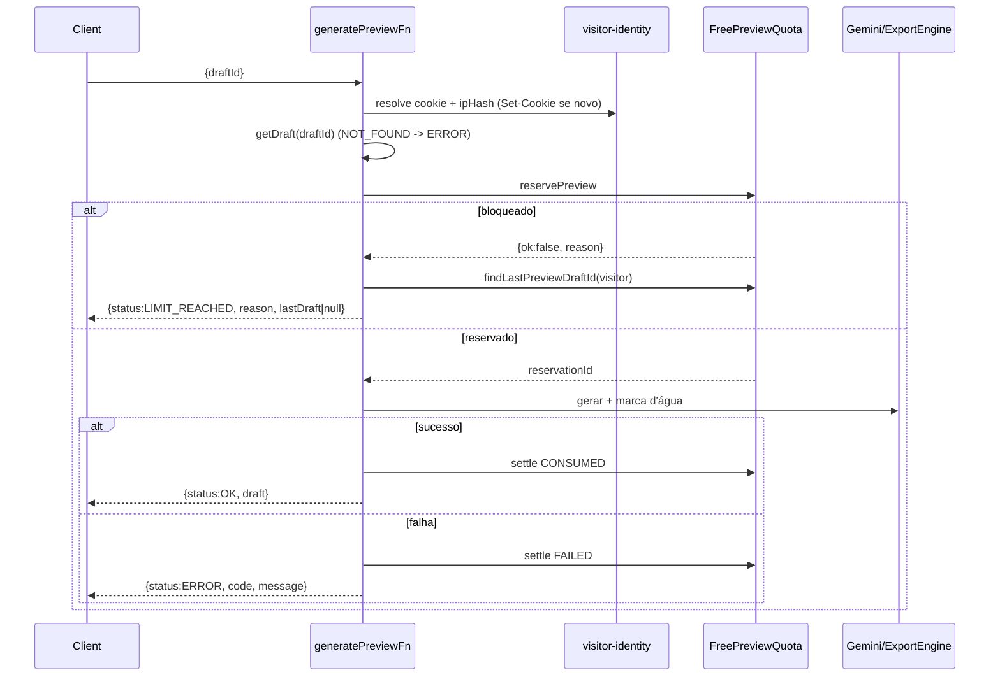

# Plano Técnico — Limites de Prévia Grátis (`free-preview-limits`)

- **Spec**: [docs/specs/free-preview-limits.md](../specs/free-preview-limits.md)
- **Tickets (paralelos, sem bloqueio)**: [01-backend-stream](../tickets/free-preview-limits/01-backend-stream.md) · [02-frontend-stream](../tickets/free-preview-limits/02-frontend-stream.md)
- **Branch/worktree**: `feat/free-preview-limits` / `.worktrees/free-preview-limits`

## 1. Decisões das questões em aberto

| Questão                                          | Decisão                                                                                                                                                                                                                                                                                                                                                              | Justificativa                                                                                                                                                                                                                                                                                                                                                                                                            |
| ------------------------------------------------ | -------------------------------------------------------------------------------------------------------------------------------------------------------------------------------------------------------------------------------------------------------------------------------------------------------------------------------------------------------------------- | ------------------------------------------------------------------------------------------------------------------------------------------------------------------------------------------------------------------------------------------------------------------------------------------------------------------------------------------------------------------------------------------------------------------------ |
| Dia do teto global (`FREE_PREVIEW_DAILY_BUDGET`) | **Dia civil em `America/Sao_Paulo`** (reset 00:00 BRT). Visitante e IP continuam em **janela móvel de 24h**.                                                                                                                                                                                                                                                         | O teto é orçamento de custo diário e a UI diz "volte amanhã"; dia civil BRT é previsível para o operador (compara com a fatura/dashboard) e para o usuário. Janela móvel no global daria "amanhã" ambíguo. Custo: pico à meia-noite, aceitável (teto ≤ 300). Implementação: `date_trunc('day', now() AT TIME ZONE 'America/Sao_Paulo')` convertido de volta a timestamptz, calculado em SQL; `now` injetável nos testes. |
| Reservas `RESERVED` órfãs                        | **Expiração preguiçosa de 5 min, sem cron/job.** Uma linha `RESERVED` só conta nos limites se `reserved_at > now - 5min`. Linhas expiradas são ignoradas (e podem ser apagadas oportunisticamente na mesma transação de `reserve`). Um `settle` tardio sobre uma reserva ainda `RESERVED` é aceito (sucesso tardio vira `CONSUMED`, que conta; falha vira `FAILED`). | YAGNI: sem scheduler, a cota se auto-cura. O timeout do Gemini deve ser < 5 min (verificar no `ai-card-generator`; se não houver, `AbortSignal.timeout(120s)`). `settle` é idempotente: só transita a partir de `RESERVED`.                                                                                                                                                                                              |

## 2. Arquitetura



- **`FreePreviewQuota`** (`src/features/promotions/server/services/free-preview-quota.service.ts`): único módulo que conhece limites, janelas, ordem de checagem e locking. Chamadores só veem 3 funções. Dependência: `db` (Drizzle/Postgres). **Seam**: a própria interface pública; testes usam o Postgres de teste (padrão do repo) ou fake in-memory, com `now` injetável. Sem porta para Postgres (um adaptador só).
- **Teste de deleção**: apagar o módulo espalharia por `generatePreviewFn`, `getPreviewQuotaFn` e testes: janelas, ordem global→IP→visitante, lock, expiração, mapeamento de razão. Ganha o lugar.
- **`visitor-identity.ts`** (funções puras + leitura de request): `signVisitorId/verifyVisitorId`, `hashIp`, `resolveClientIp(headers)`. Fica separado porque é testável sem DB e não conhece cota.

### Interface pública (`FreePreviewQuota`)

```ts
type BlockedReason = "visitor" | "ip" | "global";
reservePreview(input: { visitorId: string; ipHash: string; draftId: string; now?: Date }):
  Promise<{ ok: true; reservationId: string } | { ok: false; reason: BlockedReason }>;
settlePreview(reservationId: string, outcome: "CONSUMED" | "FAILED", now?: Date): Promise<void>;
getQuotaStatus(input: { visitorId: string; ipHash: string; now?: Date }):
  Promise<{ remaining: number; blockedReason: BlockedReason | null }>;
// auxiliar interno exportado p/ o integrador:
findLastPreviewDraftId(input: { visitorId: string }): Promise<string | null>; // ledger CONSUMED mais recente
```

Limites: visitante 2/24h, IP 6/24h, global `FREE_PREVIEW_DAILY_BUDGET` (padrão 300)/dia BRT. `remaining = min(visitante restante, IP restante)` (≥0); se global esgotado → `remaining 0`, `blockedReason "global"`. Ordem de precedência na razão: **global → ip → visitor**. Contam `CONSUMED` + `RESERVED` não expiradas; `FAILED` não conta.

## 3. Schema Drizzle (`src/server/db/schema/promotions.ts` ou novo `free-preview.ts` exportado no `index.ts`)

`free_preview_ledger`:

| coluna        | tipo                                                                                  |
| ------------- | ------------------------------------------------------------------------------------- |
| `id`          | `text` PK (uuid gerado no service)                                                    |
| `visitor_id`  | `text` not null (uuid do cookie)                                                      |
| `ip_hash`     | `text` not null (hex HMAC-SHA256)                                                     |
| `draft_id`    | `text` not null (sem FK rígida: drafts podem ser limpos; ledger é histórico de custo) |
| `status`      | `text` not null: `RESERVED` \| `CONSUMED` \| `FAILED` (check constraint)              |
| `reserved_at` | `timestamptz` not null default now                                                    |
| `settled_at`  | `timestamptz` null                                                                    |

Índices: `(visitor_id, reserved_at)`, `(ip_hash, reserved_at)`, `(reserved_at)` (global/dia), `(visitor_id, status, reserved_at desc)` para `lastDraft`. Migração via `pnpm db:generate && pnpm db:migrate` na worktree.



## 4. Atomicidade

`reservePreview` roda em **uma transação**: `SELECT pg_advisory_xact_lock(hashtext('free_preview_quota'))` (lock global único: volume baixo, teto ≤ centenas/dia, simples e evita deadlock; sem locks por chave) → conta global → IP → visitante (na ordem) → `INSERT ... RESERVED`. O lock é liberado no commit/rollback. Teste de concorrência: N `reservePreview` paralelos com 1 vaga → exatamente 1 `ok`. `settlePreview`: `UPDATE ... SET status, settled_at WHERE id=$1 AND status='RESERVED'` (idempotente). O `generatePreview` usa `try/finally`: qualquer exceção após reservar → `settle FAILED`.

## 5. Identidade do visitante

**Cookie `op_vid`**: valor `"<uuidv4>.<base64url(HMAC-SHA256(secret, uuid))>"`. Flags: `HttpOnly; Secure` (em produção; `Secure` desligado só em `NODE_ENV!=production`); `SameSite=Lax; Path=/; Max-Age=31536000` (1 ano). Verificação com `timingSafeEqual`. Ausente/inválido → novo uuid + `Set-Cookie` (via `setCookie` de `@tanstack/react-start/server`). Limpar o cookie só reseta o limite de visitante; IP e global continuam (defesa em profundidade).
**Segredo**: `FREE_PREVIEW_COOKIE_SECRET` (Zod, `min(32)`; em produção obrigatório, em dev/test default determinístico explícito). **Rotação**: aceitar opcional `FREE_PREVIEW_COOKIE_SECRET_PREVIOUS` na verificação (assinatura nova sempre com o atual); remover o anterior após ~1 ano. Sem versionamento no cookie (YAGNI).
**IP confiável**: `resolveClientIp(headers)`: prefere `cf-connecting-ip`; senão o **primeiro** IP de `x-forwarded-for` quando `TRUSTED_PROXY=true` (env booleano, default `false`); senão IP do socket/`x-real-ip` se disponível; se nenhum → bucket `"unknown"` (conta no limite de IP, nunca isenta). Assume deploy atrás de Cloudflare/proxy que sobrescreve esses headers; sem proxy confiável, headers de cliente seriam forjáveis, daí a flag. IPv6: normalizar para o prefixo `/64`. **Hash**: `HMAC-SHA256(FREE_PREVIEW_IP_SALT, ip)` hex; nunca persistir/logar IP cru. `FREE_PREVIEW_IP_SALT` em Zod `min(16)`; pode reutilizar o mesmo segredo do cookie com prefixo de domínio (`"ip:"+ip`) para reduzir envs — **decisão: um só segredo `FREE_PREVIEW_SECRET`** (cookie usa `"vid:"+uuid`, IP usa `"ip:"+ip`); rotação do IP-hash apenas zera janelas de 24h (aceitável). Envs finais: `FREE_PREVIEW_SECRET`, `FREE_PREVIEW_SECRET_PREVIOUS?`, `FREE_PREVIEW_DAILY_BUDGET` (int>0, 300), `TRUSTED_PROXY` (bool, false).

## 6. Fluxo (sequência)



Regeneração pós-pagamento (`post-payment-regeneration.service.ts`) **não** é tocada nem consulta a cota. A reserva substitui `validateDraftQuota`; `aiGenerationCount` do draft passa a ser apenas informativo (mantém incremento atômico em `updateDraftPreviewCard`); a regra "1 por draft" é preservada **adicionalmente** (draft com `aiGenerationCount>=1` não reserva nova cota: retorna `OK` com o draft existente? **Não**: retorna `LIMIT_REACHED` `reason:"visitor"` com `lastDraft` = o próprio draft, sem consumir ledger).

## 7. Contratos Zod CONGELADOS (`offer-brief.schema.ts`, isomórficos)

```ts
const blockedReasonSchema = z.enum(["visitor", "ip", "global"]);
export const draftClientDtoSchema = /* allowlist: ver §8 */;
export const generatePreviewOutputSchema = z.discriminatedUnion("status", [
  z.object({ status: z.literal("OK"), draft: draftClientDtoSchema }),
  z.object({ status: z.literal("LIMIT_REACHED"), reason: blockedReasonSchema,
             lastDraft: draftClientDtoSchema.nullable() }),
  // extensão compatível: preserva os erros existentes (NOT_FOUND, AI_GENERATION_FAILED, VALIDATION...)
  z.object({ status: z.literal("ERROR"), code: z.string(), message: z.string() }),
]);
export const getPreviewQuotaOutputSchema = z.object({
  remaining: z.number().int().min(0),
  blockedReason: blockedReasonSchema.nullable(),
});
```

`generatePreviewFn` input permanece `{ draftId }`; `getPreviewQuotaFn` sem input (identidade vem de cookie/headers). Validar a saída com `.parse` no handler. A variante `ERROR` é o único acréscimo ao contrato pedido (necessária: `NOT_FOUND`/falha de IA hoje usam `success:false`, e `LIMIT_REACHED` não deve ser erro). O front trata `ERROR` como erro de UI.

## 8. DTO de saída do draft (P0)

`formatDraftForClient` passa a **montar objeto explícito** (allowlist), nunca `...draft`. Campos permitidos: `id`, `businessSegment`, `targetAspectRatio`, `businessName`, `offerTitle`, `promoPrice`, `originalPrice`, `callToAction`, `whatsapp`, `stylePresetId`, `customStyleInstructions`, `cardIntent`, `customIntentText`, `productImageDataUrl`, `referenceImageDataUrl`, `logoImageDataUrl` (URLs resolvidas), `previewCardImageUrl`, `aiGenerationCount`, `createdAt`, `updatedAt`. **Excluídos**: `cleanMasterImageDataUrl`, `cleanMasterAssetKey`, `previewAssetKey`, `productAssetKey`, `referenceAssetKey`, `logoAssetKey`. Tipo `DraftClientDto = z.infer<typeof draftClientDtoSchema>`; `OfferDraft` (linha do banco) permanece interno. `getDraftFn`, `saveDraftFn` e `generatePreviewFn` validam a saída com `draftClientDtoSchema`.
`saveOfferDraftSchema` fica `.strict()`-like para esses campos: remove `cleanMasterImageDataUrl`, `cleanMasterAssetKey`, `previewCardImageUrl`, `previewAssetKey` (rejeita se presentes). `saveOfferDraft` (update) não toca nos server-only. `pix-checkout.service.ts` lê `previewCardImageUrl`/master do banco (verificar que não usa payload do cliente).

## 9. Compatibilidade dos testes existentes

- `generator.functions.test.ts` e testes do `preview-generator.service` esperam `success/code`: migrar para `status`. `executeGeneratePreview(input, deps)` ganha `deps.quota?: Pick<FreePreviewQuota API>` e `deps.identity?: {visitorId, ipHash}` com defaults reais; testes injetam o ledger in-memory/DB de teste (replace-don't-layer, sem mock de módulo).
- `drafts.service.test.ts`: ajustar asserts de `formatDraftForClient` para a allowlist; novo caso sem `cleanMaster*`.
- `use-offer-brief-draft.test.ts`, `offer-brief-wizard.test.tsx`: mocks de `generatePreviewFn` com `{status:"OK",draft}`; `AI_QUOTA_EXCEEDED` → `LIMIT_REACHED`. `post-payment-regeneration.service(.test)` intocados (apenas confirmar que a suíte continua verde).
- `ai-quota-exceeded-alert.tsx`: reutilizado/adaptado como estado de limite (texto por `reason`).

## 10. Checklist de segurança e qualidade

- [ ] Reserva **antes** do Gemini; `FAILED` não consome; `try/finally` garante settle.
- [ ] Transação + `pg_advisory_xact_lock`; teste de concorrência.
- [ ] Cookie HMAC `timingSafeEqual`, `HttpOnly`, `Secure`, `SameSite=Lax`; segredo via Zod, nunca logado.
- [ ] IP nunca persistido/logado cru; headers de proxy só com `TRUSTED_PROXY`; `unknown` conta.
- [ ] Preço/cobrança permanecem autoritativos no backend; front não envia preço.
- [ ] Zod na entrada **e** saída em todas as server functions; zero `any`; sem supressões.
- [ ] Nenhum `cleanMaster*`/asset key no DTO; save não escreve server-only.
- [ ] Sem upstream sem timeout (< 5 min); regeneração paga não toca a cota.

## 11. TDD seams e escopo paralelo

**Backend (ticket 01)** — arquivos: `src/server/db/schema/{promotions|free-preview}.ts` + `index.ts`, `drizzle/*.sql`, `src/config/server-env.ts` (+`.env.example`), `.../services/free-preview-quota.service.ts(+.test)`, `.../services/visitor-identity.ts(+.test)`, `.../services/preview-generator.service.ts(+test)`, `.../services/drafts.service.ts(+test)`, `.../functions/generator.functions.ts(+test)` (+ `getPreviewQuotaFn`), `.../data/offer-brief.schema.ts`, `pix-checkout.service.ts` (verificação). Ordem TDD: quota (limites/janela/concorrência/FAILED) → identity → gerador (Gemini fake não chamado) → P0 DTO/save/checkout. Verificação: `pnpm vitest run <testes editados>` + `pnpm typecheck` (+ `pnpm db:generate && pnpm db:migrate`).

**Frontend (ticket 02)** — arquivos: `use-ad-card-generator`, `use-promotion-draft`/`use-offer-brief-draft.ts(+test)`, `offer-brief-wizard.tsx`, `ai-quota-exceeded-alert.tsx`, `LiveCardPreview`/`PreviewView`, tipos que referenciam `cleanMaster*`. Usa o contrato do §7 via stub tipado até integrar. Verificação: `pnpm vitest run <testes editados>` + `pnpm typecheck` + `./.agents/scripts/verify.sh --shadcn`.

Tickets: nenhum ajuste estrutural; apenas alinhar (ver notas anexas nos próprios tickets) à variante `ERROR`, às envs finais e à regra "draft já gerado → LIMIT_REACHED sem consumir ledger".
