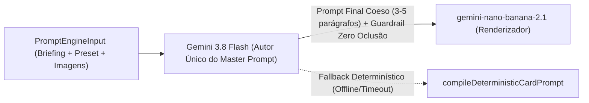

# Plano Técnico: Gemini 3.8 Flash como Autor Único do Prompt Final (`gemini38-master-prompt-author`)

## 1. Contexto e Motivação
A análise forense dos logs (`.server.log`, pedido `15c571e8-834c-49d8-bd0c-37833a742df6`) e o protótipo validado pelo usuário demonstraram que:
1. O motor anterior usava o `gemini-3.8-flash` apenas para preencher um micro-JSON de 4 campos e o enterrava dentro de ~8.800 caracteres de templates estáticos contraditórios em TypeScript.
2. O arquétipo `split-editorial` sobrescrevia presets gastronômicos (`rustic-wood`) para `clean-minimal` (estética de revista de moda) e exigia *"separação física em duas zonas verticais"*, gerando cards divididos ao meio por paredes chapadas e fontes retas sem expressão.
3. Ofertas sem preço (`promoPrice: ""`) sofriam degradação estética para *"selo institucional discreto"*.
4. Na regeneração em modo `RECOMPOSE`, o envio de `baseCardImageDataUrl` como `inlineData` para o `gemini-nano-banana-2.1` travava a estrutura espacial nos pixels da imagem anterior (impedindo centralizar o produto).
5. Quando o **`gemini-3.8-flash` assume 100% da autoria do prompt final de Direção de Arte** (com `maxOutputTokens: 4096` e `thinkingLevel: "low"`), o `gemini-nano-banana-2.1` produz peças publicitárias de nível de agência com cena 3D contínua (full-bleed), *food/product styling* hiper-realista, lettering multi-estilo expressivo, *micro-copy* de atributos sensoriais (`•`) e selo de CTA com textura gráfica real (*grunge brush stroke* / carimbo).

---

## 2. Arquitetura Proposta (Deep Module `src/server/prompt-engine`)

### 2.1. Mudanças nos Módulos

1. **`src/config/server-env.ts`**:
   - Alterar `GEMINI_DYNAMIC_PLANNER_ENABLED` para `.default(true)` para que a autoria dinâmica pelo `gemini-3.8-flash` esteja ativa por padrão em qualquer ambiente que possua `GEMINI_API_KEY`.

2. **`src/server/prompt-engine/types.ts`**:
   - Adicionar `DEFAULT_MASTER_PROMPT_TIMEOUT_MS = 25000` (mantendo `DEFAULT_DYNAMIC_PLANNER_TIMEOUT_MS = 8000` exportado para compatibilidade de superfície).
   - Adicionar campo opcional `authoredMasterPrompt?: string` em `DynamicCompositionBrief` para transportar o prompt integral redigido pelo `gemini-3.8-flash`.

3. **`src/server/prompt-engine/dynamic-planner.ts`**:
   - Implementar `buildMasterPromptAuthorContents(input: PromptEngineInput)` que instrui o `gemini-3.8-flash` a atuar como **Diretor de Arte Publicitário Sênior de Agência**, redigindo 100% do prompt visual final em português (3 a 5 parágrafos densos e coesos) para todos os 7 segmentos (`burger-shop`, `pizzeria`, `restaurant`, `supermarket`, `fashion`, `beauty-salon`, `local-retail`), contemplando:
     - **Cena Única Tridimensional Contínua (Full-Bleed, Proibido Divisão 50/50 Chapada)**: superfície contínua, sujeito Hero imponente, elementos de apoio em 1º plano (profundidade Z), fundo autêntico do segmento em bokeh (ex: luminária industrial quente, forno a lenha, boutique, salão) e zona de penumbra orgânica/texturizada para leitura limpa dos textos.
     - **Detalhamento Sensorial e *Food/Product Styling* Hiper-Realista**: descrição tátil específica do `offerTitle` anunciado (reação de Maillard, queijo derretendo, gergelim, ervas, sal grosso, gotículas, vapor, texturas reais de tecidos/produtos) com óptica 85mm f/2.0 e *rim light* dourada.
     - **Tipografia Publicitária Expressiva Multi-Estilo**:
       - Assinatura da marca no topo como emblema/insígnia artesanal com pequeno ícone temático desenhado à mão (ou preservação fiel do logotipo anexado);
       - Título principal quebrado combinando fontes contrastantes (display condensada robusta com leve textura + *lettering brush script* / caligráfico dinâmico inclinado nas palavras-chave de sabor/apelo em cor de destaque + conectores pintados à mão);
       - Linha curta de atributos sensoriais (*micro-copy* com 3 atributos em caixa alta separados por `•`, ex: `"ARTESANAL • SUCULENTO • CROCANTE"`);
       - Selo de CTA (`callToAction`) dentro de faixa com acabamento gráfico rico (pincelada rústica *grunge brush stroke*, carimbo ou fita vibrante com pequeno ícone temático);
       - Destaque de preço (`promoPrice` / `originalPrice`) em badge de alto impacto quando informado, ou supressão estrita de valores monetários/R$ quando vazio **mantendo 100% da agressividade promocional**.
     - **Modo `REFERENCE_DRIVEN`**: quando `isReferenceDrivenMode(input)` for `true`, instruir o `gemini-3.8-flash` a extrair 100% da paleta, iluminação, composição e tipografia da imagem de referência anexa, sem códigos HEX e sem nomes de presets externos.
   - Em `planDynamicCompositionBrief`:
     - Configurar `maxOutputTokens: 4096`, `temperature: 0.4`, `thinkingConfig: { thinkingLevel: "low" }` e timeout padrão `options?.timeoutMs ?? DEFAULT_MASTER_PROMPT_TIMEOUT_MS` (25s).
     - Se a resposta do modelo for um prompt completo em linguagem natural (não um JSON legado com `subjectAnatomy`), armazená-lo em `brief.authoredMasterPrompt` (aplicando `sanitizeTextForReferenceMode` se `isReferenceDrivenMode`). Se for um JSON legado (ex: mocks de testes unitários existentes), manter o parse JSON compatível.

4. **`src/server/prompt-engine/prompt-compiler.ts`**:
   - Em `compileDynamicCardPrompt`:
     - Se `brief.authoredMasterPrompt` estiver presente, compor o prompt final diretamente a partir do `brief.authoredMasterPrompt` redigido pelo `gemini-3.8-flash`, anexando os metadados essenciais garantidos (proporção `4:5` ou `9:16` com `SAFE ZONE OBRIGATÓRIA` de 15% para Story, diretrizes de anexos multimodais se houver logo/produto/referência, e `ZERO_TEXT_OCCLUSION_DIRECTIVE`).
     - Na edição (`input.baseCardImageDataUrl`):
       - Em modo `RECOMPOSE`, remover o envio de `baseCardImageDataUrl` como `inlineData` em `buildBaseCardMultimodalParts` quando o usuário busca reestruturar/centralizar o layout, evitando que o `gemini-nano-banana-2.1` fique ancorado aos pixels do layout dividido anterior (mantendo `logoImageDataUrl`, `productImageDataUrl` e `referenceImageDataUrl` se existirem). Em modo `SURGICAL`, continuar enviando `baseCardImageDataUrl` para preservação estrita.
       - Permitir que o `gemini-3.8-flash` também enriqueça a recomposição (`RECOMPOSE`) com instruções de cena contínua, centralização real do produto e tipografia expressiva.
