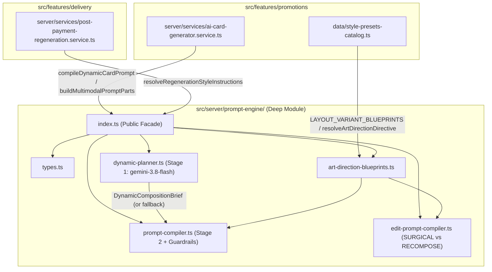
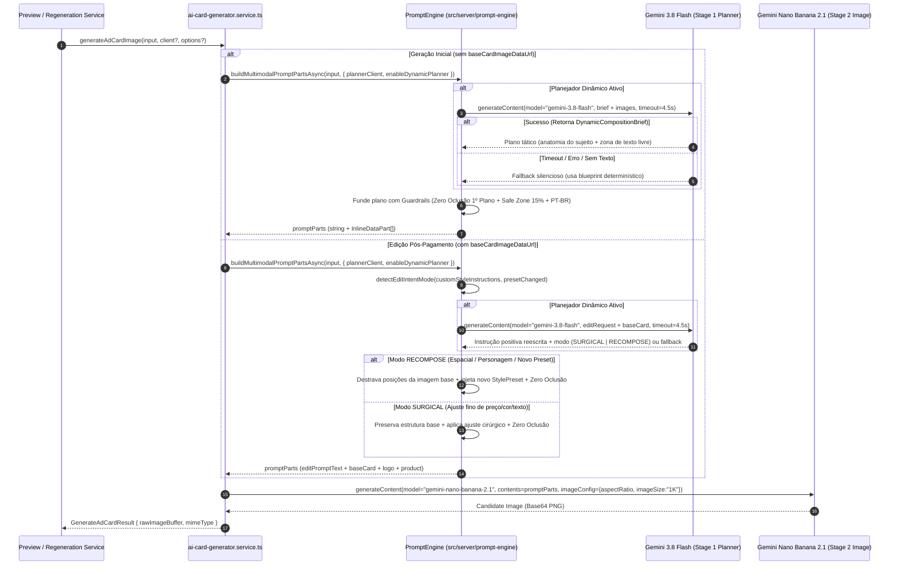
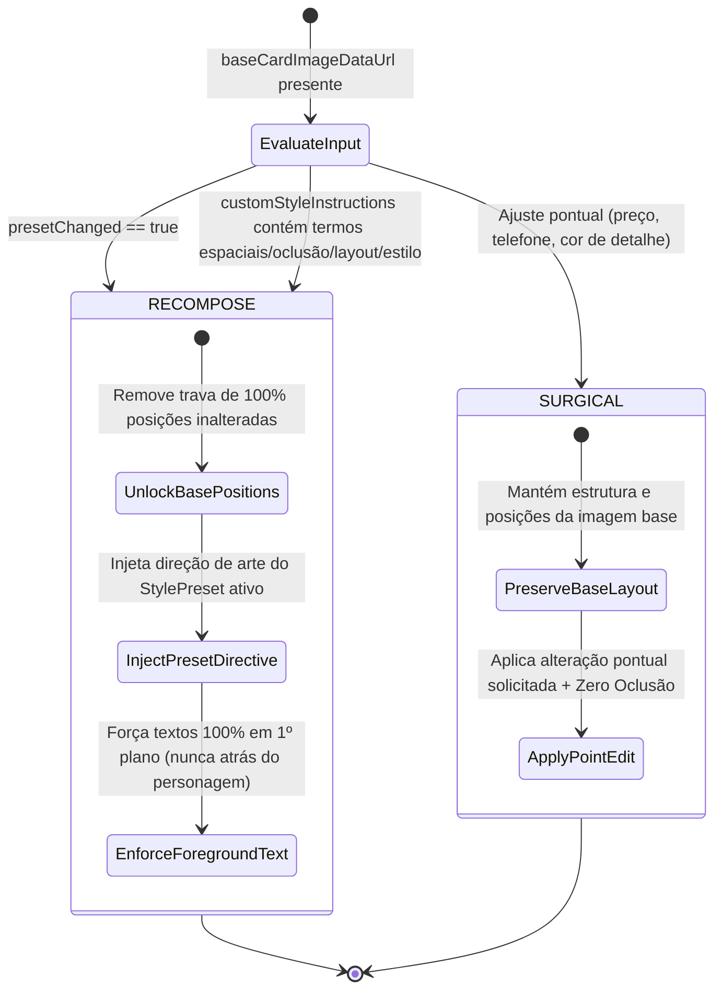

# Technical Plan: Motor de Prompt Dinâmico Híbrido e Centralização em Módulo Único (`PromptEngine`)

- **Slug**: `hybrid-dynamic-prompt-engine`
- **Product Spec**: [`docs/specs/hybrid-dynamic-prompt-engine.md`](../specs/hybrid-dynamic-prompt-engine.md)
- **Tickets & Execution Order**:
  1. [`docs/tickets/hybrid-dynamic-prompt-engine/01-decoupled-prompt-engine-and-hybrid-compiler.md`](../tickets/hybrid-dynamic-prompt-engine/01-decoupled-prompt-engine-and-hybrid-compiler.md) — **Stream 1**: Criação do Módulo Profundo `src/server/prompt-engine/` (Blueprints, Planejador Dinâmico Híbrido `gemini-3.8-flash`, Compilador com Zero Oclusão Tipográfica, Edição Adaptativa `SURGICAL` vs. `RECOMPOSE` e Testes Unitários).
  2. [`docs/tickets/hybrid-dynamic-prompt-engine/02-smart-regeneration-editing-and-service-integration.md`](../tickets/hybrid-dynamic-prompt-engine/02-smart-regeneration-editing-and-service-integration.md) — **Stream 2**: Refatoração e integração em `ai-card-generator.service.ts` e `post-payment-regeneration.service.ts` + testes de regressão e integração.

---

## 1. Decisões Arquiteturais Consolidadas (`/grill-me` & 4 Pilares)

1. **Módulo Profundo Único (`src/server/prompt-engine/`)**:
   - **100% da inteligência de prompts** (geração inicial determinística e híbrida, blueprints de direção de arte por segmento/layout/intenção, modo `REFERENCE_DRIVEN`, regra de **Zero Oclusão Tipográfica**, classificador de intenção de edição `SURGICAL` vs. `RECOMPOSE` e montagem de partes multimodais) passa a residir exclusivamente em `src/server/prompt-engine/`.
   - [`src/features/promotions/server/services/ai-card-generator.service.ts`](../../src/features/promotions/server/services/ai-card-generator.service.ts) atua apenas como orquestrador da chamada ao modelo de imagem (`gemini-nano-banana-2.1`) e tratamento de erros/extração de buffer, mantendo re-exports limpos para retrocompatibilidade.
   - [`src/features/delivery/server/services/post-payment-regeneration.service.ts`](../../src/features/delivery/server/services/post-payment-regeneration.service.ts) atua apenas como orquestrador de elegibilidade, cota (máx. 3 regenerações em 30 min) e persistência no PostgreSQL, delegando a resolução de instruções de regeneração ao `PromptEngine`.

2. **Pipeline Dinâmico Híbrido em 2 Etapas (Modelo Canônico `gemini-3.8-flash` + Fallback Determinístico)**:
   - **Regra Crítica do SDK Gemini (`gemini-api-dev`)**: Modelos `gemini-2.5-*`, `gemini-2.0-*` e `gemini-1.5-*` estão depreciados/descontinuados. A Etapa 1 utiliza obrigatoriamente **`gemini-3.8-flash`** (`export const DEFAULT_GEMINI_PROMPT_MODEL = "gemini-3.8-flash"`), configurável via variável de ambiente opcional `GEMINI_PROMPT_MODEL`.
   - **Etapa 1 (`planDynamicCompositionBrief`)**: Invoca `gemini-3.8-flash` com o resumo do `Offer Brief`, diretrizes do `StylePreset` e os insumos visuais (`Product Image` / `Reference Image`) para diagnosticar a anatomia do sujeito (ex.: pessoa/personagem vertical em card de inauguração vs. produto isolado de mesa) e o comprimento do título, retornando um plano tático conciso (`DynamicCompositionBrief`) que define o posicionamento do sujeito e a zona livre para tipografia.
   - **Etapa 2 (`compileInitialCardPrompt` / `compileDynamicCardPrompt`)**: Funde o plano dinâmico da Etapa 1 com os guardrails determinísticos obrigatórios:
     - **Invariante de Zero Oclusão Tipográfica (`FOREGROUND TEXT PRIORITY / ZERO TEXT OCCLUSION`)**: Proibição explícita de posicionar qualquer texto, título, preço ou selo atrás da cabeça, rosto, cabelo, corpo de personagens/pessoas ou produtos (`NEVER place text behind person/character/subject; 100% foreground z-index priority`).
     - **Guardrails de Negócio**: Fidelidade ortográfica PT-BR exata, Safe Zone de 15% no topo/base para `story` (`9:16`), supressão estrita de preço (`"R$ 0,00"` proibido) quando `promoPrice` for vazio, e isolamento estrito no modo `REFERENCE_DRIVEN` (zero códigos `#HEX` e zero nomes de presets externos quando `isReferenceDrivenMode(input) === true`).
   - **Fallback Determinístico Transparente**: Se a Etapa 1 exceder o timeout (default `4500ms`), sofrer erro de API ou receber resposta sem texto (ex.: fakes de teste de imagem), o motor cai silenciosamente para o compilador determinístico aprimorado sem interromper nem atrasar a geração.

3. **Edição Pós-Pagamento Adaptativa (`SURGICAL` vs. `RECOMPOSE`)**:
   - `detectEditIntentMode({ customStyleInstructions, presetChanged, hasReferenceOverride })` classifica a intenção do ajuste:
     - **`'RECOMPOSE'`**: Ativado quando o comerciante pede reposicionamento espacial, desobstrução de texto atrás de personagem, mudança de layout/estrutura/fundo/cenário ou quando troca o `stylePresetId` (`presetChanged === true`). Remove a trava _"Mantenha 100% da estrutura, faixas e posições da IMAGEM BASE rigorosamente inalterados"_, instrui a IA a **reposicionar livremente textos e elementos** colocando toda a tipografia em **1º plano absoluto (100% legível e sem oclusão)** e, se houver troca de preset, injeta a nova Diretriz de Direção de Arte (`resolveArtDirectionDirective`) do preset escolhido.
     - **`'SURGICAL'`**: Ativado para ajustes pontuais (ex.: corrigir preço, telefone, cor de detalhe como `"Mudar a logo para verde"`), mantendo os títulos e marcadores canônicos (`"EDIÇÃO CIRÚRGICA DE IMAGEM EXISTENTE"`, `"PRESERVAÇÃO ESTRITA"`, `"PROIBIDO REINVENTAR"`) combinados com a regra de Zero Oclusão Tipográfica.

---

## 2. Diagramas Arquiteturais (Mermaid)

### 2.1. Topologia do Módulo Profundo (`flowchart TD`)



### 2.2. Sequência do Pipeline Híbrido em 2 Etapas e Edição Adaptativa (`sequenceDiagram`)



### 2.3. Máquina de Decisão de Edição Pós-Compra (`stateDiagram-v2`)



---

## 3. Estrutura de Arquivos e Contratos TypeScript (`src/server/prompt-engine/`)

### 3.1. Árvore de Arquivos do Novo Módulo

```text
src/server/prompt-engine/
├── index.ts                      # Fachada pública única do módulo profundo
├── types.ts                      # Contratos TypeScript, constantes de modelo e interfaces
├── art-direction-blueprints.ts   # SEGMENT_ART_DIRECTIVES, buildReferenceDrivenArtDirective, isReferenceDrivenMode, re-exports seguros de style-presets-catalog
├── dynamic-planner.ts            # Etapa 1: Planejador Dinâmico via gemini-3.8-flash com timeout e fallback
├── prompt-compiler.ts            # Etapa 2: Compilador de 4 camadas + Zero Oclusão Tipográfica + partes multimodais
├── edit-prompt-compiler.ts       # detectEditIntentMode ('SURGICAL' | 'RECOMPOSE'), buildAdaptiveEditPromptText, resolveRegenerationStyleInstructions
└── prompt-engine.test.ts         # Suíte de testes unitários cobrindo 100% da superfície pública do PromptEngine
```

### 3.2. Contratos Exatos (`src/server/prompt-engine/types.ts`)

```ts
import type {
  BusinessSegment,
  CardAspectRatio,
  CardIntent,
} from "@/features/promotions/data/offer-brief.schema";

export const DEFAULT_GEMINI_PROMPT_MODEL = "gemini-3.8-flash";
export const DEFAULT_DYNAMIC_PLANNER_TIMEOUT_MS = 4500;

export type EditIntentMode = "SURGICAL" | "RECOMPOSE";

export interface InlineDataPart {
  inlineData: {
    mimeType: string;
    data: string;
  };
}

export interface PromptEngineInput {
  businessSegment: BusinessSegment;
  targetAspectRatio?: CardAspectRatio;
  businessName: string;
  offerTitle: string;
  promoPrice?: string | null;
  originalPrice?: string | null;
  callToAction?: string | null;
  whatsapp?: string | null;
  productImageDataUrl?: string | null;
  referenceImageDataUrl?: string | null;
  baseCardImageDataUrl?: string | null;
  stylePresetId?: string | null;
  customStyleInstructions?: string | null;
  logoImageDataUrl?: string | null;
  cardIntent?: CardIntent | null;
  customIntentText?: string | null;
}

export interface PromptPlannerResponseCandidate {
  finishReason?: string;
  content?: {
    parts?: Array<{
      text?: string;
      inlineData?: {
        mimeType?: string;
        data?: string;
      };
    }>;
  };
}

export interface PromptPlannerGenerateResponse {
  text?: string;
  candidates?: PromptPlannerResponseCandidate[];
}

export interface PromptPlannerClient {
  models: {
    generateContent(params: {
      model: string;
      contents: Array<string | InlineDataPart>;
      config?: Record<string, unknown>;
    }): Promise<PromptPlannerGenerateResponse>;
  };
}

export interface DynamicCompositionBrief {
  subjectAnatomy: string;
  safeTypographyZone: string;
  antiOcclusionStrategy: string;
  layoutAdaptation: string;
  source: "ai-dynamic" | "deterministic-fallback";
}

export interface DynamicPromptCompileOptions {
  client?: PromptPlannerClient;
  model?: string;
  timeoutMs?: number;
  enableDynamicPlanner?: boolean;
}

export interface DetectEditIntentInput {
  customStyleInstructions?: string | null;
  presetChanged?: boolean;
  hasReferenceOverride?: boolean;
}

export interface ResolveRegenerationInstructionsOptions {
  presetChanged?: boolean;
  newStylePresetId?: string | null;
}
```

### 3.3. Regra de Ouro de Anti-Oclusão Tipográfica (`Zero Text Occlusion`)

Em `src/server/prompt-engine/prompt-compiler.ts` e `src/server/prompt-engine/edit-prompt-compiler.ts`, todo prompt compilado (seja determinístico, híbrido ou de edição, incluindo `REFERENCE_DRIVEN`) DEVE injetar a diretriz de **Zero Oclusão Tipográfica** sem usar códigos `#HEX` (para preservar a invariante zero-HEX do modo `REFERENCE_DRIVEN`):

```ts
export const ZERO_TEXT_OCCLUSION_DIRECTIVE = [
  "--- REGRA INEGOCIÁVEL DE CAMADA E LEGIBILIDADE (ZERO OCLUSÃO TIPOGRÁFICA / 100% FOREGROUND TEXT PRIORITY) ---",
  "- PRIORIDADE ABSOLUTA DE 1º PLANO (TOP Z-INDEX / FOREGROUND LAYER): Todos os textos do anúncio (título principal, nome do estabelecimento, preço promocional, selos e chamada para ação) DEVEM ser renderizados estritamente na camada frontal superior (100% em primeiro plano).",
  "- PROIBIÇÃO DE TEXTO ATRÁS DO PERSONAGEM OU PRODUTO (NO TEXT BEHIND SUBJECT): É TERMINANTEMENTE PROIBIDO posicionar letras, palavras ou títulos atrás da cabeça, rosto, cabelo, ombros, corpo de pessoas/personagens/modelos ou atrás do produto anunciado. Nenhuma parte do sujeito pode cobrir, cortar ou ocultar caracteres do texto.",
  "- ZONA DE RESPIRO OU FAIXA DE CONTRASTE FRONTAL: Se a imagem contiver uma pessoa/personagem vertical ou produto alto, posicione o sujeito levemente deslocado ou enquadrado de forma que o título ocupe uma zona negativa limpa ou uma faixa/container gráfico sólido em 1º plano absoluto com leitura 100% desobstruída.",
].join("\n");
```

### 3.4. Classificador de Intenção de Edição (`src/server/prompt-engine/edit-prompt-compiler.ts`)

- **Marcador de Troca de Preset (`RECOMPOSE_PRESET_MARKER`)**:
  - Quando `resolveRegenerationStyleInstructions` recebe `options?.presetChanged === true`, anexa a instrução explícita: `"Reestruturar layout e estilo visual aplicando integralmente o novo preset selecionado"` (e se `presetChanged` for `false` ou omitido, mantém exatamente o formato `"${cleanOriginal}. Ajuste solicitado pelo cliente: ${combinedAdjustment}"` para 100% de compatibilidade com os testes existentes de `post-payment-regeneration.service.test.ts`).
- **Regex de Detecção `RECOMPOSE`**:
  ```ts
  const RECOMPOSE_INTENT_REGEX =
    /\b(atrás|atras|frente|personagem|pessoa|modelo|rosto|cabeça|cabeca|escondid\w*|cobrind\w*|cobert\w*|cortad\w*|sobrepon\w*|sobrepos\w*|posiç\w*|posic\w*|mover|mova|mude\s+o\s+lugar|mudar\s+de\s+lugar|colocar?\s+em\s+cima|colocar?\s+em\s+baixo|mais\s+para\s+(baixo|cima|esquerda|direita)|topo|rodapé|rodape|lado|esquerda|direita|layout|estrutura|reestrutur\w*|reorganiz\w*|reposicion\w*|trocar\s+(o\s+)?(estilo|fundo|cenário|cenario|layout)|mudar\s+(o\s+)?(estilo|fundo|cenário|cenario|layout)|novo\s+preset|afastar|separar|desobstru\w*|visível|visivel|legível|legivel|1º\s*plano|primeiro\s+plano)\b/i;
  ```
- **Comportamento de `buildAdaptiveEditPromptText(input, options)`**:
  - Quando `detectEditIntentMode(...) === "SURGICAL"`:
    - Mantém os cabeçalhos `"EDIÇÃO CIRÚRGICA DE IMAGEM EXISTENTE"`, `"PRESERVAÇÃO ESTRITA"` e `"PROIBIDO REINVENTAR"` exigidos pelos testes existentes, adicionando a seção `ZERO_TEXT_OCCLUSION_DIRECTIVE`.
  - Quando `detectEditIntentMode(...) === "RECOMPOSE"`:
    - Emite o cabeçalho `"RECOMPOSIÇÃO VISUAL E REESTRUTURAÇÃO DE LAYOUT DE CARD EXISTENTE (MODO RECOMPOSE)"`.
    - **Remove** a frase _"Mantenha 100% da estrutura, cenário, iluminação, produto anunciado, acompanhamentos, paleta de cores, tipografia, fontes, faixas e posições da IMAGEM BASE rigorosamente inalterados"_.
    - Instrui explicitamente: _"DESTRAVAMENTO ESPACIAL E DE ESTILO: Você está AUTORIZADO E OBRIGADO a alterar posições, reorganizar o grid/layout, corrigir textos encobertos e aplicar o novo estilo visual solicitado pelo cliente."_
    - Se `input.stylePresetId` estiver presente e não for `REFERENCE_DRIVEN`, injeta `resolveArtDirectionDirective(input.businessSegment, input.stylePresetId, ...)` para que a troca de preset na tela de entrega aplique de fato as cores, iluminação e tipografia do novo estilo.
    - Inclui `ZERO_TEXT_OCCLUSION_DIRECTIVE` exigindo que todo texto fique 100% visível na camada frontal (`100% foreground layer`), nunca atrás de personagens ou produtos.

### 3.5. Compatibilidade Estrita com `ai-card-generator.service.test.ts`

- Em `src/features/promotions/server/services/ai-card-generator.service.ts`:
  - `generateAdCardImage(input, client?, options?)`:
    - Quando `options?.enableDynamicPlanner === true` ou `options?.plannerClient` for fornecido (ou quando `client` não for um mock estático sem `options` e `serverEnv.GEMINI_DYNAMIC_PLANNER_ENABLED` estiver ativo), executa `compileDynamicCardPrompt` (Etapa 1 `gemini-3.8-flash` + Etapa 2).
    - **Invariante Crítica para Testes Legados**: Quando `generateAdCardImage(input, fakeClient)` é chamado com o 2º argumento `client` e **sem** `options?.enableDynamicPlanner` / `options?.plannerClient`, o serviço usa `buildMultimodalPromptParts(input)` síncrono na Etapa 2 para que os 22 testes unitários existentes em `ai-card-generator.service.test.ts` (que verificam `expect(fakeClient.generateContentSpy).toHaveBeenCalledTimes(1)` e inspecionam `mock.calls[0][0]`) continuem passando 100% sem regressão!
    - Novos testes em `prompt-engine.test.ts` e `ai-card-generator.service.test.ts` testam o fluxo assíncrono de 2 etapas tanto via `compileDynamicCardPrompt(input, { client })` quanto via `generateAdCardImage(input, fakeClient, { enableDynamicPlanner: true })`.

---

## 4. Security & Quality Checklist (4 Pilares)

- [x] **Isolamento Estrito Client/Server (`AGENTS.md` §4.2)**:
  - `src/server/prompt-engine/` é `[SERVER-ONLY]`.
  - `src/features/promotions/data/style-presets-catalog.ts` continua sendo seguro para importação no cliente (sem importar `@google/genai` nem `server-env.ts`). `src/server/prompt-engine/art-direction-blueprints.ts` importa de `style-presets-catalog.ts` (direção Server → Isomorphic Data), evitando qualquer vazamento de código server-only para o bundle React.
- [x] **Integridade de Negócio e Proteção de Custos (`AGENTS.md` §4.3)**:
  - A Etapa 1 (`gemini-3.8-flash`) usa um modelo de texto/visão ultrarrápido e de baixíssimo custo com `maxOutputTokens: 300` e timeout estrito de `4500ms`.
  - Na falha da Etapa 1, o fallback determinístico garante que o SLA de geração (< 90s) nunca seja comprometido.
  - Em caso de falha na Etapa 2 (`gemini-nano-banana-2.1`), `PostPaymentRegenerationService` mantém a invariante de não debitar `aiRegenerationCount`.
- [x] **Segurança e Validação na Fronteira (`AGENTS.md` §4.7)**:
  - Resposta textual da Etapa 1 (`gemini-3.8-flash`) é sanitizada e truncada (máx. 900 caracteres), removendo eventuais blocos markdown ou códigos `#HEX` indevidos quando em modo `REFERENCE_DRIVEN`.
  - Zero `any`, zero supressões de lint (`eslint-disable`, `@ts-ignore`).
- [x] **Deep Modules & TDD Seams (`codebase-design` & `ponytail`)**:
  - Interface pública enxuta em `src/server/prompt-engine/index.ts`.
  - Testes usam fakes in-memory simples implementando `PromptPlannerClient` e `GoogleGenAIClient` (_replace-don't-layer_).

---

## 5. TDD Seam Plan & Escopo dos Builders por Ticket

### Ticket 01 (`01-decoupled-prompt-engine-and-hybrid-compiler.md`) — `backend-builder`

- **Arquivos a Criar/Modificar**:
  - `src/config/server-env.ts` (adicionar opcional `GEMINI_PROMPT_MODEL: z.string().default("gemini-3.8-flash")` se aplicável, sem quebrar `parseServerEnv`)
  - `src/server/prompt-engine/types.ts`
  - `src/server/prompt-engine/art-direction-blueprints.ts`
  - `src/server/prompt-engine/dynamic-planner.ts`
  - `src/server/prompt-engine/prompt-compiler.ts`
  - `src/server/prompt-engine/edit-prompt-compiler.ts`
  - `src/server/prompt-engine/index.ts`
  - `src/server/prompt-engine/prompt-engine.test.ts`
- **Ciclo TDD Cirúrgico**:
  - Red → Green → Refactor executando exclusivamente:
    ```bash
    pnpm vitest run src/server/prompt-engine/prompt-engine.test.ts
    pnpm typecheck
    ```

### Ticket 02 (`02-smart-regeneration-editing-and-service-integration.md`) — `backend-builder`

- **Arquivos a Modificar**:
  - `src/features/promotions/server/services/ai-card-generator.service.ts` (delegar para `src/server/prompt-engine/`, manter re-exports e suportar `options?: GenerateAdCardOptions` com Etapa 1 + Etapa 2)
  - `src/features/promotions/server/services/ai-card-generator.service.test.ts` (adicionar testes de integração com `PromptEngine`, anti-oclusão de personagem e edição adaptativa `SURGICAL` vs. `RECOMPOSE`)
  - `src/features/delivery/server/services/post-payment-regeneration.service.ts` (delegar `resolveRegenerationStyleInstructions` ao `PromptEngine` detectando `presetChanged` quando `validated.stylePresetId` diferir de `snapshot.stylePresetId`)
  - `src/features/delivery/server/services/post-payment-regeneration.service.test.ts` (adicionar testes verificando destravamento `RECOMPOSE` ao trocar `stylePresetId` ou pedir ajuste espacial como _"não colocar o texto atrás do personagem"_)
- **Ciclo TDD Cirúrgico**:
  - Red → Green → Refactor executando exclusivamente:
    ```bash
    pnpm vitest run src/server/prompt-engine/prompt-engine.test.ts src/features/promotions/server/services/ai-card-generator.service.test.ts src/features/delivery/server/services/post-payment-regeneration.service.test.ts
    pnpm typecheck
    ```
