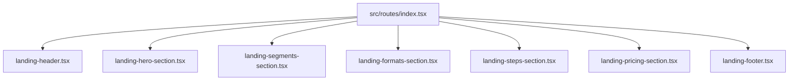

# Plano Técnico: Reformulação de Copy & CRO da Landing Page

- **Slug**: `landing-page-copy-revamp`
- **Autor**: Principal Solution Architect & Marketing Manager
- **Status**: Aprovado pelo Usuário
- **Worktree**: `/home/luis/repositories/OfertaPronta/.worktrees/landing-page-copy-revamp`
- **Especificação de Referência**: [docs/marketing/requests/landing-page-copy-revamp.md](file:///home/luis/repositories/OfertaPronta/.worktrees/landing-page-copy-revamp/docs/marketing/requests/landing-page-copy-revamp.md)

---

## 1. Visão Geral da Arquitetura & Diagnóstico de Engenharia

A Landing Page do **OfertaPronta** (`src/routes/index.tsx`) é composta por uma hierarquia de componentes compartilhados em `src/components/shared/landing-*.tsx`.

### 1.1. Desacoplamento de Catálogo & Eliminação de Vazamento de Estado Prematuro
- **Problema Técnico:** Atualmente, `landing-hero-section.tsx` e `landing-steps-section.tsx` importam `getDefaultCampaignPlan()` de `@/lib/campaign-catalog` exclusivamente para injetar `defaultPlan.formattedPrice` no botão principal do Hero (`Criar meu card agora (R$ 9,90 via Pix)`) e no Passo 3 (`Pague R$ 9,90 no Pix...`).
- **Decisão Arquitetural (Deep Module & Clean Interface):**
  1. Remover as chamadas a `getDefaultCampaignPlan()` de `landing-hero-section.tsx` e `landing-steps-section.tsx`. O Hero e a Seção de Passos tornam-se componentes puramente conceituais e focados em valor, sem acoplamento financeiro desnecessário.
  2. Concentrar a importação de `getDefaultCampaignPlan()` exclusivamente em `landing-pricing-section.tsx` (Seção de Preço & Oferta), onde os dados de plano e valores devem residir de forma canônica.

---

## 2. Mapa de Alterações por Componente

### 2.1. `src/components/shared/landing-hero-section.tsx`
- **Imports:** Remover `getDefaultCampaignPlan`. Manter `Badge`, `Button`, `Typography`, `Sparkles`, `Bolt`, `CheckCircle2`.
- **Badge Superior:** `"Feito para Donos de Mercado, Pizzaria, Salão e Comércio Local"`
- **Headline (`h1`):** `"Anúncios que vendem o seu produto hoje, sem perder horas no Canva nem pagar agência."`
- **Subtítulo (`lead`):** `"Digite o nome da oferta e o preço. Em 90 segundos, a IA entrega seu card profissional pronto para postar no WhatsApp e Instagram."`
- **CTA Principal:**
  - Texto: `"Gerar meu card grátis em 90 segundos"`
  - Link: `href="/criar"`
  - Ícone: `Bolt`
- **Micro-copy de Confiança:**
  - 1: `"Gere a prévia gratuitamente"`
  - 2: `"Sem cadastro demorado"`
  - 3: `"Pronto para Feed & Story"`

### 2.2. `src/components/shared/landing-steps-section.tsx`
- **Imports:** Remover `getDefaultCampaignPlan`.
- **Badge:** `"Simples do Início ao Fim"`
- **Título (`h2`):** `"Da sua ideia para o WhatsApp dos clientes em 3 passos"`
- **Subtítulo:** `"Tudo direto pelo celular, sem criar conta e sem mexer em ferramentas complicadas de edição."`
- **Passos:**
  - **Passo 1:**
    - Título: `"Descreva sua promoção"`
    - Descrição: `"Escolha o ramo do seu negócio, digite a oferta e o preço que vai anunciar."`
    - Conteúdo: `"Tem foto do produto no celular? Pode enviar junto. Se não tiver, a própria IA cria o cenário e a imagem para você."`
  - **Passo 2:**
    - Título: `"A IA monta o card na hora"`
    - Descrição: `"Em menos de 90 segundos, seu anúncio fica pronto com iluminação, cores e preço em destaque."`
    - Conteúdo: `"Você confere a prévia completa na tela gratuitamente antes de tomar qualquer decisão."`
  - **Passo 3:**
    - Título: `"Baixe em alta definição e poste"`
    - Descrição: `"Gostou do resultado? Libere os arquivos sem marca d'água e publique no WhatsApp e Instagram."`
    - Conteúdo: `"Você já recebe as duas versões prontas (Feed e Story) para mandar nos grupos e atrair pedidos no mesmo minuto."`

### 2.3. `src/components/shared/landing-pricing-section.tsx`
- **Imports:** Manter `getDefaultCampaignPlan`, `Card`, `Badge`, `Button`, `Typography`, `CheckCircle2`, `ShieldCheck`. Substituir `QrCode` por `Sparkles` no botão.
- **Badge:** `"Risco Zero: Teste Antes de Pagar"`
- **Título (`h2`):** `"Visual de agência por uma fração do que você gasta hoje"`
- **Subtítulo:** `"Uma agência cobra R$ 150 por arte avulsa e o Canva consome 2 horas da sua noite. Aqui você gera a prévia de graça e só paga se aprovar o resultado."`
- **Sufixo de Preço:** `"/ por campanha aprovada (Feed + Story)"`
- **Lista de Benefícios:**
  1. `"Você só paga depois de ver a prévia gerada com marca d'água"`
  2. `"Download imediato em altíssima definição: Feed (1080×1350) e Story (1080×1920)"`
  3. `\Até ${defaultPlan.maxPostPaymentRegenerations} regenerações por IA inclusas para ajustar detalhes\``
  4. `"Pagamento único via Pix, sem mensalidade e sem cadastrar cartão"`
- **CTA:**
  - Texto: `"Gerar minha prévia grátis agora"`
  - Ícone: `Sparkles`
- **Micro-copy de Segurança:** `"Zero compromisso: gere a prévia sem pagar nada • Liberação instantânea via Pix"`

### 2.4. `src/components/shared/landing-header.tsx`
- **CTA do Header:** Trocar `"Criar Card com IA"` por `"Gerar prévia grátis"`.

### 2.5. `src/components/shared/landing-segments-section.tsx`
- **Badge:** `"Feito para a Rotina do Comércio"`
- **Título (`h2`):** `"Pronto para o ritmo do seu balcão"`
- **Subtítulo:** `"Não importa se você vende quilo de alcatra, pizza grande ou corte de cabelo: a IA já conhece o visual que dá água na boca e atrai clientes no seu ramo."`
- **Cards de Segmento:**
  - Supermercados: `"Dia do hortifrúti, ofertas do açougue e encartes de fim de semana com preço bem visível."`
  - Salões & Barbearias: `"Combos de corte e barba, progressiva, manicure e promoções para encher a agenda da semana."`
  - Pizzarias: `"Foto de queijo derretendo, borda recheada e combo família com refrigerante para bombar o delivery."`
  - Hamburguerias: `"Smash burger na chapa, cheddar cremoso e combos com batata que dão fome só de olhar no celular."`
  - Restaurantes: `"Prato feito do dia, marmitex, executivo e cardápio de almoço pronto antes de abrir as portas."`
  - Comércio Local: `"Queima de estoque em lojas de roupa, banho e tosa em pet shop, óticas, farmácias e oficinas."`

### 2.6. `src/components/shared/landing-formats-section.tsx`
- **Badge:** `"2 Formatos Prontos de Uma Vez"`
- **Título (`h2`):** `"Uma única criação entrega o post do Feed e a tela cheia do Story"`
- **Subtítulo:** `"Nada de post cortado pela metade ou letra miúda que ninguém lê no celular. Você recebe os dois tamanhos certos para divulgar em todas as redes."`
- **Card Feed:**
  - Título: `"Post para Feed e Grupos"`
  - Descrição: `"Formato retrato que ocupa mais espaço na tela do celular e faz o cliente parar de rolar o Instagram."`
  - Rodapé: `"Ideal para fixar no perfil da loja e disparar nas listas de transmissão do WhatsApp."`
- **Card Story:**
  - Título: `"Story e Status com Espaço para Link"`
  - Descrição: `"Tela cheia vertical com espaço livre na parte de baixo para você colar a figurinha do link do seu WhatsApp."`
  - Rodapé: `"Perfeito para postar todo dia no Status do WhatsApp e nos Stories sem tampar o preço."`

### 2.7. `src/components/shared/landing-footer.tsx`
- **Descrição Institucional:** `"Anúncios profissionais gerados por IA para Instagram e WhatsApp em menos de 90 segundos. Gere a prévia grátis, sem cadastro e sem mensalidade."`

---

## 3. Estratégia de Testes (TDD & Regressão de Interface)

1. **Testes Unitários de Componente:**
   - Criar `src/components/shared/landing-sections.test.tsx` cobrindo a renderização de:
     - `LandingHeroSection`: verifica nova headline, ausência de menção a preço no CTA e presença dos selos de prévia gratuita.
     - `LandingStepsSection`: verifica os 3 passos simplificados e ausência de jargões técnicos.
     - `LandingPricingSection`: verifica o título com ancoragem de agência/Canva, reversão de risco no checklist e CTA de prévia grátis.
     - `LandingHeader`: verifica o botão de "Gerar prévia grátis".
   - Executar `src/components/shared/landing-footer.test.tsx` para assegurar que os testes de conformidade legal continuam passando.
2. **Typecheck & Linter Shadcn:**
   - `pnpm typecheck`
   - `./.agents/scripts/verify.sh --shadcn`
