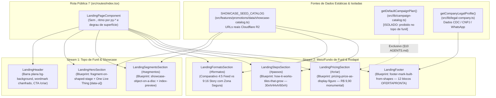
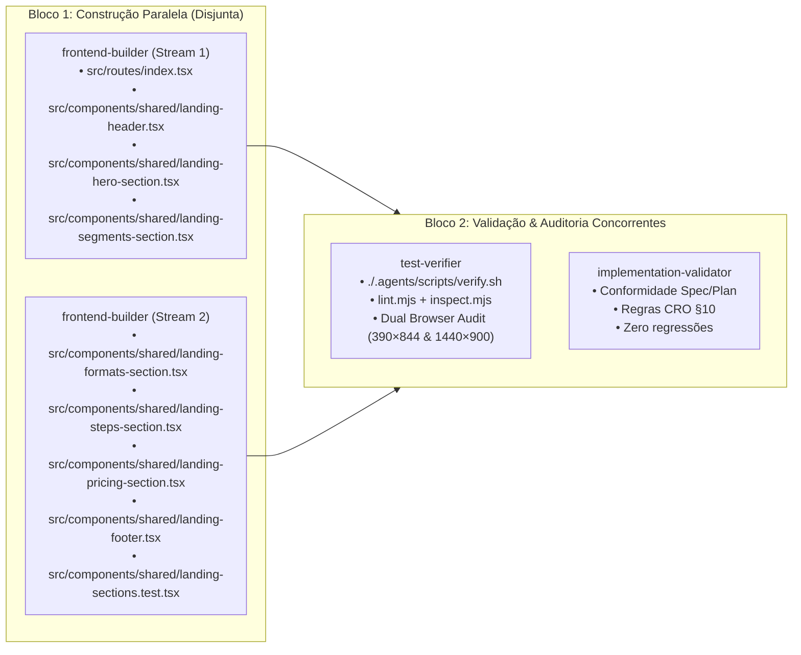

# Plano Técnico: Redesign Completo da Landing Page (`one-motif` — `design-taste-frontend`)

- **Slug**: `landing-page-taste-redesign`
- **Spec**: [`docs/specs/landing-page-taste-redesign.md`](../specs/landing-page-taste-redesign.md)
- **Tickets de Execução Paralela**:
  1. [`docs/tickets/landing-page-taste-redesign/01-hero-header-and-showcase-stream.md`](../tickets/landing-page-taste-redesign/01-hero-header-and-showcase-stream.md) — **Stream 1** (`index.tsx`, `landing-header.tsx`, `landing-hero-section.tsx`, `landing-segments-section.tsx`)
  2. [`docs/tickets/landing-page-taste-redesign/02-formats-steps-pricing-footer-stream.md`](../tickets/landing-page-taste-redesign/02-formats-steps-pricing-footer-stream.md) — **Stream 2** (`landing-formats-section.tsx`, `landing-steps-section.tsx`, `landing-pricing-section.tsx`, `landing-footer.tsx`, `landing-sections.test.tsx`)
- **Direção de Arte Canônica**: `.taste-skill/direction.json` (`seed: 1184189397`, `direction: "one-motif"`)

---

## 1. Topologia Arquitetural e Fluxo de Dados Estáticos

O redesign opera estritamente na camada de apresentação da rota pública `/` (`src/routes/index.tsx` e `src/components/shared/landing-*.tsx`), mantendo **zero chamadas de rede dinâmicas no carregamento inicial**, **desacoplamento estrito de catálogo de preço** (`AGENTS.md` §10) e **módulos profundos autocontidos**.



### Invariantes de Fronteira e Isolamento (`AGENTS.md` §10)
1. **Desacoplamento de Preço no Topo de Funil**: `LandingHeader`, `LandingHeroSection`, `LandingSegmentsSection`, `LandingFormatsSection` e `LandingStepsSection` **JAMAIS** importam `getDefaultCampaignPlan()` nem contêm as strings `"R$ 9,90"` (no contexto do preço do plano SaaS; preços fictícios de produtos dentro do simulador de oferta são permitidos apenas no card da oferta) ou `"via Pix"` nos botões de CTA.
2. **Fonte Canônica de Imagens Reais (`SHOWCASE_SEED_CATALOG`)**: Importar `SHOWCASE_SEED_CATALOG` de `@/features/promotions/data/showcase-catalog` (nota: o arquivo real no repositório é `src/features/promotions/data/showcase-catalog.ts`). Todas as imagens exibidas usam os assets reais hospedados no Cloudflare R2 (`https://pub-bb1f4a04aa2b49728b1eb1ac9ed6d7ff.r2.dev/showcase/...`), superando com folga o piso de 4 imagens reais auditado pelo `inspect.mjs`.

---

## 2. Contratos Técnicos e Geometria (`one-motif`)

### 2.1. O Motivo Geométrico Único (`The Chamfered Price Tag`)
Toda a identidade visual deriva da **etiqueta de oferta com canto chanfrado em 45° do comércio popular brasileiro**, aplicada em 4 escalas distintas via utilitários Tailwind arbitrary properties (`[clip-path:polygon(...)]`) ou `style={{ clipPath: ... }}`, **sem adicionar dependências externas**:

| Escala | Uso | Regra CSS / Tailwind (`clip-path`) |
| :--- | :--- | :--- |
| **Escala 1 — Palco Monumental (Hero & Showcase)** | Recorte de 72px no canto superior esquerdo do palco saturado (`bg-primary` `#c62828` ou `bg-card-subtle` `#faf2ec`) | `[clip-path:polygon(72px_0,100%_0,100%_100%,0_100%,0_72px)]` |
| **Escala 2 — Molduras de Cartazes e Blocos Crescentes** | Recorte de 28px no canto superior direito ou superior esquerdo dos tiles e cartazes | `[clip-path:polygon(0_0,calc(100%-28px)_0,100%_28px,100%_100%,0_100%)]` |
| **Escala 3 — Botões Primários e Etiquetas de Preço** | Recorte chanfrado de 14px no canto superior direito/inferior esquerdo | `[clip-path:polygon(0_0,calc(100%-14px)_0,100%_14px,100%_100%,14px_100%,0_calc(100%-14px))]` |
| **Escala 4 — Marcadores Inline e Símbolo do Wordmark** | Selo geométrico plano (12px–36px) com canto chanfrado de 8px | `[clip-path:polygon(8px_0,100%_0,100%_100%,0_100%,0_8px)]` |

### 2.2. Camada de Motion & Acessibilidade
- **Transições Explícitas**: Proibido `transition-all` ou `ease-in`. Usar exclusivamente:
  - `transition-[transform,opacity,background-color,color] duration-200 ease-out` em botões e controles interativos.
  - `transition-opacity duration-300 ease-out` na troca de cartazes do Showcase (`index-preview`) e do Simulador Ao Vivo do Hero.
- **Respeito a `prefers-reduced-motion`**: Adicionar `motion-reduce:transition-none motion-reduce:transform-none` em todos os elementos com transição.

---

## 3. Especificação Detalhada por Componente

### 3.1. `src/routes/index.tsx` (Stream 1)
- **Responsabilidade**: Compor a árvore vertical da Landing Page sem divisórias artificiais.
- **Mudanças Obrigatórias**:
  - Remover o import de `Separator` (`@/components/ui/separator`) e todas as instâncias de `<Separator />`.
  - Manter o wrapper raiz `<div className="flex min-h-svh flex-col bg-background text-foreground overflow-x-hidden">`.
  - Renderizar em ordem: `<LandingHeader />`, `<main className="flex-1">`, `<LandingHeroSection />`, `<LandingSegmentsSection />`, `<LandingFormatsSection />`, `<LandingStepsSection />`, `<LandingPricingSection />`, `</main>`, `<LandingFooter />`.

### 3.2. `src/components/shared/landing-header.tsx` (Stream 1)
- **Blueprint**: Barra superior plana (`bg-background`) a `28px` (`py-5 sm:py-7`) do topo, sem `border-b`, sem `backdrop-blur`, sem `shadow-*` e sem `animate-pulse`.
- **Estrutura e Contratos**:
  - Esquerda: Símbolo geométrico plano em `bg-primary text-primary-foreground` com canto chanfrado (`[clip-path:polygon(8px_0,100%_0,100%_100%,0_100%,0_8px)]`, sem `shadow-sm`) + `<Typography variant="h4" as="span" className="font-extrabold tracking-tight">Oferta<span className="text-primary">Pronta</span></Typography>`.
  - Centro/Direita (Desktop): 4 links planos de navegação em `15px` (`text-[15px] text-muted-foreground hover:text-foreground transition-colors`):
    - `<a href="#segmentos">Segmentos</a>`
    - `<a href="#formatos">Formatos</a>`
    - `<a href="#passos">Como funciona</a>`
    - `<a href="#criar">Preço</a>`
  - Direita: `<Button asChild size="sm">` plano e chanfrado (`rounded-none [clip-path:polygon(0_0,calc(100%-10px)_0,100%_10px,100%_100%,0_100%)] bg-primary text-primary-foreground hover:bg-primary-hover font-semibold transition-colors`):
    - `<a href="/criar">Gerar prévia grátis</a>` (Preserva o teste em `landing-sections.test.tsx`).

### 3.3. `src/components/shared/landing-hero-section.tsx` (Stream 1)
- **Blueprint**: `fragment-on-shaped-stage` + `One Live Thing` (`data-ui="hero-live-fragment"`).
- **Layout Grid Assimétrico (12 colunas)**:
  - **Coluna Esquerda (`lg:col-span-6`, alinhada à esquerda, nunca centralizada)**:
    - **Único `<h1>` da página**:
      ```tsx
      <Typography
        variant="h1"
        className="text-left text-[clamp(36px,4.8vw,68px)] font-extrabold leading-[1.04] tracking-[-0.03em] text-foreground mb-6"
      >
        Anúncios que vendem o seu produto hoje, sem perder horas no Canva nem pagar agência.
      </Typography>
      ```
    - **Subtítulo (`max-w-[40ch]`)**:
      ```tsx
      <Typography variant="lead" className="text-left text-base sm:text-[18px] leading-relaxed text-muted-foreground max-w-[40ch] mb-8">
        Digite o nome da oferta e o preço. Em 90 segundos, a IA entrega seu card profissional pronto para postar no WhatsApp e Instagram.
      </Typography>
      ```
    - **CTA Primário Único (Zero menção a R$ 9,90 ou Pix)**:
      - `<Button size="lg" asChild className="h-14 px-8 rounded-none [clip-path:polygon(0_0,calc(100%-14px)_0,100%_14px,100%_100%,14px_100%,0_calc(100%-14px))] bg-primary text-primary-foreground text-base font-bold hover:bg-primary-hover active:scale-[0.98] transition-[transform,background-color] duration-200 ease-out">`
      - `<a href="/criar">Gerar meu card grátis em 90 segundos</a>`
    - **Selos de Confiança e Nota Multisegmento (posicionados ABAIXO do CTA — zero eyebrow acima do H1)**:
      - Renderizar os 3 selos planos alinhados à esquerda:
        - `"Gere a prévia gratuitamente"`
        - `"Sem cadastro demorado"`
        - `"Pronto para Feed & Story"`
      - Renderizar a linha contextual exigida pelo teste (abaixo dos selos, nunca acima do `h1`):
        - `<Typography variant="muted" className="pt-4 text-left text-sm font-medium text-muted-foreground">Feito para Donos de Mercado, Pizzaria, Salão e Comércio Local</Typography>`
  - **Coluna Direita / Palco Chanfrado (`lg:col-span-6`, `bg-primary` `#c62828` com `[clip-path:polygon(72px_0,100%_0,100%_100%,0_100%,0_72px)]`)**:
    - O palco tem preenchimento interno de `p-4 pt-12 sm:p-10 sm:pt-14` e abriga o fragmento interativo real marcado com `data-ui="hero-live-fragment"`.
    - **O Simulador Ao Vivo de Balcão (`data-ui="hero-live-fragment"`)**:
      - Estado local React (`useState`) permitindo alternar entre 4 ofertas reais curadas do `SHOWCASE_SEED_CATALOG`:
        1. `seed-supermarket-03` (*Açougue / Carnes Nobres* — `R$ 54,90/kg`)
        2. `seed-pizzeria-01` (*Pizzaria / Terça em Dobro* — `R$ 59,90`)
        3. `seed-beauty-01` (*Barbearia / Corte & Barba* — `R$ 65,00`)
        4. `seed-burger-01` (*Hamburgueria / Smash Burger* — `R$ 29,90`)
      - E estado local para alternar a proporção ao vivo: `"feed"` (`Feed 4:5`) vs `"story"` (`Story 9:16`).
      - Todos os botões de seleção dentro do simulador utilizam `<Button type="button" variant="..." size="sm">` (respeitando `check_shadcn_usage.py`), exibindo a imagem real (``), o nome do estabelecimento (`activeItem.metadata?.businessName`) e a etiqueta chanfrada com o preço promocional (`activeItem.metadata?.promoPrice`).

### 3.4. `src/components/shared/landing-segments-section.tsx` (Stream 1)
- **Blueprint**: `showcase-object-on-a-disc` + `index-preview` (`id="segmentos"`).
- **Superfície e Espaçamento**: `bg-card-subtle` (`#faf2ec`), `py-20 lg:py-36 px-4 sm:px-8` (zero `border-y`, zero `<Card>`).
- **Dados dos 6 Segmentos (Mapeados para `SHOWCASE_SEED_CATALOG`)**:
  1. **Supermercados** (`seed-supermarket-01`): `"Dia do hortifrúti, ofertas do açougue e encartes de fim de semana com preço bem visível."`
  2. **Salões & Barbearias** (`seed-beauty-01`): `"Combos de corte e barba, progressiva, manicure e promoções para encher a agenda da semana."`
  3. **Pizzarias** (`seed-pizzeria-01`): `"Foto de queijo derretendo, borda recheada e combo família com refrigerante para bombar o delivery."`
  4. **Hamburguerias** (`seed-burger-01`): `"Smash burger na chapa, cheddar cremoso e combos com batata que dão fome só de olhar no celular."`
  5. **Restaurantes** (`seed-restaurant-01`): `"Prato feito do dia, marmitex, executivo e cardápio de almoço pronto antes de abrir as portas."`
  6. **Comércio Local** (`seed-retail-01`): `"Queima de estoque em lojas de roupa, banho e tosa em pet shop, óticas, farmácias e oficinas."`
- **Composição e Interatividade**:
  - Cabeçalho da seção alinhado à esquerda (zero eyebrow acima do `h2`):
    - `<Typography variant="h2" className="text-left text-[clamp(28px,3.2vw,44px)] font-bold tracking-tight mb-3">Pronto para o ritmo do seu balcão</Typography>`
    - `<Typography variant="muted" className="text-left max-w-xl text-base mb-2">Não importa se você vende quilo de alcatra, pizza grande ou corte de cabelo: a IA já conhece o visual que dá água na boca e atrai clientes no seu ramo.</Typography>`
    - `<Typography variant="muted" className="text-left text-sm font-semibold text-primary">Feito para a Rotina do Comércio</Typography>` (posicionado abaixo do subtítulo, preservando o texto exato do teste sem ser eyebrow).
  - **Lista Index Interativa (Colunas 1–6)** + **Palco Chanfrado com Card Real (Colunas 7–12)**:
    - Estado `activeIndex` (`useState(0)`).
    - Cada um dos 6 segmentos é acionável via `<Button type="button" variant="ghost">` (em escala display `text-[clamp(24px,2.8vw,40px)] font-extrabold leading-[1.15] h-auto py-2 px-0 justify-start hover:bg-transparent`) que atualiza `activeIndex` no `onClick` e `onMouseEnter`.
    - O item ativo tem `text-foreground opacity-100`; os inativos têm `text-foreground opacity-25 hover:opacity-60 transition-opacity duration-200`.
    - **Importante para SEO, Mobile e Testes (`landing-sections.test.tsx`)**: Todas as 6 descrições de balcão permanecem renderizadas no DOM dentro de cada item (com o item ativo exibindo sua descrição em destaque `opacity-100` e os demais mantendo o texto acessível no DOM).
    - À direita (e acima/integrado no mobile), o palco geométrico chanfrado (`[clip-path:polygon(56px_0,100%_0,100%_100%,0_100%,0_56px)] bg-primary/12`) exibe a imagem real do `SHOWCASE_SEED_CATALOG` correspondente ao segmento selecionado, rompendo o topo do bloco chanfrado, acompanhada da etiqueta chanfrada de preço (`metadata.promoPrice`).

### 3.5. `src/components/shared/landing-formats-section.tsx` (Stream 2)
- **Seção (`id="formatos"`)**: Comparativo em escala real entre Feed (`4:5`) e Story (`9:16`) sobre `bg-background` (`#fff8f3`), `py-20 lg:py-36 px-4 sm:px-8`.
- **Zero `<Card>`, Zero `shadow-*`, Zero `border-dashed`, Zero Eyebrow**:
  - Cabeçalho alinhado à esquerda:
    - `<Typography variant="h2" className="text-left text-[clamp(28px,3.2vw,44px)] font-bold tracking-tight mb-3">Uma única criação entrega o post do Feed e a tela cheia do Story</Typography>`
    - `<Typography variant="muted" className="text-left max-w-xl text-base mb-2">Nada de post cortado pela metade ou letra miúda que ninguém lê no celular. Você recebe os dois tamanhos certos para divulgar em todas as redes.</Typography>`
    - `<Typography variant="muted" className="text-left text-sm font-semibold text-secondary">2 Formatos Prontos de Uma Vez</Typography>` (abaixo do subtítulo).
  - **2 Blocos Planos em Degrau de Tom (`bg-card-subtle` `#faf2ec` com recorte chanfrado `[clip-path:polygon(0_0,calc(100%-32px)_0,100%_32px,100%_100%,0_100%)]`)**:
    1. **Bloco Feed (Colunas 1–6)**:
       - Rótulos: `"Feed Retrato"` e `"1080 × 1350 px (4:5)"`.
       - Título (`<Typography variant="h3">`): `"Post para Feed e Grupos"`.
       - Descrição: `"Formato retrato que ocupa mais espaço na tela do celular e faz o cliente parar de rolar o Instagram."`
       - Palco Visual (`aspect-[4/5]`): Exibe imagem real do `SHOWCASE_SEED_CATALOG` (`seed-pizzeria-02.imageUrl`) recortada no motivo chanfrado, com legenda `"Arte para Feed"` e `"Tipografia comercial de alto impacto e selo de preço em destaque"`.
       - Rodapé do bloco: `"Ideal para fixar no perfil da loja e disparar nas listas de transmissão do WhatsApp."`
    2. **Bloco Story (Colunas 7–12)**:
       - Rótulos: `"Story & Status"` e `"1080 × 1920 px (9:16)"`.
       - Título (`<Typography variant="h3">`): `"Story e Status com Espaço para Link"`.
       - Descrição: `"Tela cheia vertical com espaço livre na parte de baixo para você colar a figurinha do link do seu WhatsApp."`
       - Palco Visual (`aspect-[9/16]`): Exibe imagem real do `SHOWCASE_SEED_CATALOG` (`seed-burger-02.imageUrl`) + faixa inferior plana em `bg-secondary text-secondary-foreground` indicando a zona segura para sticker de link (`"Arte para Story"` / `"Zona segura calibrada para sticker de pedido e mensagens"`).
       - Rodapé do bloco: `"Perfeito para postar todo dia no Status do WhatsApp e nos Stories sem tampar o preço."`

### 3.6. `src/components/shared/landing-steps-section.tsx` (Stream 2)
- **Blueprint**: `how-it-works-tiles-that-grow` (`id="passos"`).
- **Regras Estritas (`lint.mjs` + Testes)**:
  - **Zero numeração (`1`, `2`, `3` ou `01`, `02`, `03`)**: A ordem é comunicada exclusivamente pelo crescimento físico dos 3 blocos (`tiles`) alinhados pela base (`items-end`).
  - **Zero `border-y`**, **zero `<Card>`**, **zero jargões banidos** (`"placeholders"`, `"insumos visuais"`, `"PNGs"`).
- **Cabeçalho da Seção (posicionado acima dos dois primeiros tiles no desktop)**:
  - `<Typography variant="h2" className="text-left text-[clamp(28px,3.2vw,44px)] font-bold tracking-tight mb-3">Da sua ideia para o WhatsApp dos clientes em 3 passos</Typography>`
  - `<Typography variant="muted" className="text-left max-w-md text-base mb-2">Tudo direto pelo celular, sem criar conta e sem mexer em ferramentas complicadas de edição.</Typography>`
  - `<Typography variant="muted" className="text-left text-sm font-semibold text-primary">Simples do Início ao Fim</Typography>` (abaixo do subtítulo, nunca acima do `h2`).
- **Grid de 12 Colunas com 3 Blocos Crescentes Alinhados pela Base (`grid grid-cols-1 lg:grid-cols-12 gap-7 lg:gap-[10px] items-end`)**:
  1. **Tile 1 (`lg:col-span-3`)**:
     - Bloco visual plano (`min-h-[34vw] lg:min-h-[30vh] bg-card-subtle [clip-path:polygon(0_0,calc(100%-24px)_0,100%_24px,100%_100%,0_100%)] p-5 flex flex-col justify-between`): Mostra o briefing rápido ("Oferta: Alcatra Bovina • R$ 49,90") e miniatura de foto simples (`seed-supermarket-02.imageUrl`).
     - Texto **abaixo** do tile, alinhado à esquerda:
       - `<Typography variant="h3" className="text-[20px] font-bold mt-4">Descreva sua promoção</Typography>`
       - `<Typography variant="muted" className="text-base mt-1">Escolha o ramo do seu negócio, digite a oferta e o preço que vai anunciar.</Typography>`
       - `<Typography variant="muted" className="text-sm mt-2">Tem foto do produto no celular? Pode enviar junto. Se não tiver, a própria IA cria o cenário e a imagem para você.</Typography>`
  2. **Tile 2 (`lg:col-span-4`)**:
     - Bloco visual plano (`min-h-[46vw] lg:min-h-[44vh] bg-secondary/15 [clip-path:polygon(0_0,calc(100%-28px)_0,100%_28px,100%_100%,0_100%)] p-6 flex flex-col justify-between`): Mostra a arte sendo composta com iluminação comercial e etiqueta chanfrada (`seed-restaurant-02.imageUrl`).
     - Texto **abaixo** do tile, alinhado à esquerda:
       - `<Typography variant="h3" className="text-[20px] font-bold mt-4">A IA monta o card na hora</Typography>`
       - `<Typography variant="muted" className="text-base mt-1">Em menos de 90 segundos, seu anúncio fica pronto com iluminação, cores e preço em destaque.</Typography>`
       - `<Typography variant="muted" className="text-sm mt-2">Você confere a prévia completa na tela gratuitamente antes de tomar qualquer decisão.</Typography>`
  3. **Tile 3 (`lg:col-span-5`)**:
     - Bloco visual plano (`min-h-[62vw] lg:min-h-[60vh] bg-primary text-primary-foreground [clip-path:polygon(0_0,calc(100%-36px)_0,100%_36px,100%_100%,0_100%)] p-6 sm:p-8 flex flex-col justify-between`): Mostra o par finalizado em maior escala (`seed-burger-03.imageUrl` e `seed-pizzeria-03.imageUrl`) pronto para postar.
     - Texto **abaixo** do tile, alinhado à esquerda:
       - `<Typography variant="h3" className="text-[20px] font-bold mt-4">Baixe em alta definição e poste</Typography>`
       - `<Typography variant="muted" className="text-base mt-1">Gostou do resultado? Libere os arquivos sem marca d&apos;água e publique no WhatsApp e Instagram.</Typography>`
       - `<Typography variant="muted" className="text-sm mt-2">Você já recebe as duas versões prontas (Feed e Story) para mandar nos grupos e atrair pedidos no mesmo minuto.</Typography>`

### 3.7. `src/components/shared/landing-pricing-section.tsx` (Stream 2)
- **Blueprint**: `pricing-price-as-display-figure` (`id="criar"`).
- **Um Plano, Sem Card Emoldurado**:
  - Superfície plana `bg-card-subtle` (`#faf2ec`), `min-h-[80svh] flex items-center py-20 lg:py-36 px-4 sm:px-8` (zero `<Card>`, zero `shadow-*`, zero `border`).
  - Importa `getDefaultCampaignPlan()` de `@/lib/campaign-catalog`.
- **Grid de 12 Colunas (`max-w-6xl mx-auto w-full grid grid-cols-1 lg:grid-cols-12 gap-10 lg:gap-8 items-center`)**:
  - **Colunas 1–4 (`lg:col-span-4`, alinhadas ao topo/esquerda)**:
    - `<Typography variant="h2" className="text-left text-[clamp(28px,2.8vw,36px)] font-bold tracking-tight mb-4">Visual de agência por uma fração do que você gasta hoje</Typography>`
    - `<Typography variant="muted" className="text-left text-[17px] leading-relaxed mb-4">Uma agência cobra R$ 150 por arte avulsa e o Canva consome 2 horas da sua noite. Aqui você gera a prévia de graça e só paga se aprovar o resultado.</Typography>`
    - Nota de reversão de risco abaixo do parágrafo (sem eyebrow acima do `h2`):
      - `<div className="inline-flex items-center px-3 py-1.5 bg-secondary text-secondary-foreground [clip-path:polygon(0_0,calc(100%-10px)_0,100%_10px,100%_100%,0_100%)]"><Typography as="span" variant="muted" className="text-xs font-bold text-secondary-foreground">Risco Zero: Teste Antes de Pagar</Typography></div>`
  - **Colunas 6–12 (`lg:col-start-6 lg:col-span-7`, alinhadas à esquerda)**:
    - **Figura Tipográfica Monumental (`R$ 9,90`)**:
      - Container `relative inline-flex flex-wrap items-baseline gap-x-3 mb-8`:
      - Moeda elevada à cap-line: `<Typography as="span" variant="muted" className="text-[clamp(44px,6vw,88px)] font-extrabold leading-none text-foreground self-start mt-2">{defaultPlan.priceParts.currencySymbol}</Typography>`
      - Numerais monumentais (nota: usar `as="div"` ou `as="span"`, **nunca** `h1` para manter apenas 1 `h1` na página!):
        ```tsx
        <Typography
          as="span"
          variant="h2"
          className="text-[34vw] sm:text-[clamp(120px,16vw,220px)] font-black leading-[0.85] tracking-[-0.04em] text-primary"
        >
          {defaultPlan.priceParts.formattedDecimal}
        </Typography>
        ```
      - Selo chanfrado sobreposto a 10–15% do canto superior direito dos numerais (`absolute -top-3 right-0 translate-x-1/4 bg-foreground text-background px-3 py-1 [clip-path:polygon(8px_0,100%_0,100%_100%,0_100%,0_8px)]`): `"Feed + Story"`.
      - Período na linha de base:
        `<Typography as="span" variant="muted" className="text-base sm:text-[18px] font-medium text-muted-foreground">/ por campanha aprovada (Feed + Story)</Typography>`
    - **4 Linhas Planas de Benefícios Inclusos (alinhadas à margem esquerda da coluna 6, a `17px–18px`)**:
      1. `"Você só paga depois de ver a prévia gerada com marca d'água"`
      2. `"Download imediato em altíssima definição: Feed (1080×1350) e Story (1080×1920)"`
      3. `"Até {defaultPlan.maxPostPaymentRegenerations} regenerações por IA inclusas para ajustar detalhes"`
      4. `"Pagamento único via Pix, sem mensalidade e sem cadastrar cartão"`
    - **CTA Primário Chanfrado e Nota de Segurança**:
      - `<Button size="lg" asChild className="w-full sm:w-auto h-14 px-10 rounded-none [clip-path:polygon(0_0,calc(100%-14px)_0,100%_14px,100%_100%,14px_100%,0_calc(100%-14px))] bg-primary text-primary-foreground text-base font-bold hover:bg-primary-hover active:scale-[0.98] transition-[transform,background-color] duration-200 ease-out">`
      - `<a href="/criar">Gerar minha prévia grátis agora</a>`
      - `<Typography variant="muted" className="text-xs pt-3 text-left">Zero compromisso: gere a prévia sem pagar nada • Liberação instantânea via Pix</Typography>`

### 3.8. `src/components/shared/landing-footer.tsx` (Stream 2)
- **Blueprint**: `footer-mark-built-from-shapes`.
- **Regras Estritas (`lint.mjs` + `check_shadcn_usage.py` + `landing-footer.test.tsx`)**:
  - **Zero `border-t`**, **zero `<Separator />`**, **zero `<Card>`**, **zero `backdrop-blur`**, **zero `shadow-*`**, **zero `uppercase tracking-wider text-xs`**.
- **Estrutura**:
  1. **Construção em 12 Blocos Geométricos (`OFERTAPRONTA`)**:
     - No topo do rodapé (`bg-background` `#fff8f3` ou `bg-card-subtle` `#faf2ec`), uma fileira de 12 blocos sólidos (`grid grid-cols-6 sm:grid-cols-12 gap-[4px] items-end h-[22svh] sm:h-[30svh] w-full`, `aria-hidden="true"`) onde cada letra de `O-F-E-R-T-A-P-R-O-N-T-A` ocupa seu próprio bloco retangular/chanfrado em cores da paleta (`bg-primary`, `bg-foreground`, `bg-secondary`) com alturas variadas entre `62%` e `100%` alinhados pela base (`items-end`), com a letra vazada em `text-background font-black text-[clamp(28px,4.5vw,64px)] leading-none`.
  2. **Grid Institucional e Legal (56px abaixo — `pt-14`)**:
     - Colunas 1–5: Identidade (`OfertaPronta`), descrição institucional exata exigida pelo teste:
       `"Anúncios profissionais gerados por IA para Instagram e WhatsApp em menos de 90 segundos. Gere a prévia grátis, sem cadastro e sem mensalidade."`
       e selo `"Ambiente Seguro • Pix Dinâmico"`.
     - Colunas 6–8: Títulos de coluna em sentence-case (`font-bold text-sm text-foreground`, **sem** `uppercase tracking-wider text-xs`): `"Documentos Legais"` com links planos `<a href="/termos">Termos de Uso</a>` e `<a href="/privacidade">Política de Privacidade</a>`.
     - Colunas 9–12: `"Atendimento"` com link externo `<a href={profile.supportWhatsappUrl} target="_blank" rel="noopener noreferrer">Suporte WhatsApp</a>` e `<a href={`mailto:${profile.contactEmail}`}>{profile.contactEmail}</a>`.
  3. **Faixa Fiscal & Legal CDC (Plana, em degrau de superfície `bg-card-subtle p-4`, sem `border`)**:
     - Exibe `{profile.legalName} • CNPJ: {profile.cnpj} • {profile.addressCityState}` e `"Compra avulsa sob demanda • Entrega imediata"`, mais copyright `© 2026 {profile.tradeName}. Todos os direitos reservados.` e botão compacto chanfrado `<Button size="sm" asChild><a href="/criar">Criar oferta</a></Button>`.

---

## 4. Checklist de Segurança, Qualidade e Linters Obrigatórios

| Verificador | Regra / Invariante | Como Garantir 0 Erros |
| :--- | :--- | :--- |
| **`node /home/luis/.agents/skills/design-taste-frontend/scripts/lint.mjs`** | Zero `FAIL` e Zero `WARN` evitáveis | • Proibido `shadow`, `shadow-sm`, `shadow-md`, `drop-shadow` fora de `[data-ui]`<br>• Proibido `border-t`, `border-b`, `border-y`, `<hr>`, `<Separator />`, `divide-x/y`<br>• Proibido `backdrop-blur`<br>• Proibido `animate-pulse`, `animate-bounce`, `transition-all`, `ease-in`, `h-screen` (usar `min-h-svh`)<br>• Proibido `uppercase` + `tracking-wider` + `text-xs` juntos (`micro-label`)<br>• Proibido `01` / `02` / `03` (`numbering`)<br>• Proibido classes `eyebrow`, `kicker`, `overline`, `section-label` |
| **`./.agents/scripts/verify.sh --shadcn`** (`check_shadcn_usage.py`) | Zero tags HTML nativas substituíveis e zero cards manuais | • Nunca usar `<button>`, `<input>`, `<h1>..<h6>`, `<p>`, `<hr>` crus — usar sempre `<Button>` e `<Typography>` de `@/components/ui/`<br>• Nunca usar `<div className="... rounded ... border ... bg-card">` (Layer 3 warning)<br>• Nunca usar `<span className="... text-emerald-600">` sem `<Typography>` |
| **CRO & Anti-Atrito (`AGENTS.md` §10)** | Desacoplamento estrito de preço no topo de funil | • `LandingHeader`, `LandingHeroSection`, `LandingSegmentsSection`, `LandingFormatsSection`, `LandingStepsSection` não importam `getDefaultCampaignPlan()` |
| **Suíte Vitest Existente + Novos Testes** | 100% de compatibilidade regressiva + cobertura das interações novas | • Preservar todas as strings auditadas em `landing-sections.test.tsx` e `landing-footer.test.tsx`<br>• Adicionar testes para o Simulador Ao Vivo (`[data-ui="hero-live-fragment"]`) no Hero e troca de segmento ativo no Showcase |

---

## 5. Plano de Execução Paralela das 2 Macro-Streams

As duas streams possuem **fronteiras de arquivos 100% disjuntas** e podem ser despachadas simultaneamente (`parallel execution`) pelo `feature-orchestrator`:



### Escopo Exato por Stream e Comandos de Verificação Cirúrgica

#### Stream 1 — [`01-hero-header-and-showcase-stream.md`](../tickets/landing-page-taste-redesign/01-hero-header-and-showcase-stream.md)
- **Agente**: `frontend-builder`
- **Arquivos Exclusivos**:
  - `src/routes/index.tsx`
  - `src/components/shared/landing-header.tsx`
  - `src/components/shared/landing-hero-section.tsx`
  - `src/components/shared/landing-segments-section.tsx`
- **Comandos de Verificação no Builder**:
  ```bash
  node /home/luis/.agents/skills/design-taste-frontend/scripts/lint.mjs src/routes/index.tsx src/components/shared/landing-header.tsx src/components/shared/landing-hero-section.tsx src/components/shared/landing-segments-section.tsx
  ./.agents/scripts/verify.sh --shadcn
  pnpm vitest run src/components/shared/landing-sections.test.tsx
  pnpm typecheck
  ```

#### Stream 2 — [`02-formats-steps-pricing-footer-stream.md`](../tickets/landing-page-taste-redesign/02-formats-steps-pricing-footer-stream.md)
- **Agente**: `frontend-builder`
- **Arquivos Exclusivos**:
  - `src/components/shared/landing-formats-section.tsx`
  - `src/components/shared/landing-steps-section.tsx`
  - `src/components/shared/landing-pricing-section.tsx`
  - `src/components/shared/landing-footer.tsx`
  - `src/components/shared/landing-sections.test.tsx` (adição dos testes de interatividade do simulador do Hero e seleção de segmento no Showcase, além de validar toda a suíte)
- **Comandos de Verificação no Builder**:
  ```bash
  node /home/luis/.agents/skills/design-taste-frontend/scripts/lint.mjs src/components/shared/landing-formats-section.tsx src/components/shared/landing-steps-section.tsx src/components/shared/landing-pricing-section.tsx src/components/shared/landing-footer.tsx
  ./.agents/scripts/verify.sh --shadcn
  pnpm vitest run src/components/shared/landing-sections.test.tsx src/components/shared/landing-footer.test.tsx
  pnpm typecheck
  ```
