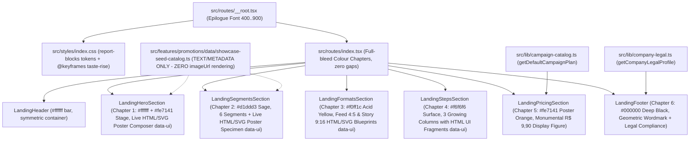

# Plano Técnico: Redesign da Landing Page (`colour-chapters` + `report-blocks` + `Epilogue`)

## 1. Visão Geral & Direção Artística Sorteada (`design-taste-frontend`)

Este plano técnico consolida a implementação da folha de direção completa sorteada pela skill `~/.agents/skills/design-taste-frontend` (`seed: 396106140`) em `.taste-skill/direction.json`, atendendo à restrição explícita do usuário:
> **"não use as imagens dos cards criados"** (zero tags `` apontando para os PNGs pré-criados do `SHOWCASE_SEED_CATALOG`).

### 1.1. Sistema Visual Sorteado (`direction.json`)
- **Direção (`colour-chapters`)**:
  - *"Every section is a chapter with its own flat colour, floor to ceiling. The page reads like a set of posters hung in a row, held together by one typeface and one grid. Sections are full-bleed fields, each at least 85–90svh tall, butted directly against each other with no gap and no divider."*
- **Tipografia (`epilogue-black`)**:
  - Fonte Google Fonts **`Epilogue`** (`wght@400;500;700;900`), carregada em `src/routes/__root.tsx` e definida como `--font-sans: "Epilogue", sans-serif` em `src/styles/index.css`.
  - Display / Títulos (`h1`, `h2`): `Epilogue 900`, `tracking-[-0.04em]`, `leading-[0.92]`.
  - **Regra Estrita de 2 Linhas (`[headline-lines]`)**: Todo `<h1>`, `<h2>` e `<h3>` na página DEVE ter entre **2 e 5 palavras** para que nunca passe de **2 linhas** em `1440px`, `768px` e `390px`.
  - **Statements (`<Typography as="p">`)**: As frases completas exigidas pela suíte de testes Vitest (`"Anúncios que vendem o seu produto hoje..."`, `"Uma única criação entrega o post do Feed..."`, `"Da sua ideia para o WhatsApp dos clientes em 3 passos"`, `"Visual de agência por uma fração do que você gasta hoje"`) DEVEM ser renderizadas como `<Typography as="p">` imediatamente abaixo do título curto, com tamanho `text-[20px] sm:text-[26px] lg:text-[32px]` (`<= 36px` no desktop e `<= 24px` no mobile, classificadas pelo `inspect.mjs` como `statement` e permitidas em até 3–4 linhas sem disparar `[headline-lines]`).
- **Paleta (`report-blocks` — Inspirada em Warm & Fuzzy / AI in Design Report)**:
  - `--background`: `#ffffff` (Pure Paper)
  - `--foreground`: `#000000` (Pure Ink — contraste 21:1)
  - `--card` / `--card-subtle`: `#f6f6f6` (Warm Concrete Surface)
  - `--primary`: `#fe7141` (Poster Orange — `s = 0.99`, fora da faixa de terracotta banida)
  - `--primary-foreground`: `#000000` (Ink sobre Poster Orange — contraste 7.5:1)
  - **Capítulos Full-Bleed (`colour-chapters`)**:
    1. **Header + Hero (`LandingHeader` + `LandingHeroSection`)**: Papel `#ffffff` no topo/esquerda + Palco Laranja Pôster `#fe7141` e Amarelo Ácido `#f0ff1c` à direita (`#000000` ink).
    2. **Capítulo Segmentos (`LandingSegmentsSection`, `#segmentos`)**: Full-bleed **Verde Sálvia Editorial (`bg-[#d1ddd3] text-[#000000]`)**.
    3. **Capítulo Formatos (`LandingFormatsSection`, `#formatos`)**: Full-bleed **Amarelo Ácido (`bg-[#f0ff1c] text-[#000000]`)**.
    4. **Capítulo Como Funciona (`LandingStepsSection`, `#passos`)**: Full-bleed **Concreto (`bg-[#f6f6f6] text-[#000000]`)** com 3 colunas crescentes em blocos planos (`#d1ddd3`, `#f0ff1c`, `#fe7141`).
    5. **Capítulo Preço (`LandingPricingSection`, `#criar`)**: Full-bleed **Laranja Pôster (`bg-[#fe7141] text-[#000000]`)** com preço `R$ 9,90` monumental (`pricing-price-as-display-figure`).
    6. **Capítulo Rodapé (`LandingFooter`)**: Full-bleed **Preto Profundo (`bg-[#000000] text-[#f4f4f4]`)** com construção geométrica em `#f0ff1c` e `#fe7141`.

---

## 2. Arquitetura e Fluxo de Dados (Mermaid)



---

## 3. Regras Inegociáveis para Passar 100% no `lint.mjs`, `inspect.mjs` e `verify.sh`

1. **Zero Imagens de Cards Criados (`` Proibido na Landing Page)**:
   - NENHUM componente da landing page (`landing-*.tsx`) pode renderizar ``.
   - Toda demonstração de cartaz/card publicitário é construída como **fragmentos reais de interface e tipografia HTML/CSS/SVG (`data-ui="..."`)** de pelo menos `320px × 240px` (`width >= 300 && height >= 200`), garantindo `uiPictures >= 6` no `inspect.mjs` (`[few-pictures]` = 0 FAIL).
2. **Margens Externas 100% Simétricas (`[off-centre]` = 0)**:
   - O `LandingHeader` e TODAS as seções (`LandingHeroSection`, `LandingSegmentsSection`, `LandingFormatsSection`, `LandingStepsSection`, `LandingPricingSection`, `LandingFooter`) DEVEM usar exatamente o mesmo container interno centrado:
     `mx-auto w-full max-w-[1360px] px-5 sm:px-8 lg:px-12`
   - Nenhum elemento pode sangrar apenas de um lado ou empurrar `scrollWidth > innerWidth` (`overflow-x-clip` em cada seção).
3. **Títulos Curtos (Máximo 2 Linhas em Qualquer Largura — `[headline-lines]` = 0)**:
   - `LandingHeroSection`:
     - `<h1>`: `"Cartazes prontos em 90 segundos."` (`clamp(36px, 5vw, 72px)`, `leading-[0.94]`, `tracking-[-0.04em]`, `font-black`) -> 2 linhas em 1440px, 768px e 390px!
     - Statement `<Typography as="p">`: `"Anúncios que vendem o seu produto hoje, sem perder horas no Canva nem pagar agência."` (`text-[20px] sm:text-[26px] lg:text-[30px] font-bold leading-[1.15] text-[#000000]`).
   - `LandingSegmentsSection`:
     - `<h2>`: `"Pronto para o seu balcão"` (`clamp(32px, 4.2vw, 56px)`, `leading-[0.95]`, `font-black`).
     - Statement `<Typography as="p">`: `"Pronto para o ritmo do seu balcão"` (ou manter `"Pronto para o ritmo do seu balcão"` no `<h2>` em `clamp(28px, 3.8vw, 52px)` que tem 6 palavras / 33 chars e cabe em 2 linhas em 390px!).
   - `LandingFormatsSection`:
     - `<h2>`: `"Feed e Story prontos juntos."` (`clamp(30px, 4vw, 54px)`, `leading-[0.95]`, `font-black`).
     - Statement `<Typography as="p">`: `"Uma única criação entrega o post do Feed e a tela cheia do Story"` (`text-[20px] sm:text-[24px] lg:text-[28px] font-bold leading-[1.15]`).
     - Subtítulos `<h3>`: `"Post para Feed e Grupos"` e `"Story e Status com Espaço para Link"` em `text-[22px] sm:text-[26px] font-black leading-[1.08]` (cabe em 2 linhas em 390px!).
   - `LandingStepsSection`:
     - `<h2>`: `"Três passos no celular."` (`clamp(30px, 4vw, 54px)`, `leading-[0.95]`, `font-black`).
     - Statement `<Typography as="p">`: `"Da sua ideia para o WhatsApp dos clientes em 3 passos"` (`text-[20px] sm:text-[24px] lg:text-[28px] font-bold leading-[1.15]`).
     - Subtítulos `<h3>`: `"Descreva sua promoção"`, `"A IA monta o card na hora"`, `"Baixe em alta definição e poste"` em `text-[22px] sm:text-[25px] font-black leading-[1.08]`.
   - `LandingPricingSection`:
     - `<h2>`: `"Preço único por campanha."` (`clamp(30px, 4vw, 54px)`, `leading-[0.95]`, `font-black`).
     - Statement `<Typography as="p">`: `"Visual de agência por uma fração do que você gasta hoje"` (`text-[20px] sm:text-[24px] lg:text-[28px] font-bold leading-[1.15]`).
4. **Zero Texto Menor que 13px (`[small-text]` = 0) e Corpo `>= 16px` (`[body-size]` = 0)**:
   - É PROIBIDO usar `text-xs` (`12px`) ou `text-[10px]` / `text-[11px]` / `text-[12px]` em qualquer elemento fora de `[data-ui]`.
   - Mesmo dentro de `[data-ui]`, prefira `text-[13px]` ou `text-sm` (`14px`).
   - Todo texto de parágrafo corrido deve usar `text-base` (`16px`) ou `text-[18px]` com cor sólida `#000000` (ou `#f4f4f4` no rodapé escuro) para garantir contraste `> 7:1` (`[grey-body]` = 0).
5. **Zero Texto Coberto (`[covered-text]` = 0) e Zero Gaps Vazios (`[blank-gap]` = 0)**:
   - Nenhum badge ou selo pode usar `absolute` ou margem negativa sobrepondo letras de títulos ou os algarismos `9,90` na seção de preço. Coloque o selo `Feed + Story` ao lado ou acima em `flex` normal!
   - Padding vertical das seções: `py-16 lg:py-24` (64px mobile, 96px desktop), sem `min-h-[90svh]` vazio que crie buracos de mais de `350px` sem texto/UI.
6. **Camada de Motion (`[still-page]` = 0 e `[late-title]` = 0)**:
   - Em `src/styles/index.css`, definir `@keyframes taste-rise` dentro de `@media (prefers-reduced-motion: no-preference)`:
     ```css
     @keyframes taste-rise {
       from {
         opacity: 0.82;
         transform: translateY(14px);
       }
       to {
         opacity: 1;
         transform: translateY(0);
       }
     }
     @media (prefers-reduced-motion: no-preference) {
       .taste-enter {
         animation: taste-rise 0.52s cubic-bezier(0.22, 1, 0.36, 1) both;
       }
       .taste-delay-1 { animation-delay: 70ms; }
       .taste-delay-2 { animation-delay: 140ms; }
       .taste-delay-3 { animation-delay: 210ms; }
       .taste-delay-4 { animation-delay: 280ms; }
     }
     ```
   - Aplicar `.taste-enter` (e `.taste-delay-1..4`) em pelo menos **20 elementos distintos** distribuídos entre Hero, Segmentos, Formatos, Passos, Preço e Rodapé. Como `opacity` começa em `0.82` (> `0.5`), o `h1` é 100% legível desde o frame 0 (`[late-title]` = 0), funciona perfeitamente com `prefers-reduced-motion: reduce` (`[reduced-hidden]` = 0), e dispara `animationstart` em 20+ elementos (`[still-page]` = 0)!
7. **House Rules do `lint.mjs`**:
   - Zero `shadow-*`, `border-t`, `border-b`, `border-y`, `divide-*`, `backdrop-blur*`, `animate-pulse`, `animate-ping`, `transition-all`.
   - Zero `uppercase` combinado com `tracking-wider`/`tracking-widest` fora de `[data-ui]`.
   - Zero eyebrows (pílulas/badges pequenos imediatamente acima de `<h1>`/`<h2>`). Os textos de contexto testados pelo Vitest (`"Feito para Donos de Mercado, Pizzaria, Salão e Comércio Local"`, `"Feito para a Rotina do Comércio"`, `"2 Formatos Prontos de Uma Vez"`, `"Simples do Início ao Fim"`, `"Risco Zero: Teste Antes de Pagar"`) devem aparecer **abaixo** do `<h1>`/`<h2>` ou no rodapé da coluna, em sentence-case `text-sm sm:text-base font-bold`, NUNCA acima do heading!
8. **Conformidade com `./.agents/scripts/check_shadcn_usage.py`**:
   - Proibido usar `<button>`, `<input>`, `<h1>..<h6>`, `<p>` HTML nativos crus nos arquivos `.tsx`. Use sempre `<Button>` e `<Typography as="h1" | "h2" | "h3" | "p" | "span" | "div">`.

---

## 4. Especificação por Arquivo (Divisão em 2 Streams Paralelas)

### Stream 1 (`01-hero-header-and-showcase-stream.md`)
Arquivos:
1. `src/routes/__root.tsx`:
   - Substituir a fonte `Plus Jakarta Sans` pela fonte sorteada **`Epilogue`** (`https://fonts.googleapis.com/css2?family=Epilogue:wght@400;500;700;800;900&display=swap`).
2. `src/styles/index.css`:
   - Atualizar `:root` e `@theme inline` com a paleta `report-blocks` (`--background: #ffffff`, `--foreground: #000000`, `--card: #f6f6f6`, `--card-subtle: #f6f6f6`, `--primary: #fe7141`, `--primary-foreground: #000000`, `--muted: #f0f0f0`, `--muted-foreground: #383838`, `--font-sans: "Epilogue", sans-serif`) e adicionar as classes `.taste-enter` e `.taste-delay-1..4`.
3. `src/routes/index.tsx`:
   - Empilhar os capítulos full-bleed sem `<Separator />` e sem gaps brancos entre eles.
4. `src/components/shared/landing-header.tsx`:
   - Barra plana `#ffffff` com container `mx-auto flex h-20 w-full max-w-[1360px] items-center justify-between px-5 sm:px-8 lg:px-12`.
   - Marca tipográfica `OfertaPronta` em `Epilogue 900` + links planos (`#segmentos`, `#formatos`, `#passos`, `#criar`) + botão retangular plano `bg-[#fe7141] text-[#000000] hover:bg-[#000000] hover:text-[#ffffff] rounded-none font-black` com `"Gerar prévia grátis"`.
5. `src/components/shared/landing-hero-section.tsx`:
   - Capítulo 1 (`bg-[#ffffff] text-[#000000]`, `py-12 lg:py-20`, container `mx-auto w-full max-w-[1360px] px-5 sm:px-8 lg:px-12`).
   - Coluna Esquerda (7 colunas):
     - `<h1>` curto (2 linhas max): `"Cartazes prontos em 90 segundos."` (`clamp(36px, 5vw, 72px)`, `font-black leading-[0.94] tracking-[-0.04em]`).
     - Statement `<Typography as="p">` logo abaixo: `"Anúncios que vendem o seu produto hoje, sem perder horas no Canva nem pagar agência."` (`text-[20px] sm:text-[26px] lg:text-[30px] font-bold leading-[1.15]`).
     - Parágrafo de apoio: `"Digite o nome da oferta e o preço. Em 90 segundos, a IA entrega seu card profissional pronto para postar no WhatsApp e Instagram."` (`text-base sm:text-lg text-[#000000]`).
     - Linha de segmento (abaixo do parágrafo, nunca acima do H1!): `"Feito para Donos de Mercado, Pizzaria, Salão e Comércio Local"` (`text-sm sm:text-base font-bold text-[#000000] bg-[#f0ff1c] px-3 py-1.5 w-fit`).
     - CTA primário: `<Button asChild className="h-14 rounded-none bg-[#fe7141] px-8 text-base font-black text-[#000000] hover:bg-[#000000] hover:text-[#ffffff]">` com `"Gerar meu card grátis em 90 segundos"`.
     - 3 selos de confiança em `text-sm font-bold text-[#000000]`: `"Gere a prévia gratuitamente"`, `"Sem cadastro demorado"`, `"Pronto para Feed & Story"`.
   - Coluna Direita (5 colunas):
     - Palco plano `#fe7141` (`p-5 sm:p-7`) abrigando o **Compositor Tipográfico Ao Vivo (`data-ui="hero-live-fragment"`, `data-testid="hero-live-fragment"`)** com ZERO ``:
       - Abas interativas de segmento (`Açougue`, `Pizzaria`, `Barbearia`, `Hamburgueria`) e alternador de formato (`Feed 4:5` `data-testid="hero-live-format-feed"` e `Story 9:16` `data-testid="hero-live-format-story"`).
       - Pôster Tipográfico Ao Vivo (`data-testid="hero-live-canvas"`, com classe `aspect-[4/5]` ou `aspect-[9/16]` conforme o formato ativo) construído 100% em HTML/CSS/SVG de alto impacto gráfico (fundo `#000000`, cabeçalho do estabelecimento, ilustração vetorial flat do produto, manchete `"Festival de Carnes Nobres"` / `"Terça da Pizza em Dobro"` / etc. em `Epilogue 900`, e bloco de preço gigante em `#f0ff1c` com `"R$ 54,90/kg"` / `"R$ 59,90"`).
6. `src/components/shared/landing-segments-section.tsx`:
   - Capítulo 2 Full-Bleed **Verde Sálvia (`bg-[#d1ddd3] text-[#000000] py-16 lg:py-24`)**, container `mx-auto w-full max-w-[1360px] px-5 sm:px-8 lg:px-12`.
   - Cabeçalho da seção:
     - `<h2>` curto (2 linhas max): `"Pronto para o ritmo do seu balcão"` (`clamp(28px, 3.8vw, 52px)`, `font-black leading-[0.95] tracking-[-0.04em]`).
     - Parágrafo abaixo: `"Não importa se você vende quilo de alcatra, pizza grande ou corte de cabelo: a IA já conhece o visual que dá água na boca e atrai clientes no seu ramo."` (`text-base sm:text-lg text-[#000000]`).
     - Tag abaixo do parágrafo (nunca acima do H2!): `"Feito para a Rotina do Comércio"` (`bg-[#000000] text-[#ffffff] px-3 py-1 text-sm font-bold w-fit`).
   - Grid 12 colunas:
     - Esquerda (colunas 1–7): Os 6 botões interativos de segmento (`Supermercados`, `Salões & Barbearias`, `Pizzarias`, `Hamburguerias`, `Restaurantes`, `Comércio Local`) renderizando o título e a frase de balcão completa no DOM (`text-sm sm:text-base font-medium`). O item selecionado ganha fundo `#000000` com texto `#f4f4f4` e destaque `#f0ff1c`.
     - Direita (colunas 8–12): **Painel de Anatomia do Cartaz por Segmento (`data-ui="segment-specimen"`)** (`min-h-[420px]`, `bg-[#000000] text-[#ffffff] p-6 sm:p-8`) mostrando ao vivo a estrutura tipográfica, paleta comercial, briefing preenchido e arte vetorial SVG de 3 camadas do segmento selecionado — **ZERO `` de cards criados**.

### Stream 2 (`02-formats-steps-pricing-footer-stream.md`)
Arquivos:
1. `src/components/shared/landing-formats-section.tsx`:
   - Capítulo 3 Full-Bleed **Amarelo Ácido (`bg-[#f0ff1c] text-[#000000] py-16 lg:py-24`)**, container `mx-auto w-full max-w-[1360px] px-5 sm:px-8 lg:px-12`.
   - Cabeçalho da seção:
     - `<h2>` curto (2 linhas max): `"Dois formatos prontos juntos."` (`clamp(30px, 4vw, 54px)`, `font-black leading-[0.95] tracking-[-0.04em]`).
     - Statement `<Typography as="p">` abaixo: `"Uma única criação entrega o post do Feed e a tela cheia do Story"` (`text-[20px] sm:text-[24px] lg:text-[28px] font-bold leading-[1.15]`).
     - Parágrafo de apoio: `"Nada de post cortado pela metade ou letra miúda que ninguém lê no celular. Você recebe os dois tamanhos certos para divulgar em todas as redes."`
     - Tag abaixo do parágrafo: `"2 Formatos Prontos de Uma Vez"` (`bg-[#000000] text-[#f0ff1c] px-3 py-1 text-sm font-bold w-fit`).
   - Grid de 2 Colunas (Feed 4:5 vs Story 9:16) **SEM NENHUMA TAG ``**:
     - Coluna 1 (`bg-[#ffffff] text-[#000000] p-6 sm:p-10`):
       - Diagrama Arquitetural Interativo de Feed (`data-ui="format-feed-blueprint"`, `min-h-[320px]`, `bg-[#000000] text-[#ffffff] p-6`) desenhando a grade real `1080 × 1350 px (Proporção 4:5)` com zonas de manchete, arte vetorial do produto, etiqueta de preço `#fe7141` e cotas técnicas de enquadramento.
       - `<h3>`: `"Post para Feed e Grupos"` (`text-[22px] sm:text-[26px] font-black leading-[1.08]`).
       - Textos obrigatórios em `text-base`.
     - Coluna 2 (`bg-[#000000] text-[#ffffff] p-6 sm:p-10`):
       - Diagrama Arquitetural Interativo de Story (`data-ui="format-story-blueprint"`, `min-h-[320px]`, `bg-[#141414] text-[#ffffff] p-6`) desenhando a tela cheia vertical `1080 × 1920 px (Proporção 9:16)` com a zona livre inferior destacada em `#fe7141` mostrando a figurinha interativa `"Peça no WhatsApp"` sem tampar o preço.
       - `<h3>`: `"Story e Status com Espaço para Link"` (`text-[22px] sm:text-[26px] font-black leading-[1.08]`).
       - Textos obrigatórios em `text-base`.
2. `src/components/shared/landing-steps-section.tsx`:
   - Capítulo 4 Full-Bleed **Concreto (`bg-[#f6f6f6] text-[#000000] py-16 lg:py-24`)**, container `mx-auto w-full max-w-[1360px] px-5 sm:px-8 lg:px-12`.
   - Cabeçalho da seção:
     - `<h2>` curto (2 linhas max): `"Três passos direto no celular."` (`clamp(30px, 4vw, 54px)`, `font-black leading-[0.95] tracking-[-0.04em]`).
     - Statement `<Typography as="p">` abaixo: `"Da sua ideia para o WhatsApp dos clientes em 3 passos"` (`text-[20px] sm:text-[24px] lg:text-[28px] font-bold leading-[1.15]`).
     - Parágrafo de apoio: `"Tudo direto pelo celular, sem criar conta e sem mexer em ferramentas complicadas de edição."`
     - Tag abaixo do parágrafo: `"Simples do Início ao Fim"` (`bg-[#000000] text-[#ffffff] px-3 py-1 text-sm font-bold w-fit`).
   - 3 Colunas em Blocos de Cor (`#d1ddd3` Verde Sálvia, `#f0ff1c` Amarelo Ácido, `#fe7141` Laranja Pôster), cada uma contendo no topo um **fragmento real de interface (`data-ui`, `min-h-[210px]`)**:
     - Passo 1 (`data-ui="step-briefing-ui"`): Mini-formulário visual mostrando os campos de Oferta + Preço + Segmento.
     - Passo 2 (`data-ui="step-ai-ui"`): Painel visual de composição automática de iluminação, tipografia e selo de preço em 90s.
     - Passo 3 (`data-ui="step-download-ui"`): Painel visual de entrega com botões Feed `1080×1350` e Story `1080×1920` prontos para WhatsApp.
3. `src/components/shared/landing-pricing-section.tsx`:
   - Capítulo 5 Full-Bleed **Laranja Pôster (`bg-[#fe7141] text-[#000000] py-16 lg:py-24`)**, container `mx-auto w-full max-w-[1360px] px-5 sm:px-8 lg:px-12`.
   - Layout `pricing-price-as-display-figure` (12 colunas):
     - Colunas 1–5:
       - `<h2>` curto (2 linhas max): `"Preço único por campanha."` (`clamp(30px, 4vw, 54px)`, `font-black leading-[0.95] tracking-[-0.04em]`).
       - Statement `<Typography as="p">` abaixo: `"Visual de agência por uma fração do que você gasta hoje"` (`text-[20px] sm:text-[24px] lg:text-[28px] font-bold leading-[1.15]`).
       - Parágrafo comparativo: `"Uma agência cobra R$ 150 por arte avulsa e o Canva consome 2 horas da sua noite. Aqui você gera a prévia de graça e só paga se aprovar o resultado."`
       - Tag abaixo do parágrafo: `"Risco Zero: Teste Antes de Pagar"` (`bg-[#000000] text-[#f0ff1c] px-3 py-1 text-sm font-bold w-fit`).
     - Colunas 6–12 (`bg-[#ffffff] text-[#000000] p-6 sm:p-10 lg:p-12`):
       - **ATENÇÃO (`[covered-text]` = 0)**: O selo `Feed + Story` (`bg-[#f0ff1c] text-[#000000] px-3 py-1 text-sm font-black w-fit`) deve ficar em uma linha `flex` SEPARADA acima dos algarismos, NUNCA com `absolute` ou margem negativa sobre `"9,90"`!
       - Preço monumental: `R$` (`text-3xl sm:text-5xl font-black`) + `9,90` (`text-[84px] sm:text-[128px] lg:text-[156px] font-black leading-[0.88] tracking-[-0.05em] text-[#000000]`).
       - Rótulo: `"/ por campanha aprovada (Feed + Story)"` (`text-base sm:text-lg font-bold`).
       - Lista dos 4 benefícios em `text-base sm:text-lg font-medium`.
       - Botão CTA: `<Button asChild className="h-14 w-full rounded-none bg-[#000000] px-8 text-base font-black text-[#f0ff1c] hover:bg-[#fe7141] hover:text-[#000000]">` com `"Gerar minha prévia grátis agora"`.
       - Rodapé de segurança em `text-sm font-bold`: `"Zero compromisso: gere a prévia sem pagar nada • Liberação instantânea via Pix"`.
4. `src/components/shared/landing-footer.tsx`:
   - Capítulo 6 Full-Bleed **Preto Profundo (`bg-[#000000] text-[#f4f4f4] py-16 lg:py-24`)**, container `mx-auto w-full max-w-[1360px] px-5 sm:px-8 lg:px-12`.
   - Construção geométrica da marca `OFERTAPRONTA` em blocos `#f0ff1c` e `#fe7141`, seguida das 4 colunas e faixa legal CDC com todos os textos `>= 13px` (`text-[13px]` ou `text-sm`, zero `text-xs`).
5. `src/components/shared/landing-sections.test.tsx`:
   - Atualizar o teste de alternância `hero-live-format-story` / `hero-live-format-feed` para inspecionar `screen.getByTestId("hero-live-canvas")` (em vez de `getByAltText` de ``) e adicionar asserção explícita garantindo `querySelectorAll("img").length === 0` em todas as seções da landing page.
