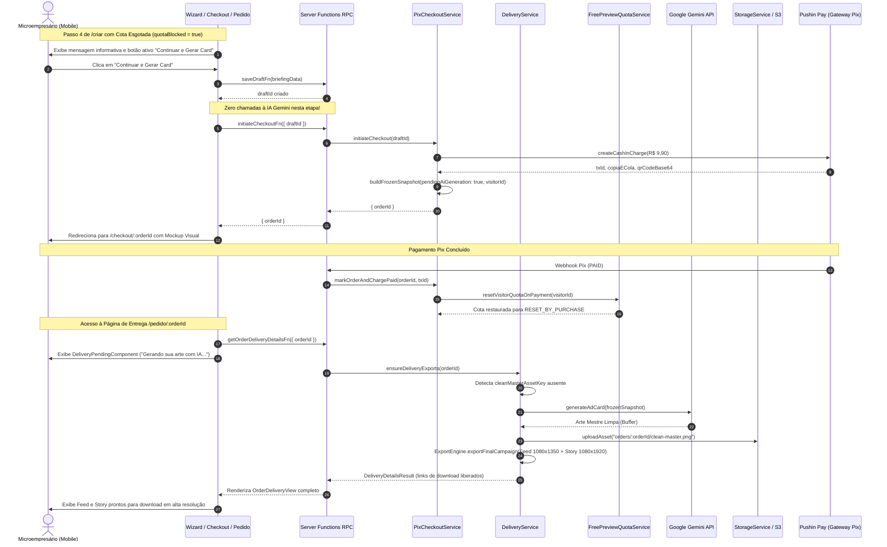
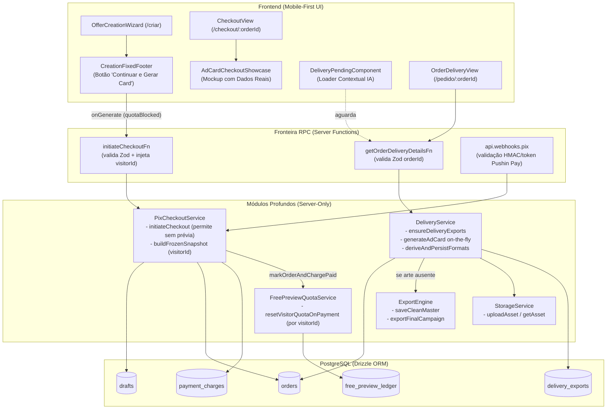
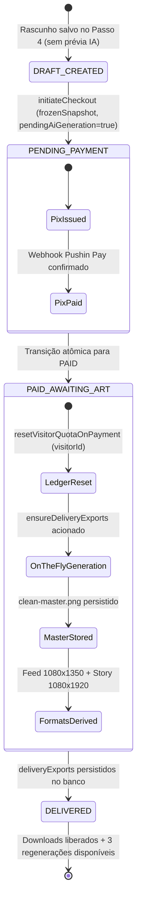

# Plano Técnico: Card Pago Direto após Cota de Prévias Esgotada

- **Slug**: `paid-card-after-quota`
- **Spec**: [`docs/specs/paid-card-after-quota.md`](../specs/paid-card-after-quota.md)
- **Macro-Tickets**:
  - [`docs/tickets/paid-card-after-quota/01-backend-stream.md`](../tickets/paid-card-after-quota/01-backend-stream.md)
  - [`docs/tickets/paid-card-after-quota/02-frontend-stream.md`](../tickets/paid-card-after-quota/02-frontend-stream.md)
- **Status**: `ready-for-implementation`

---

## 1. Avaliação dos 4 Pilares de Engenharia

### Pilar 1: Módulos Profundos & Isolamento de Camadas (`codebase-design`)
- **`PixCheckoutService`**: Interface pública concisa (`initiateCheckout(input)`). Oculta toda a validação do plano, busca do rascunho, reutilização de cobranças ativas, congelamento do snapshot imutável (`frozenSnapshot` com `pendingAiGeneration: true` e `visitorId`), geração da cobrança Pix e persistência relacional atômica.
- **`DeliveryService`**: Interface pública concisa (`ensureDeliveryExports(orderId)`). Oculta a verificação de status (`PAID`), verificação idempotente de exports existentes, resolução ou síntese sob demanda da arte mestre limpa (`generateAdCard`), persistência no `StorageService`, derivação vetorial/raster para Feed (1080×1350) e Story (1080×1920) via `ExportEngine`, e assinatura de URLs seguras.
- **`FreePreviewQuotaService`**: Interface pública concisa (`resetVisitorQuotaOnPayment(input)`). Suporta identificação direta por `visitorId` além do fallback por `draftId`, realizando a transição atômica das reservas `CONSUMED`/`RESERVED` para `RESET_BY_PURCHASE` no ledger.
- **Isolamento Estrito Client/Server**: Todas as interações cliente-servidor ocorrem estritamente por Server Functions (`initiateCheckoutFn`, `getOrderDeliveryDetailsFn`), com validação Zod isomórfica nos limites RPC e zero vazamento de módulos de infraestrutura (`sharp`, `@google/genai`, `drizzle-orm`) para o bundle do navegador.

### Pilar 2: Integridade de Negócio & Segurança Financeira
- **Custo Zero de IA Antes do Pagamento**: Quando a cota de 2 prévias diárias do visitante estiver esgotada (`quotaBlocked === true`), o botão do Passo 4 não dispara geração de prévia. Apenas o rascunho é persistido e a cobrança Pix é gerada. Nenhum token da API Gemini é consumido sem receita garantida.
- **Geração On-The-Fly Idempotente**: Ao confirmar o pagamento Pix (`status === "PAID"`), se o pedido não tiver arte mestre, o `DeliveryService` gera a arte mestre limpa uma única vez, armazena no `StorageService` e deriva os formatos. Chamadas repetidas à página de entrega retornam os exports já armazenados sem novas chamadas à IA.
- **Preservação dos Direitos do Cliente**: O pedido pago inicia com `aiRegenerationCount: 0`, garantindo as 3 regenerações pós-compra integralmente disponíveis. A cota diária de 2 prévias do visitante é restaurada no ledger, permitindo que o cliente crie novas campanhas.

### Pilar 3: Segurança por Design
- **Validação de Entrada Zod**: Validação estrita em todos os pontos de entrada (`initiateCheckoutSchema`, `orderIdSchema`).
- **Autorização e Controle de Acesso**: `DeliveryService.ensureDeliveryExports` rejeita pedidos com status diferente de `PAID` com erro 403 (`ORDER_NOT_PAID`), prevenindo extração de artes não pagas.
- **Idempotência**: Webhooks da Pushin Pay e requisições repetidas de entrega operam com idempotência estrita através de transações de banco e verificação de registros existentes.

### Pilar 4: Qualidade, Simplicidade & Anti-Bloat (`ponytail` / `solid`)
- **Sem Portas Rasas ou Camadas Hipotéticas**: Reutilização direta da infraestrutura existente (`StorageService`, `ExportEngine`, `generateAdCardImage`).
- **TDD Cirúrgico**: Testes unitários com fakes em memória para chamadas de IA e storage, sem mock excessivo ou pass-through wrappers.

---

## 2. Diagramas Estruturais da Solução

### 2.1 Diagrama de Sequência de Ponta a Ponta



### 2.2 Topologia de Módulos e Componentes



### 2.3 Ciclo de Estados do Pedido e da Cota



---

## 3. Contratos de Dados & Interfaces dos Módulos Profundos

### 3.1 `InitiateCheckoutInput` & `initiateCheckoutSchema`
Em `src/features/checkout/data/checkout.schemas.ts`:
```ts
export const initiateCheckoutSchema = z.object({
  draftId: z.string().min(1, "draftId é obrigatório"),
  planId: campaignPlanIdSchema.optional(),
  customerWhatsapp: z.string().optional(),
  customerEmail: z.string().email("E-mail inválido").optional(),
  visitorId: z.string().optional(),
});

export type InitiateCheckoutInput = z.infer<typeof initiateCheckoutSchema>;
```

### 3.2 `ResetVisitorQuotaInput` & `ResetVisitorQuotaResult`
Em `src/features/promotions/server/services/free-preview-quota.service.ts`:
```ts
export interface ResetVisitorQuotaInput {
  draftId?: string;
  visitorId?: string;
  now?: Date;
}

export interface ResetVisitorQuotaResult {
  resetCount: number;
  visitorId: string | null;
}
```
**Regra de Resolução**:
- Se `input.visitorId` for fornecido, atualiza diretamente todas as linhas no `free_preview_ledger` para aquele `visitorId` com status `CONSUMED` ou `RESERVED` para `RESET_BY_PURCHASE`.
- Se `input.visitorId` não for fornecido mas `input.draftId` for fornecido, recupera o `visitorId` através da busca no ledger por `draftId`.

### 3.3 `DeliveryServiceDependencies` & `ensureDeliveryExports`
Em `src/features/delivery/server/services/delivery.service.ts`:
```ts
export interface DeliveryServiceDependencies {
  database?: AppDatabase;
  baseUrl?: string;
  storageService?: StorageService;
  exportEngine?: ExportEngine;
  formatFeed?: (buffer: Buffer) => Promise<Buffer>;
  formatStory?: (buffer: Buffer) => Promise<Buffer>;
  applySignature?: (buffer: Buffer, creditText?: string) => Promise<Buffer>;
  generateAdCard?: (input: GenerateAdCardInput) => Promise<GenerateAdCardResult>;
}
```
**Comportamento em `ensureDeliveryExports(orderId: string)`**:
1. Busca `order` por `orderId`. Se não existir, erro 404 (`ORDER_NOT_FOUND`).
2. Se `order.status !== "PAID"`, erro 403 (`ORDER_NOT_PAID`).
3. Busca `deliveryExports`. Se existir, retorna imediatamente (idempotência confirmada).
4. Se não houver `deliveryExports`:
   - Verifica se há arte mestre (`cleanMasterAssetKey` ou `cleanMasterImageDataUrl`).
   - Se ausente:
     - Monta `GenerateAdCardInput` a partir de `order.frozenSnapshot`.
     - Invoca `this.generateAdCard(generateInput)`.
     - Salva o buffer limpo chamando `this.exportEngine.saveCleanMaster({ ownerId: order.id, buffer, contentType: mimeType, prefix: "orders" })`.
     - Atualiza `orders.cleanMasterAssetKey` no banco (`aiRegenerationCount` permanece `0`).
   - Executa `this.deriveAndPersistFormats(order, masterBuffer)`.
   - Retorna `DeliveryDetailsResult` completo.

---

## 4. Escopo Detalhado das 2 Macro-Streams

### Macro-Stream 1: Backend & Data (`01-backend-stream.md`)
**Responsável**: `backend-builder`  
**Arquivos de Escopo**:
- `src/features/checkout/server/services/pix-checkout.service.ts`:
  - Permitir `initiateCheckout` para rascunhos sem `previewCardImageUrl`.
  - Em `buildFrozenSnapshot`, marcar `pendingAiGeneration: !draft.previewCardImageUrl` e gravar `visitorId`.
  - Em `markOrderAndChargePaid` e `simulateDevPayment`, extrair `visitorId` do snapshot e repassar para `resetPreviewQuotaSafely`.
- `src/features/checkout/server/functions/checkout.functions.ts`:
  - Em `initiateCheckoutFn`, resolver `visitorId` via headers se ausente no payload.
- `src/features/delivery/server/services/delivery.service.ts`:
  - Injetar `generateAdCard` nas dependências (com default `generateAdCardImage`).
  - Em `resolveCleanMasterBuffer` (ou antes dele em `ensureDeliveryExports`), se não houver asset mestre, gerar arte limpa on-the-fly, salvar no storage e persistir `cleanMasterAssetKey`.
- `src/features/promotions/server/services/free-preview-quota.service.ts`:
  - Atualizar `resetVisitorQuotaOnPayment` para aceitar `visitorId` diretamente.
- **Testes Unitários Backend**:
  - `src/features/checkout/server/services/pix-checkout.service.test.ts`
  - `src/features/delivery/server/services/delivery.service.test.ts`
  - `src/features/promotions/server/services/free-preview-quota.service.test.ts`

### Macro-Stream 2: Frontend & UX (`02-frontend-stream.md`)
**Responsável**: `frontend-builder`  
**Arquivos de Escopo**:
- `src/features/promotions/components/wizard/creation-fixed-footer.tsx`:
  - Quando `isLastStep && quotaBlocked`:
    - Botão **ATIVO** com texto `"Continuar e Gerar Card"`, ícone `Wand2` ou `Sparkles`, `data-testid="btn-wizard-generate"`.
    - Mensagem informativa acolhedora no topo: *"Você usou suas 2 prévias grátis de hoje. Confirme o Pix (R$ 9,90) e nossa IA criará seu card logo após o pagamento."*
- `src/features/promotions/hooks/use-offer-brief-draft.ts` & `src/features/promotions/components/offer-creation-wizard.tsx`:
  - Adicionar ação `checkoutWithoutPreview`: salva rascunho e invoca `initiateCheckoutFn` diretamente (sem chamar `generatePreviewFn`).
  - Em `OfferCreationWizard`, quando `quotaBlocked === true`, disparar `checkoutWithoutPreview` ao clicar em gerar.
- `src/features/checkout/components/ad-card-checkout-showcase.tsx`:
  - Quando `previewCardImageUrl` for nulo/indefinido, renderizar mockup estruturado do card com aspecto `4/5` ou `9/16`, título, preço promocional e badge de vidro/blur: `Sparkles` + *"Arte gerada por IA após o Pix"*.
- `src/features/checkout/views/checkout-view.tsx`:
  - Quando `!previewCardImageUrl`, exibir banner informativo acolhedor no topo: *"Criação por IA Garantida: Seu card será gerado pela Inteligência Artificial assim que o pagamento Pix for confirmado."*
- `src/routes/pedido.$orderId.tsx`:
  - Adicionar `pendingComponent`: card mobile-first com animação suave e mensagem informativa: *"Gerando sua arte publicitária com IA... Estamos criando suas versões em alta resolução para Feed (1080×1350) e Story (1080×1920). Isso leva menos de 15 segundos."*
- **Testes de Integração / UI**:
  - `src/features/promotions/components/wizard/creation-fixed-footer.test.tsx` (novo)
  - `src/features/promotions/components/offer-creation-wizard.test.tsx` (atualização)
  - `src/features/checkout/components/ad-card-checkout-showcase.test.tsx` (novo)
  - `src/routes/pedido.$orderId.test.tsx` (atualização)

---

## 5. Plano de Seams para TDD & Isolamento

### 5.1 Seams do Backend (`backend-builder`)
1. **Seam de Checkout sem Prévia**:
   - Chamar `initiateCheckout` com draft válido sem `previewCardImageUrl`.
   - Esperar retorno `{ orderId }`, pedido `PENDING`, e `order.frozenSnapshot.pendingAiGeneration === true`.
2. **Seam de Entrega com Geração On-The-Fly**:
   - Criar pedido `PAID` com `pendingAiGeneration: true` e sem master art.
   - Fornecer fake `generateAdCard` injetado no `DeliveryService`.
   - Chamar `ensureDeliveryExports(orderId)`.
   - Verificar que fake `generateAdCard` foi chamado exatamente 1 vez com os dados do snapshot.
   - Verificar que `cleanMasterAssetKey` foi gravado no banco e no storage.
   - Verificar que `aiRegenerationCount` permanece `0`.
   - Verificar que chamadas subsequentes retornam os exports sem chamar `generateAdCard` novamente.
3. **Seam de Reset de Cota por `visitorId`**:
   - Inserir entradas `CONSUMED` no ledger para um `visitorId`.
   - Invocar `resetVisitorQuotaOnPayment({ visitorId })` sem `draftId`.
   - Verificar que as linhas são atualizadas para `RESET_BY_PURCHASE`.

### 5.2 Seams do Frontend (`frontend-builder`)
1. **Seam do Rodapé Fixo**:
   - Renderizar `CreationFixedFooter` com `step: 4`, `quotaBlocked: true`.
   - Verificar presença do texto informativo de 2 prévias usadas.
   - Verificar que o botão está habilitado com texto `"Continuar e Gerar Card"`.
   - Clicar no botão e verificar chamada a `onGenerate`.
2. **Seam do Wizard sem IA**:
   - Simular wizard no Passo 4 com `quotaBlocked: true`.
   - Clicar em gerar e verificar que `saveDraftFn` e `initiateCheckoutFn` são disparados, mas `generatePreviewFn` NÃO é chamada.
3. **Seam do Mockup no Showcase**:
   - Renderizar `AdCardCheckoutShowcase` com `previewCardImageUrl: null` e dados da oferta.
   - Verificar presença do título, preço e selo `"Arte gerada por IA após o Pix"`.
4. **Seam do Loading na Rota de Entrega**:
   - Renderizar `pedido.$orderId.tsx` com estado pending ativo e verificar exibição do loader acolhedor.

---

## 6. Comandos de Validação Cirúrgica

### Stream 1 (Backend)
```bash
pnpm vitest run src/features/checkout/server/services/pix-checkout.service.test.ts
pnpm vitest run src/features/delivery/server/services/delivery.service.test.ts
pnpm vitest run src/features/promotions/server/services/free-preview-quota.service.test.ts
pnpm typecheck
```

### Stream 2 (Frontend)
```bash
pnpm vitest run src/features/promotions/components/wizard/creation-fixed-footer.test.tsx
pnpm vitest run src/features/promotions/components/offer-creation-wizard.test.tsx
pnpm vitest run src/features/checkout/components/ad-card-checkout-showcase.test.tsx
pnpm vitest run src/routes/pedido.$orderId.test.tsx
pnpm typecheck
./.agents/scripts/verify.sh --shadcn
```
