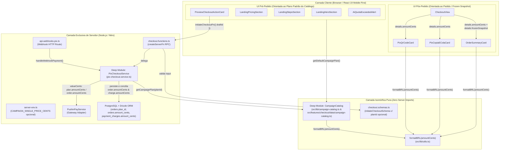
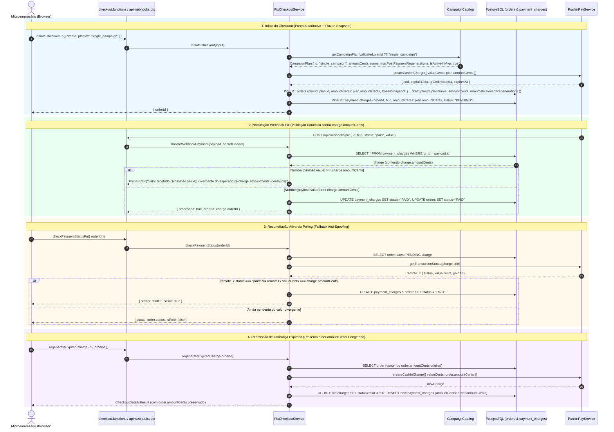
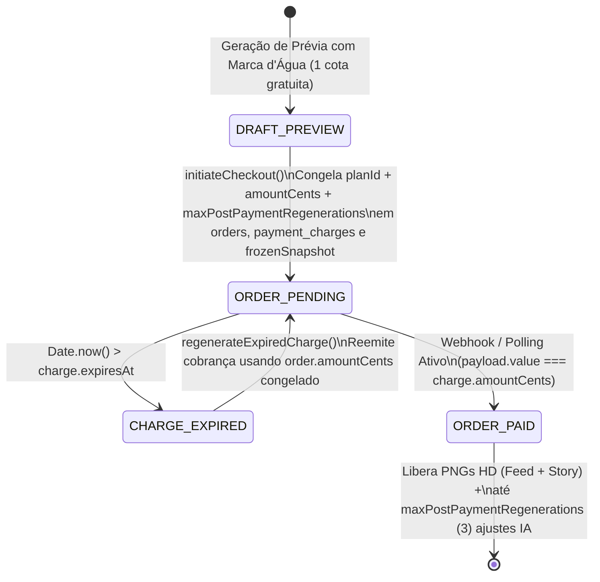
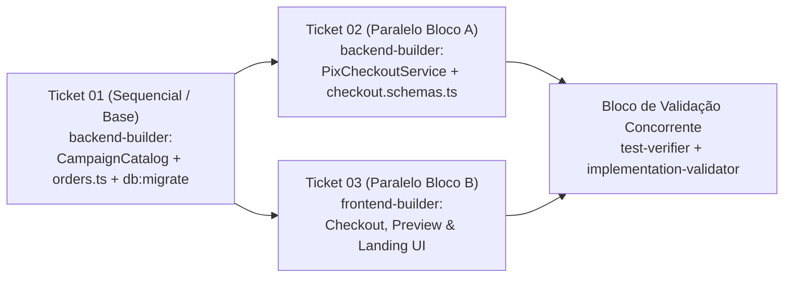

# Plano Técnico e Arquitetural: Aprofundamento de Precificação, Catálogo de Planos (`CampaignCatalog`) e Conciliação Dinâmica Pix

- **Slug**: `pricing-catalog-deepening`
- **Data**: 17 de Outubro de 2026
- **Status**: Pronto para Execução (`ready-for-agent`)
- **Autor**: Principal Solution & Security Architect
- **Spec de Produto**: [`docs/specs/pricing-catalog-deepening.md`](../specs/pricing-catalog-deepening.md)
- **Glossário de Domínio**: [`GLOSSARY.md`](../../GLOSSARY.md)
- **Tickets Verticais de Execução**:
  1. [`docs/tickets/pricing-catalog-deepening/01-campaign-catalog-and-order-schema.md`](../tickets/pricing-catalog-deepening/01-campaign-catalog-and-order-schema.md)
  2. [`docs/tickets/pricing-catalog-deepening/02-pix-checkout-dynamic-pricing-and-reconciliation.md`](../tickets/pricing-catalog-deepening/02-pix-checkout-dynamic-pricing-and-reconciliation.md) _(Blocked by: 01)_
  3. [`docs/tickets/pricing-catalog-deepening/03-ui-dynamic-pricing-and-entitlements.md`](../tickets/pricing-catalog-deepening/03-ui-dynamic-pricing-and-entitlements.md) _(Blocked by: 01 — Paralelizável com 02)_

---

## 1. Visão Geral Arquitetural e Princípios de Design (`Deep Modules`)

Atualmente, o valor comercial de uma campanha (`990` centavos / `"R$ 9,90"`) e a cota de regenerações pós-compra (`3`) estão espalhados como literais mágicos entre o schema Drizzle (`src/server/db/schema/orders.ts`), a máquina de estados de pagamento (`src/features/checkout/server/services/pix-checkout.service.ts`) e 8 componentes React nas camadas de Checkout, Prévia e Landing Page.

Seguindo os princípios de **Módulos Profundos (`codebase-design`)**, **SOLID** e **YAGNI (`ponytail`)**, este plano concentra todo o conhecimento de planos comerciais, preços, formatação monetária BRL e direitos de regeneração em um módulo profundo `in-process` (**`CampaignCatalog`**), aprofundando simultaneamente o **`PixCheckoutService`** para que toda emissão, conciliação via webhook, reconciliação ativa via polling e reemissão de cobrança expirada operem estritamente sobre o preço autoritativo congelado no banco (`order.amountCents` e `charge.amountCents`).

### 1.1. Atenção Crítica ao Isolamento Client/Server (`Zero Server Code Leaks`)

1. **Proibição Absoluta de Importar `server-env.ts` no `CampaignCatalog`**:
   - O módulo `CampaignCatalog` será importado tanto pelo backend (`PixCheckoutService`) quanto por componentes cliente (`PreviewCheckoutActionCard`, `AiQuotaExceededAlert`, `OrderSummaryCard`, `LandingHeroSection`, `LandingPricingSection`, `LandingStepsSection`).
   - Portanto, `campaign-catalog.ts` **JAMAIS** deve importar `src/config/server-env.ts` nem qualquer arquivo sob `src/server/` ou `src/features/*/server/`.
   - Para suportar o override de preço no servidor via variável de ambiente (`CAMPAIGN_SINGLE_PRICE_CENTS`), as funções de resolução (`getCampaignPlan`, `getCampaignPlanById`, `getDefaultCampaignPlan`, `listCampaignPlans`) recebem um parâmetro opcional `env?: CampaignCatalogEnv` e fazem fallback seguro para:
     ```ts
     const runtimeEnv =
       env ??
       (typeof process !== "undefined" && process.env
         ? (process.env as CampaignCatalogEnv)
         : undefined);
     ```
   - Dessa forma, no servidor (Node.js) `process.env.CAMPAIGN_SINGLE_PRICE_CENTS` é lido automaticamente sem acoplamento a `server-env.ts`, em testes unitários pode ser injetado diretamente via parâmetro `env` ou `process.env`, e no navegador (bundle cliente) avalia de forma 100% isomórfica e segura sem vazar código ou segredos de servidor.
2. **Localização Canônica e Re-Export Isomórfico**:
   - A implementação canônica viverá em `src/lib/campaign-catalog.ts` (ao lado de `src/lib/utils.ts`, pois é consumida transversalmente por `src/components/shared/`, `src/features/promotions/` e `src/features/checkout/`).
   - Para máxima ergonomia interna da feature de checkout, `src/features/checkout/data/campaign-catalog.ts` re-exportará integralmente a interface pública de `@/lib/campaign-catalog`.
3. **Preservação do Contrato de `server-isolation.test.ts`**:
   - Os testes `src/features/checkout/server/server-isolation.test.ts`, `src/features/promotions/server/server-isolation.test.ts` e `src/server/logger/server-isolation.test.ts` validam a lista exata de chaves exportadas pelos barrels `server/index.ts`. **Não** adicione exports não autorizados em `src/features/checkout/server/index.ts`.

---

## 2. Diagramas Estruturais (Mermaid)

### 2.1. Topologia de Módulos Profundos e Isolamento Client/Server (`flowchart TD`)



### 2.2. Sequência de Emissão, Webhook, Reconciliação Ativa e Reemissão (`sequenceDiagram`)



### 2.3. Ciclo de Vida de Preço e Estado do Pedido (`stateDiagram-v2`)



---

## 3. Especificação Detalhada dos Módulos, Contratos e Schemas

### 3.1. Utilitário Monetário (`src/lib/utils.ts`)

Para evitar discrepâncias de espaço não-quebrável (`\u00a0` / `NBSP`) gerado por `Intl.NumberFormat("pt-BR")` entre motores JS e garantir que `formatBRL(990)` produza deterministicamente `"R$ 9,90"` com espaço ASCII padrão em todo o servidor, navegador e suítes de teste:

- **`[MODIFY]` `src/lib/utils.ts`**:
  ```ts
  export function formatBRL(cents: number): string {
    const value = cents / 100;
    return new Intl.NumberFormat("pt-BR", {
      style: "currency",
      currency: "BRL",
    })
      .format(value)
      .replace(/\u00a0/g, " ");
  }
  ```

### 3.2. Módulo Profundo `CampaignCatalog` (`src/lib/campaign-catalog.ts` & `src/features/checkout/data/campaign-catalog.ts`)

- **`[NEW]` `src/lib/campaign-catalog.ts`**:
  - **Tipos e Schemas Exportados**:
    ```ts
    import { z } from "zod";
    import { formatBRL } from "./utils";

    export const CAMPAIGN_PLAN_IDS = [
      "single_campaign",
      "pack_5_campaigns",
      "pack_10_campaigns",
    ] as const;

    export const campaignPlanIdSchema = z.enum(CAMPAIGN_PLAN_IDS);
    export type CampaignPlanId = z.infer<typeof campaignPlanIdSchema>;

    export interface CampaignPriceParts {
      currencySymbol: "R$";
      integerPart: string; // ex.: "9"
      decimalPart: string; // ex.: "90"
      formattedDecimal: string; // ex.: "9,90"
    }

    export interface CampaignPlan {
      id: CampaignPlanId;
      name: string;
      shortLabel: string;
      description: string;
      formatsLabel: string;
      campaignsCount: number;
      defaultAmountCents: number;
      amountCents: number;
      formattedPrice: string;
      priceParts: CampaignPriceParts;
      freePreviewGenerations: number;
      maxPostPaymentRegenerations: number;
      isActiveInMvp: boolean;
    }

    export interface CampaignCatalogEnv {
      CAMPAIGN_SINGLE_PRICE_CENTS?: string | number | undefined;
      [key: string]: unknown;
    }
    ```
  - **Dados Canônicos dos Planos (Seção 4 do `PRD.md`)**:
    - `"single_campaign"`:
      - `name`: `"Campanha Avulsa"`
      - `shortLabel`: `"avulso"`
      - `description`: `"1 card publicitário entregue nos dois formatos: Feed (1080×1350) e Story (1080×1920)."`
      - `formatsLabel`: `"Feed (1080×1350) + Story (1080×1920)"`
      - `campaignsCount`: `1`
      - `defaultAmountCents`: `990`
      - `freePreviewGenerations`: `1`
      - `maxPostPaymentRegenerations`: `3`
      - `isActiveInMvp`: `true`
    - `"pack_5_campaigns"`:
      - `name`: `"Pacote 5 Campanhas"`
      - `shortLabel`: `"pacote 5 campanhas"`
      - `description`: `"Pacote com 5 campanhas completas nos formatos Feed (1080×1350) e Story (1080×1920)."`
      - `formatsLabel`: `"Feed (1080×1350) + Story (1080×1920)"`
      - `campaignsCount`: `5`
      - `defaultAmountCents`: `2990`
      - `freePreviewGenerations`: `1`
      - `maxPostPaymentRegenerations`: `3`
      - `isActiveInMvp`: `false`
    - `"pack_10_campaigns"`:
      - `name`: `"Pacote 10 Campanhas"`
      - `shortLabel`: `"pacote 10 campanhas"`
      - `description`: `"Pacote com 10 campanhas completas nos formatos Feed (1080×1350) e Story (1080×1920)."`
      - `formatsLabel`: `"Feed (1080×1350) + Story (1080×1920)"`
      - `campaignsCount`: `10`
      - `defaultAmountCents`: `4990`
      - `freePreviewGenerations`: `1`
      - `maxPostPaymentRegenerations`: `3`
      - `isActiveInMvp`: `false`
  - **Funções Públicas Exportadas**:
    - `formatPlanPrice(amountCents: number): string`: delega para `formatBRL(amountCents)`.
    - `buildPriceParts(amountCents: number): CampaignPriceParts`: extrai `integerPart` (com separador de milhar pt-BR se aplicável), `decimalPart` (2 dígitos com zero-pad) e `formattedDecimal` (`"${integerPart},${decimalPart}"`).
    - `getCampaignPlanById(planId: string, env?: CampaignCatalogEnv): CampaignPlan`:
      - Valida se `planId` pertence a `CAMPAIGN_PLAN_IDS` (usando `Object.hasOwn` / `campaignPlanIdSchema.safeParse`). Caso contrário, lança `new Error(\`Plano de campanha inválido ou desconhecido: \${String(planId)}\`)`.
      - Para `"single_campaign"`, verifica `runtimeEnv?.CAMPAIGN_SINGLE_PRICE_CENTS`. Se definido e for um inteiro positivo válido (`Number.isInteger(parsed) && parsed > 0`), utiliza `parsed` como `amountCents`; caso contrário, utiliza `defaultAmountCents` (`990`).
      - Calcula `formattedPrice` e `priceParts` dinamicamente a partir do `amountCents` resolvido.
    - `getCampaignPlan(planId: CampaignPlanId = "single_campaign", env?: CampaignCatalogEnv): CampaignPlan`:
      - Atalho tipado que delega para `getCampaignPlanById(planId, env)`.
    - `getDefaultCampaignPlan(env?: CampaignCatalogEnv): CampaignPlan`:
      - Retorna `getCampaignPlan("single_campaign", env)`.
    - `listCampaignPlans(env?: CampaignCatalogEnv): readonly CampaignPlan[]`:
      - Retorna a lista imutável dos 3 planos resolvidos (`CAMPAIGN_PLAN_IDS.map((id) => getCampaignPlanById(id, env))`).

- **`[NEW]` `src/features/checkout/data/campaign-catalog.ts`**:
  - Re-exporta toda a superfície pública de `@/lib/campaign-catalog` (`export * from "@/lib/campaign-catalog";`) para que módulos dentro de `src/features/checkout/` ou testes possam importar de qualquer um dos dois caminhos sem duplicação de código.

### 3.3. Configuração de Ambiente do Servidor (`src/config/server-env.ts`)

- **`[MODIFY]` `src/config/server-env.ts`**:
  - Adicionar `CAMPAIGN_SINGLE_PRICE_CENTS: z.coerce.number().int().positive().optional()` ao `serverEnvSchema`.

### 3.4. Evolução do Schema Drizzle (`src/server/db/schema/orders.ts`) e Migração SQL

- **`[MODIFY]` `src/server/db/schema/orders.ts`**:
  ```ts
  export const orders = pgTable("orders", {
    id: uuid("id").defaultRandom().primaryKey(),
    campaignId: text("campaign_id").references(() => campaigns.id),
    draftId: text("draft_id").references(() => drafts.id),
    planId: text("plan_id").notNull().default("single_campaign"),
    status: text("status").notNull().default("PENDING"),
    amountCents: integer("amount_cents").notNull(),
    frozenSnapshot: jsonb("frozen_snapshot").notNull(),
    customerEmail: text("customer_email"),
    customerWhatsapp: text("customer_whatsapp"),
    aiRegenerationCount: integer("ai_regeneration_count").notNull().default(0),
    paidAt: timestamp("paid_at", { withTimezone: true }),
    createdAt: timestamp("created_at", { withTimezone: true })
      .defaultNow()
      .notNull(),
    updatedAt: timestamp("updated_at", { withTimezone: true })
      .defaultNow()
      .notNull(),
  });
  ```
  - Em `paymentCharges`:
    ```ts
    amountCents: integer("amount_cents").notNull(),
    ```
  - **Sincronização do Banco PostgreSQL**:
    - O `backend-builder` DEVE executar `pnpm db:generate` e `pnpm db:migrate` (ou `pnpm db:push`) após atualizar `src/server/db/schema/orders.ts` para garantir que a coluna `plan_id` exista na tabela `orders` do banco PostgreSQL usado pelos testes de integração (`pix-checkout.service.test.ts`).
  - **`[MODIFY]` `src/server/db/db.test.ts`**:
    - Adicionar asserção `expect(columns.planId).toBeDefined()` no teste de colunas da tabela `orders`.

### 3.5. Contratos Zod do Checkout (`src/features/checkout/data/checkout.schemas.ts`)

- **`[MODIFY]` `src/features/checkout/data/checkout.schemas.ts`**:
  - Importar `campaignPlanIdSchema` de `../../../lib/campaign-catalog` (ou `./campaign-catalog`).
  - Em `initiateCheckoutSchema`:
    ```ts
    export const initiateCheckoutSchema = z.object({
      draftId: z.string().min(1, "draftId é obrigatório"),
      planId: campaignPlanIdSchema.optional(),
      customerWhatsapp: z.string().optional(),
      customerEmail: z.string().email("E-mail inválido").optional(),
    });
    ```
  - **Nota de Tipagem Estrita**: Manter `planId` como `.optional()` no schema (resolvendo o default `"single_campaign"` dentro do `PixCheckoutService.initiateCheckout`) garante que `InitiateCheckoutInput` (`z.infer<typeof initiateCheckoutSchema>`) mantenha `planId?: CampaignPlanId`, preservando 100% de compatibilidade com chamadas existentes `initiateCheckout({ draftId })` sem quebrar `pnpm typecheck`.

### 3.6. Aprofundamento do `PixCheckoutService` (`src/features/checkout/server/services/pix-checkout.service.ts`)

- **`[MODIFY]` `src/features/checkout/server/services/pix-checkout.service.ts`**:
  1. **Construtor com Costura de Ambiente Opcional**:
     ```ts
     constructor(
       private readonly pushinPay: PushinPayService = new PushinPayService(),
       private readonly database: AppDatabase = db,
       private readonly catalogEnv?: CampaignCatalogEnv,
     ) {}
     ```
  2. **`buildFrozenSnapshot(draft: Draft, plan: CampaignPlan, customerWhatsapp?: string)`**:
     - Congela junto aos dados do rascunho os metadados comerciais imutáveis do plano contratado:
       ```ts
       planId: plan.id,
       planName: plan.name,
       amountCents: plan.amountCents,
       maxPostPaymentRegenerations: plan.maxPostPaymentRegenerations,
       ```
  3. **`initiateCheckout(input: InitiateCheckoutInput)`**:
     - Valida `input` com `initiateCheckoutSchema.parse(input)`.
     - Resolve o plano autoritativo via `const plan = getCampaignPlanById(validated.planId ?? "single_campaign", this.catalogEnv)`.
     - Verifica se `plan.isActiveInMvp` é `true`; se for `false` (ex.: `"pack_5_campaigns"` ou `"pack_10_campaigns"`), lança erro de domínio:
       ```ts
       if (!plan.isActiveInMvp) {
         throw new Error(
           `O plano "${plan.name}" (${plan.id}) ainda não está habilitado para compra avulsa no MVP`,
         );
       }
       ```
     - Emite a cobrança Pix via `this.pushinPay.createCashInCharge({ valueCents: plan.amountCents })`.
     - Na transação Drizzle, insere em `orders` com `planId: plan.id` e `amountCents: plan.amountCents`, e insere em `paymentCharges` com `amountCents: plan.amountCents`.
  4. **`handleWebhookPayment(payload: PushinPayWebhookPayload, secretHeader?: string)`**:
     - Substitui a comparação estática `if (Number(payload.value) !== 990)` por:
       ```ts
       if (Number(payload.value) !== charge.amountCents) {
         log.error(
           "Valor recebido divergente do esperado em webhook",
           undefined,
           {
             txId: payload.id,
             receivedValue: payload.value,
             expectedValue: charge.amountCents,
           },
         );
         throw new Error(
           `Valor recebido (${payload.value}) divergente do esperado (${charge.amountCents} centavos)`,
         );
       }
       ```
  5. **`checkPaymentStatus(orderId: string)`**:
     - Na reconciliação ativa com a Pushin Pay, substitui `if (remoteTx.status === "paid" && remoteTx.valueCents === 990)` por:
       ```ts
       if (remoteTx.status === "paid" && remoteTx.valueCents === charge.amountCents)
       ```
  6. **`regenerateExpiredCharge(orderId: string)`**:
     - Utiliza o valor congelado no pedido (`order.amountCents`), mesmo que o catálogo mude futuramente:
       ```ts
       const newCharge = await this.pushinPay.createCashInCharge({
         valueCents: order.amountCents,
       });
       ```
     - E grava `amountCents: order.amountCents` no novo registro inserido em `paymentCharges`.

### 3.7. Componentes Visuais Mobile-First (UI Orientada ao Pedido e ao Catálogo)

1. **`[MODIFY]` `src/features/checkout/components/order-summary-card.tsx`**:
   - Importar `formatBRL` de `@/lib/utils` e `getDefaultCampaignPlan` de `@/lib/campaign-catalog`.
   - Props `OrderSummaryCardProps`:
     ```ts
     export interface OrderSummaryCardProps {
       amountCents?: number;
       offerTitle: string;
       businessName?: string | null;
       previewCardImageUrl?: string | null;
       targetAspectRatio?: string | null;
       planName?: string | null;
       maxRegenerations?: number | null;
     }
     ```
   - Resolver defaults a partir de `getDefaultCampaignPlan()` quando `amountCents` ou `maxRegenerations` não forem informados, formatando o preço com `formatBRL(resolvedAmountCents)` e exibindo `Direito a até ${resolvedMaxRegenerations} ajustes ou regenerações com IA pós-compra`.
2. **`[MODIFY]` `src/features/checkout/components/pix-copia-cola-card.tsx`**:
   - Importar `formatBRL` de `@/lib/utils` e `getDefaultCampaignPlan` de `@/lib/campaign-catalog`.
   - Adicionar `amountCents?: number` em `PixCopiaEColaCardProps`.
   - Calcular `const formattedPrice = formatBRL(amountCents ?? getDefaultCampaignPlan().amountCents);`.
   - No passo 3 das instruções bancárias, substituir `<strong>R$ 9,90</strong>` por `<strong>{formattedPrice}</strong>`.
3. **`[MODIFY]` `src/features/checkout/components/pix-qr-code-card.tsx`**:
   - Importar `formatBRL` de `@/lib/utils` e `getDefaultCampaignPlan` de `@/lib/campaign-catalog`.
   - Adicionar `amountCents?: number` em `PixQrCodeCardProps`.
   - Calcular `const formattedPrice = formatBRL(amountCents ?? getDefaultCampaignPlan().amountCents);`.
   - No atributo `alt` da imagem do QR Code, substituir `"QR Code Pix Dinâmico para Pagamento de R$ 9,90"` por `` `QR Code Pix Dinâmico para Pagamento de ${formattedPrice}` ``.
4. **`[MODIFY]` `src/features/checkout/views/checkout-view.tsx`**:
   - Extrair opcionalmente `planName` e `maxPostPaymentRegenerations` de `details.frozenSnapshot`.
   - Passar `amountCents={details.amountCents}`, `planName={frozen.planName}` e `maxRegenerations={frozen.maxPostPaymentRegenerations}` para `<OrderSummaryCard />`.
   - Passar `amountCents={details.amountCents}` para `<PixCopiaEColaCard />` e `<PixQrCodeCard />`.
5. **`[MODIFY]` `src/features/promotions/components/preview-checkout-action-card.tsx`**:
   - Consumir `const defaultPlan = getDefaultCampaignPlan();` de `@/lib/campaign-catalog`.
   - Substituir todas as ocorrências fixas de `"R$ 9,90"` e `"Feed (1080×1350) + Story (1080×1920)"` por `defaultPlan.formattedPrice`, `defaultPlan.shortLabel` e `defaultPlan.formatsLabel`:
     - Descrição: `Pague apenas {defaultPlan.formattedPrice} via Pix Dinâmico e baixe os arquivos nítidos sem marca d'água imediatamente.`
     - Resumo: `{defaultPlan.formatsLabel}` e `{defaultPlan.formattedPrice} {defaultPlan.shortLabel}`
     - CTA: `isQuotaExceeded ? \`Pagar com Pix (${defaultPlan.formattedPrice})\` : \`Liberar em HD sem marca d'água (${defaultPlan.formattedPrice})\``
6. **`[MODIFY]` `src/features/promotions/components/ai-quota-exceeded-alert.tsx`**:
   - Consumir `const defaultPlan = getDefaultCampaignPlan();` de `@/lib/campaign-catalog`.
   - Substituir texto fixo por:
     `Você já gerou sua prévia gratuita deste rascunho. Para gerar novas variações ou refinar com IA, conclua o pagamento Pix ({defaultPlan.formattedPrice}) — com direito a até {defaultPlan.maxPostPaymentRegenerations} regenerações pós-compra!`
7. **`[MODIFY]` `src/components/shared/landing-hero-section.tsx`**:
   - Consumir `const defaultPlan = getDefaultCampaignPlan();` de `@/lib/campaign-catalog`.
   - No botão CTA principal, exibir `Criar meu card agora ({defaultPlan.formattedPrice} via Pix)`.
8. **`[MODIFY]` `src/components/shared/landing-pricing-section.tsx`**:
   - Consumir `const defaultPlan = getDefaultCampaignPlan();` de `@/lib/campaign-catalog`.
   - Exibir título `Apenas {defaultPlan.formattedPrice} por campanha completa`.
   - No display numérico em destaque, exibir `{defaultPlan.priceParts.currencySymbol}` (`R$`), `{defaultPlan.priceParts.formattedDecimal}` (`9,90`) e `/ {defaultPlan.shortLabel}` (`/ avulso`).
   - No item de benefícios, exibir `Até {defaultPlan.maxPostPaymentRegenerations} regenerações por IA inclusas`.
9. **`[MODIFY]` `src/components/shared/landing-steps-section.tsx`**:
   - Consumir `const defaultPlan = getDefaultCampaignPlan();` de `@/lib/campaign-catalog`.
   - No Passo 3, exibir `Pague {defaultPlan.formattedPrice} no Pix e receba os PNGs nítidos sem marca d'água em segundos.` e `Confirmação instantânea com direito a até {defaultPlan.maxPostPaymentRegenerations} regenerações por IA pós-compra.`

---

## 4. Checklist de Segurança, Qualidade e Invariantes (`AGENTS.md`)

- [x] **Preços Autoritativos no Backend**: O cliente envia apenas `draftId` (e opcionalmente `planId`). Jamais envia `amountCents`. O backend resolve o valor via `CampaignCatalog`, congela em `orders` e `payment_charges` e valida webhooks/polling contra o valor congelado.
- [x] **Zero Server Code Leaks (`server-isolation.test.ts`)**: `src/lib/campaign-catalog.ts` e `src/features/checkout/data/campaign-catalog.ts` não importam `server-env.ts`, `drizzle-orm`, `pg` ou módulos de `server/`.
- [x] **Conciliação Anti-Spoofing Dinâmica**: `handleWebhookPayment` e `checkPaymentStatus` comparam `payload.value` e `remoteTx.valueCents` estritamente contra `charge.amountCents`.
- [x] **Imutabilidade do Preço Contratado (`Frozen Snapshot`)**: `regenerateExpiredCharge` utiliza `order.amountCents` (e não o catálogo atual), garantindo que uma mudança futura de preço não altere o valor de um pedido já aberto pelo microempresário.
- [x] **Conformidade Shadcn UI & Mobile-First**: Todos os componentes modificados preservam estritamente os primitivos `@/components/ui/*` (`Card`, `Button`, `Badge`, `Typography`, `Alert`) e passam em `./.agents/scripts/verify.sh --shadcn`.
- [x] **Tipagem Estrita & Zero `any`**: Schemas Zod e tipos inferidos sem `any` ou supressões de linter.

---

## 5. Plano de Costuras de Teste (TDD Seams) e Escopo Paralelo dos Builders

### Ordem de Execução dos Tickets Verticais



### Escopo Detalhado por Ticket

#### Ticket 01: `01-campaign-catalog-and-order-schema.md` (`backend-builder`)

- **Arquivos a criar/modificar**:
  - `[MODIFY]` `src/lib/utils.ts` (normalizar `\u00a0` para `" "` em `formatBRL`)
  - `[NEW]` `src/lib/campaign-catalog.ts`
  - `[NEW]` `src/features/checkout/data/campaign-catalog.ts` (re-export de `@/lib/campaign-catalog`)
  - `[NEW]` `src/lib/campaign-catalog.test.ts`
  - `[MODIFY]` `src/config/server-env.ts` (`CAMPAIGN_SINGLE_PRICE_CENTS` opcional)
  - `[MODIFY]` `src/server/db/schema/orders.ts` (`planId` + remoção de `.default(990)` cego em `amountCents`)
  - `[MODIFY]` `src/server/db/db.test.ts` (asserção de `columns.planId`)
  - `[NEW/MODIFY]` Migração Drizzle em `drizzle/` via `pnpm db:generate && pnpm db:migrate` (ou `pnpm db:push`)
- **Comando de verificação TDD**:
  - `pnpm vitest run src/lib/utils.test.ts src/lib/campaign-catalog.test.ts src/server/db/db.test.ts`

#### Ticket 02: `02-pix-checkout-dynamic-pricing-and-reconciliation.md` (`backend-builder`)

- **Arquivos a modificar**:
  - `[MODIFY]` `src/features/checkout/data/checkout.schemas.ts` (`planId` opcional com `campaignPlanIdSchema`)
  - `[MODIFY]` `src/features/checkout/server/services/pix-checkout.service.ts`
  - `[MODIFY]` `src/features/checkout/server/services/pix-checkout.service.test.ts` (testar snapshot congelado com `planId`/`planName`/`amountCents`/`maxPostPaymentRegenerations`, rejeição de plano inativo no MVP, conciliação de webhook/polling/reemissão com preço padrão `990` e preço customizado ex.: `1490`)
  - `[MODIFY]` `src/features/checkout/server/functions/checkout.functions.test.ts`
- **Comando de verificação TDD**:
  - `pnpm vitest run src/features/checkout/server/services/pix-checkout.service.test.ts src/features/checkout/server/functions/checkout.functions.test.ts src/features/checkout/server/api.webhooks.pix.test.ts src/features/checkout/server/server-isolation.test.ts`

#### Ticket 03: `03-ui-dynamic-pricing-and-entitlements.md` (`frontend-builder`)

- **Arquivos a modificar**:
  - `[MODIFY]` `src/features/checkout/components/order-summary-card.tsx`
  - `[MODIFY]` `src/features/checkout/components/pix-copia-cola-card.tsx`
  - `[MODIFY]` `src/features/checkout/components/pix-qr-code-card.tsx`
  - `[MODIFY]` `src/features/checkout/views/checkout-view.tsx`
  - `[MODIFY]` `src/features/checkout/views/checkout-view.test.tsx` (incluir teste renderizando pedido com `amountCents: 1490` verificando `"R$ 14,90"` no resumo, no passo 3 do Copia e Cola e no `alt` do QR Code)
  - `[MODIFY]` `src/features/promotions/components/preview-checkout-action-card.tsx`
  - `[MODIFY]` `src/features/promotions/components/ai-quota-exceeded-alert.tsx`
  - `[MODIFY]` `src/components/shared/landing-hero-section.tsx`
  - `[MODIFY]` `src/components/shared/landing-pricing-section.tsx`
  - `[MODIFY]` `src/components/shared/landing-steps-section.tsx`
- **Comando de verificação TDD & Shadcn**:
  - `pnpm vitest run src/features/checkout/views/checkout-view.test.tsx src/features/promotions/components/offer-brief-wizard.test.tsx`
  - `./.agents/scripts/verify.sh --shadcn`

#### Validação Final Concorrente (`test-verifier` + `implementation-validator`)

- Executar `./.agents/scripts/verify.sh` completo (Shadcn UI + Typecheck + ESLint + Vitest + Build Nitro).
