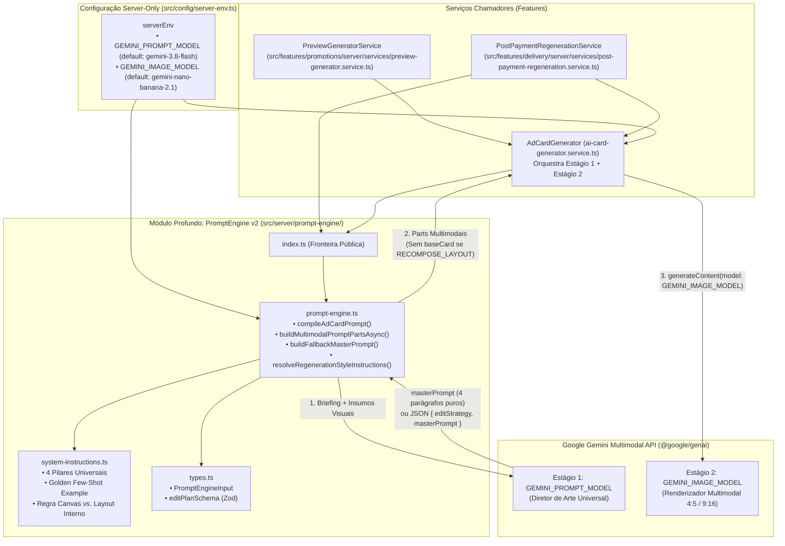
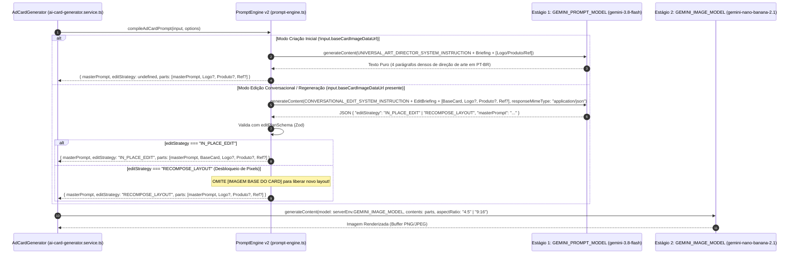

# Plano Técnico e Arquitetura: `prompt-engine-v2` (Clean-Slate Universal Art Director)

## 1. Referências e Escopo Executivo

- **Protótipo Validado pelo Usuário**: [comparativo-prompt-gemini38.md](file:///home/luis/.gemini/antigravity/brain/11f34f32-0c45-4aaa-a5c9-bb4799eafce0/comparativo-prompt-gemini38.md)
- **Macro-Ticket de Execução (Fast-Track Pós-Protótipo)**:
  1. [01-backend-stream.md](file:///home/luis/repositories/OfertaPronta/.worktrees/prompt-engine-v2/docs/tickets/prompt-engine-v2/01-backend-stream.md) — _Clean-Slate `prompt-engine-v2`, Configuração de Modelos via `.env`, Edição Conversacional Inteligente (`IN_PLACE_EDIT` vs `RECOMPOSE_LAYOUT`) e Remoção de Legado_.
- **Worktree Isolada**: `/home/luis/repositories/OfertaPronta/.worktrees/prompt-engine-v2` (branch `feat/prompt-engine-v2`).

### Problema Arquitetural Resolvido

O motor antigo de geração de prompts (`src/server/prompt-engine/`) sofria de **diluição severa de atenção (_Attention Dilution_)** e acoplamento raso espalhado em 4 módulos (`art-direction-blueprints.ts`, `dynamic-planner.ts`, `edit-prompt-compiler.ts`, `prompt-compiler.ts`), concatenando até ~9.000 caracteres de meta-regras, códigos HEX conflitantes, listas negativas e `ZERO_TEXT_OCCLUSION_DIRECTIVE` que confundiam o renderizador de imagem (`gemini-nano-banana-2.1`). Além disso, a regeneração pós-compra utilizava regexes frágeis e mantinha sempre a `[IMAGEM BASE DO CARD]` anexada no Estágio 2, travando os pixels e impedindo recomposições reais de layout.

O **`prompt-engine-v2`** substitui integralmente o motor antigo por um **Módulo Profundo (`Deep Module`)** enxuto em que o Estágio 1 (`GEMINI_PROMPT_MODEL`, default `gemini-3.8-flash`) atua como **Diretor de Arte Publicitário Universal** guiado por **4 Pilares Universais + 1 Golden Few-Shot Example**, entregando ao Estágio 2 (`GEMINI_IMAGE_MODEL`, default `gemini-nano-banana-2.1`) **exclusivamente 4 parágrafos densos de descrição visual de estúdio em português** (zero meta-regras, zero regexes, zero arquétipos por segmento hardcoded).

---

## 2. Auditoria dos 4 Pilares de Engenharia

### Pilar 1: Arquitetura & Deep Modules (`codebase-design`)

- **Consolidação e Deleção de Cascas Rasas**:
  - **Deleção Completa**: `art-direction-blueprints.ts`, `dynamic-planner.ts`, `edit-prompt-compiler.ts` e `prompt-compiler.ts` são removidos.
  - **Novo Módulo Profundo (`src/server/prompt-engine/`)**:
    - `types.ts`: Contratos concisos e schemas Zod de fronteira (`PromptEngineInput`, `EditStrategy`, `editPlanSchema`, `PromptEngineCompileResult`, `PromptEngineOptions`).
    - `system-instructions.ts`: System Instructions universais para Criação (`UNIVERSAL_ART_DIRECTOR_SYSTEM_INSTRUCTION`) e Edição Conversacional (`CONVERSATIONAL_EDIT_SYSTEM_INSTRUCTION`) contendo os 4 Pilares Universais, o Golden Few-Shot Example verbatim e a Regra Canvas vs. Layout Interno.
    - `prompt-engine.ts`: Implementação profunda encapsulando a chamada ao `GEMINI_PROMPT_MODEL`, validação Zod da estratégia de edição, desbloqueio de pixels em `RECOMPOSE_LAYOUT`, fallback determinístico de 4 parágrafos visuais puros e montagem das partes multimodais para o `GEMINI_IMAGE_MODEL`.
    - `index.ts`: Ponto único de exportação pública para `ai-card-generator.service.ts` e `post-payment-regeneration.service.ts`.

### Pilar 2: Integridade de Regras de Negócio

- **Preservação Verbatim de Textos em Português**: O `GEMINI_PROMPT_MODEL` preserva 100% da grafia original de `businessName`, `offerTitle`, `promoPrice`, `originalPrice`, `callToAction` e `whatsapp`.
- **Supressão Estrita de Preço em Cards Institucionais**: Quando `promoPrice` está vazio ou ausente, o briefing instrui o Diretor de Arte a criar uma peça institucional/editorial sem qualquer valor monetário ou badge de preço (proibindo `"R$ 0,00"` ou preços inventados).
- **Regra Canvas vs. Layout Interno**: Pedidos de edição como `"quero um layout horizontal"` ou `"dividir na horizontal"` dentro de um card Feed (`4:5`) ou Story (`9:16`) alteram exclusivamente o **arranjo interno horizontal dos elementos** (faixas horizontais superior/inferior ou divisão interna) mantendo inalterada a proporção vertical do canvas (`4:5` ou `9:16`).
- **Desbloqueio de Pixels em `RECOMPOSE_LAYOUT`**: Quando `editStrategy === "RECOMPOSE_LAYOUT"`, o `prompt-engine-v2` omite `[IMAGEM BASE DO CARD]` (`baseCardImageDataUrl`) das partes enviadas ao `GEMINI_IMAGE_MODEL` no Estágio 2, mantendo apenas `[LOGOTIPO OFICIAL]`, `[FOTO DO PRODUTO REAL]` e `[IMAGEM DE REFERÊNCIA ESTÉTICA]`.

### Pilar 3: Segurança por Design

- **Isolamento Estrito Server-Only**: `src/server/prompt-engine/` e `src/config/server-env.ts` permanecem estritamente no ambiente Node.js, sem vazamento de `GEMINI_API_KEY`, `GEMINI_PROMPT_MODEL` ou `GEMINI_IMAGE_MODEL` para o bundle cliente.
- **Validação Zod na Fronteira com LLM**: A resposta JSON do Estágio 1 no modo de edição é validada estritamente com `editPlanSchema` (`z.object({ editStrategy: z.enum(["IN_PLACE_EDIT", "RECOMPOSE_LAYOUT"]), masterPrompt: z.string().min(20) })`). Em caso de JSON malformado ou timeout, aciona fallback seguro sem derrubar a requisição do usuário.

### Pilar 4: Qualidade, Simplicidade & Costuras TDD (`solid` + `ponytail`)

- **Zero Regex / Zero Segment Archetypes Hardcoded**: Nenhuma expressão regular de classificação de intenção e nenhum mapa estático de segmentos (`SEGMENT_ART_DIRECTIVES`).
- **Costura Única de Teste (_Replace-Don't-Layer_)**: `PromptPlannerClient` e `GoogleGenAIClient` usam a assinatura mínima `{ models: { generateContent(...) } }`, permitindo testes unitários determinísticos com _fakes in-memory_ em < 1s.

---

## 3. Diagramas Arquiteturais (Mermaid)

### 3.1. Topologia de Módulos e Fluxo em 2 Estágios



### 3.2. Sequência de Criação vs. Edição Conversacional (`IN_PLACE_EDIT` vs `RECOMPOSE_LAYOUT`)



---

## 4. Contratos Públicos, Variáveis de Ambiente e Interfaces

### 4.1. Configuração de Ambiente (`src/config/server-env.ts` e `.env.example`)

Em [server-env.ts](file:///home/luis/repositories/OfertaPronta/.worktrees/prompt-engine-v2/src/config/server-env.ts):

```typescript
GEMINI_API_KEY: z.string().optional(),
GEMINI_PROMPT_MODEL: z.string().min(1).default("gemini-3.8-flash"),
GEMINI_IMAGE_MODEL: z.string().min(1).default("gemini-nano-banana-2.1"),
GEMINI_DYNAMIC_PLANNER_ENABLED: z.coerce.boolean().default(true),
```

Em [.env.example](file:///home/luis/repositories/OfertaPronta/.worktrees/prompt-engine-v2/.env.example):

```dotenv
# AI Image Generation & Art Direction (Google Gemini)
GEMINI_API_KEY=your_gemini_api_key_here
# Estágio 1: Diretor de Arte / Planejador de Prompt
GEMINI_PROMPT_MODEL="gemini-3.8-flash"
# Estágio 2: Renderizador Multimodal de Imagem (ex: "gemini-nano-banana-2.1" ou "gemini-3-pro-image")
GEMINI_IMAGE_MODEL="gemini-nano-banana-2.1"
```

### 4.2. Contratos e Schemas Zod (`src/server/prompt-engine/types.ts`)

```typescript
import { z } from "zod";
import type {
  BusinessSegment,
  CardAspectRatio,
  CardIntent,
} from "@/features/promotions/data/offer-brief.schema";

export const DEFAULT_GEMINI_PROMPT_MODEL = "gemini-3.8-flash";
export const DEFAULT_GEMINI_IMAGE_MODEL = "gemini-nano-banana-2.1";
export const DEFAULT_PROMPT_ENGINE_TIMEOUT_MS = 25000;

export const editStrategySchema = z.enum(["IN_PLACE_EDIT", "RECOMPOSE_LAYOUT"]);

export type EditStrategy = z.infer<typeof editStrategySchema>;

export const editPlanSchema = z.object({
  editStrategy: editStrategySchema,
  masterPrompt: z.string().min(20),
});

export type EditPlan = z.infer<typeof editPlanSchema>;

export interface InlineDataPart {
  inlineData: {
    mimeType: string;
    data: string;
  };
}

export interface PromptEngineInput {
  businessSegment: BusinessSegment;
  targetAspectRatio?: CardAspectRatio;
  businessName: string;
  offerTitle: string;
  promoPrice?: string | null;
  originalPrice?: string | null;
  callToAction?: string | null;
  whatsapp?: string | null;
  productImageDataUrl?: string | null;
  referenceImageDataUrl?: string | null;
  baseCardImageDataUrl?: string | null;
  stylePresetId?: string | null;
  customStyleInstructions?: string | null;
  regenerationPrompt?: string | null;
  logoImageDataUrl?: string | null;
  cardIntent?: CardIntent | null;
  customIntentText?: string | null;
}

export interface PromptPlannerResponseCandidate {
  finishReason?: string;
  content?: {
    parts?: Array<{
      text?: string;
      inlineData?: {
        mimeType?: string;
        data?: string;
      };
    }>;
  };
}

export interface PromptPlannerGenerateResponse {
  text?: string;
  candidates?: PromptPlannerResponseCandidate[];
}

export interface PromptPlannerClient {
  models: {
    generateContent(params: {
      model: string;
      contents: Array<string | InlineDataPart>;
      config?: Record<string, unknown>;
    }): Promise<PromptPlannerGenerateResponse>;
  };
}

export interface PromptEngineOptions {
  client?: PromptPlannerClient;
  model?: string;
  timeoutMs?: number;
  enableDynamicPlanner?: boolean;
}

export interface PromptEngineCompileResult {
  masterPrompt: string;
  editStrategy?: EditStrategy;
  parts: Array<string | InlineDataPart>;
  source: "ai-art-director" | "deterministic-fallback";
}

export interface ResolveRegenerationInstructionsOptions {
  presetChanged?: boolean;
  newStylePresetId?: string | null;
  colorPalette?: string | null;
}
```

### 4.3. System Instructions Universais (`src/server/prompt-engine/system-instructions.ts`)

1. **`UNIVERSAL_ART_DIRECTOR_SYSTEM_INSTRUCTION` (Modo Criação)**:
   - Define o papel do modelo como **Diretor de Arte Publicitário Sênior e Fotógrafo Comercial de Estúdio**.
   - Ensina os **4 Pilares Universais de Direção de Arte Publicitária**:
     1. **Zoneamento Espacial Assimétrico (Split Composition & Zero Colisão)**: Posicionar o Hero Subject em uma zona de destaque (ex: centro-direito/inferior-direito ou divisão equilibrada) e reservar deliberadamente uma zona limpa de baixa frequência visual (`bokeh` desfocado suave, penumbra tonal ou superfície limpa) para o bloco tipográfico em primeiro plano absoluto, garantindo zero colisão entre letras e detalhes complexos do produto/personagem. Se o formato for Story (`9:16`), concentrar textos e assinatura dentro da zona segura central, mantendo 15% no topo e 15% na base livres de textos para não colidir com a interface do Instagram/WhatsApp.
     2. **Densidade Sensorial, Materiais Físicos e Óptica de Estúdio**: Deduzir organicamente a partir do briefing superfícies táteis autênticas, micro-elementos de cena coerentes com o produto/serviço, temperatura de iluminação (ex: key light direcional + rim light 3200K, bokeh) e óptica de câmera full-frame (ex: lente 85mm f/2.0 ou 50mm f/2.2). Se houver `[FOTO DO PRODUTO REAL]`, preservar sua identidade física integrando-o à iluminação da cena; se houver `[IMAGEM DE REFERÊNCIA ESTÉTICA]`, absorver sua atmosfera cromática, iluminação e arquitetura tipográfica; se houver `[LOGOTIPO OFICIAL]`, integrá-lo nitidamente no topo sem distorcer.
     3. **Hierarquia Tipográfica Multi-Nível (100% Verbatim em Português)**: Estruturar de 3 a 4 níveis visuais claros em primeiro plano sobre a zona limpa:
        - Nível 1: Assinatura/Emblema ou Logotipo da marca no topo.
        - Nível 2: Título da oferta (`offerTitle`) em tipografia mista de alto contraste (combinando display condensada robusta e lettering/destaque expressivo nas palavras-chave).
        - Nível 3: Linha curta de micro-copy com 3 atributos sensoriais em caixa alta separados por bullet (`•`).
        - Nível 4: Se houver preço promocional (`promoPrice`), selo/badge de preço de alto impacto visual (incluindo `originalPrice` se informado) + faixa/selo de chamada para ação (`callToAction`) e contato (`whatsapp`) no rodapé. Se NÃO houver preço, jamais inventar valores ou escrever `"R$ 0,00"`.
     4. **Saída Visual Pura (Zero Diluição de Prompt)**: Responder **exclusivamente** com os **4 parágrafos densos em português** descrevendo a fotografia publicitária e o design tipográfico integrado. Proibido incluir títulos de seção, markdown headers (`#`, `---`), listas com bullets, meta-regras ou instruções negativas.
   - Inclui o **Golden Few-Shot Example** exato validado no protótipo ([comparativo-prompt-gemini38.md](file:///home/luis/.gemini/antigravity/brain/11f34f32-0c45-4aaa-a5c9-bb4799eafce0/comparativo-prompt-gemini38.md#L17-L23)).

2. **`CONVERSATIONAL_EDIT_SYSTEM_INSTRUCTION` (Modo Edição / Regeneração)**:
   - Instrui o modelo a analisar o pedido de edição do cliente (`regenerationPrompt` / `customStyleInstructions`), os dados atualizados do card e a `[IMAGEM BASE DO CARD]` anexa, retornando **exclusivamente um objeto JSON válido** no formato:
     ```json
     {
       "editStrategy": "IN_PLACE_EDIT" | "RECOMPOSE_LAYOUT",
       "masterPrompt": "<4 parágrafos densos em português seguindo os 4 Pilares Universais>"
     }
     ```
   - **Critério de Classificação Semântica (`editStrategy`)**:
     - `"IN_PLACE_EDIT"`: Ajustes pontuais que mantêm a estrutura e posição espacial atual do card (ex: alterar cor de texto/fundo, corrigir texto/preço, ajustar brilho/iluminação, adicionar detalhe sutil mantendo a mesma composição).
     - `"RECOMPOSE_LAYOUT"`: Mudanças estruturais de layout, posicionamento espacial, divisão de tela, troca de estilo visual/preset ou pedidos para mover produto/texto de lugar (ex: `"quero um layout horizontal"`, `"dividir na horizontal"`, `"colocar o produto na esquerda e o texto na direita"`, `"mudar o texto para o topo"`, `"não deixar texto atrás do personagem"`, `"mudar totalmente o layout"`).
   - **Regra Inegociável Canvas vs. Layout Interno**:
     - O formato externo do canvas (`4:5` vertical para Feed ou `9:16` vertical para Story) é fixo da plataforma.
     - Quando o usuário pedir `"layout horizontal"`, `"dividir na horizontal"`, `"faixa horizontal"` ou similar dentro de um card `4:5` ou `9:16`, isso refere-se **exclusivamente à organização interna em faixas horizontais (split horizontal topo/base ou blocos horizontais internos dentro do canvas vertical)** — NUNCA mudar a proporção da imagem para widescreen `16:9`.

---

## 5. Lista Exata de Arquivos a Deletar, Criar e Modificar

### Arquivos Legados a Deletar (`git rm`)

1. `src/server/prompt-engine/art-direction-blueprints.ts`
2. `src/server/prompt-engine/dynamic-planner.ts`
3. `src/server/prompt-engine/edit-prompt-compiler.ts`
4. `src/server/prompt-engine/prompt-compiler.ts`

### Arquivos a Criar / Reescrever do Zero

1. `src/server/prompt-engine/types.ts` — Schemas Zod (`editStrategySchema`, `editPlanSchema`) e tipos enxutos do `prompt-engine-v2`.
2. `src/server/prompt-engine/system-instructions.ts` — `UNIVERSAL_ART_DIRECTOR_SYSTEM_INSTRUCTION` (4 Pilares + Golden Few-Shot Example) e `CONVERSATIONAL_EDIT_SYSTEM_INSTRUCTION` (Classificação `IN_PLACE_EDIT` vs `RECOMPOSE_LAYOUT` + Regra Canvas vs. Layout Interno).
3. `src/server/prompt-engine/prompt-engine.ts` — Implementação do módulo profundo (`compileAdCardPrompt`, `buildMultimodalPromptPartsAsync`, `buildFallbackMasterPrompt`, `resolveRegenerationStyleInstructions`, `isReferenceDrivenMode`, `parseDataUrl`).
4. `src/server/prompt-engine/index.ts` — Exportação pública limpa do módulo profundo.
5. `src/server/prompt-engine/prompt-engine.test.ts` — Suíte de testes TDD cobrindo os 4 Pilares, Golden Few-Shot, `IN_PLACE_EDIT` (mantém `[IMAGEM BASE DO CARD]`), `RECOMPOSE_LAYOUT` (remove `[IMAGEM BASE DO CARD]`), Regra Canvas vs. Layout Interno e fallback resiliente.

### Arquivos Existentes a Modificar

1. `src/config/server-env.ts` & `src/config/server-env.test.ts` — Adição de `GEMINI_IMAGE_MODEL` com default `"gemini-nano-banana-2.1"` e validação de `GEMINI_PROMPT_MODEL` com default `"gemini-3.8-flash"`.
2. `.env.example` — Documentação de `GEMINI_PROMPT_MODEL` e `GEMINI_IMAGE_MODEL`.
3. `src/features/promotions/server/services/ai-card-generator.service.ts` & `src/features/promotions/server/services/ai-card-generator.service.test.ts` — Consumo de `serverEnv.GEMINI_IMAGE_MODEL`, integração com `compileAdCardPrompt` / `buildMultimodalPromptPartsAsync` do `prompt-engine-v2` e atualização dos testes unitários sem acoplamento a templates legados.
4. `src/features/delivery/server/services/post-payment-regeneration.service.ts` — Repasse explícito de `regenerationPrompt: currentAdjustment` no `generateInput` enviado ao `generateAdCardImage`.

---

## 6. Checklist de Segurança e Qualidade

- [x] **Zero Server Code Leaks**: `src/server/prompt-engine/` importa apenas tipos de `src/features/promotions/data/` e utilitários server-only (`server-env.ts`, `logger`).
- [x] **Validação Zod Estrita**: Saída JSON do Estágio 1 no modo de edição validada via `editPlanSchema.safeParse()`.
- [x] **Zero Segmentos Hardcoded / Zero Regexes**: Nenhuma tabela de segmentos ou regex de intenção no `prompt-engine-v2`.
- [x] **Zero `any` e Zero Supressões de Lint**: Tipagem TypeScript estrita (`strict: true`).
- [x] **TDD Cirúrgico**: Testes rápidos usando `PromptPlannerClient` fake in-memory sem chamadas de rede reais.
