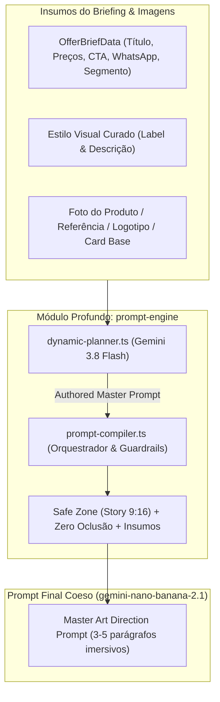

# Plano Técnico — Pure Gemini 3.8 Prompt Engine (Zero Hardcoded Art Direction)

## 1. Visão Geral e Motivação

A refatoração anterior introduziu o Gemini 3.8 Flash como autor do master prompt na Etapa 1, mas manteve:

1. `SEGMENT_AUTHOR_PROFILES` hardcoded em `dynamic-planner.ts` com receitas estáticas por segmento.
2. Mais de 1.000 linhas de templates legados de "4 camadas" e "blueprints" estáticos espalhados em `art-direction-blueprints.ts` e `prompt-compiler.ts`.
3. Modo de edição/regeneração (`edit-prompt-compiler.ts`) ainda 100% ancorado em templates estáticos gigantes (`buildRecomposePromptTemplate` e `buildSurgicalPromptTemplate`), sem autoria do Gemini 3.8 Flash para o novo prompt reestruturado.

Este plano consolida a direção de arte com 100% de autoria do `gemini-3.8-flash` tanto na **Criação Inicial** quanto na **Regeneração/Edição**, eliminando perfis engessados e templates redundantes.

---

## 2. Arquitetura de Módulos Profundos

---

## 3. Especificações Técnicas de Refatoração

### 3.1. `dynamic-planner.ts`

- **Remover** `SEGMENT_AUTHOR_PROFILES`: O Gemini 3.8 Flash deve receber as informações brutas do produto e estilo e usar sua inteligência criativa para ditar iluminação, texturas, cenário e tipografia.
- **Refatorar `buildMasterPromptAuthorContents`**:
  - Instruções puras de Diretor de Arte de Agência Publicitária.
  - Passa os dados reais da oferta + imagens anexas.
  - Exige cena tridimensional contínua (full-bleed, sem divisões 50/50 chapadas), tipografia expressiva em 1º plano com zero oclusão, detalhamento sensorial do produto anunciado e ausência de códigos HEX.
- **Adicionar Autoria de Prompt na Edição (`buildMasterEditPromptAuthorContents`)**:
  - Na regeneração pós-compra, o Gemini 3.8 Flash recebe a arte existente (análise multimodal), o pedido do cliente (`customStyleInstructions`), e redige **diretamente o novo Master Prompt** no modo `RECOMPOSE` ou `SURGICAL`.
  - Retorna `{ mode, authoredMasterPrompt, reason }`.

### 3.2. `edit-prompt-compiler.ts`

- Eliminar templates estáticos gigantescos.
- Fornecer apenas um fallback mínimo e enxuto caso a chamada de IA falhe.

### 3.3. `prompt-compiler.ts`

- Unificar o fluxo em `compileDynamicCardPrompt`:
  - Se `input.baseCardImageDataUrl` (edição pós-compra): invoca `planDynamicEditIntent`, obtém o `authoredMasterPrompt` e aplica os guardrails essenciais via `assembleAuthoredMasterPrompt`.
  - Se criação inicial: invoca `planDynamicCompositionBrief`, obtém o `authoredMasterPrompt` e aplica guardrails via `assembleAuthoredMasterPrompt`.
- Manter fallback determinístico ultracompacto para cenários sem rede/timeout.

### 3.4. `prompt-engine.test.ts`

- Atualizar os testes unitários para validar a autoria do Gemini 3.8 Flash (mockando `generateContent`) e o fallback compacto, garantindo cobertura total de tipos e regressão zero.
