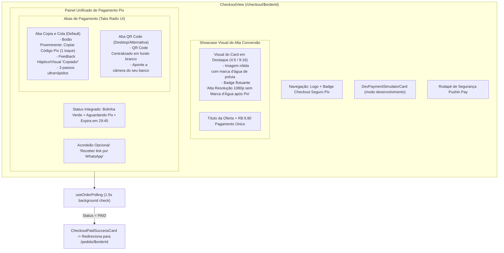

# Plano Técnico — Redesign e Simplificação do Checkout Pix (Mobile-First)

**Slug**: `redesign-checkout-simplificado`  
**Data**: 2026-10-20  
**Status**: Aprovado (Gate 0)

---

## 1. Visão Geral e Objetivos

O checkout atual de Pix (`/checkout/$orderId`) apresenta uma proliferação de 5 cards verticais pesados (`OrderSummaryCard`, `PaymentPollingIndicator`, `PixCopiaEColaCard`, `PixQrCodeCard`, `OrderWhatsappRecoveryCard`), gerando poluição visual, rolagem excessiva no celular e duplicações desnecessárias de informações.

Este plano redefine a experiência do checkout para seguir a mesma simplicidade e elegância do novo fluxo de criação (`/criar`) e da nova tela de entrega (`/pedido/$orderId`), consolidando todo o fluxo em um **Cartão Unificado de Checkout (`UnifiedPixCard`)** de alto contraste, mobile-first e com abas intuitivas.

### Decisões Alinhadas no Gate 0:
1. **Showcase Visual do Card em Destaque (Conversão Máxima)**: O card gerado NÃO pode ser apenas um thumbnail minúsculo. Ele deve ser exibido com destaque e apelo visual (aspect ratio 4:5 ou 9:16, cantos arredondados, proteção de marca d'água suave e badge "Seu Card Está Pronto • Alta Definição 1080p"), despertando o desejo imediato do microempresário de pagar para baixar o arquivo limpo.
2. **Card Unificado com Abas de Pagamento**: Abas "Copia e Cola" (ativa por padrão no celular) e "QR Code" logo abaixo da imagem da oferta, com botão primário proeminente de 1 toque.
3. **Hero Resumo de Valor**: Preço em destaque (R$ 9,90) com benefício claro ("Feed + Story sem marca d'água + 3 regenerações com IA"), sem bullet points repetitivos.
4. **Indicador de Status Integrado**: Badge sutil com bolinha pulsante e contador regressivo de expiração ("Aguardando Pix • 29:45").
5. **WhatsApp Colapsável**: Acordeão discreto ("Receber link também no WhatsApp"), sem poluir a visão principal.

---

## 2. Arquitetura da Interface (Mermaid)

---

## 3. Macro-Streams de Implementação

Adotando o padrão mandatório de **2 Macro-Streams**:

### Stream 1: Frontend & Componentes Unificados (`01-frontend-stream.md`)
- Criação de `src/features/checkout/components/unified-pix-card.tsx` com:
  - Hero compacto da oferta (miniatura + título + formato + preço).
  - Status sutil com indicador pulsante e contador de expiração.
  - Abas Radix UI (`Tabs`, `TabsList`, `TabsTrigger`, `TabsContent`) para alternância entre Copia e Cola e QR Code.
  - Acordeão colapsável para recuperação de link via WhatsApp.
- Refatoração de `src/features/checkout/views/checkout-view.tsx` para plugar o `UnifiedPixCard` e limpar componentes obsoletos.

### Stream 2: Testes, Qualidade e Limpeza (`02-test-and-cleanup.md`)
- Atualização e expansão de `src/features/checkout/views/checkout-view.test.tsx` com cobertura completa de:
  - Renderização do hero compacto e preço formatado.
  - Cópia do código Pix e alternância de abas.
  - Abertura do acordeão e salvamento do WhatsApp.
  - Simulação de pagamento e transição de sucesso.
- Validação no pipeline oficial (`verify.sh`) e verificação visual mobile e desktop.
