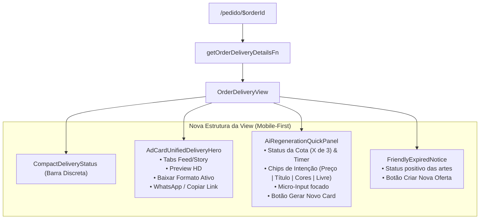

# Plano Técnico: Redesign & Simplificação da Tela de Entrega do Pedido

## 1. Visão Geral e Objetivos

A tela de entrega atual (`/pedido/$orderId`) apresenta sobrecarga de informação ("card fatigue") com 5 cartões empilhados verticalmente (~2.000px de rolagem no mobile), empurrando a arte para baixo da dobra e impondo um formulário de refinamento com 5 campos de texto burocráticos.

Este plano consolida a **Opção A (Card Hero Integrado + Chips Rápidos)** escolhida pelo usuário, alinhando a experiência visual e a ergonomia mobile-first ao padrão dos micro-passos da criação (`/criar`).

### Principais Mudanças de UX/UI:

1. **Header Discreto**: Substituir o cartão gigante `DeliveryHeaderStatus` por uma barra de status discreta e elegante (`✅ Pagamento Confirmado • [Título]`).
2. **Hero Card Unificado (`AdCardUnifiedDeliveryHero`)**:
   - Abas integradas: `Feed (1080×1350)` | `Story (1080×1920)`.
   - Preview da arte em alta definição com proteção visual.
   - Botão de ação primário dinâmico: **"Baixar {Formato Ativo} em HD"** sincronizado automaticamente com a aba selecionada.
   - Botão secundário de **"Salvar no WhatsApp"** e atalho para copiar link permanente.
3. **Painel de Refinamento por Chips de Micro-Ajuste (`AiRegenerationQuickPanel`)**:
   - Reutiliza a mentalidade de micro-passos do `/criar`.
   - Chips de seleção de intenção:
     - 🏷️ **Mudar Preço**: exibe apenas campo de preço promocional.
     - ✏️ **Corrigir Título**: exibe apenas campo de título.
     - 🎨 **Trocar Estilo & Cores**: exibe chips de paletas visuais (Vermelho/Amarelo, Preto/Dourado, etc.).
     - 💬 **Outro Ajuste**: campo de instrução livre com sugestões rápidas.
4. **Tratamento Amigável de Janela Expirada**:
   - Substitui o bloco pesado de cadeado por mensagem positiva de celebração e botão de conversão: **"Criar Nova Oferta"**.

---

## 2. Arquitetura e Diagrama de Fluxo



---

## 3. Contratos de Dados (Isomorfismo & Schemas Zod)

### 3.1. Extensão de `RequestRegenerationInput` em `delivery.schemas.ts`:

```typescript
export const requestRegenerationInputSchema = z.object({
  orderId: z.string().uuid("ID de pedido inválido"),
  offerTitle: z.string().min(2).optional(),
  promoPrice: z.string().optional(),
  originalPrice: z.string().optional().nullable(),
  callToAction: z.string().optional().nullable(),
  stylePresetId: z.string().optional().nullable(),
  colorPalette: z.string().optional().nullable(),
  customAdjustmentPrompt: z.string().max(500).optional().nullable(),
});
```

### 3.2. Mapeamento no `PostPaymentRegenerationService`:

Se `colorPalette` ou `stylePresetId` forem fornecidos, o serviço combina as instruções com o estilo já congelado no snapshot da campanha, garantindo que o Gemini regenere a arte respeitando o novo estilo visual solicitado.

---

## 4. Macro-Streams de Implementação

- **Stream 1 (Backend & Contratos)**:
  - Extensão do schema `RequestRegenerationInput` em `src/features/delivery/data/delivery.schemas.ts`.
  - Atualização do método `prepareRegenerationContext` em `src/features/delivery/server/services/post-payment-regeneration.service.ts`.
  - Testes unitários de regeneração atualizados em `post-payment-regeneration.service.test.ts`.

- **Stream 2 (Frontend & UX)**:
  - Criação do `AdCardUnifiedDeliveryHero` integrando visualização, tabs Feed/Story e download dinâmico.
  - Criação do `AiRegenerationQuickPanel` com chips de intenção rápidos e micro-formulários focados.
  - Atualização do `OrderDeliveryView` e limpeza de componentes legados redundantes.
  - Testes de componentes e integração em `order-delivery-view.test.tsx` e `pedido.$orderId.test.tsx`.
