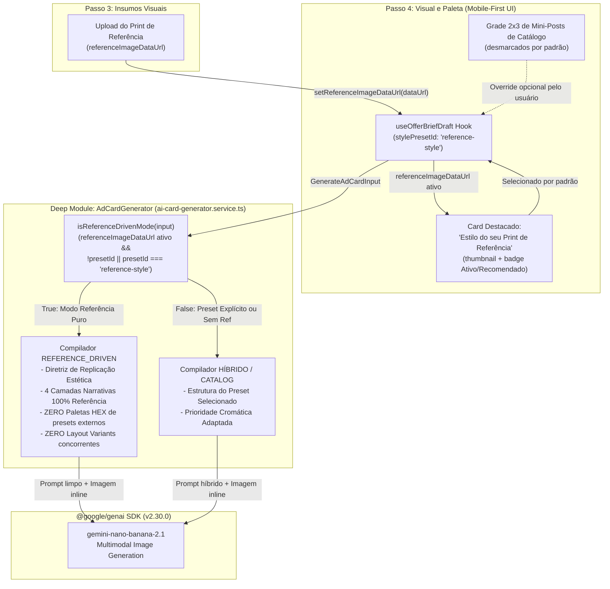
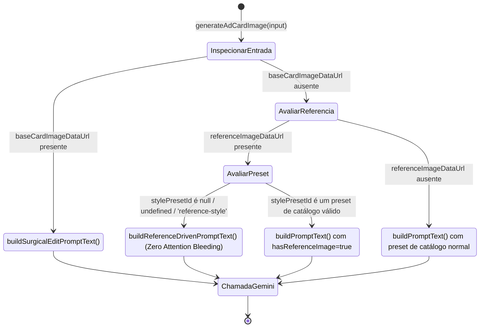
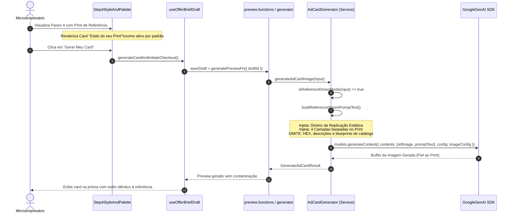

# Plano Técnico e Arquitetural: Estilo Orientado à Imagem de Referência (`reference-driven-style`)

- **Slug**: `reference-driven-style`
- **Data**: 20 de Outubro de 2026
- **Status**: Pronto para Execução (`ready-for-agent`)
- **Autor**: Principal Solution & Security Architect
- **Spec de Produto**: [`docs/specs/reference-driven-style.md`](../specs/reference-driven-style.md)
- **Macro-Tickets de Execução**:
  1. [`docs/tickets/reference-driven-style/01-backend-stream.md`](../tickets/reference-driven-style/01-backend-stream.md) *(Stream 1: Backend & Data — Modo `REFERENCE_DRIVEN` no `AdCardGenerator`, Eliminação de Attention Bleeding e Testes Unitários)*
  2. [`docs/tickets/reference-driven-style/02-frontend-stream.md`](../tickets/reference-driven-style/02-frontend-stream.md) *(Stream 2: Frontend & UX — Card Especial de Referência no Passo 4, Hook `useOfferBriefDraft` e Testes de Integração)*

---

## 1. Contexto e Diagnóstico do Problema ("Attention Bleeding")

O OfertaPronta permite que o comerciante envie no Passo 3 uma **Imagem de Referência (`referenceImageDataUrl`)** para clonar a estética visual de um anúncio real (composição, luz, tipografia, paleta).

### A Causa Raiz Técnica
1. **Atribuição Indesejada no Frontend**:
   - No `use-offer-brief-draft.ts`, `getInitialFields` inicializava `stylePresetId` com `SEGMENT_CATALOG[segment].stylePresets[0].id`.
   - No `step4-style-and-palette.tsx`, a expressão `selectedStyleId || styles[0]?.id` forçava a seleção visual do primeiro preset do segmento (ex.: `"burger-dark"` / *"Dark Burger & Fumaça"*).
2. **Poluição Semântica no Backend**:
   - Em `ai-card-generator.service.ts`, a função `resolvePresetAndBlueprint` fazia fallback obrigatório para `presets[0]`.
   - O compilador de prompt injetava:
     - `resolveArtDirectionDirective(...)`: especificando paleta HEX (ex.: `#111111`, `#DC2626`), cenários rústicos, ardósia, fumaça densa e fontes Didone.
     - `compileFourLayersNarrative(...)`: forçando `blueprint.cameraAndLightingSetup`, `blueprint.spatialGrid`, `blueprint.priceBadgeStyle` e códigos HEX nos 4 blocos de camadas.
3. **Colisão no Espaço Latente do Gemini Multimodal (`@google/genai`)**:
   - O modelo recebia o print de referência do usuário, mas era bombardeado por tokens imperativos do preset de catálogo padrão.
   - O resultado era a degradação da fidelidade da referência por **competição de atenção ("attention bleeding")**.

---

## 2. Princípios de Design e Arquitetura de Módulos Profundos (`codebase-design`)

1. **Módulo Profundo `AdCardGenerator` (`ai-card-generator.service.ts`)**:
   - Mantém uma interface pública concisa e estável (`generateAdCardImage(input, client)`).
   - Oculta a complexidade de compilação de prompt entre três modos mutuamente exclusivos e coesos:
     1. `SURGICAL_EDIT` (quando há `baseCardImageDataUrl`).
     2. `REFERENCE_DRIVEN` (quando há `referenceImageDataUrl` e `stylePresetId` não é um override explícito).
     3. `CATALOG_PRESET` (quando não há imagem de referência, ou quando o usuário escolhe deliberadamente um preset).
2. **Sentinela Canônico e Backward Compatibility**:
   - Constante canônica exportada: `REFERENCE_STYLE_PRESET_ID = "reference-style"`.
   - Trata graciosamente valores `null`, `undefined`, `""` e `"reference-style"` na presença de `referenceImageDataUrl` como modo orientado à referência.
3. **Pureza do Prompt (Zero Attention Bleeding)**:
   - No modo `REFERENCE_DRIVEN`, **nenhum nome de preset de catálogo, código HEX de preset ou especificação de layout-variant** é injetado.
   - A Camada 1 a 4 e a Diretriz de Direção de Arte tornam-se puramente derivadas da imagem de referência anexa.
4. **Estratégia Híbrida Coerente (Override Explícito)**:
   - Se o usuário fornecer uma referência visual E escolher deliberadamente um estilo de catálogo no Passo 4 (ex: `stylePresetId === "fashion-modern"`), o compilador combina o preset como estrutura base com a prioridade cromática da referência (`options.hasReferenceImage: true`).
5. **Ergonomia Visual no Frontend (Mobile-First)**:
   - No Passo 4, quando houver referência enviada, renderiza um card especial de destaque no topo da grade: **"Estilo do seu Print de Referência"**, com miniatura da imagem, badge "Ativo / Recomendado" e seleção visual clara.
   - Desacopla a seleção automática dos presets do catálogo.

---

## 3. Diagramas Estruturais (Mermaid)

### 3.1. Topologia de Componentes e Fluxo de Dados (`flowchart TD`)



### 3.2. Máquina de Estados e Resolução de Modo (`stateDiagram-v2`)



### 3.3. Sequência de Compilação no Modo `REFERENCE_DRIVEN` (`sequenceDiagram`)



---

## 4. Contratos de Dados, Tipos e Interfaces Deep Modules

### 4.1. Sentinela Canônico e Predicado de Modo (`ai-card-generator.service.ts` e `offer-brief.schema.ts`)

```typescript
/**
 * Identificador sentinela para o estilo guiado pelo print de referência.
 */
export const REFERENCE_STYLE_PRESET_ID = "reference-style";

/**
 * Avalia se a geração deve operar no modo puramente orientado à referência visual.
 */
export function isReferenceDrivenMode(input: {
  referenceImageDataUrl?: string | null;
  stylePresetId?: string | null;
}): boolean {
  const hasRef = Boolean(
    input.referenceImageDataUrl && input.referenceImageDataUrl.trim().length > 0,
  );
  if (!hasRef) return false;

  const presetId = input.stylePresetId?.trim();
  return !presetId || presetId === REFERENCE_STYLE_PRESET_ID;
}
```

### 4.2. Compilação de Prompt `REFERENCE_DRIVEN` (`ai-card-generator.service.ts`)

```typescript
function buildReferenceDrivenArtDirective(): string {
  return [
    `--- DIRETRIZ DE DIREÇÃO DE ARTE: REPLICAÇÃO ESTÉTICA DA IMAGEM DE REFERÊNCIA ---`,
    `- Papel do Modelo: Atue como diretor de arte e designer gráfico sênior encarregado de reproduzir com maestria a identidade visual do print de referência anexo.`,
    `- Estilo, Composição e Grid: Analise detalhadamente a IMAGEM DE REFERÊNCIA anexa e reproduza sua distribuição espacial, enquadramento, proporções relativas, alinhamentos, formas geométricas e padrão de respiro/bordas.`,
    `- Paleta Cromática Dominante: Extraia com fidelidade as cores de fundo, contrastes, gradientes e tons de acento presentes na IMAGEM DE REFERÊNCIA, aplicando-os à composição do anúncio sem recorrer a paletas externas genéricas.`,
    `- Tipografia e Hierarquia: Emule o estilo visual, peso das fontes (bold, condensed, elegante, etc.) e disposição de títulos e chamadas observados na IMAGEM DE REFERÊNCIA.`,
    `- Iluminação e Atmosfera: Replique o clima luminoso (luz suave, iluminação comercial, contraste dramático, estética clean ou vibrante) e as texturas da IMAGEM DE REFERÊNCIA.`,
    `- Adaptação ao Conteúdo: Combine toda essa estética do print com os dados da oferta comercial anunciada (título, preço, contato e fotos enviadas), gerando uma peça inédita que pareça pertencer à mesma campanha visual.`,
  ].join("\n");
}
```

#### Narrativa de 4 Camadas no Modo Referência:
- **Camada 1 (Fundo & Atmosfera)**: Full-bleed edge-to-edge; paleta cromática, texturas e atmosfera extraídas 100% da imagem de referência anexa.
- **Camada 2 (Sujeito Hero & Óptica Fotográfica)**: Tratamento e iluminação do produto/sujeito inspirados no acabamento da referência (e preservação estrita da foto do produto, se anexa).
- **Camada 3 (Geometria de Grid & Tipografia)**: Grid e fontes espelhando a diagramação da referência; zona segura respeitada se story.
- **Camada 4 (Ancoragem de Preço & Rodapé)**: Badge de preço e dados de rodapé integrados na linguagem visual da referência (ou supressão estrita se institucional).

### 4.3. Contratos de Frontend (`use-offer-brief-draft.ts` e `step4-style-and-palette.tsx`)

#### No Hook `use-offer-brief-draft.ts`:
- Em `getInitialFields`:
  ```typescript
  stylePresetId:
    initialDraft?.stylePresetId ??
    (initialDraft?.referenceImageDataUrl
      ? REFERENCE_STYLE_PRESET_ID
      : SEGMENT_CATALOG[segment].stylePresets[0].id),
  ```
- Em `setReferenceImageDataUrl(v)`:
  ```typescript
  setReferenceImageDataUrl: (v?: string) =>
    setFields((p) => ({
      ...p,
      referenceImageDataUrl: v,
      stylePresetId: v ? REFERENCE_STYLE_PRESET_ID : p.stylePresetId,
    })),
  ```
- Em `setStylePresetId(v)`:
  Permite selecionar tanto um preset do catálogo quanto `REFERENCE_STYLE_PRESET_ID`, sem limpar destrutivamente a imagem de referência enviada.

#### No Componente `Step4StyleAndPalette`:
- Card superior interativo quando `referenceImageDataUrl` estiver presente:
  - `data-testid="reference-style-card"`
  - Miniatura do print (`referenceImageDataUrl`)
  - Título: *"Estilo do seu Print de Referência"*
  - Descrição: *"A IA vai copiar a estética, paleta de cores e tipografia do print que você enviou."*
  - Badge: *"Ativo / Recomendado"*
  - Estado de seleção (`aria-pressed={isRefSelected}`)
  - Clique ativa `onSelectStyle(REFERENCE_STYLE_PRESET_ID)`
- Grade de presets do catálogo:
  - Cada preset é marcado como selecionado exclusivamente se `selectedStyleId === style.id`.
  - Se `selectedStyleId === REFERENCE_STYLE_PRESET_ID` ou nulo/indefinido (com ref presente), nenhum preset do catálogo é marcado.

---

## 5. Checklist de Segurança, Qualidade e Invariantes (`AGENTS.md`)

| Pilar | Requisito / Invariante | Como é Garantido |
|---|---|---|
| **Boundary Isolation** | Zero imports de backend no cliente | `REFERENCE_STYLE_PRESET_ID` é constante isomórfica pura. Código do Gemini permanece em `server/services/ai-card-generator.service.ts`. |
| **Integridade de Negócio** | Preço e cotas inalterados | Preço continua autoritativo do backend (R$ 9,90). Cota de 1 geração de prévia gratuita preservada. |
| **Anti-Attention Bleeding** | Zero poluição de prompt | Diretrizes de catálogo (HEX, nomes, blueprints) são completamente omitidas quando `isReferenceDrivenMode` for verdadeiro. |
| **Segurança e Validação Zod** | Validação estrita na borda | `stylePresetId` aceita string opcional (`"reference-style"` ou id de catálogo). Data URLs continuam sob limite de 4MB. |
| **Acessibilidade e Mobile-First** | Conformidade Shadcn UI | O card especial de referência usa tags semânticas, `role="button"`, foco acessível via teclado (`onKeyDown`), sem HTML cru não estilizado. |
| **Simplicidade (YAGNI & Ponytail)** | Zero abstrações desnecessárias | Não cria novos adapters nem camadas extras. Modifica pontualmente o compilador interno do Deep Module existente. |

---

## 6. Plano de Seams TDD e Escopo Paralelo de Builders

### Macro-Stream 1 (Backend & Prompt Engineering) — `01-backend-stream.md`
- **Arquivos**:
  - `src/features/promotions/data/offer-brief.schema.ts`
  - `src/features/promotions/server/services/ai-card-generator.service.ts`
  - `src/features/promotions/server/services/ai-card-generator.service.test.ts`
- **Comando TDD Cirúrgico**:
  ```bash
  pnpm vitest run src/features/promotions/server/services/ai-card-generator.service.test.ts && pnpm typecheck
  ```
- **Critérios de Teste**:
  1. Detecta `isReferenceDrivenMode` corretamente (com `reference-style`, nulo ou indefinido).
  2. Garante que prompt textual contém `--- DIRETRIZ DE DIREÇÃO DE ARTE: REPLICAÇÃO ESTÉTICA DA IMAGEM DE REFERÊNCIA ---`.
  3. Garante ausência estrita de strings de preset de catálogo (`"Dark Burger"`, `#111111`, `#DC2626`, `retail-burst`, `dark-luxury`).
  4. Garante que seleção explícita de preset com referência adota o modo híbrido coerente.
  5. Garante que gerações sem imagem de referência permanecem 100% inalteradas.

### Macro-Stream 2 (Frontend & UX) — `02-frontend-stream.md`
- **Arquivos**:
  - `src/features/promotions/hooks/use-offer-brief-draft.ts`
  - `src/features/promotions/components/wizard/step4-style-and-palette.tsx`
  - `src/features/promotions/components/offer-creation-wizard.test.tsx`
- **Comando TDD Cirúrgico**:
  ```bash
  pnpm vitest run src/features/promotions/components/offer-creation-wizard.test.tsx && pnpm typecheck && ./.agents/scripts/verify.sh --shadcn
  ```
- **Critérios de Teste**:
  1. No Passo 4, quando há `referenceImageDataUrl`, o card "Estilo do seu Print de Referência" é renderizado e selecionado por padrão.
  2. Nenhum mini-post do catálogo fica selecionado por padrão quando a referência está ativa.
  3. O usuário pode clicar em um preset do catálogo para ativá-lo ou clicar no card de referência para reativá-lo.
  4. Ao avançar para geração, o payload carrega `stylePresetId: "reference-style"` junto ao `referenceImageDataUrl`.
