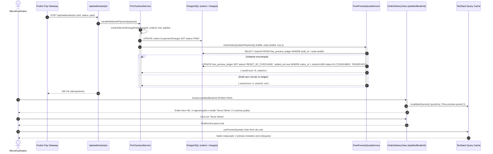

# Plano Técnico: Reset de Cota de Prévias Gratuitas na Confirmação de Pagamento

- **Feature Slug**: `reset-preview-quota-on-payment`
- **Spec de Referência**: [`docs/specs/reset-preview-quota-on-payment.md`](../specs/reset-preview-quota-on-payment.md)
- **Macro-Tickets de Execução**:
  1. [`docs/tickets/reset-preview-quota-on-payment/01-backend-stream.md`](../tickets/reset-preview-quota-on-payment/01-backend-stream.md)
  2. [`docs/tickets/reset-preview-quota-on-payment/02-frontend-stream.md`](../tickets/reset-preview-quota-on-payment/02-frontend-stream.md)
- **Status**: `approved-for-execution`
- **Autor**: Principal Solution & Security Architect

---

## 1. Visão Geral da Arquitetura & Decisões Chave

### 1.1 O Problema Arquitetural
Atualmente, o visitante do OfertaPronta possui uma cota de 2 prévias com IA por janela rolante de 24 horas registradas na tabela `free_preview_ledger`. Quando ele cria um card publicitário, visualiza a prévia com marca d'água e avança para a compra efetuando o pagamento Pix (R$ 9,90), o pedido é liberado para download em alta resolução (`/pedido/$orderId`).

Entretanto, se esse mesmo cliente pagante tentar criar imediatamente uma nova campanha para outro produto da sua loja clicando em "Nova Oferta" (ou retornando para `/criar`), ele encontra o bloqueio `visitor` ("Você já utilizou suas 2 prévias grátis de hoje para este navegador"). Isso pune a conversão imediata e cria atrito de recompra. O microempresário pagante deve ter sua capacidade de prévias gratuitas restaurada para novas criações sem que o histórico de consumo de IA seja destruído.

### 1.2 Princípios e Invariantes da Solução
1. **Preservação Integral de Auditoria (Soft Reset)**:
   - Zero `DELETE` no banco de dados. Nenhuma linha do `free_preview_ledger` é apagada. Métricas financeiras e custos de IA permanecem 100% auditáveis.
   - Linhas ativas (`CONSUMED` e `RESERVED`) do visitante são transicionadas para o novo status de domínio: `RESET_BY_PURCHASE`.
2. **Desacoplamento e Idempotência Estrita**:
   - Webhooks duplicados da Pushin Pay, polling concorrente ou chamadas repetidas de liquidação não falham nem geram duplicatas: o update é idempotente (`where visitor_id = ... and status in ('CONSUMED', 'RESERVED')`). Se já estiverem em `RESET_BY_PURCHASE`, o reset é um no-op seguro retornando `resetCount: 0`.
3. **Escopo Estrito de Segurança (Anti-Free-Rider)**:
   - O reset busca o `visitorId` pagante pelo vínculo `orders.draftId -> free_preview_ledger.draftId`. Apenas o `visitorId` daquele comprador é restaurado. Usuários não-pagantes compartilhando a mesma rede/IP continuam sujeitos às suas cotas individuais.
4. **Ponto Único de Liquidação Backend (`markOrderAndChargePaid`)**:
   - A chamada para o módulo profundo `FreePreviewQuota` ocorre exclusivamente em `markOrderAndChargePaid` dentro de `PixCheckoutService`. Isso unifica automaticamente todos os canais de entrada de pagamento:
     - Webhook Pushin Pay (`handleWebhookPayment`)
     - Polling com reconciliação ativa em tempo real (`checkPaymentStatus`)
     - Bypass de desenvolvimento (`simulateDevPayment`)
5. **Independência dos Direitos Pós-Compra**:
   - As 3 regenerações de IA concedidas ao pedido atual (`orders.id`) continuam inalteradas em `/pedido/$orderId`.
   - O visitante ganha simultaneamente a restauração de suas 2 prévias grátis em `/criar` para testar sua próxima oferta.
6. **Invalidação Reativa e UX Mobile-First**:
   - A tela de entrega (`/pedido/$orderId` / `OrderDeliveryView`) invalida a query de cota `["free-preview-quota"]` (`PREVIEW_QUOTA_QUERY_KEY`) ao renderizar um pedido `PAID`.
   - O botão "Nova Oferta" na barra de entrega ganha indicação visual sutil (+2 prévias grátis liberadas) estimulando a recompra sem poluição visual.

---

## 2. Diagramas Mermaid de Estrutura e Sequência

### 2.1 Sequência do Fluxo de Pagamento e Reset de Cota



### 2.2 Ciclo de Vida do Ledger de Prévias

```mermaid
stateDiagram-v2
    [*] --> RESERVED: reservePreview(visitorId, ipHash, draftId)
    RESERVED --> CONSUMED: settlePreview(id, 'CONSUMED') [Geração IA & Watermark OK]
    RESERVED --> FAILED: settlePreview(id, 'FAILED') [Erro de IA/Rede]
    RESERVED --> RESERVED: Expira após 5min (ignorado por activeCondition)
    
    CONSUMED --> RESET_BY_PURCHASE: resetVisitorQuotaOnPayment({ draftId }) [Pedido marcado como PAID]
    RESERVED --> RESET_BY_PURCHASE: resetVisitorQuotaOnPayment({ draftId }) [Reserva ativa convertida em pagamento]
    
    RESET_BY_PURCHASE --> [*]: Histórico preservado para métricas de custo; cota ativa liberada (activeCondition ignora)
```



---

## 3. Interfaces de Módulos Profundos e Contratos de Dados

### 3.1 Schema de Banco (`src/server/db/schema/free-preview.ts`)

O campo `status` em `freePreviewLedger` é tipado como `text("status").notNull()`. Não é necessária migração DDL de alteração de tipo enum no Postgres, mas a documentação de tipo e o domínio devem formalizar os 4 estados válidos:

```ts
// src/server/db/schema/free-preview.ts
export type FreePreviewStatus = 
  | "RESERVED" 
  | "CONSUMED" 
  | "FAILED" 
  | "RESET_BY_PURCHASE";

export const freePreviewLedger = pgTable(
  "free_preview_ledger",
  {
    id: text("id").primaryKey(),
    visitorId: text("visitor_id").notNull(),
    ipHash: text("ip_hash").notNull(),
    draftId: text("draft_id").notNull(),
    status: text("status").notNull(), // 'RESERVED' | 'CONSUMED' | 'FAILED' | 'RESET_BY_PURCHASE'
    reservedAt: timestamp("reserved_at", { withTimezone: true })
      .defaultNow()
      .notNull(),
    settledAt: timestamp("settled_at", { withTimezone: true }),
  },
  // Índices existentes preservados
);
```

### 3.2 Deep Module `FreePreviewQuota` (`src/features/promotions/server/services/free-preview-quota.service.ts`)

Interface pública concisa e de alto leverage adicionada ao serviço:

```ts
export interface ResetVisitorQuotaInput {
  draftId: string;
  now?: Date;
}

export interface ResetVisitorQuotaResult {
  resetCount: number;
  visitorId: string | null;
}

/**
 * Módulo profundo FreePreviewQuota:
 * Restaura integralmente o saldo de prévias do visitante pagante ao identificar
 * o draft pago e transicionar todas as linhas ativas (CONSUMED / RESERVED)
 * para 'RESET_BY_PURCHASE' de forma atômica e estritamente idempotente.
 */
export async function resetVisitorQuotaOnPayment(
  input: ResetVisitorQuotaInput,
  database: AppDatabase = db,
): Promise<ResetVisitorQuotaResult> {
  const now = input.now ?? new Date();

  // 1. Localiza a linha do ledger correspondente ao draftId pago
  const [ledgerRow] = await database
    .select({ visitorId: freePreviewLedger.visitorId })
    .from(freePreviewLedger)
    .where(eq(freePreviewLedger.draftId, input.draftId))
    .orderBy(desc(freePreviewLedger.reservedAt))
    .limit(1);

  if (!ledgerRow || !ledgerRow.visitorId) {
    log.info("Reset de cota de prévia ignorado: draft não possui registro no ledger", {
      draftId: input.draftId,
    });
    return { resetCount: 0, visitorId: null };
  }

  const { visitorId } = ledgerRow;

  // 2. Atualiza atômica e idempotentemente todas as linhas ativas do visitante
  const updatedRows = await database
    .update(freePreviewLedger)
    .set({
      status: "RESET_BY_PURCHASE",
      settledAt: now,
    })
    .where(
      and(
        eq(freePreviewLedger.visitorId, visitorId),
        or(
          eq(freePreviewLedger.status, "CONSUMED"),
          eq(freePreviewLedger.status, "RESERVED"),
        ),
      ),
    )
    .returning({ id: freePreviewLedger.id });

  const resetCount = updatedRows.length;

  log.info("Cota de prévias do visitante resetada por pagamento", {
    visitorId,
    draftId: input.draftId,
    resetCount,
  });

  return { resetCount, visitorId };
}
```

### 3.3 Integração em `PixCheckoutService` (`src/features/checkout/server/services/pix-checkout.service.ts`)

Dentro do método central de liquidação `markOrderAndChargePaid`:

```ts
// Em markOrderAndChargePaid (após as atualizações de paymentCharges e orders):
if (order?.draftId) {
  try {
    await resetVisitorQuotaOnPayment(
      { draftId: order.draftId, now: paidAt },
      this.database,
    );
  } catch (error) {
    // Log resiliente sem quebrar a confirmação de pagamento
    log.error("Erro ao resetar cota de prévia do visitante após pagamento", {
      orderId,
      draftId: order.draftId,
      error: error instanceof Error ? error.message : String(error),
    });
  }
}
```

### 3.4 Invalidação de Cache e UX Frontend (`OrderDeliveryView`)

No componente `OrderDeliveryView` (`src/features/delivery/views/order-delivery-view.tsx`):

```tsx
import { useQueryClient } from "@tanstack/react-query";
import { PREVIEW_QUOTA_QUERY_KEY } from "@/features/promotions/hooks/use-preview-quota";

export function OrderDeliveryView({ initialDetails, ... }: OrderDeliveryViewProps) {
  const queryClient = useQueryClient();

  useEffect(() => {
    if (details.status === "PAID") {
      // Invalida o cache de cota para que /criar reflita o saldo restaurado imediatamente
      queryClient.invalidateQueries({ queryKey: PREVIEW_QUOTA_QUERY_KEY });
    }
  }, [details.status, queryClient]);

  // Barra de navegação com botão "Nova Oferta" contendo tooltip ou badge de incentivo:
  // "Nova Oferta" com texto auxiliar ou badge sutil "+2 prévias grátis"
}
```

---

## 4. Checklist de Segurança e Qualidade

| Item | Requisito de Segurança / Qualidade | Verificação / Implementação |
|---|---|---|
| **Boundary Isolation** | Dependências Node (`db`, `drizzle-orm`) restritas ao backend. | `resetVisitorQuotaOnPayment` vive em `promotions/server/services/` e só é invocado por `PixCheckoutService` no server. Zero imports no client. |
| **Idempotência Estrita** | Múltiplas notificações de webhook não devem falhar nem duplicar resets. | Filtro `where status IN ('CONSUMED', 'RESERVED')`. Se já for `RESET_BY_PURCHASE`, retorna `resetCount: 0` de forma segura. |
| **Anti-Spoofing / Escopo** | Não permitir que pagamento de um usuário libere cotas de terceiros na mesma rede IP. | Reset vinculado exclusivamente ao `visitor_id` do comprador extraído do `draftId` persistido. |
| **Preservação de Dados** | Retenção mandatória para auditoria contábil e telemetria de tokens de IA. | Nenhuma linha deletada (`UPDATE SET status = 'RESET_BY_PURCHASE'`). |
| **Tratamento de Exceções** | Uma falha isolada no reset de cota não pode invalidar ou reverter uma confirmação de pagamento Pix legítima. | Bloco `try/catch` defensivo ao redor da chamada de reset em `markOrderAndChargePaid`, com log estruturado `error`. |
| **Mobile-First UX** | A indicação de recompra na tela de entrega deve respeitar viewports estreitos (360px). | Layout compacto utilizando componentes primitivos `Button`, `Badge` do shadcn/ui. |

---

## 5. Plano de TDD Cirúrgico e Escopo das Macro-Streams

### Stream 1: Backend & Data (`01-backend-stream.md`)
- **Arquivos a modificar**:
  - `src/server/db/schema/free-preview.ts` (tipos de status)
  - `src/features/promotions/server/services/free-preview-quota.service.ts` (implementar `resetVisitorQuotaOnPayment`)
  - `src/features/promotions/server/index.ts` (exportar `resetVisitorQuotaOnPayment` e seus DTOs)
  - `src/features/checkout/server/services/pix-checkout.service.ts` (chamar `resetVisitorQuotaOnPayment` em `markOrderAndChargePaid`)
  - `src/features/promotions/server/services/free-preview-quota.service.test.ts` (adicionar cenários de teste)
  - `src/features/checkout/server/services/pix-checkout.service.test.ts` (adicionar teste de integração com reset de cota)
- **Comandos TDD Cirúrgicos (Builder)**:
  - `pnpm vitest run src/features/promotions/server/services/free-preview-quota.service.test.ts`
  - `pnpm vitest run src/features/checkout/server/services/pix-checkout.service.test.ts`
  - `pnpm typecheck`

### Stream 2: Frontend & UX (`02-frontend-stream.md`)
- **Arquivos a modificar**:
  - `src/features/delivery/views/order-delivery-view.tsx` (adicionar `useQueryClient`, invalidar `PREVIEW_QUOTA_QUERY_KEY`, adicionar microcopy informativo no botão "Nova Oferta")
  - `src/features/delivery/views/order-delivery-view.test.tsx` (testar invalidação de query ao montar com pedido PAID)
- **Comandos TDD Cirúrgicos (Builder)**:
  - `pnpm vitest run src/features/delivery/views/order-delivery-view.test.tsx`
  - `pnpm typecheck`
  - `./.agents/scripts/verify.sh --shadcn`

---

## 6. Critérios de Homologação Final (Gate 3)

1. Pipeline completo `./.agents/scripts/verify.sh` verde (Shadcn + Typecheck + ESLint + Vitest + Nitro Build).
2. Nenhuma regressão nas 3 regenerações pós-pagamento em `/pedido/$orderId`.
3. Teste ponta a ponta: visitante gera 2 prévias -> cota esgota (`remaining: 0`) -> avança para checkout e paga -> cota é resetada para `RESET_BY_PURCHASE` -> visitante clica em "Nova Oferta" e acessa `/criar` com 2 prévias liberadas.
