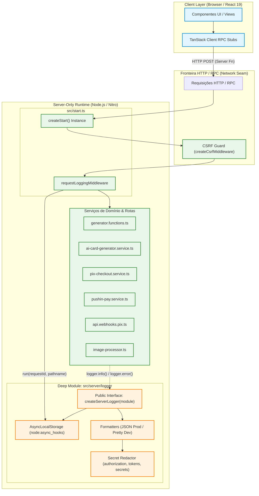
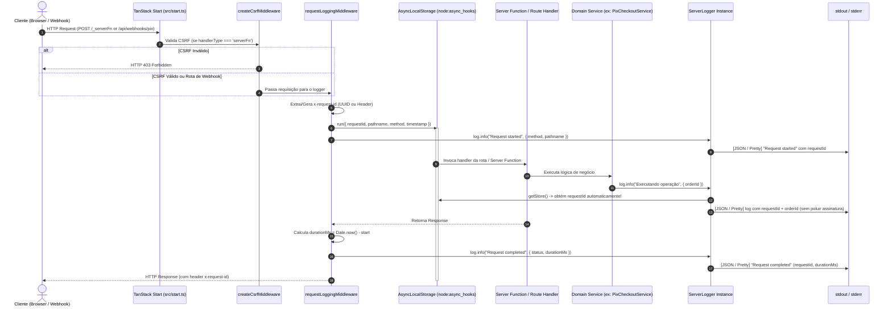

# Plano Técnico: Sistema Unificado de Logs do Servidor & Segurança (Deep Module `src/server/logger`)

**Data:** 17 de Outubro de 2026  
**Status:** Pronto para Implementação (Gate 0 Técnico Concluído)  
**Autor:** Solution Architect  
**Referência de Pesquisa:** [`docs/research/server-logging-tanstack-start.md`](../research/server-logging-tanstack-start.md)  
**Invariantes Canônicas:** `AGENTS.md` (Módulos Profundos, Isolamento Client/Server, Zero Bloat Ponytail, Zero `any`, TDD Red-Green)

---

## 1. Visão Geral e Objetivos de Arquitetura

O **OfertaPronta** é uma plataforma web mobile-first de geração de Cards Publicitários por IA construída sobre **TanStack Start** (React 19 + TanStack Router + Vite/Nitro).

Atualmente, o subsistema de backend utiliza chamadas ad-hoc a `console.warn` e `console.error` espalhadas por múltiplos módulos (`generator.functions.ts`, `ai-card-generator.service.ts`, `api.webhooks.pix.ts`). Essas chamadas:

1. **Não possuem correlação distribuída**: Impossível rastrear um fluxo do início ao fim via `requestId`.
2. **Não possuem estruturação nem observabilidade**: Dificulta ingestão em plataformas de agregação de logs (Datadog, CloudWatch, Better Stack) e polui o terminal local em desenvolvimento.
3. **Apresentam riscos de segurança**:
   - Cabeçalhos HTTP com tokens e segredos (`authorization`, `x-webhook-secret`) logados em texto puro em `api.webhooks.pix.ts`.
   - Cabeçalhos CORS excessivamente permissivos (`Access-Control-Allow-Origin: *`, `Allow-Headers: *`) no webhook Pix.
   - Ausência de proteção CSRF global contra ataques Cross-Site Request Forgery direcionados às Server Functions RPC do TanStack Start.

### Metas Arquiteturais

- **Módulo Profundo `src/server/logger`**: Interface pública concisa (`createServerLogger`, `logger`), escondendo toda a complexidade de `AsyncLocalStorage` (`node:async_hooks`), formatação dual (JSON em produção vs legível colorizado em dev/test), mascaramento automático de segredos e serialização segura de erros.
- **Zero Server Code Leaks**: Garantia estrita de que nenhum arquivo do logger, módulo nativo do Node.js (`node:async_hooks`, etc.) ou segredo atinja o bundle JavaScript do navegador.
- **Orquestração Global no TanStack Start (`src/start.ts`)**: Registro do `requestLoggingMiddleware` e `createCsrfMiddleware({ filter: (ctx) => ctx.handlerType === 'serverFn' })` via `createStart`.
- **Saneamento do Webhook Pix (`src/routes/api.webhooks.pix.ts`)**: Remoção de logs em texto puro de headers sensíveis e restrição estrita de cabeçalhos CORS (`Access-Control-Allow-Origin` restrito ou derivado, headers permitidos explicitamente delimitados).
- **Substituição Sistemática**: Adoção de `createServerLogger` em todos os serviços do servidor com TDD rigoroso.

---

## 2. Diagramas de Arquitetura e Fluxo (Mermaid)

### 2.1. Topologia do Módulo Profundo e Isolamento Client/Server



### 2.2. Sequência de Execução de Requisição com `AsyncLocalStorage`



---

## 3. Especificação do Módulo Profundo `src/server/logger/`

O módulo profundo segue rigorosamente a filosofia de **Deep Modules** e **Ponytail**:

- **Interface pequena e concisa**: O chamador precisa conhecer apenas `createServerLogger(moduleName)` e os métodos `.info()`, `.warn()`, `.error()`, `.debug()`.
- **Implementação substancial e oculta**: Oculta manipulação de `node:async_hooks`, detecção de ambiente (`process.env.NODE_ENV`), formatação dual, sanitização de objetos aninhados e mascaramento de segredos.
- **Zero dependências externas adicionais**: Sem instalação de bibliotecas pesadas (Pino/Winston) que adicionam complexidade operacional e risco de quebra no Vite Nitro SSR. Uso da biblioteca padrão do Node.js (`node:async_hooks`, `node:crypto`).

### 3.1. Estrutura de Arquivos

```
src/server/logger/
├── index.ts                   # Ponto único de export público (createServerLogger, logger, tipos)
├── async-context.ts           # [PRIVATE] Encapsulamento de AsyncLocalStorage e store types
├── formatters.ts              # [PRIVATE] Serialização JSON (prod) / Pretty (dev) e mascaramento de segredos
├── middleware.ts              # [PUBLIC] TanStack Start requestLoggingMiddleware
├── logger.test.ts             # Testes de unidade do Logger (níveis, redação, herança de contexto)
└── server-isolation.test.ts   # Teste garantindo Zero Server Code Leaks para o client
```

### 3.2. Contratos e Tipos da Interface Pública (`src/server/logger/index.ts`)

```typescript
export interface LogContext {
  requestId?: string;
  module?: string;
  orderId?: string;
  draftId?: string;
  durationMs?: number;
  [key: string]: unknown;
}

export interface Logger {
  debug(message: string, context?: LogContext): void;
  info(message: string, context?: LogContext): void;
  warn(message: string, context?: LogContext): void;
  error(message: string, error?: unknown, context?: LogContext): void;
  child(defaultContext: LogContext): Logger;
}

export function createServerLogger(moduleName: string): Logger;
export const logger: Logger; // Instância raiz
```

### 3.3. Propagação de Contexto com `AsyncLocalStorage` (`src/server/logger/async-context.ts`)

- Utiliza `node:async_hooks.AsyncLocalStorage<RequestLogStore>`.
- `RequestLogStore`:
  ```typescript
  export interface RequestLogStore {
    requestId: string;
    pathname: string;
    method: string;
    startTime: number;
    customContext?: Record<string, unknown>;
  }
  ```
- Expõe funções utilitárias internas:
  - `runWithRequestContext<T>(store: RequestLogStore, fn: () => T | Promise<T>): Promise<T>`
  - `getCurrentRequestStore(): RequestLogStore | undefined`
  - `getTraceContext(): { requestId?: string }`

### 3.4. Mascaramento de Segredos e Formatação Dual (`src/server/logger/formatters.ts`)

#### Regras de Mascaramento (Redaction):

- Campos mascarados recursivamente em qualquer objeto ou header:
  - `authorization` -> `Bearer ***`
  - `x-webhook-secret`, `webhooksecret`, `secret` -> `***`
  - `token`, `pushinpaytoken`, `geminiapikey`, `apikey` -> `***`
  - `password`, `senha` -> `***`
- Chaves são verificadas em formato case-insensitive.
- Serialização segura de `Error`:
  - Extrai `name`, `message`, `stack`, `cause` e códigos de erro sem perder rastreamento.

#### Formatação:

- **`production`**: Saída JSON linear em linha única (`JSON.stringify`), incluindo `timestamp` ISO 8601, `level`, `module`, `message`, `requestId`, `context`, `error`.
- **`development` e `test`**: Saída legível com cores ANSI e prefixo padronizado:
  - `[12:34:56.789] INFO [checkout.pix] (req_abc123) Mensagem do log { txId: "..." }`
  - Erros exibem stack trace formatado.

### 3.5. Middleware do TanStack Start (`src/server/logger/middleware.ts`)

- Criado via `createMiddleware().server(...)`:
  ```typescript
  export const requestLoggingMiddleware = createMiddleware().server(
    async ({ next, request }) => {
      const requestId =
        request.headers.get("x-request-id") || crypto.randomUUID();
      const url = new URL(request.url);
      const startTime = Date.now();

      const store: RequestLogStore = {
        requestId,
        pathname: url.pathname,
        method: request.method,
        startTime,
      };

      return runWithRequestContext(store, async () => {
        logger.info(`Incoming request: ${request.method} ${url.pathname}`, {
          requestId,
          method: request.method,
          pathname: url.pathname,
        });

        try {
          const response = await next();
          const durationMs = Date.now() - startTime;
          logger.info(`Request completed: ${request.method} ${url.pathname}`, {
            requestId,
            status: response.status,
            durationMs,
          });
          response.headers.set("x-request-id", requestId);
          return response;
        } catch (error) {
          const durationMs = Date.now() - startTime;
          logger.error(
            `Request failed: ${request.method} ${url.pathname}`,
            error,
            {
              requestId,
              durationMs,
            },
          );
          throw error;
        }
      });
    },
  );
  ```

---

## 4. Orquestração Global e Segurança em `src/start.ts`

### 4.1. Configuração do `createStart`

Criação do arquivo central `src/start.ts` descoberto automaticamente pelo compilador do TanStack Start:

```typescript
import { createStart, createCsrfMiddleware } from "@tanstack/react-start";
import { requestLoggingMiddleware } from "~/server/logger/middleware";

export const startInstance = createStart(() => ({
  requestMiddleware: [
    createCsrfMiddleware({
      filter: (ctx) => ctx.handlerType === "serverFn",
    }),
    requestLoggingMiddleware,
  ],
}));
```

### 4.2. Invariante de Segurança CSRF:

- **Server Functions RPC (`ctx.handlerType === 'serverFn'`)**: Protegidas ativamente contra requisições cross-site forjadas via validação automática de cabeçalhos de origem (`Origin` / `Referer`) embutida no `createCsrfMiddleware`.
- **Rotas de Webhook e APIs Externas (`/api/webhooks/pix`)**: Isentas da validação CSRF (pois são chamadas machine-to-machine de servidores externos que não enviam origin de browser).

---

## 5. Saneamento e Segurança em `src/routes/api.webhooks.pix.ts`

### 5.1. Vulnerabilidades Atuais e Correções:

1. **Vazamento de Headers Sensíveis em Texto Puro**:
   - _Atual_: `console.warn('[Webhook Pix] 📋 Headers:', JSON.stringify(headers));` (expõe tokens de autorização e o segredo `x-webhook-secret` nos logs).
   - _Correção_: Substituir por logger estruturado que mascara automaticamente headers sensíveis:
     ```typescript
     const log = createServerLogger("routes.api.webhooks.pix");
     log.info("Webhook Pix recebido", {
       method,
       url,
       headers: sanitizeHeaders(headers),
     });
     ```

2. **CORS Excessivamente Permissivo no Handler OPTIONS**:
   - _Atual_:
     ```typescript
     "Access-Control-Allow-Origin": "*",
     "Access-Control-Allow-Headers": "*"
     ```
   - _Correção_: Restringir estritamente. Webhooks machine-to-machine não exigem CORS de navegadores arbitrários. Caso necessário para preflight de gateway parceiro:
     ```typescript
     headers: {
       Allow: "GET, POST, HEAD, OPTIONS",
       "Access-Control-Allow-Origin": request.headers.get("origin") || "*",
       "Access-Control-Allow-Methods": "GET, POST, HEAD, OPTIONS",
       "Access-Control-Allow-Headers": "Content-Type, x-webhook-secret, Authorization",
     }
     ```

3. **Substituição dos logs console.\* por `createServerLogger`**:
   - Remover todas as 12 chamadas a `console.warn` e `console.error` em `src/routes/api.webhooks.pix.ts`.

---

## 6. Substituição Sistemática em Serviços do Servidor

| Arquivo                                                                | Logger a Instanciar                                   | Escopo de Substituição                                                                                                                        |
| ---------------------------------------------------------------------- | ----------------------------------------------------- | --------------------------------------------------------------------------------------------------------------------------------------------- |
| `src/features/promotions/server/functions/generator.functions.ts`      | `createServerLogger("promotions.generator")`          | Substituir 12 ocorrências de `console.warn` e `console.error` no fluxo de síntese de IA e cota de prévia.                                     |
| `src/features/promotions/server/services/ai-card-generator.service.ts` | `createServerLogger("promotions.ai-card-generator")`  | Substituir 5 ocorrências de `console.warn` e `console.error` na chamada ao SDK Google Gemini.                                                 |
| `src/features/checkout/server/services/pix-checkout.service.ts`        | `createServerLogger("checkout.pix-checkout")`         | Adicionar logs estruturados para: criação de pedido, congelamento de snapshot, processamento de webhook idempotente e reconciliação ativa.    |
| `src/features/checkout/server/services/pushin-pay.service.ts`          | `createServerLogger("checkout.pushin-pay")`           | Adicionar logs estruturados para: emissão de cobrança Pix, consulta de status e tratamento de erros de gateway (com dados sensíveis ocultos). |
| `src/server/export-engine/image-processor.ts`                          | `createServerLogger("export-engine.image-processor")` | Adicionar logs de debug/info para redimensionamento e composição harmônica via Sharp.                                                         |

---

## 7. Garantia de Isolamento e Zero Server Code Leaks

1. **Barrels de Features (`src/features/*/server/index.ts`)**:
   - Permanece a regra inegociável do `AGENTS.md`: barrels públicos exportam **apenas** Server Functions e Schemas Zod.
   - O `logger` NUNCA é re-exportado nesses barrels.
2. **Testes de Isolamento (`server-isolation.test.ts`)**:
   - Criação de `src/server/logger/server-isolation.test.ts`:
     - Garante que módulos clientes que tentem importar `src/server/logger` falhem ou que a suite audite que nenhuma Server Function vaze referências do logger para o client.
     - Valida que `node:async_hooks`, `node:crypto` e métodos de formatação estão restritos ao ambiente `server-only`.

---

## 8. Plano de Testes e Metodologia TDD

A implementação seguirá o ciclo **TDD Red → Green → Refactor**:

1. **`src/server/logger/logger.test.ts` (RED)**:
   - Teste de níveis de log (`debug`, `info`, `warn`, `error`).
   - Teste de mascaramento de segredos (`authorization`, `x-webhook-secret`, tokens).
   - Teste de formatação dual (JSON em produção com timestamp ISO vs texto legível em dev).
   - Teste de serialização de `Error` com `stack` e `cause`.
   - Teste de propagação de contexto via `AsyncLocalStorage` (`requestId` mantido entre chamadas assíncronas).
   - Teste do método `.child({ subContext })`.
2. **`src/server/logger/server-isolation.test.ts` (RED)**:
   - Teste verificando que a superfície pública do logger é estritamente de servidor e não vaza para arquivos clientes.
3. **`src/server/logger/middleware.test.ts` (RED)**:
   - Teste unitário do middleware interceptando requests, gerando `requestId`, calculando `durationMs` e injetando no `AsyncLocalStorage`.
4. **Execução do Pipeline de Qualidade**:
   - `./.agents/scripts/verify.sh` (ou `./scripts/verify.sh --quick`).
   - `pnpm test` (garantindo que todos os 169 testes existentes continuem passando e os novos passem 100%).
   - `pnpm typecheck` (zero erros de TypeScript).
   - `pnpm lint`.

---

## 9. Lista de Arquivos a Criar e Modificar

### Novos Arquivos `[NEW]`

1. `src/server/logger/index.ts`
2. `src/server/logger/async-context.ts`
3. `src/server/logger/formatters.ts`
4. `src/server/logger/middleware.ts`
5. `src/server/logger/logger.test.ts`
6. `src/server/logger/server-isolation.test.ts`
7. `src/start.ts`

### Arquivos a Modificar `[MODIFY]`

1. `src/routes/api.webhooks.pix.ts` (substituição de logs, mascaramento de headers, saneamento de CORS)
2. `src/features/promotions/server/functions/generator.functions.ts` (substituição de `console.*` por `createServerLogger`)
3. `src/features/promotions/server/services/ai-card-generator.service.ts` (substituição de `console.*` por `createServerLogger`)
4. `src/features/checkout/server/services/pix-checkout.service.ts` (instrumentação com `createServerLogger`)
5. `src/features/checkout/server/services/pushin-pay.service.ts` (instrumentação com `createServerLogger`)
6. `src/server/export-engine/image-processor.ts` (instrumentação com `createServerLogger`)
7. `src/features/checkout/server/api.webhooks.pix.test.ts` (adequação e verificação do novo comportamento de logs e CORS)
