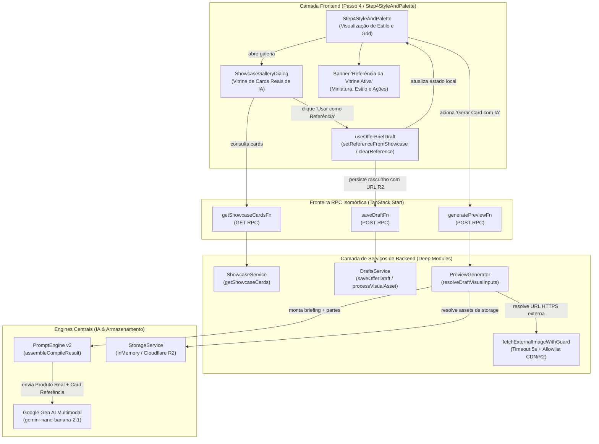
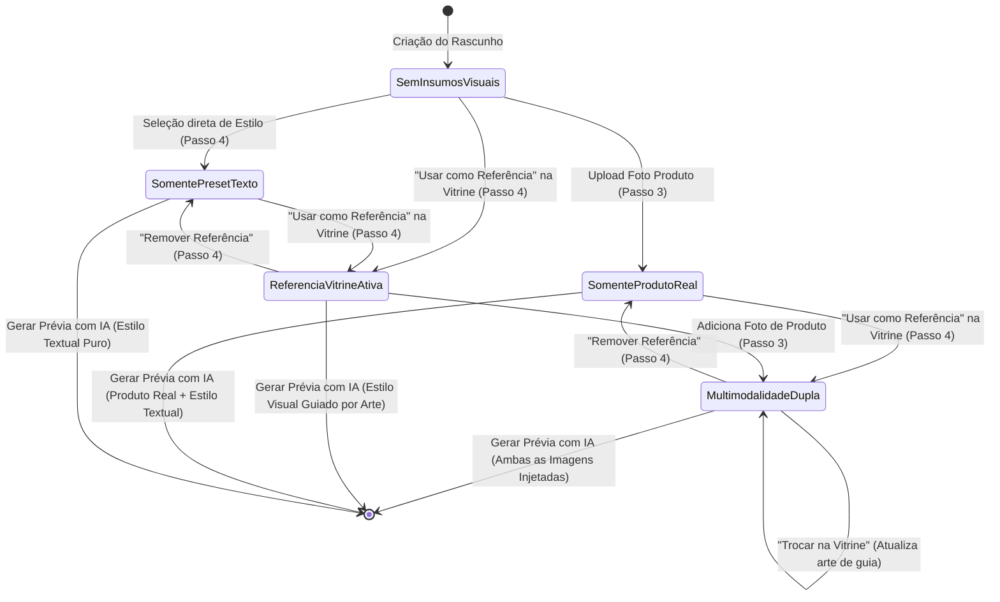

# Plano Técnico e Arquitetural: Vitrine com Cards Reais de IA & Ação "Usar como Referência"

- **Slug**: `showcase-real-cards-reference`
- **Data**: 26 de Outubro de 2026
- **Status**: Pronto para Execução (`ready-for-agent`)
- **Autor**: Principal Solution & Security Architect
- **Spec de Produto**: [`docs/specs/showcase-real-cards-reference.md`](../specs/showcase-real-cards-reference.md)
- **Macro-Tickets de Execução**:
  1. [`docs/tickets/showcase-real-cards-reference/01-backend-stream.md`](../tickets/showcase-real-cards-reference/01-backend-stream.md) _(Backend & Data Stream: Catálogo R2, Persistência de Referência e Injeção Multimodal no Gemini)_
  2. [`docs/tickets/showcase-real-cards-reference/02-frontend-stream.md`](../tickets/showcase-real-cards-reference/02-frontend-stream.md) _(Frontend & UX Stream: Vitrine no Passo 4, Ação "Usar como Referência", Banner de Feedback e Hook de Rascunho)_

---

## 1. Visão Geral Arquitetural e Auditoria dos 4 Pilares de Engenharia

No fluxo de criação de cards publicitários do OfertaPronta (`/criar`), o Passo 4 (`Step4StyleAndPalette`) oferece a "Vitrine de Artes Prontas para Inspirar" (`ShowcaseGalleryDialog`), prometendo ao comerciante: _"Cards publicitários reais criados pela IA"_.

Entretanto, uma auditoria técnica profunda identificou três gargalos que quebram a conversão e geram desperdício de insumos multimodais:
1. **Falta de Veracidade Visual no Catálogo:** As imagens de exemplo atuais no catálogo de semente (`SHOWCASE_SEED_CATALOG`) são fotografias cruas do Unsplash (`images.unsplash.com`) sem títulos, ofertas ou estética de card diagramado por IA.
2. **Desperdício do Insumo Visual no Prompt:** Ao tocar em "Usar este Estilo", a aplicação salvava apenas o ID textual (`stylePresetId`). A imagem de alta resolução do exemplo aprovado pelo usuário era descartada, impedindo o modelo Gemini multimodal de absorver a iluminação, composição espacial e paleta de cores reais da peça.
3. **Perda de Dados e Falha Silenciosa de Ingestão:** Ao receber uma URL pública HTTPS (como assets hospedados no Cloudflare R2), o resolvedor de rascunhos (`drafts.service.ts`) não realizava upload nem preservava a URL externa, gerando chaves fictícias vazias (`drafts/{id}/reference.png`) e referências nulas.

Esta especificação técnica estabelece a infraestrutura completa para transformar a vitrine em um poderoso acelerador de criação, viabilizando a ação unificada **"Usar como Referência"** em 1 toque, com **multimodalidade dupla** (Foto do Produto Real + Estilo da Vitrine) e resolução segura de assets com proteção contra SSRF e timeouts.

A solução foi projetada sob os **4 Pilares Universais de Engenharia**:

### 1.1. Arquitetura & Módulos Profundos (`codebase-design`)

- **Módulo Profundo `ShowcaseService` (`src/features/promotions/server/services/showcase.service.ts`)**:
  Interface pública concisa `getShowcaseCards({ segment, stylePresetId })` ocultando a estratégia de resolução (consulta indexada no PostgreSQL via `showcase_cards` com fallback determinístico em memória para o catálogo semente `SHOWCASE_SEED_CATALOG`).
- **Catálogo Curado em Cloudflare R2 (`src/features/promotions/data/showcase-catalog.ts`)**:
  Substituição de 100% das URLs do Unsplash por cards publicitários reais de IA hospedados na CDN do Cloudflare R2 (`https://pub-ofertapronta.r2.dev/showcase/{segment}/{stylePresetId}-{slug}.png`).
- **Resolvedor Isomórfico em `drafts.service.ts` e `preview-generator.service.ts`**:
  O pipeline de persistência passa a aceitar de forma transparente tanto Data URLs Base64 (upload do usuário via drag-and-drop) quanto URLs públicas HTTPS (seleção de cards da vitrine ou CDN). URLs públicas são persistidas diretamente na coluna `reference_image_data_url` sem re-upload redundante no R2, poupando custos e latência de storage.
- **Isolamento Estrito Client/Server**:
  Segredos de ambiente (`R2_*`, `GEMINI_API_KEY`), dependências nativas (`sharp`, `@google/genai`) e regras de download rodam exclusivamente no Node.js. Componentes de UI comunicam-se via Server Functions tipadas end-to-end com Zod (`getShowcaseCardsFn`, `saveDraftFn`, `generatePreviewFn`).

### 1.2. Integridade das Regras de Negócio & Multimodalidade Dupla

- **Multimodalidade Dupla (Produto Real + Referência Estética)**:
  Quando o comerciante envia uma Foto de Produto no Passo 3 (`productImageDataUrl`) e seleciona um Card de Inspiração na Vitrine no Passo 4 (`referenceImageDataUrl`), o sistema preserva ambos os insumos. O `PromptEngine` injeta as duas imagens no Gemini com diretivas complementares e não-conflitantes:
  - `[FOTO DO PRODUTO REAL: Manter fidelidade visual e integrar harmonicamente à cena]`
  - `[IMAGEM DE REFERÊNCIA ESTÉTICA: Absorver iluminação, paleta de cores e estilo visual]`
- **Preservação de Briefing e Estilo**:
  Ao acionar "Usar como Referência", o rascunho atualiza atomicamente o `referenceImageDataUrl` e sincroniza o `stylePresetId`, mantendo todos os dados digitados do briefing comercial (marca, título, preços, WhatsApp e CTA).
- **Substituição Consciente com Toast**:
  Se o usuário já havia enviado um print de referência no Passo 3 e opta por um card da vitrine no Passo 4, a vitrine assume como referência ativa e um toast amigável avisa: _"Referência da vitrine aplicada ao seu card!"_.

### 1.3. Segurança por Design (`Security by Design`)

- **Proteção Rigorosa contra SSRF (`fetchExternalImageWithGuard`)**:
  O download de imagens externas pelo backend é protegido por validação de allowlist:
  - **Protocolo estrito:** Apenas `https:`.
  - **Bloqueio de redes internas/privadas:** Rejeição imediata de `localhost`, `127.0.0.1`, faixas RFC 1918 (`10.0.0.0/8`, `172.16.0.0/12`, `192.168.0.0/16`), link-local (`169.254.169.254`) e metadados de nuvem.
  - **Hostnames Permitidos:** Apenas a CDN pública do Cloudflare R2 (`pub-ofertapronta.r2.dev`, `*.r2.dev`), host configurado em `serverEnv.R2_PUBLIC_URL`, ou domínio legado de imagens autorizado (`images.unsplash.com`).
- **Timeout Rígido de 5 Segundos**:
  Toda requisição HTTP de asset externo utiliza `AbortSignal.timeout(5000)`.
- **Degradação Graciosa (Zero 500s)**:
  Caso uma imagem externa sofra timeout, erro de rede (404, DNS) ou formato inválido, o serviço registra um log informativo de alerta (`log.warn`) e dá prosseguimento à síntese com IA baseando-se nas diretivas textuais do `stylePresetId`, garantindo que o usuário nunca receba um erro 500 ou tela travada.
- **Validação de Conteúdo e Quota de Memória**:
  Cabeçalho `Content-Type` deve ser obrigatoriamente `image/png`, `image/jpeg` ou `image/webp`. Tamanho máximo limitado a 5MB para prevenir exaustão de heap (OOM).

### 1.4. Qualidade, Simplicidade & Costuras TDD (`SOLID` + `YAGNI`)

- **Costuras TDD Públicas (Replace-Don't-Layer)**:
  Em ambiente de teste/CI e desenvolvimento offline, `resolveDraftVisualInputs` opera sem chamadas de rede externas, utilizando o `InMemoryStorageDriver` e buffers sintéticos determinísticos (`MOCK_SHOWCASE_IMAGE_DATA_URL`).
- **Velocidade de Execução**:
  A suíte inteira de vitrine e resolução multimodal executa em menos de 2 segundos no Vitest.
- **Aderência Estrita a Shadcn UI & Mobile-First**:
  Componentes constroem toda a interface utilizando primitivos acessíveis (Radix UI / shadcn/ui), sem tags HTML desestilizadas (`<button>`, `<input>`), garantindo alvos de toque mínimos de 44px e compliance total com `./.agents/scripts/check_shadcn_usage.py`.

---

## 2. Diagramas Estruturais da Arquitetura (Mermaid)

### 2.1. Topologia de Módulos e Fluxo de Dados (`flowchart TD`)



### 2.2. Diagrama de Sequência de Ponta a Ponta (`sequenceDiagram`)

```mermaid
sequenceDiagram
    autonumber
    actor User as Microempresário (Mobile)
    participant UI as Step4StyleAndPalette
    participant Dialog as ShowcaseGalleryDialog
    participant Hook as useOfferBriefDraft
    participant RPC as drafts.functions / generator.functions
    participant DraftService as DraftsService
    participant PreviewService as PreviewGeneratorService
    participant SSRF as SSRFGuard (fetch 5s)
    participant Engine as PromptEngine v2
    participant Gemini as Google Gemini Multimodal

    User->>UI: Toque em "Ver Exemplos Reais Criados por IA"
    UI->>Dialog: Abre modal de inspiração
    Dialog->>RPC: getShowcaseCardsFn({ segment: "supermarket" })
    RPC-->>Dialog: Retorna 3 cards de IA reais com URLs Cloudflare R2
    User->>Dialog: Toque em "Usar como Referência" (Card Encarte da Semana)
    Dialog->>Hook: setReferenceFromShowcase({ stylePresetId, imageUrl })
    Dialog-->>UI: Fecha modal
    Hook-->>UI: Exibe Toast ("Referência da vitrine aplicada ao seu card!")
    UI->>UI: Renderiza Banner "Referência da Vitrine Ativa" + Seleciona Estilo no Grid
    Hook->>RPC: saveDraftFn({ referenceImageDataUrl: "https://pub-ofertapronta.r2.dev/..." })
    RPC->>DraftService: processVisualAsset(url HTTPS)
    DraftService-->>DraftService: Grava URL externa no banco (sem re-upload redundante)
    
    User->>UI: Toque em "Gerar Card Publicitário com IA"
    UI->>RPC: generatePreviewFn({ draftId })
    RPC->>PreviewService: executeGeneratePreview(draftId)
    PreviewService->>PreviewService: resolveDraftVisualInputs(draft)
    
    alt URL Externa HTTPS em Produção
        PreviewService->>SSRF: fetchExternalImageWithGuard(url, timeout 5s)
        SSRF-->>PreviewService: Buffer binário PNG/WebP validado
        PreviewService->>PreviewService: Formata data:image/png;base64,...
    else Testes Vitest / Offline
        PreviewService->>PreviewService: Resolução in-memory determinística (MOCK_SHOWCASE_IMAGE_DATA_URL)
    end

    PreviewService->>Engine: compileAdCardPrompt(input com Produto + Referência)
    Engine->>Engine: Adiciona [FOTO DO PRODUTO REAL] (Passo 3)
    Engine->>Engine: Adiciona [IMAGEM DE REFERÊNCIA ESTÉTICA] (Vitrine Passo 4)
    Engine->>Gemini: generateContent(parts multimodais)
    Gemini-->>PreviewService: Retorna buffer da arte gerada
    PreviewService-->>RPC: Retorna prévia com marca d'água
    RPC-->>UI: Apresenta LiveCardPreview com arte criada
```

### 2.3. Diagrama de Estados do Rascunho e Insumos Visuais (`stateDiagram-v2`)



---

## 3. Interfaces Públicas, Contratos de Tipos e Esquemas de Dados

### 3.1. Catálogo de Semente e Constante Mock de Teste (`showcase-catalog.ts`)

```typescript
export interface ShowcaseCardMetadata {
  businessName?: string;
  promoPrice?: string;
  originalPrice?: string;
  highlights?: string[];
}

export interface ShowcaseCardItem {
  id: string;
  businessSegment: string;
  stylePresetId: string;
  cardIntent: string;
  title: string;
  description?: string | null;
  imageUrl: string;
  aspectRatio: string;
  isFeatured: boolean;
  displayOrder: number;
  metadata?: ShowcaseCardMetadata | null;
}

/**
 * Buffer determinístico 1x1 PNG transparente codificado em Base64 para execução
 * de testes unitários e de integração sem qualquer chamada de rede externa.
 */
export const MOCK_SHOWCASE_IMAGE_DATA_URL =
  "data:image/png;base64,iVBORw0KGgoAAAANSUhEUgAAAAEAAAABCAYAAAAfFcSJAAAADUlEQVR42mP8z8BQDwAEhQGAhKmMIQAAAABJRU5ErkJggg==";

/**
 * Catálogo canônico resiliente de semente com cards publicitários de IA reais
 * hospedados na CDN do Cloudflare R2 (zero ocorrências de Unsplash).
 */
export const SHOWCASE_SEED_CATALOG: readonly ShowcaseCardItem[] = [
  {
    id: "seed-supermarket-01",
    businessSegment: "supermarket",
    stylePresetId: "market-discount",
    cardIntent: "promo",
    title: "Super Encarte da Semana",
    description: "Layout vibrante com selos explosivos e alto contraste de preço promocional.",
    imageUrl: "https://pub-ofertapronta.r2.dev/showcase/supermarket/market-discount-encarte.png",
    aspectRatio: "feed",
    isFeatured: true,
    displayOrder: 1,
    metadata: {
      businessName: "Supermercado Compre Bem",
      promoPrice: "R$ 19,90",
      originalPrice: "R$ 29,90",
      highlights: ["Encarte Semanal", "Economia Garantida", "Preço Baixo"],
    },
  },
  // Demais segmentos: beauty-salon, pizzeria, burger-shop, restaurant, local-retail, fashion...
];
```

### 3.2. Contrato do Serviço de Rascunhos (`drafts.service.ts`)

A função interna `processVisualAsset` é ajustada para diferenciar Data URLs de URLs HTTPS:

```typescript
async function processVisualAsset(
  draftId: string,
  assetType: "product" | "reference" | "logo",
  inputDataUrl: string | null | undefined,
  inputAssetKey: string | null | undefined,
  existingAssetKey: string | null | undefined,
  existingDataUrl: string | null | undefined,
  storageService: StorageService,
): Promise<ProcessAssetResult> {
  // 1. Remoção explícita: usuário enviou null
  if (inputDataUrl === null) {
    if (existingAssetKey) {
      try {
        await storageService.deleteAsset(existingAssetKey);
      } catch (err) {
        log.warn("Erro ao deletar asset no storage durante remoção", { key: existingAssetKey, err });
      }
    }
    return { assetKey: null, dataUrl: null };
  }

  // 2. Upload de Base64 Data URL -> grava no R2, armazena assetKey e zera dataUrl no DB
  if (typeof inputDataUrl === "string" && inputDataUrl.startsWith("data:image/")) {
    const parsed = parseDataUrl(inputDataUrl);
    if (parsed) {
      const key = `drafts/${draftId}/${assetType}.png`;
      await storageService.uploadAsset({
        key,
        buffer: parsed.buffer,
        contentType: parsed.contentType,
        isPublic: true,
      });
      return { assetKey: key, dataUrl: null };
    }
  }

  // 3. Chave de storage R2 fornecida diretamente
  if (inputAssetKey) {
    return { assetKey: inputAssetKey, dataUrl: null };
  }

  // 4. URL pública HTTPS (ex: card da vitrine hospedado em R2/CDN)
  // Grava diretamente na coluna dataUrl sem criar chaves fictícias vazias nem re-upload desnecessário
  if (typeof inputDataUrl === "string" && (inputDataUrl.startsWith("http://") || inputDataUrl.startsWith("https://"))) {
    if (existingAssetKey) {
      try {
        await storageService.deleteAsset(existingAssetKey);
      } catch {
        // Ignora falha de limpeza secundária
      }
    }
    return { assetKey: null, dataUrl: inputDataUrl };
  }

  // 5. Undefined: preserva chaves ou dados preexistentes
  if (inputDataUrl === undefined) {
    return {
      assetKey: existingAssetKey ?? null,
      dataUrl: existingAssetKey ? null : (existingDataUrl ?? null),
    };
  }

  return { assetKey: null, dataUrl: null };
}
```

Na leitura (`formatDraftForClient`), o DTO preserva a URL pública sem truncamento:
```typescript
export function formatDraftForClient(
  draft: Draft,
  storageService: StorageService = getStorageService(),
): DraftClientDto {
  const resolvedReference = draft.referenceAssetKey
    ? storageService.getPublicUrl(draft.referenceAssetKey)
    : draft.referenceImageDataUrl;

  return {
    // ...demais campos
    referenceImageDataUrl: resolvedReference ?? null,
  };
}
```

### 3.3. Módulo Profundo de Proteção e Resolução de Assets (`fetchExternalImageWithGuard`)

Local: `src/features/promotions/server/services/preview-generator.service.ts`

```typescript
export interface FetchImageGuardOptions {
  timeoutMs?: number;
  maxSizeBytes?: number;
  fetchFn?: typeof fetch;
}

/**
 * Validador estrito de segurança contra SSRF (Server-Side Request Forgery).
 */
export function isAllowedExternalImageUrl(urlString: string): boolean {
  try {
    const parsed = new URL(urlString);
    if (parsed.protocol !== "https:") {
      return false;
    }

    const host = parsed.hostname.toLowerCase();

    // Bloqueio rigoroso de redes privadas, loopback e metadados de nuvem
    if (
      host === "localhost" ||
      host === "127.0.0.1" ||
      host === "::1" ||
      host === "169.254.169.254" ||
      host.endsWith(".local") ||
      host.endsWith(".internal") ||
      /^10\./.test(host) ||
      /^192\.168\./.test(host) ||
      /^172\.(1[6-9]|2[0-9]|3[0-1])\./.test(host)
    ) {
      return false;
    }

    // Allowlist de domínios confiáveis (R2 CDN da aplicação e imagens legadas de semente)
    const isR2Dev = host.endsWith(".r2.dev");
    const isUnsplash = host === "images.unsplash.com";
    const isAppCdn = serverEnv.R2_PUBLIC_URL
      ? host === new URL(serverEnv.R2_PUBLIC_URL).hostname.toLowerCase()
      : false;

    return isR2Dev || isUnsplash || isAppCdn;
  } catch {
    return false;
  }
}

/**
 * Baixa uma imagem externa com timeout estrito de 5s, proteção contra SSRF e limites de payload.
 * Em caso de falha de rede ou formato inválido, devolve null para degradação graciosa.
 */
export async function fetchExternalImageWithGuard(
  url: string,
  options: FetchImageGuardOptions = {},
): Promise<{ buffer: Buffer; contentType: string } | null> {
  const timeoutMs = options.timeoutMs ?? 5000;
  const maxSizeBytes = options.maxSizeBytes ?? 5 * 1024 * 1024; // 5MB
  const customFetch = options.fetchFn ?? fetch;

  if (!isAllowedExternalImageUrl(url)) {
    log.warn("Tentativa de download de imagem bloqueada por política de segurança SSRF", { url });
    return null;
  }

  try {
    const response = await customFetch(url, {
      signal: AbortSignal.timeout(timeoutMs),
      headers: {
        Accept: "image/png,image/jpeg,image/webp",
      },
    });

    if (!response.ok) {
      log.warn("Falha HTTP ao baixar asset de imagem externa", { url, status: response.status });
      return null;
    }

    const contentType = response.headers.get("content-type") || "image/png";
    if (!/^image\/(png|jpeg|webp)/i.test(contentType)) {
      log.warn("Tipo de conteúdo de imagem inválido retornado na URL externa", { url, contentType });
      return null;
    }

    const arrayBuffer = await response.arrayBuffer();
    if (arrayBuffer.byteLength > maxSizeBytes) {
      log.warn("Asset externo excede tamanho máximo permitido de 5MB", {
        url,
        sizeBytes: arrayBuffer.byteLength,
      });
      return null;
    }

    return {
      buffer: Buffer.from(arrayBuffer),
      contentType,
    };
  } catch (error) {
    log.warn("Exceção ou timeout ao baixar asset externo com timeout de 5s", {
      url,
      error: error instanceof Error ? error.message : String(error),
    });
    return null;
  }
}
```

### 3.4. Resolução Isomórfica em `resolveDraftVisualInputs`

```typescript
export async function resolveDraftVisualInputs(
  draft: DraftRow | OfferDraft,
  storageService: StorageService,
  fetchOptions?: FetchImageGuardOptions,
): Promise<{
  productImageDataUrl?: string;
  referenceImageDataUrl?: string;
  logoImageDataUrl?: string;
}> {
  let productImageDataUrl = draft.productImageDataUrl || undefined;
  let referenceImageDataUrl = draft.referenceImageDataUrl || undefined;
  let logoImageDataUrl = draft.logoImageDataUrl || undefined;

  const rawDraft = draft as Record<string, unknown>;

  // 1. Resolução via chaves de Storage R2
  if (typeof rawDraft.productAssetKey === "string") {
    const asset = await storageService.getAsset(rawDraft.productAssetKey);
    if (asset) {
      productImageDataUrl = `data:${asset.contentType};base64,${asset.buffer.toString("base64")}`;
    }
  }

  if (typeof rawDraft.referenceAssetKey === "string") {
    const asset = await storageService.getAsset(rawDraft.referenceAssetKey);
    if (asset) {
      referenceImageDataUrl = `data:${asset.contentType};base64,${asset.buffer.toString("base64")}`;
    }
  }

  if (typeof rawDraft.logoAssetKey === "string") {
    const asset = await storageService.getAsset(rawDraft.logoAssetKey);
    if (asset) {
      logoImageDataUrl = `data:${asset.contentType};base64,${asset.buffer.toString("base64")}`;
    }
  }

  // 2. Resolução de URLs públicas HTTPS (Vitrine R2 / CDN)
  if (
    referenceImageDataUrl &&
    (referenceImageDataUrl.startsWith("http://") || referenceImageDataUrl.startsWith("https://"))
  ) {
    // Modo Testes / Desenvolvimento com InMemoryStorageDriver
    if (storageService instanceof InMemoryStorageDriver || serverEnv.NODE_ENV === "test") {
      referenceImageDataUrl = MOCK_SHOWCASE_IMAGE_DATA_URL;
    } else {
      const downloaded = await fetchExternalImageWithGuard(referenceImageDataUrl, fetchOptions);
      if (downloaded) {
        referenceImageDataUrl = `data:${downloaded.contentType};base64,${downloaded.buffer.toString("base64")}`;
      } else {
        // Fallback gracioso: prossegue sem a parte binária da referência se a rede falhar
        referenceImageDataUrl = undefined;
      }
    }
  }

  return {
    productImageDataUrl,
    referenceImageDataUrl,
    logoImageDataUrl,
  };
}
```

### 3.5. Componentes de Frontend e Hook de Rascunho

#### Contrato Atualizado do `ShowcaseGalleryDialogProps`:
```typescript
export interface ShowcaseGalleryDialogProps {
  open: boolean;
  onOpenChange: (open: boolean) => void;
  segment: string;
  segmentLabel?: string;
  activeStyleId?: string | null;
  activeReferenceUrl?: string | null;
  onSelectReference: (card: ShowcaseCardItem) => void;
  /** @deprecated Mantido para compatibilidade retroativa com chamadores legados */
  onSelectStyle?: (styleId: string) => void;
  cards?: ShowcaseCardItem[];
}
```

#### Contrato Atualizado do `Step4StyleAndPaletteProps`:
```typescript
export interface Step4StyleAndPaletteProps {
  segmentData: CreationCatalogItem;
  selectedStyleId?: string | null;
  businessName: string;
  offerTitle: string;
  promoPrice?: string;
  productImageDataUrl?: string | null;
  referenceImageDataUrl?: string | null;
  customStyleNote?: string;
  onSelectStyle: (styleId: string) => void;
  onSelectReference?: (card: ShowcaseCardItem) => void;
  onClearReference?: () => void;
  onCustomStyleNoteChange: (val: string) => void;
  className?: string;
}
```

#### Métodos Expostos no Hook `useOfferBriefDraft`:
```typescript
export interface UseOfferBriefDraftReturn {
  // ...estados existentes
  setReferenceFromShowcase: (card: { stylePresetId: string; imageUrl: string }) => void;
  clearReferenceImage: () => void;
}
```

- **Comportamento de `setReferenceFromShowcase`**:
  1. Atualiza `referenceImageDataUrl = card.imageUrl`.
  2. Atualiza `stylePresetId = card.stylePresetId`.
  3. Mantém `productImageDataUrl` intacto (habilitando multimodalidade dupla).
  4. Dispara notificação via `toast.success("Referência da vitrine aplicada ao seu card!")`.
- **Comportamento de `clearReferenceImage`**:
  1. Define `referenceImageDataUrl = undefined`.
  2. Se `stylePresetId === REFERENCE_STYLE_PRESET_ID`, redefine para o primeiro estilo do segmento.

---

## 4. Estratégia de Testes TDD (Replace-Don't-Layer)

Toda a suíte é projetada para rodar de ponta a ponta sem qualquer dependência de rede externa, garantindo tempo de execução inferior a 2 segundos por arquivo.

### 4.1. Matriz de Cobertura de Testes

| Arquivo de Teste | Camada | Casos Críticos de Teste |
| :--- | :--- | :--- |
| `src/features/promotions/server/services/showcase.service.test.ts` | Backend | - Retorno de 100% dos cards sem links do Unsplash.<br>- Resolução de aliases de segmento.<br>- Ordenação determinística por `displayOrder`.<br>- Fallback transparente em falha de banco. |
| `src/features/promotions/server/services/preview-generator.service.test.ts` | Backend | - `fetchExternalImageWithGuard`: Bloqueio de SSRF (localhost, IP privado) e aceitação de R2.<br>- Timeout de 5s acionando fallback gracioso.<br>- `resolveDraftVisualInputs`: Conversão de URL HTTPS em Data URL Base64.<br>- Injeção de Multimodalidade Dupla (Produto + Referência). |
| `src/server/prompt-engine/prompt-engine.test.ts` | Backend Engine | - Montagem de parts multimodais com `[IMAGEM DE REFERÊNCIA ESTÉTICA]`.<br>- Convivência harmônica de `productImageDataUrl` e `referenceImageDataUrl`. |
| `src/features/promotions/components/wizard/step4-style-and-palette.test.tsx` | Frontend UI | - Abertura da vitrine e clique em "Usar como Referência".<br>- Exibição do banner "Referência da Vitrine Ativa" com miniatura.<br>- Destaque do estilo correspondente no grid.<br>- Remoção da referência com limpeza do banner. |
| `src/features/promotions/components/wizard/showcase-gallery-dialog.test.tsx` | Frontend UI | - Botão "Usar como Referência" (ícone `Sparkles`).<br>- Estado "Referência Ativa" (ícone `CheckCircle2`) quando o card está ativo.<br>- Disparo do callback com `stylePresetId` e `imageUrl`. |
| `src/features/promotions/hooks/use-offer-brief-draft.test.ts` | Frontend State | - Execução de `setReferenceFromShowcase` preservando `productImageDataUrl`.<br>- Disparo de `clearReferenceImage` e reset de estilo.<br>- Disparo de toast informativo de sucesso. |

---

## 5. Escopo e Limites dos Macro-Tickets (Execução Concorrente)

A execução técnica é dividida em **2 Macro-Streams Concorrentes**, sem over-slicing:

### Stream 1: Backend & Data (`01-backend-stream.md`)
- **Arquivos:**
  - `src/features/promotions/data/showcase-catalog.ts` (substituição integral de Unsplash por R2 e export de `MOCK_SHOWCASE_IMAGE_DATA_URL`).
  - `src/features/promotions/server/services/drafts.service.ts` (ingestão segura de URLs públicas em `processVisualAsset`).
  - `src/features/promotions/server/services/preview-generator.service.ts` (`fetchExternalImageWithGuard` + `resolveDraftVisualInputs`).
  - `src/server/prompt-engine/prompt-engine.ts` (validação de injeção multimodal dupla).
  - `src/features/promotions/server/services/showcase.service.test.ts`.
  - `src/features/promotions/server/services/preview-generator.service.test.ts`.
- **Verificação Rápida TDD:**
  ```bash
  pnpm vitest run src/features/promotions/server/services/showcase.service.test.ts src/features/promotions/server/services/preview-generator.service.test.ts src/server/prompt-engine/prompt-engine.test.ts
  pnpm typecheck
  ```

### Stream 2: Frontend & UX (`02-frontend-stream.md`)
- **Arquivos:**
  - `src/features/promotions/components/wizard/showcase-gallery-dialog.tsx` (ação "Usar como Referência", ícones e estado ativo).
  - `src/features/promotions/components/wizard/step4-style-and-palette.tsx` (banner de referência ativa, sincronização com o grid e ações de troca/remoção).
  - `src/features/promotions/hooks/use-offer-brief-draft.ts` (`setReferenceFromShowcase`, `clearReferenceImage`, toast amigável e preservação do produto).
  - `src/features/promotions/components/offer-creation-wizard.tsx` (repasses de handlers).
  - `src/features/promotions/components/wizard/step4-style-and-palette.test.tsx`.
  - `src/features/promotions/components/wizard/showcase-gallery-dialog.test.tsx`.
- **Verificação Rápida TDD:**
  ```bash
  pnpm vitest run src/features/promotions/components/wizard/step4-style-and-palette.test.tsx src/features/promotions/hooks/use-offer-brief-draft.test.ts
  ./.agents/scripts/check_shadcn_usage.py
  pnpm typecheck
  ```

---

## 6. Checklist de Segurança e Qualidade de Produção

- [x] **Zero Server Code Leaks**: Nenhum segredo ou módulo de servidor (`sharp`, `@google/genai`, `pg`) importado no cliente.
- [x] **Proteção contra SSRF**: Validação rigorosa de URLs de imagens externas (somente HTTPS, rejeição de redes privadas/loopback, allowlist de R2 CDN).
- [x] **Resiliência a Timeouts**: Timeout de 5s via `AbortSignal.timeout(5000)` com fallback automático para diretivas textuais do `stylePresetId`.
- [x] **Integridade de Negócio**: Preservação de foto de produto do Passo 3 ao selecionar referências da vitrine (Multimodalidade Dupla).
- [x] **Conformidade de Acessibilidade & Mobile**: Alvos de toque de no mínimo 44px, tipografia responsiva e uso exclusivo de componentes do shadcn/ui.
- [x] **TDD com Fakes In-Memory**: Testes rápidos (< 2s) sem dependências externas de rede.
