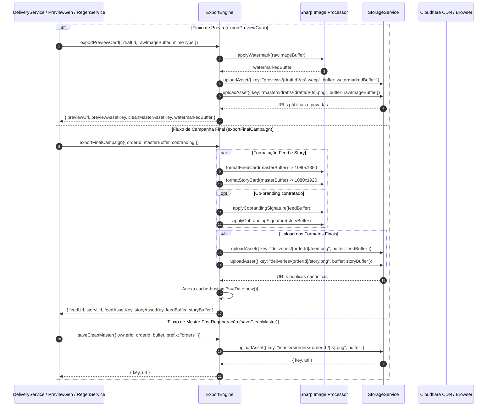
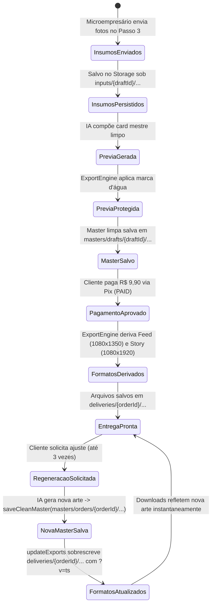

# Plano Técnico e Arquitetural: Aprofundamento do Cloudflare R2, Módulo Profundo ExportEngine e Eliminação de TOAST Bloat no PostgreSQL

- **Slug:** `storage-architecture-deepening`
- **Spec:** [`docs/specs/storage-architecture-deepening.md`](../specs/storage-architecture-deepening.md)
- **Macro-Tickets:**
  - [`01-backend-storage-stream.md`](../tickets/storage-architecture-deepening/01-backend-storage-stream.md) (Stream 1: Sealing da Costura StorageService, Drivers R2/Memória, Módulo Profundo ExportEngine e Schemas de Insumos)
  - [`02-delivery-and-intake-stream.md`](../tickets/storage-architecture-deepening/02-delivery-and-intake-stream.md) (Stream 2: Refatoração de Chamadores Delivery, Preview, Regeneração e Ingestão de Insumos no Assistente)
- **Status:** `ready-for-execution`

---

## 1. Visão Geral Arquitetural e Auditoria dos 4 Pilares de Engenharia

Esta iniciativa aprofunda e sela a arquitetura de armazenamento do OfertaPronta, transformando o `ExportEngine` em um Módulo Profundo (*Deep Module*), eliminando vazamentos de abstração no `StorageService` e sanando uma vulnerabilidade latente de inchaço de dados (*TOAST bloat*) no banco PostgreSQL decorrente do envio de fotos em Base64 no assistente de criação de anúncios.

### Pilar 1: Arquitetura & Deep Modules (`codebase-design`)
- **Sealing Hermético do `StorageService`:**
  - O `InMemoryStorageDriver` atual gera URLs sintéticas contendo `"https://storage.local.fake"`, que forçam os chamadores a realizar *string sniffing* frágil (`url.includes("storage.local.fake")`) para desviar o fluxo para endpoints de download locais.
  - A costura é vedada: quando `publicUrlBase` não for fornecida, o `InMemoryStorageDriver` passa a retornar Data URLs autocontidas (`data:${contentType};base64,...`) perfeitamente consumíveis por tags `` e clientes HTTP sem necessidade de rede.
  - O `CloudflareR2StorageDriver` passa a adotar política *fail-fast* estrita: sua inicialização sem `publicUrl` (`R2_PUBLIC_URL`) lança erro imediato em tempo de inicialização, prevenindo a geração de URLs privadas do R2 inoperantes para clientes finais.
- **Elevação do `ExportEngine` a Módulo Profundo:**
  - Anteriormente, o `ExportEngine` expunha apenas funções utilitárias isoladas do Sharp (`formatFeedCard`, `formatStoryCard`, `applyWatermark`, `applyCobrandingSignature`), delegando aos chamadores (`DeliveryService`, `PreviewGeneratorService`, `PostPaymentRegenerationService`) a responsabilidade de formatar dimensões, construir nomes canônicos de arquivos, chamar o `StorageService` e anexar strings de cache-busting de CDN (`?v=timestamp`).
  - O novo `ExportEngine` encapsula o pipeline completo através de 3 métodos de alto nível:
    1. `exportPreviewCard`: aplica marca d'água diagonal, persiste prévia pública (`previews/{draftId}/{timestamp}.webp`) e mestre limpa privada (`masters/drafts/{draftId}/{timestamp}.png`), retornando chaves e URLs canônicas.
    2. `exportFinalCampaign`: deriva os formatos Feed (1080×1350) e Story (1080×1920 com barras desfocadas harmônicas), aplica co-branding se contratado, faz upload em `deliveries/{orderId}/feed.png` e `story.png`, e anexa cache-busting determinístico (`?v=timestamp`).
    3. `saveCleanMaster`: persiste artes mestres em caminhos canônicos (`masters/orders/{orderId}/{timestamp}.png` ou `masters/drafts/...`) retornando chave e URL.
  - **Leverage Máximo:** Deletar o `ExportEngine` espalharia dezenas de linhas de I/O, Sharp e formatação de strings por 4 serviços diferentes; sua centralização oferece interface concisa e implementação rica.

### Pilar 2: Integridade de Regras de Negócio
- **Simetria Rigorosa na Regeneração Pós-Pagamento:**
  - Ao regenerar um card em `PostPaymentRegenerationService`, a nova arte mestre gerada pelo Google Gemini deixa de ser gravada apenas como Base64 no snapshot do pedido: ela é obrigatoriamente persistida no `StorageService` via `exportEngine.saveCleanMaster(...)` e o campo `orders.cleanMasterAssetKey` é atualizado atomicamente no banco.
  - O `deliveryService.updateExports(...)` substitui os arquivos HD no bucket com cache-busting atualizado, garantindo que o cliente baixe imediatamente o card corrigido sem colisões de cache de CDN ou navegador.
- **Preservação de Cota e Transações Atômicas:**
  - A cota de 3 regenerações por pedido continua protegida: falhas na chamada do modelo multimodal do Gemini abortam a operação sem incrementar o contador `aiRegenerationCount` e sem corromper a arte mestre anterior.
- **Retrocompatibilidade Transparente com Dados Legados:**
  - Registros de rascunhos ou pedidos anteriores à migração (que contêm imagens gravadas em Data URLs Base64 no PostgreSQL) continuam sendo lidos e processados normalmente através de *fallback* transparente, sem quebrar funcionalidades em produção.

### Pilar 3: Segurança por Design
- **Fail-Fast de Configuração de Ambiente:**
  - Se `STORAGE_DRIVER === "r2"`, a ausência de `R2_PUBLIC_URL` interrompe a subida da aplicação com mensagem operacional explícita, impedindo que a aplicação sirva links inacessíveis.
- **Isolamento Estrito de Credenciais e Binários:**
  - Chaves de API do R2/S3 e banco residem exclusivamente em `serverEnv` (`src/config/server-env.ts`), inacessíveis no bundle do navegador.
  - Downloads de alta resolução continuam autorizados exclusivamente para pedidos com status confirmado `PAID`.
  - O endpoint de download realiza streaming com sanitização de cabeçalhos RFC 6266 (`Content-Disposition: attachment; filename="ofertapronta-{format}-{orderId}.png"`).

### Pilar 4: Qualidade, Simplicidade & Anti-Bloat (YAGNI & TDD)
- **Eliminação de Bloat TOAST no PostgreSQL:**
  - Insumos enviados pelo microempresário no assistente (Foto do Produto, Imagem de Referência e Logotipo) pesavam entre 5 MB e 15 MB por rascunho na tabela `drafts`.
  - O pipeline de salvamento (`saveOfferDraft`) intercepta Data URLs Base64, salva os binários no `StorageService` sob chaves leves (`inputs/{draftId}/product.png`, `reference.png`, `logo.png`) e grava apenas essas chaves de texto no PostgreSQL, mantendo as colunas Base64 nulas. O peso por rascunho cai de ~10 MB para menos de 2 KB.
- **Costuras TDD com Fakes In-Memory (Replace-Don't-Layer):**
  - Zero dependência de mocks do Vitest para serviços externos de cloud storage. O `InMemoryStorageDriver` implementa a interface `StorageService` completa, permitindo testes ultrarrápidos executando em menos de 2 segundos.

---

## 2. Diagramas Estruturais da Arquitetura (Mermaid)

### 2.1. Topologia de Módulos e Limites de Fronteira

```mermaid
flowchart TD
    subgraph Client ["Client Browser (Mobile-First UI)"]
        Wizard["OfferCreationWizard / Step3VisualAssets"]
        DeliveryUI["OrderDeliveryView / PedidoRoute"]
    end

    subgraph RPC ["Fronteira RPC / Server Functions"]
        SaveDraftRPC["saveDraftFn"]
        GenPreviewRPC["generatePreviewFn"]
        RegenRPC["regenerateCardFn"]
        DownloadAPI["/api/delivery/download"]
    end

    subgraph DeepModules ["Módulos Profundos (Server-Only)"]
        DraftsService["drafts.service.ts\n(Intake & Insumos)"]
        PreviewGen["preview-generator.service.ts\n(Cota Grátis 1)"]
        RegenService["post-payment-regeneration.service.ts\n(Cota Paga 3)"]
        DeliveryService["delivery.service.ts\n(Entrega HD & Cache)"]
        ExportEngine["ExportEngine\n(Sharp + Layouts Canônicos)"]
        StorageService["StorageService\n(R2Driver / InMemoryDriver)"]
    end

    subgraph StorageBackends ["Armazenamento Físico"]
        Postgres[("PostgreSQL\n(Drizzle ORM - Metadados Leves)")]
        R2Bucket[("Cloudflare R2 Bucket\n(Zero Egress CDN)")]
        MemoryStore[("InMemory Map\n(Testes & Offline Dev)")]
    end

    Wizard -->|Envia Briefing + Fotos| SaveDraftRPC
    Wizard -->|Gera Prévia Gratuita| GenPreviewRPC
    DeliveryUI -->|Solicita Ajuste IA| RegenRPC
    DeliveryUI -->|Download HD| DownloadAPI

    SaveDraftRPC --> DraftsService
    GenPreviewRPC --> PreviewGen
    RegenRPC --> RegenService
    DeliveryUI --> DeliveryService
    DownloadAPI --> DeliveryService

    DraftsService -->|Upload inputs/{draftId}/...| StorageService
    DraftsService -->|Grava chaves leves de asset| Postgres

    PreviewGen -->|Busca insumos| StorageService
    PreviewGen -->|exportPreviewCard| ExportEngine

    RegenService -->|saveCleanMaster| ExportEngine
    RegenService -->|updateExports| DeliveryService
    RegenService -->|Atualiza cleanMasterAssetKey| Postgres

    DeliveryService -->|exportFinalCampaign| ExportEngine
    DeliveryService -->|Grava URLs e chaves| Postgres

    ExportEngine -->|I/O de Imagens| StorageService

    StorageService -.->|STORAGE_DRIVER=r2| R2Bucket
    StorageService -.->|STORAGE_DRIVER=memory| MemoryStore
```

### 2.2. Sequência de Ingestão de Insumos do Microempresário (Drafts Intake)

```mermaid
sequenceDiagram
    autonumber
    actor User as Microempresário (Celular)
    participant UI as Step3VisualAssets
    participant RPC as saveDraftFn
    participant Service as drafts.service.ts
    participant Storage as StorageService
    participant DB as PostgreSQL (drafts)

    User->>UI: Seleciona Foto do Produto / Referência / Logo
    UI->>RPC: saveDraft({ id, productImageDataUrl: "data:image/png;base64,..." })
    RPC->>Service: saveOfferDraft(input)
    
    alt Insumo contém Data URL Base64
        Service->>Service: Decodifica buffer binário e detecta contentType
        Service->>Storage: uploadAsset({ key: "inputs/{draftId}/product.png", buffer, contentType: "image/png" })
        Storage-->>Service: { key: "inputs/{draftId}/product.png", url: "https://cdn.../inputs/..." }
        Service->>DB: UPSERT drafts SET product_asset_key = "inputs/{draftId}/product.png", product_image_data_url = NULL
    else Insumo removido (null ou undefined)
        Service->>Storage: deleteAsset("inputs/{draftId}/product.png")
        Service->>DB: UPSERT drafts SET product_asset_key = NULL, product_image_data_url = NULL
    else Insumo inalterado (URL pública existente)
        Service->>DB: UPSERT drafts (preserva product_asset_key sem re-upload)
    end

    DB-->>Service: Draft persistido (< 2 KB)
    Service-->>RPC: Draft consolidado
    RPC-->>UI: Confirmação de salvamento
```

### 2.3. Sequência de Exportação Unificada via ExportEngine



### 2.4. Ciclo de Vida de Armazenamento e Regeneração



---

## 3. Contratos Técnicos e Interfaces Detalhadas

### 3.1. Sealing do `StorageService` (`src/server/storage/`)

#### 3.1.1. Interface Unificada (`src/server/storage/index.ts`)
```typescript
export interface AssetUploadOptions {
  key: string;
  buffer: Buffer;
  contentType: string;
  isPublic?: boolean;
  metadata?: Record<string, string>;
}

export interface AssetUploadResult {
  key: string;
  url: string;
}

export interface StorageAsset {
  buffer: Buffer;
  contentType: string;
}

export interface StorageService {
  uploadAsset(options: AssetUploadOptions): Promise<AssetUploadResult>;
  getAsset(key: string): Promise<StorageAsset | null>;
  deleteAsset(key: string): Promise<void>;
  getPublicUrl(key: string): string;
}
```

#### 3.1.2. Comportamento do `InMemoryStorageDriver` (`src/server/storage/memory-driver.ts`)
- **Eliminação de `storage.local.fake`:**
  - Quando `publicUrlBase` for fornecida explicitamente: retorna `${publicUrlBase}/${cleanKey}`.
  - Quando `publicUrlBase` for omitida (padrão em testes e dev local): busca o asset no mapa de memória. Se presente, gera uma Data URL compatível com qualquer navegador: `data:${asset.contentType};base64,${asset.buffer.toString("base64")}`. Se a chave não existir no momento da consulta, gera Data URL neutra para evitar referências nulas.
  - `uploadAsset`: retorna a URL canônica gerada por `getPublicUrl(key)`.

#### 3.1.3. Validação Fail-Fast no `CloudflareR2StorageDriver` (`src/server/storage/r2-driver.ts`)
- No construtor:
  ```typescript
  if (!options.publicUrl || options.publicUrl.trim().length === 0) {
    throw new Error(
      "CloudflareR2StorageDriver requer publicUrl (R2_PUBLIC_URL) obrigatória para distribuição pública via CDN.",
    );
  }
  ```
- O método `getPublicUrl(key)` passa a retornar invariavelmente `${this.publicUrl}/${cleanKey}`, eliminando qualquer menção ou teste com URLs privadas ou sintéticas.

---

### 3.2. Módulo Profundo `ExportEngine` (`src/server/export-engine/`)

#### 3.2.1. Contrato da Interface Pública (`src/server/export-engine/index.ts`)
```typescript
export interface ExportPreviewCardInput {
  draftId: string;
  rawImageBuffer: Buffer;
  mimeType?: string;
  watermarkText?: string;
  subText?: string;
}

export interface ExportPreviewCardResult {
  previewUrl: string;
  previewAssetKey: string;
  cleanMasterAssetKey: string;
  watermarkedBuffer: Buffer;
}

export interface ExportFinalCampaignInput {
  orderId: string;
  masterBuffer: Buffer;
  cobranding?: {
    accepted: boolean;
    creditText?: string;
  };
}

export interface ExportFinalCampaignResult {
  feedUrl: string;
  feedAssetKey: string;
  storyUrl: string;
  storyAssetKey: string;
  feedBuffer: Buffer;
  storyBuffer: Buffer;
}

export interface SaveCleanMasterInput {
  ownerId: string; // draftId ou orderId
  buffer: Buffer;
  contentType?: string;
  prefix?: "drafts" | "orders";
}

export interface SaveCleanMasterResult {
  key: string;
  url: string;
}

export interface ExportEngine {
  exportPreviewCard(input: ExportPreviewCardInput): Promise<ExportPreviewCardResult>;
  exportFinalCampaign(input: ExportFinalCampaignInput): Promise<ExportFinalCampaignResult>;
  saveCleanMaster(input: SaveCleanMasterInput): Promise<SaveCleanMasterResult>;
}
```

#### 3.2.2. Implementação Concreta e Fábrica Singleton
- **Convenção Canônica de Chaves:**
  - Prévias protegidas: `previews/{draftId}/{timestamp}.webp` (ou `.png` dependendo do pipeline)
  - Mestres limpas de rascunhos: `masters/drafts/{draftId}/{timestamp}.png`
  - Mestres limpas de pedidos pós-regeneração: `masters/orders/{orderId}/{timestamp}.png`
  - Formatos finais HD:
    - Feed: `deliveries/{orderId}/feed.png`
    - Story: `deliveries/{orderId}/story.png`
  - Sufixo de cache-busting automático: `?v=${Date.now()}` anexado às URLs finais retornadas por `exportFinalCampaign`.
- **Fábrica e Injeção para Testes:**
  - `getExportEngine(deps?: { storageService?: StorageService }): ExportEngine`
  - `setExportEngineForTesting(engine: ExportEngine | null): void`

---

### 3.3. Drizzle Schema e Migrações SQL (`src/server/db/schema/promotions.ts`)

#### 3.3.1. Novas Colunas na Tabela `drafts`
```typescript
export const drafts = pgTable("drafts", {
  id: text("id").primaryKey(),
  // ... colunas existentes ...
  
  // === COLUNAS DE ASSETS DE INSUMOS (DRAFTS INTAKE) ===
  productAssetKey: text("product_asset_key"),
  referenceAssetKey: text("reference_asset_key"),
  logoAssetKey: text("logo_asset_key"),

  // === COLUNAS DE ARMAZENAMENTO R2 ===
  previewAssetKey: text("preview_asset_key"),
  cleanMasterAssetKey: text("clean_master_asset_key"),
  // ...
});
```

#### 3.3.2. Migração SQL Oficial (`drizzle/0009_warm_dormammu.sql`)
```sql
ALTER TABLE "drafts" ADD COLUMN "product_asset_key" text;
ALTER TABLE "drafts" ADD COLUMN "reference_asset_key" text;
ALTER TABLE "drafts" ADD COLUMN "logo_asset_key" text;
```
Gerada via `pnpm db:generate` e aplicada via `pnpm db:migrate` dentro da worktree.

---

### 3.4. Ingestão de Insumos e Schemas Zod (`src/features/promotions/`)

#### 3.4.1. Atualização no `saveOfferDraftSchema` (`offer-brief.schema.ts`)
```typescript
export const saveOfferDraftSchema = z.object({
  id: z.string().optional(),
  // ...
  productImageDataUrl: imageDataUrlSchema.optional().nullable(),
  referenceImageDataUrl: imageDataUrlSchema.optional().nullable(),
  logoImageDataUrl: imageDataUrlSchema.optional().nullable(),
  
  // Novas chaves leves opcionais
  productAssetKey: z.string().optional().nullable(),
  referenceAssetKey: z.string().optional().nullable(),
  logoAssetKey: z.string().optional().nullable(),

  previewAssetKey: z.string().optional().nullable(),
  cleanMasterAssetKey: z.string().optional().nullable(),
});
```

#### 3.4.2. Fluxo em `drafts.service.ts` (`saveOfferDraft` e `getOfferDraft`)
- **Em `saveOfferDraft`:**
  - Função auxiliar `processVisualAsset(draftId, assetType, inputDataUrl, existingAssetKey, storageService)`:
    - Se `inputDataUrl` começar com `"data:image/"`:
      - Converte para buffer e detecta contentType (`image/png`, `image/jpeg`, etc.).
      - Faz upload para `inputs/${draftId}/${assetType}.png` via `storageService.uploadAsset(...)`.
      - Retorna `{ assetKey: "inputs/...", dataUrl: null }`.
    - Se `inputDataUrl === null`:
      - Se havia `existingAssetKey`, invoca `storageService.deleteAsset(existingAssetKey)`.
      - Retorna `{ assetKey: null, dataUrl: null }`.
    - Se `inputDataUrl` for uma URL existente ou indefinida:
      - Mantém a chave existente sem re-upload e preserva Data URL nula.
  - Grava no PostgreSQL apenas as chaves leves (`productAssetKey`, etc.) e define as colunas legadas como nulas para evitar bloat no TOAST.
- **Em `getOfferDraft`:**
  - Para garantir transparência total no frontend (`Step3VisualAssets`), se a coluna `productAssetKey` estiver presente e `productImageDataUrl` for nula, resolve a URL pública via `storageService.getPublicUrl(draft.productAssetKey)` e a preenche no campo retornado. O assistente exibe a imagem perfeitamente sem modificações no componente visual.

#### 3.4.3. Resolução no `PreviewGeneratorService`
- Ao preparar os insumos para o `aiCardGenerator`:
  - Se `draft.productAssetKey` estiver presente, busca o buffer via `storageService.getAsset(draft.productAssetKey)` e converte em Data URL para o SDK `@google/genai`.
  - Se for rascunho legado sem `productAssetKey`, utiliza a coluna `draft.productImageDataUrl` diretamente.
  - O mesmo processo é executado para a imagem de referência e logotipo.

---

### 3.5. Simetria na Regeneração Pós-Pagamento (`PostPaymentRegenerationService`)

1. Ao receber a nova imagem gerada pelo Gemini:
   ```typescript
   const masterResult = await this.exportEngine.saveCleanMaster({
     ownerId: orderId,
     buffer: generationResult.rawImageBuffer,
     prefix: "orders",
   });
   ```
2. Atualiza a tabela `orders`:
   ```typescript
   await this.database
     .update(orders)
     .set({
       aiRegenerationCount: sql`${orders.aiRegenerationCount} + 1`,
       cleanMasterAssetKey: masterResult.key,
       cleanMasterImageDataUrl: null, // Evita bloat no pedido pós-regeneração
       frozenSnapshot: updatedSnapshot,
       updatedAt: now,
     })
     .where(eq(orders.id, orderId));
   ```
3. Atualiza os exports chamando `deliveryService.updateExports(orderId, generationResult.rawImageBuffer)`.
4. Ambos os registros de assets e os arquivos finais em `deliveries/{orderId}/` permanecem 100% sincronizados.

---

## 4. Checklist de Segurança e Qualidade

- [x] **Fail-Fast no Driver R2:** Lançamento imediato de exceção no construtor de `CloudflareR2StorageDriver` se `publicUrl` estiver ausente.
- [x] **Zero Strings Mágicas:** Remoção definitiva de `"storage.local.fake"` em todos os arquivos de produção e teste.
- [x] **Autorização de Entrega:** Verificação estrita de `orders.status === "PAID"` antes de qualquer geração ou download de PNG em alta resolução.
- [x] **Segurança de Streaming:** Cabeçalhos `Content-Disposition: attachment; filename="ofertapronta-{format}-{orderId}.png"` e tipo MIME validado.
- [x] **Anti-Bloat no Banco:** Colunas `product_image_data_url`, `reference_image_data_url` e `logo_image_data_url` mantidas como `NULL` para novos uploads, substituídas por chaves de texto (< 2 KB por draft).
- [x] **Retrocompatibilidade:** Processamento automático e transparente de drafts legados que contenham Data URLs Base64.
- [x] **TDD Cirúrgico:** Testes unitários com fakes in-memory executando em menos de 2 segundos sem acoplamento de rede externa.

---

## 5. Plano de Costuras TDD e Escopo dos Builders Paralelos

### Stream 1: Backend Storage Stream (`01-backend-storage-stream.md`)
- **Responsável:** `backend-builder` (Stream 1)
- **Escopo de Arquivos:**
  - `src/server/storage/index.ts`
  - `src/server/storage/memory-driver.ts`
  - `src/server/storage/r2-driver.ts`
  - `src/server/storage/storage.service.test.ts`
  - `src/server/export-engine/index.ts`
  - `src/server/export-engine/export-engine.service.ts` (ou classe central `ExportEngine`)
  - `src/server/export-engine/export-engine.test.ts`
  - `src/server/db/schema/promotions.ts`
  - `drizzle/` (migração gerada via `pnpm db:generate && pnpm db:migrate`)
- **Comandos de Verificação TDD Cirúrgica:**
  ```bash
  pnpm vitest run src/server/storage/storage.service.test.ts src/server/export-engine/export-engine.test.ts
  pnpm typecheck
  ```

### Stream 2: Delivery & Intake Stream (`02-delivery-and-intake-stream.md`)
- **Responsável:** `backend-builder` / `frontend-builder` (Stream 2)
- **Escopo de Arquivos:**
  - `src/features/delivery/server/services/delivery.service.ts`
  - `src/features/delivery/server/services/delivery.service.test.ts`
  - `src/features/delivery/server/services/post-payment-regeneration.service.ts`
  - `src/features/delivery/server/services/post-payment-regeneration.service.test.ts`
  - `src/features/promotions/server/services/preview-generator.service.ts`
  - `src/features/promotions/server/functions/generator.functions.test.ts`
  - `src/features/promotions/server/services/drafts.service.ts`
  - `src/features/promotions/server/services/drafts.service.test.ts`
  - `src/features/promotions/data/offer-brief.schema.ts`
  - `src/features/promotions/components/wizard/step3-visual-assets.test.tsx`
- **Comandos de Verificação TDD Cirúrgica:**
  ```bash
  pnpm vitest run src/features/delivery/server/services/delivery.service.test.ts src/features/delivery/server/services/post-payment-regeneration.service.test.ts src/features/promotions/server/services/drafts.service.test.ts src/features/promotions/server/functions/generator.functions.test.ts
  pnpm typecheck
  ```

---

## 6. Verificação de Fechamento & Pipeline Global

Concluídas ambas as streams, o pipeline oficial completo deve ser executado pelo `test-verifier`:
```bash
./.agents/scripts/verify.sh
```
Garantindo conformidade total de Shadcn UI, Typecheck estrito, ESLint, suíte completa de testes unitários/integração com Vitest e build de produção do TanStack Start / Nitro.
