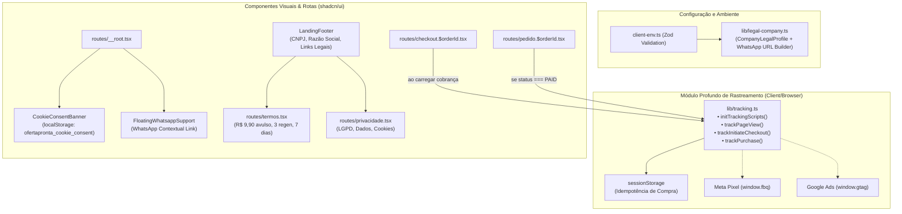
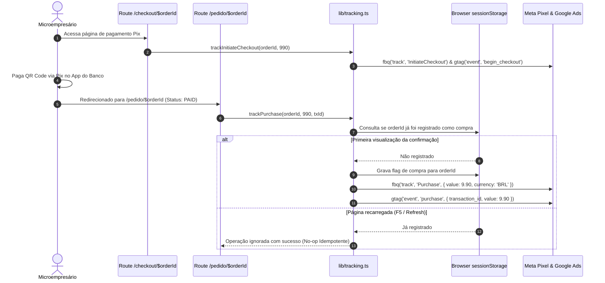

# Plano Técnico: Trust & Compliance (LGPD, Termos de Uso, Dados Legais e Tracking de Conversão)

- **Slug**: `trust-compliance`
- **Spec**: [`docs/specs/trust-compliance.md`](../specs/trust-compliance.md)
- **Tickets**:
  1. [`01-data-tracking-infrastructure.md`](../tickets/trust-compliance/01-data-tracking-infrastructure.md) (Stream 1: Backend/Config & Tracking Core)
  2. [`02-ui-pages-legal-compliance.md`](../tickets/trust-compliance/02-ui-pages-legal-compliance.md) (Stream 2: UI Pages, Banner LGPD, WhatsApp Floating & Footer)

---

## 1. Visão Geral Executiva da Arquitetura

O OfertaPronta opera no modelo de conversão direta sem cadastro prévio, no qual microempresários pagam R$ 9,90 via Pix por campanha de Cards Publicitários gerados por IA. 

Para eliminar qualquer fricção de desconfiança legal, atender integralmente à LGPD e viabilizar mensuração com precisão cirúrgica de campanhas em tráfego pago (Meta Ads e Google Ads), esta feature introduz:
1. **Configuração Unificada de Identidade Legal e Suporte (`legal-company.ts` & `client-env.ts`)**: Mapeamento seguro e tipado com Zod de Razão Social, CNPJ, E-mail e WhatsApp com fallbacks determinísticos.
2. **Módulo Profundo de Tracking Isomórfico (`tracking.ts`)**: Interface pública simples (`trackPageView`, `trackInitiateCheckout`, `trackPurchase`) ocultando inicialização assíncrona, sanitização, resiliência no SSR e **idempotência de conversão via sessionStorage** (evitando disparos duplicados de compra em refresh).
3. **Páginas Institucionais Transparentes (`/termos` e `/privacidade`)**: Construídas com primitivos do design system `shadcn/ui`, esclarecendo o modelo avulso (sem assinatura), limite de 3 regenerações de IA em 30 min e retenção segura de 7 dias.
4. **Consentimento LGPD Mobile-First (`CookieConsentBanner`)**: Banner não obstrutivo no rodapé com persistência em `localStorage` e montagem protegida contra SSR hydration mismatches.
5. **Canal de Atendimento de Suporte Ágil (`FloatingWhatsappSupport`)**: Botão flutuante acessível no canto inferior direito com mensagem pré-formatada contextualizada.

---

## 2. Diagramas de Arquitetura

### 2.1 Topologia de Módulos e Fluxo de Dados (Mermaid)



### 2.2 Ciclo de Vida do Tracking de Conversão e Idempotência (Sequence Diagram)



---

## 3. Interfaces Públicas e Contratos Técnicos

### 3.1 `src/config/client-env.ts` (Atualização com Zod)
```ts
import { z } from "zod";

const clientEnvSchema = z.object({
  VITE_PUBLIC_APP_NAME: z.string().min(1).default("OfertaPronta"),
  VITE_PUBLIC_APP_URL: z.string().url().default("http://localhost:3000"),
  VITE_PUBLIC_LEGAL_NAME: z.string().optional(),
  VITE_PUBLIC_LEGAL_CNPJ: z.string().optional(),
  VITE_PUBLIC_CONTACT_EMAIL: z.string().email().optional(),
  VITE_PUBLIC_SUPPORT_WHATSAPP: z.string().optional(),
  VITE_PUBLIC_META_PIXEL_ID: z.string().optional(),
  VITE_PUBLIC_GOOGLE_ADS_ID: z.string().optional(),
});
```

### 3.2 `src/lib/legal-company.ts` (Deep Module de Identidade Legal)
```ts
export interface CompanyLegalProfile {
  legalName: string;
  tradeName: string;
  cnpj: string;
  contactEmail: string;
  supportWhatsapp: string;
  supportWhatsappUrl: string;
  addressCityState: string;
}

export function formatCnpj(rawCnpj: string): string;
export function buildWhatsappSupportUrl(phone: string, text?: string): string;
export function getCompanyLegalProfile(): CompanyLegalProfile;
```

### 3.3 `src/lib/tracking.ts` (Deep Module de Tracking de Conversão)
```ts
export interface TrackingEventParams {
  orderId?: string;
  amountCents?: number;
  txId?: string;
  currency?: string;
}

export function initTrackingScripts(): void;
export function trackPageView(pageUrl?: string): void;
export function trackInitiateCheckout(orderId: string, amountCents: number): void;
export function trackPurchase(orderId: string, amountCents: number, txId?: string): void;
```

---

## 4. Checklist de Segurança, Qualidade e Invariantes

- [x] **Zero Server Leaks**: Nenhuma variável de segredo (`server-env.ts`, `DATABASE_URL`, etc.) é importada nos módulos `legal-company.ts`, `tracking.ts` ou componentes.
- [x] **Sanitização de URLs**: Sanitização rigorosa no gerador de links do WhatsApp (`encodeURIComponent`, remoção de caracteres não numéricos).
- [x] **Idempotência de Compra**: Deduplicação estrita via `sessionStorage` chaveada por `orderId` para evitar disparar `Purchase` mais de uma vez no reload da página.
- [x] **Zero SSR Hydration Mismatch**: `CookieConsentBanner` e `FloatingWhatsappSupport` usam verificação de montagem no cliente (`isMounted` via `useEffect`) com chave de consentimento no `localStorage`.
- [x] **Conformidade Shadcn UI**: Proibido uso de `<p>`, `<h1>`-`<h6>`, `<small>` nativos desestilizados; uso obrigatório de `<Typography variant="...">` e `<Button>` conforme auditado por `./.agents/scripts/check_shadcn_usage.py`.
- [x] **YAGNI Radical**: Sem SDKs pesados de terceiros no bundle principal. Injeção dinâmica assíncrona apenas quando os IDs existirem no ambiente.

---

## 5. Plano de Execução em Macro-Streams Paralelas

### Macro-Stream 1: Backend/Config & Tracking Core (`01-data-tracking-infrastructure.md`)
- **Arquivos**:
  - `src/config/client-env.ts`
  - `src/lib/legal-company.ts`
  - `src/lib/legal-company.test.ts`
  - `src/lib/tracking.ts`
  - `src/lib/tracking.test.ts`
  - `src/routes/checkout.$orderId.tsx` (ou `checkout-view.tsx`)
  - `src/routes/pedido.$orderId.tsx` (ou `order-delivery-view.tsx`)
- **Comandos de Teste do Builder**:
  - `pnpm vitest run src/lib/legal-company.test.ts`
  - `pnpm vitest run src/lib/tracking.test.ts`
  - `pnpm typecheck`

### Macro-Stream 2: UI Pages, Banner LGPD, WhatsApp & Footer (`02-ui-pages-legal-compliance.md`)
- **Arquivos**:
  - `src/components/shared/cookie-consent-banner.tsx`
  - `src/components/shared/cookie-consent-banner.test.tsx`
  - `src/components/shared/floating-whatsapp-support.tsx`
  - `src/components/shared/floating-whatsapp-support.test.tsx`
  - `src/components/shared/landing-footer.tsx`
  - `src/components/shared/landing-footer.test.tsx`
  - `src/routes/termos.tsx`
  - `src/routes/privacidade.tsx`
  - `src/routes/__root.tsx`
- **Comandos de Teste do Builder**:
  - `pnpm vitest run src/components/shared/cookie-consent-banner.test.tsx`
  - `pnpm vitest run src/components/shared/floating-whatsapp-support.test.tsx`
  - `pnpm vitest run src/components/shared/landing-footer.test.tsx`
  - `./.agents/scripts/verify.sh --shadcn`
  - `pnpm typecheck`
