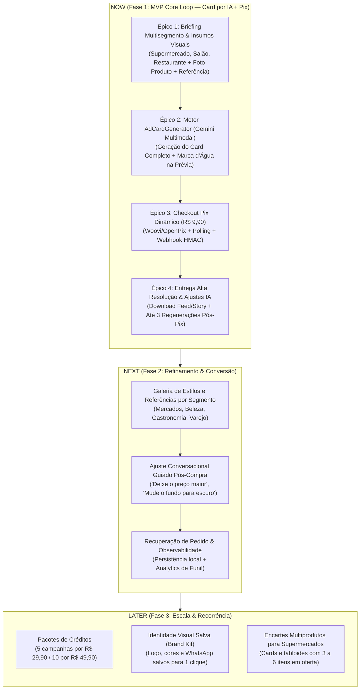

# Roadmap Estratégico — OfertaPronta

**Versão:** 2.0  
**Data:** 15/10/2026  
**Status:** Aprovado para Ciclo MVP (Core: Geração de Cards Publicitários por IA para Microempresários)  
**Horizonte:** Q4 2026 — Q1 2027  
**Alinhamento Estratégico:** PRD v2.0, GLOSSARY.md, ADR 0001 e ADR 0002

---

## 1. Contexto Estratégico & Objetivos de Negócio

### 1.1 Proposta de Valor
> *"Seu card publicitário criado por IA e pronto para postar, sem precisar saber design."*

O **OfertaPronta** resolve a dor crítica de **microempresários de diversos segmentos** (donos de supermercado, cabeleireiros, salões de beleza, barbearias, pizzarias, hamburguerias, restaurantes e comércio local) que precisam divulgar ofertas diariamente no Instagram e WhatsApp, mas não têm tempo nem domínio técnico para usar editores complexos (Canva/Photoshop) ou contratar agências.

Com o OfertaPronta, o microempresário informa os dados da promoção (**Briefing da Oferta**), envia opcionalmente a **Imagem do Produto** e/ou uma **Imagem de Referência** (ou escolhe um **Estilo Visual**), e a **Inteligência Artificial gera o Card Publicitário (`Ad Card`) completo** — com cenário, produto ambientado, estética da referência e textos/preços integrados.

### 1.2 OKRs & Metas do Ciclo de MVP

| ID | Objetivo Estratégico | Métrica Chave (KR) | Meta |
|---|---|---|---|
| **OKR 1** | **Validação Comercial Multisegmento** | Transações Pix concluídas com dinheiro real (R$ 9,90) | ≥ 30 campanhas pagas no primeiro mês |
| **OKR 2** | **Fluidez e Baixo Atrito (No-Login)** | Tempo médio da abertura até a prévia do Card gerado por IA | ≤ 90 segundos |
| **OKR 3** | **Qualidade Criativa da IA** | Taxa de aprovação do Card gerado na 1ª prévia ou com até 3 ajustes | ≥ 80% de aprovação |
| **OKR 4** | **Confiabilidade de Entrega** | Liberação automática dos PNGs sem marca d'água em < 5s pós-Pix | ≥ 99% dos pedidos pagos |

### 1.3 Decisões Arquiteturais Fundamentais (ADR 0001 & ADR 0002)
- **Framework Unificado:** TanStack Start (Full-stack React 19 + Vinxi/Nitro + Server Functions com Zod).
- **Interface Mobile-First:** Tailwind CSS v4 + componentes primitivos shadcn/ui (viewport primário 360px–430px).
- **Motor Central de IA (`AdCardGenerator`):** Geração completa do Card Publicitário via Google Gemini Multimodal (`gemini-nano-banana-2.1` / `gemini-3-pro-image` com SDK `@google/genai`), fundindo Briefing da Oferta + Imagem do Produto (opcional) + Imagem de Referência (opcional).
- **Proteção de Prévia e Exportação (`ExportEngine`):** Aplicação server-side de marca d'água na prévia gratuita e exportação limpa em alta resolução nos formatos Feed (1080×1350) e Story (1080×1920) pós-confirmação Pix.
- **Preços Autoritativos e Idempotência:** Preço fixado no backend (R$ 9,90) com `Frozen Snapshot` em banco (`PostgreSQL + Drizzle`) e webhooks Pix protegidos por HMAC.

---

## 2. Definição de Épicos & Hipóteses de Negócio

### Épico 1: Briefing Multisegmento & Upload Flexível (Produto + Referência + Estilo)
- **Hipótese:** Acreditamos que permitir a qualquer microempresário (supermercado, salão, pizzaria, hamburgueria, restaurante) preencher o Briefing da Oferta e enviar opcionalmente a foto do seu produto e/ou uma imagem de referência (ou escolher um Estilo Visual do seu segmento) em menos de 90 segundos sem login elevará a chegada à prévia para mais de 65%.
- **Métrica de Sucesso:** Taxa de conclusão do briefing (Visitante → Geração de Prévia) ≥ 65%; tempo médio ≤ 90s.
- **Tamanho:** Médio (M) — 2 semanas.
- **Outcome:** Ativação Multisegmento / Topo de Funil.

### Épico 2: Motor de Geração de Card Publicitário por IA Multimodal (`AdCardGenerator` & `ExportEngine`)
- **Hipótese:** Acreditamos que gerar o Card Publicitário completo via IA multimodal (`gemini-nano-banana-2.1` / `gemini-3-pro-image`) integrando o produto enviado, a direção visual da referência e os textos/preços da promoção nos formatos Feed (1080×1350) e Story (1080×1920) entregará percepção de valor de nível de agência por R$ 9,90.
- **Métrica de Sucesso:** Taxa de conversão da Prévia com Marca d'Água para o Checkout ≥ 35%; tempo de geração do card ≤ 10s.
- **Tamanho:** Grande (L) — 2 a 3 semanas.
- **Outcome:** Core Value / Diferencial Competitivo do Produto.

### Épico 3: Checkout Pix Dinâmico & Confirmação em Tempo Real (`PixCheckout`)
- **Hipótese:** Acreditamos que oferecer cobrança instantânea via Pix dinâmico (QR Code + Pix Copia e Cola) a R$ 9,90 com polling em tempo real e webhook idempotente alcançará conversão de pagamento superior a 65% dos checkouts iniciados no celular.
- **Métrica de Sucesso:** Taxa de conclusão de pagamento (Checkout → Pago) ≥ 65%; detecção pós-pagamento ≤ 4s.
- **Tamanho:** Médio (M) — 2 semanas.
- **Outcome:** Faturamento / Receita.

### Épico 4: Entrega Sem Marca d'Água & Regeneração Controlada Pós-Compra (Fulfillment)
- **Hipótese:** Acreditamos que liberar imediatamente os PNGs em alta resolução (Feed e Story) sem marca d'água após o Pix e oferecer direito a até 3 regenerações/ajustes com IA no mesmo pedido garantirá satisfação máxima sem risco de abuso de custo da API.
- **Métrica de Sucesso:** Taxa de download bem-sucedido ≥ 98%; custo médio de IA por pedido < 8% do ticket (R$ 9,90).
- **Tamanho:** Pequeno (S) — 1 a 2 semanas.
- **Outcome:** Satisfação do Cliente / Margem Saudável.

---

## 3. Sequenciamento Estratégico (Now / Next / Later)

---

## 4. Cronograma e Entregáveis da Fase 1 (MVP)

| Etapa | Foco de Entrega | Entregáveis Técnicos |
|---|---|---|
| **Etapa 1** | Briefing Multisegmento & Insumos Visuais | - Rota `/criar` mobile-first adaptada para múltiplos segmentos (Supermercado, Salão/Cabeleireiro, Pizzaria, Hamburgueria, Restaurante). - Upload combinável e opcional de **Imagem do Produto (`Product Image`)** e **Imagem de Referência (`Reference Image`)**, além de seletor de **Estilo Visual (`Style Preset`)**. |
| **Etapa 2** | Motor `AdCardGenerator` & Prévia Protegida | - Módulo profundo `src/features/promotions/server/ai-card-generator.ts` integrando `@google/genai` (`gemini-nano-banana-2.1` / `gemini-3-pro-image`). - Módulo `ExportEngine` aplicando marca d'água protetora na prévia gratuita (cota de 1 geração grátis antes do Pix) nos formatos Feed (1080×1350) e Story (1080×1920). |
| **Etapa 3** | Checkout Pix Dinâmico | - Módulo profundo `PixCheckout` com `Frozen Snapshot` (R$ 9,90). - Rota `/checkout/$orderId` com QR Code, Pix Copia e Cola e polling automático. |
| **Etapa 4** | Webhook, Entrega e Regeneração IA | - Rota `/api/webhooks/pix` com validação HMAC e idempotência. - Rota `/pedido/$orderId` liberando os PNGs limpos em alta resolução e permitindo até 3 regenerações/ajustes por IA pós-pagamento. |
