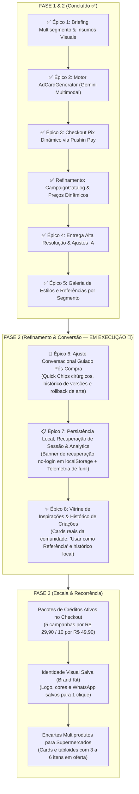

# Roadmap Estratégico — OfertaPronta

**Versão:** 3.0  
**Data:** 18/10/2026  
**Status:** Fase 1 (MVP Core Loop) 100% Concluída; Fase 2 (Refinamento & Conversão) em Execução Ativa  
**Horizonte:** Q4 2026 — Q1 2027  
**Alinhamento Estratégico:** PRD v2.0, GLOSSARY.md, ADR 0001 e ADR 0002

---

## 1. Contexto Estratégico & Objetivos de Negócio

### 1.1 Proposta de Valor
> *"Seu card publicitário criado por IA e pronto para postar, sem precisar saber design."*

O **OfertaPronta** resolve a dor crítica de **microempresários de diversos segmentos** (donos de supermercado, cabeleireiros, salões de beleza, barbearias, pizzarias, hamburguerias, restaurantes e comércio local) que precisam divulgar ofertas diariamente no Instagram e WhatsApp, mas não têm tempo nem domínio técnico para usar editores complexos (Canva/Photoshop) ou contratar agências.

Com o OfertaPronta, o microempresário informa os dados da promoção (**Briefing da Oferta**), envia opcionalmente a **Imagem do Produto** e/ou uma **Imagem de Referência** (ou escolhe um **Estilo Visual**), e a **Inteligência Artificial gera o Card Publicitário (`Ad Card`) completo** — com cenário, produto ambientado, estética da referência e textos/preços integrados.

### 1.2 OKRs & Metas do Ciclo de MVP e Fase 2

| ID | Objetivo Estratégico | Métrica Chave (KR) | Meta |
|---|---|---|---|
| **OKR 1** | **Validação Comercial Multisegmento** | Transações Pix concluídas com dinheiro real (R$ 9,90) | ≥ 50 campanhas pagas no primeiro ciclo |
| **OKR 2** | **Fluidez e Baixo Atrito (No-Login)** | Tempo médio da abertura até a prévia do Card gerado por IA | ≤ 60 segundos com estilos curados |
| **OKR 3** | **Qualidade Criativa & Refinamento da IA** | Taxa de aprovação do Card na 1ª prévia ou com até 3 ajustes guiados | ≥ 90% de aprovação final |
| **OKR 4** | **Confiabilidade de Entrega & Retenção** | Liberação instantânea dos PNGs em alta resolução e persistência local | 100% dos pedidos pagos recuperáveis |

### 1.3 Decisões Arquiteturais Fundamentais (ADR 0001 & ADR 0002)
- **Framework Unificado:** TanStack Start (Full-stack React 19 + Vinxi/Nitro + Server Functions com Zod).
- **Interface Mobile-First:** Tailwind CSS v4 + componentes primitivos shadcn/ui (viewport primário 360px–430px).
- **Motor Central de IA (`AdCardGenerator`):** Geração completa do Card Publicitário via Google Gemini Multimodal (`gemini-nano-banana-2.1` / `gemini-3-pro-image` com SDK `@google/genai`), fundindo Briefing da Oferta + Imagem do Produto (opcional) + Imagem de Referência (opcional).
- **Proteção de Prévia e Exportação (`ExportEngine`):** Aplicação server-side de marca d'água na prévia gratuita e exportação limpa em alta resolução nos formatos Feed (1080×1350) e Story (1080×1920) pós-confirmação Pix.
- **Catálogo de Preços e Conciliação Dinâmica (`CampaignCatalog`):** Módulo profundo isomórfico como fonte única da verdade para planos (`single_campaign`, pacotes de 5 e 10), precificação autoritativa, snapshots congelados e conciliação Pix via Pushin Pay.

---

## 2. Definição de Épicos & Hipóteses de Negócio

### Fase 1: MVP Core Loop (Concluída ✅)

#### Épico 1: Briefing Multisegmento & Upload Flexível (Produto + Referência + Estilo)
- **Status:** ✅ **Concluído**
- **Hipótese:** Acreditamos que permitir a qualquer microempresário (supermercado, salão, pizzaria, hamburgueria, restaurante) preencher o Briefing da Oferta e enviar opcionalmente a foto do seu produto e/ou uma imagem de referência (ou escolher um Estilo Visual do seu segmento) em menos de 90 segundos sem login elevará a chegada à prévia para mais de 65%.
- **Métrica de Sucesso:** Taxa de conclusão do briefing (Visitante → Geração de Prévia) ≥ 65%; tempo médio ≤ 90s.
- **Tamanho:** Médio (M) — 2 semanas.
- **Outcome:** Ativação Multisegmento / Topo de Funil.

#### Épico 2: Motor de Geração de Card Publicitário por IA Multimodal (`AdCardGenerator` & `ExportEngine`)
- **Status:** ✅ **Concluído**
- **Hipótese:** Acreditamos que gerar o Card Publicitário completo via IA multimodal (`gemini-nano-banana-2.1` / `gemini-3-pro-image`) integrando o produto enviado, a direção visual da referência e os textos/preços da promoção nos formatos Feed (1080×1350) e Story (1080×1920) entregará percepção de valor de nível de agência por R$ 9,90.
- **Métrica de Sucesso:** Taxa de conversão da Prévia com Marca d'Água para o Checkout ≥ 35%; tempo de geração do card ≤ 10s.
- **Tamanho:** Grande (L) — 2 a 3 semanas.
- **Outcome:** Core Value / Diferencial Competitivo do Produto.

#### Épico 3: Checkout Pix Dinâmico & Confirmação em Tempo Real (`PixCheckout`)
- **Status:** ✅ **Concluído**
- **Hipótese:** Acreditamos que oferecer cobrança instantânea via Pix dinâmico (QR Code + Pix Copia e Cola) via Pushin Pay com polling em tempo real e webhook idempotente alcançará conversão de pagamento superior a 65% dos checkouts iniciados no celular.
- **Métrica de Sucesso:** Taxa de conclusão de pagamento (Checkout → Pago) ≥ 65%; detecção pós-pagamento ≤ 4s.
- **Tamanho:** Médio (M) — 2 semanas.
- **Outcome:** Faturamento / Receita.

#### Refinamento Arquitetural: Catálogo de Preços & Conciliação Dinâmica (`CampaignCatalog`)
- **Status:** ✅ **Concluído**
- **Hipótese:** Centralizar as regras comerciais em um módulo profundo isomórfico eliminará acoplamento e hardcoded values ("R$ 9,90"), viabilizando overrides em staging e pacotes futuros sem risco de spoofing ou inconsistência em transações.
- **Tamanho:** Pequeno (S) — 1 semana.
- **Outcome:** Segurança Financeira & Escalabilidade do Catálogo.

#### Épico 4: Entrega Sem Marca d'Água & Regeneração Controlada Pós-Compra (Fulfillment)
- **Status:** ✅ **Concluído**
- **Hipótese:** Acreditamos que liberar imediatamente os PNGs em alta resolução (Feed e Story) sem marca d'água após o Pix e oferecer direito a até 3 regenerações/ajustes com IA no mesmo pedido garantirá satisfação máxima sem risco de abuso de custo da API.
- **Métrica de Sucesso:** Taxa de download bem-sucedido ≥ 98%; custo médio de IA por pedido < 8% do ticket (R$ 9,90).
- **Tamanho:** Pequeno (S) — 1 a 2 semanas.
- **Outcome:** Satisfação do Cliente / Margem Saudável.

---

### Fase 2: Refinamento, Conversão & Retenção (Em Execução 🚀)

#### Épico 5: Galeria de Estilos Visuais e Referências por Segmento (`StylePresetGallery`)
- **Status:** ✅ **Concluído**
- **Hipótese:** Acreditamos que oferecer uma galeria visual com cards de referência reais pré-curados para nichos específicos (Supermercados/Hortifrúti, Barbearias/Salões, Gastronomia/Pizzaria/Hamburgueria, Varejo/Comércio Local) selecionáveis em 1 toque aumentará a confiança do microempresário sem material próprio, reduzindo o tempo de criação e elevando a conversão de entrada.
- **Métrica de Sucesso:** Taxa de conversão Visitante → Prévia Gerada ≥ 70%; ≥ 50% dos rascunhos utilizando presets visuais curados; tempo até a prévia ≤ 60s.
- **Tamanho:** Médio (M) — 1 a 2 semanas.
- **Outcome:** Aceleração do Topo de Funil & Qualidade Visual Percebida.

#### Épico 6: Ajuste Conversacional Guiado Pós-Compra (`ConversationalCardRefinement`)
- **Status:** 🎯 **Prioridade Ativa — Pronto para Especificação**
- **Hipótese:** Acreditamos que substituir o formulário genérico de texto livre pós-compra por Quick Chips de intenção cirúrgica de 1 toque ("Destacar mais o preço", "Mudar fundo para escuro/premium", "Ajustar chamada para WhatsApp", "Aumentar contraste") com preservação estrita da arte base e histórico de versões com rollback aumentará a taxa de sucesso das 3 regenerações e a satisfação final do cliente.
- **Métrica de Sucesso:** ≥ 85% dos usuários que utilizam regeneração aplicando ao menos 1 Quick Chip; taxa de aprovação final do card ≥ 92%; satisfação líquida com o resultado pós-ajuste ≥ 90%.
- **Tamanho:** Médio (M) — 1 a 2 semanas.
- **Outcome:** Satisfação Pós-Venda, Redução de Fricção e Prevenção de Churn.

#### Épico 7: Persistência Local, Recuperação de Sessão & Analytics de Funil (`SessionRecovery & Analytics`)
- **Status:** 📋 **Prioridade 2 — Em Planejamento**
- **Hipótese:** Acreditamos que persistir rascunhos e pedidos em andamento/pagos no `localStorage` do celular e exibir um banner de recuperação inteligente na página inicial ("Você tem um card pago pronto para download!"), somado a uma telemetria transparente do funil (sem cookies invasivos), zerará a perda acidental de pedidos por fechamento de aba e fornecerá visibilidade de gargalos de conversão.
- **Métrica de Sucesso:** 100% dos pedidos pagos recuperáveis na reabertura do browser no mesmo celular; taxa de chamados por 'perdi meu link' < 0,5%; telemetria completa de 6 etapas do funil.
- **Tamanho:** Pequeno-Médio (S-M) — 1 semana.
- **Outcome:** Retenção, Segurança do Consumidor e Visibilidade de Negócio.

#### Épico 8: Vitrine de Inspirações da Comunidade & Histórico de Criações (`CommunityInspirations & CreationHistory`)
- **Status:** 📋 **Prioridade Futura — Em Planejamento (Fase 2 / Transição Fase 3)**
- **Hipótese:** Acreditamos que disponibilizar uma vitrine de cards reais gerados por outros comerciantes no mesmo segmento (com curadoria e opt-in no checkout), permitindo ao visitante navegar por inspirações autênticas e selecionar "Usar como Referência" em 1 toque (injetando automaticamente o estilo visual e enquadramento no briefing), somada a uma aba "Meus Cards Anteriores" sincronizada via `localStorage` sem exigir login ou senha, aumentará a confiança do microempresário na qualidade da IA, reduzirá o tempo de criação de quem chega sem ideias visuais e elevará a conversão de novos usuários em +15% e a taxa de recompra de novos cards para ≥ 30% em 30 dias.
- **Métrica de Sucesso:**
  - Taxa de conversão Visitante → Checkout com aumento relativo de ≥ 15% para usuários que interagem com a vitrine de inspirações.
  - ≥ 25% dos rascunhos iniciados ou enriquecidos com a ação "Usar como Referência".
  - Taxa de retenção/recompra no mesmo dispositivo (criação de um 2º card) ≥ 30% em até 30 dias.
  - Taxa de opt-in de comerciantes permitindo exibir seus cards na vitrine pública ≥ 40%.
- **Tamanho:** Médio (M) — 1 a 2 semanas.
- **Outcome:** Prova Social Irrefutável, Redução de Fricção Criativa e Retenção Orgânica.

---

## 3. Sequenciamento Estratégico (Now / Next / Later)

---

## 4. Cronograma e Entregáveis

### Fase 1: MVP Core Loop (Concluída)

| Etapa / Épico | Foco de Entrega | Entregáveis Técnicos | Status |
|---|---|---|:---:|
| **Etapa 1** | Briefing Multisegmento & Insumos Visuais | - Rota `/criar` mobile-first adaptada para múltiplos segmentos. - Upload combinável e opcional de **Imagem do Produto** e **Imagem de Referência**, além de seletor de **Estilo Visual**. | ✅ **Concluído** |
| **Etapa 2** | Motor `AdCardGenerator` & Prévia Protegida | - Módulo profundo `src/features/promotions/server/ai-card-generator.ts` integrando `@google/genai`. - Módulo `ExportEngine` aplicando marca d'água protetora na prévia gratuita nos formatos Feed (1080×1350) e Story (1080×1920). | ✅ **Concluído** |
| **Etapa 3** | Checkout Pix Dinâmico | - Módulo profundo `PixCheckout` com Pushin Pay e `Frozen Snapshot`. - Rota `/checkout/$orderId` com QR Code, Pix Copia e Cola e polling automático. - Rota `/api/webhooks/pix` com validação de secret e idempotência. | ✅ **Concluído** |
| **Refinamento** | Aprofundamento do Catálogo (`CampaignCatalog`) | - Módulo profundo `src/lib/campaign-catalog.ts` para planos canônicos e override de ambiente. - Conciliação dinâmica no checkout contra `charge.amountCents`. - UI 100% desacoplada sem strings de preço hardcoded. | ✅ **Concluído** |
| **Etapa 4** | Entrega Alta Resolução e Regeneração IA | - Rota `/pedido/$orderId` liberando os PNGs limpos em alta resolução. - Módulo profundo `delivery.service.ts` com validação de token e liberação de downloads privados. - Painel para até 3 regenerações cirúrgicas por IA preservando a arte base. | ✅ **Concluído** |

### Fase 2: Refinamento, Conversão & Retenção (Em Execução)

| Etapa / Épico | Foco de Entrega | Entregáveis Técnicos | Status |
|---|---|---|:---:|
| **Épico 5** | Galeria de Estilos e Referências por Segmento | - Módulo profundo `src/features/promotions/data/style-presets-catalog.ts` com 24 presets visuais curados por segmento. - Componentes `ProductImageUploaderCard` e `StylePresetGallery` na rota `/criar` com seleção de 1 toque e miniaturas vetoriais SVG locais. - Injeção profunda de Direção de Arte de Agência estruturada no prompt do `AdCardGenerator`. | ✅ **Concluído** |
| **Épico 6** | Ajuste Conversacional Guiado Pós-Compra | - Componente de Quick Chips de ajustes cirúrgicos na rota `/pedido/$orderId`. - Histórico visual de até 3 versões geradas com alternância/rollback de download. - Refinamento do prompt cirúrgico de regeneração multimodal com instruções estruturadas. | 🎯 **Prioridade Ativa** |
| **Épico 7** | Persistência Local, Recuperação de Sessão & Analytics | - Hook e serviço cliente de sincronização de rascunhos e pedidos em `localStorage`. - Banner de recuperação na Landing Page (`/`) com link direto para o pedido ativo. - Módulo leve de analytics de funil em Server Function / cliente respeitando privacidade. | 📋 **Prioridade 2** |
| **Épico 8** | Vitrine de Inspirações da Comunidade & Cards Salvos | - Flag `is_public_showcase` e RPC `getCommunityShowcaseFn` filtrando cards aprovados por segmento. - Aba "Inspirações Reais" em `StylePresetGallery` com cards reais de alta conversão e ação "Usar como Referência". - Aba "Meus Cards Anteriores" no navegador (`localStorage`) para consulta rápida e reutilização de campanhas sem login. | 📋 **Planejado (Futuro)** |

