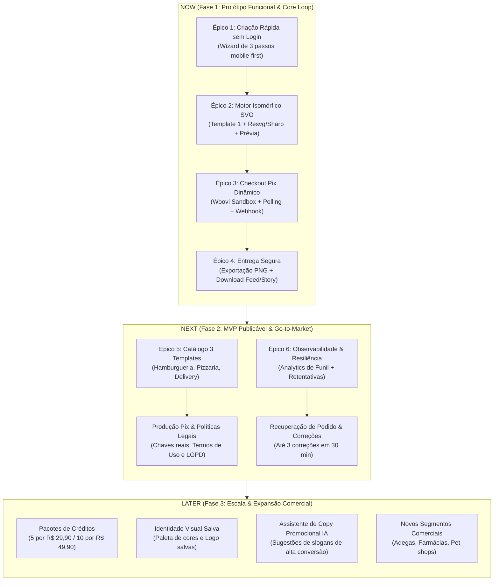

# Roadmap Estratégico — OfertaPronta

**Versão:** 1.0  
**Data:** 15/10/2026  
**Status:** Aprovado para Ciclo MVP (Fases 0 a 2)  
**Horizonte:** Q4 2026 — Q1 2027  
**Alinhamento Estratégico:** PRD v1.0, ADR 0001 e Diretrizes de Arquitetura TanStack Start

---

## 1. Contexto Estratégico & Objetivos de Negócio

### 1.1 Proposta de Valor
> *"Sua promoção pronta para postar, sem precisar saber design."*

O **OfertaPronta** resolve a dor crítica de pequenos comerciantes do setor de alimentação (hamburguerias, pizzarias, açaíterias e delivery em geral) que precisam anunciar ofertas no Instagram mas esbarram na complexidade do Canva/Photoshop ou no custo proibitivo de agências.

### 1.2 OKRs & Metas do Ciclo de MVP

| ID | Objetivo Estratégico | Métrica Chave (KR) | Meta |
|---|---|---|---|
| **OKR 1** | **Validação Comercial Rápida** | Transações Pix concluídas com dinheiro real | ≥ 30 campanhas pagas no primeiro mês |
| **OKR 2** | **Fluidez e Baixo Atrito (No-Login)** | Tempo médio da abertura até a visualização da prévia | ≤ 90 segundos |
| **OKR 3** | **Fidelidade Visual & Zero Suporte** | Taxa de conversão de prévia para checkout sem divergência visual | 0 chamados de erro visual (zero visual drift) |
| **OKR 4** | **Confiabilidade de Entrega** | Taxa de liberação automática de PNGs em < 5s pós-Pix | ≥ 99% dos pedidos pagos |

### 1.3 Restrições Técnicas & Decisões Arquiteturais Fundamentais (ADR 0001)
- **Framework Unificado:** TanStack Start (Full-stack React 19 + Vinxi/Nitro + Server Functions com Zod).
- **Interface Mobile-First:** Tailwind CSS v4 + componentes primitivos shadcn/ui (viewport primário 360px–430px).
- **Motor Isomórfico SVG:** Motor puro (`TemplateEngine`) executado no navegador para prévia instantânea com marca d'água e no servidor para renderização dos PNGs oficiais (1080×1350 Feed e 1080×1920 Story) via `@resvg/resvg-js` + `Sharp`.
- **Preços Autoritativos e Idempotência:** Preço fixado no backend (R$ 9,90) com snapshot congelado em banco (`PostgreSQL + Drizzle`) e webhooks Pix protegidos por HMAC com deduplicação rigorosa.

---

## 2. Definição de Épicos & Hipóteses de Negócio

### Épico 1: Criação Rápida de Oferta com Modo Dual (Upload ou IA Gemini Imagen)
- **Hipótese:** Acreditamos que oferecer a criação de arte promocional com modo dual de imagem (upload de foto própria OU geração instantânea com IA via Gemini Imagen com prompt gastronômico invisível), preenchendo apenas 6 a 8 campos essenciais em menos de 90 segundos sem login, aumentará a taxa de chegada à prévia para mais de 65%, pois elimina o bloqueio de comerciantes que não têm fotos profissionais de seus pratos.
- **Métrica de Sucesso:** Taxa de conclusão do formulário (Visitante → Prévia) ≥ 65%; tempo médio de preenchimento ≤ 90s; taxa de aprovação da imagem de IA ≥ 75%.
- **Tamanho:** Médio (M) — 2 a 3 semanas.
- **Outcome:** Ativação / Conversão de Topo de Funil.

### Épico 2: Motor Isomórfico SVG & Renderizador Hi-Res (Visual Engine)
- **Hipótese:** Acreditamos que centralizar a definição vetorial de layout num motor isomórfico compartilhado entre o preview React no client e a rasterização Resvg/Sharp no backend garantirá fidelidade visual de 100% entre a prévia com marca d'água e os PNGs finais (Feed 1080×1350 e Story 1080×1920), eliminando custos de suporte e chargebacks por distorção gráfica.
- **Métrica de Sucesso:** 0 divergências visuais reportadas; taxa de sucesso na geração de PNGs ≥ 99.5%; tempo de rasterização ≤ 2.5s.
- **Tamanho:** Grande (L) — 3 a 4 semanas.
- **Outcome:** Confiabilidade do Produto / Qualidade de Entrega.

### Épico 3: Checkout Pix Dinâmico & Confirmação em Tempo Real (Monetization Engine)
- **Hipótese:** Acreditamos que oferecer cobrança instantânea via Pix dinâmico (QR Code na tela + botão Pix Copia e Cola) a R$ 9,90, integrado com polling em tempo real e webhook idempotente, alcançará conversão de pagamento superior a 65% dos checkouts iniciados no ambiente mobile.
- **Métrica de Sucesso:** Taxa de conclusão de pagamento (Checkout → Confirmado) ≥ 65%; tempo de detecção de pagamento pós-transferência ≤ 4 segundos.
- **Tamanho:** Médio (M) — 2 semanas.
- **Outcome:** Faturamento / Tração de Receita.

### Épico 4: Entrega Segura, Download em Lote & Recuperação de Pedidos (Delivery & Fulfillment)
- **Hipótese:** Acreditamos que fornecer acesso imediato aos dois arquivos PNG descompactados e protegidos por links assinados de 7 dias, somado à recuperação automática da sessão de compra via localStorage/token do pedido, garantirá que 100% dos comerciantes que pagaram consigam salvar suas imagens mesmo se fecharem o navegador ou sofrerem instabilidade de rede.
- **Métrica de Sucesso:** Taxa de download bem-sucedido ≥ 98%; chamados de "paguei e não baixei" < 0.5%.
- **Tamanho:** Pequeno (S) — 1 a 2 semanas.
- **Outcome:** Retenção / Satisfação do Cliente.

### Épico 5: Catálogo de Templates Especializados em Gastronomia (Template Catalog)
- **Hipótese:** Acreditamos que disponibilizar 3 designs com apelos visuais distintos e nichados (Hamburgueria, Pizzaria e Delivery Geral / Açaí), acompanhados de fallback tipográfico robusto para quando o usuário não tiver foto, aumentará a escolha e a percepção de valor, elevando a conversão de prévia para checkout em 30%.
- **Métrica de Sucesso:** Distribuição equilibrada de escolha entre templates; aumento de 30% na intenção de compra.
- **Tamanho:** Médio (M) — 2 semanas.
- **Outcome:** Fit de Produto-Mercado / Variedade Visual.

### Épico 6: Observabilidade do Funil & Políticas de Resiliência (Production Readiness)
- **Hipótese:** Acreditamos que instrumentar eventos atômicos do funil (`analytics_events`), implementar retentativas automáticas na geração de imagens e exibir termos transparentes de compra e suporte reduzirá a necessidade de suporte manual a zero intervenções técnicas na operação regular.
- **Métrica de Sucesso:** Cobertura de 100% dos passos do funil com analytics; tempo médio de recuperação de falha de renderização < 10 segundos.
- **Tamanho:** Pequeno (S) — 1 semana.
- **Outcome:** Estabilidade Operacional / Compliance.

---

## 3. Matriz de Priorização (Framework RICE)

A pontuação utiliza a fórmula canônica:  
$$\text{RICE Score} = \frac{\text{Reach (Alcance)} \times \text{Impact (Impacto)} \times \text{Confidence (Confiança)}}{\text{Effort (Esforço em meses)}}$$

- **Reach:** Usuários impactados por ciclo mensal estimado (base 1.000 criadores).
- **Impact:** 3 = Maciço, 2 = Alto, 1 = Médio, 0.5 = Baixo.
- **Confidence:** 100% = Alta certeza baseada em requisitos, 80% = Média-alta, 50% = Média.
- **Effort:** Pessoas/Mês (0.5 m = 2 semanas, 1 m = 4 semanas).

| Épico | Reach | Impact | Confidence | Effort (m) | RICE Score | Prioridade |
|---|:---:|:---:|:---:|:---:|:---:|:---:|
| **1. Criação Rápida sem Login** | 1.000 | 3 | 90% | 0.75 | **3.600** | P0 (Must Have) |
| **2. Motor Isomórfico SVG + Renderizador** | 1.000 | 3 | 95% | 1.00 | **2.850** | P0 (Must Have) |
| **3. Checkout Pix Dinâmico** | 600 | 3 | 90% | 0.50 | **3.240** | P0 (Must Have) |
| **4. Entrega Segura & Recuperação** | 400 | 2 | 90% | 0.35 | **2.057** | P0 (Must Have) |
| **5. Catálogo 3 Templates (Gastronomia)** | 700 | 2 | 80% | 0.50 | **2.240** | P1 (MVP Launch) |
| **6. Observabilidade & Resiliência** | 1.000 | 1 | 90% | 0.30 | **3.000** | P1 (MVP Launch) |

---

## 4. Sequenciamento Estratégico (Now / Next / Later)

---

## 5. Cronograma e Entregáveis por Horizonte

### 5.1 NOW: Ciclo de Validação do Core Loop (Fase 1 — Protótipo Funcional)
*Objetivo: Fechar a primeira transação Pix ponta a ponta em ambiente controlado.*

| Semana | Foco de Entrega | Entregáveis Técnicos |
|---|---|---|
| **Semana 1** | Arquitetura Base, Wizard & IA | - Estrutura TanStack Start + Tailwind CSS v4 + shadcn/ui. - Rota `/criar` com formulário mobile-first validado via Zod. - Modo Dual: upload de fotos/logos e geração via Google Gemini Imagen API (1:1). - Módulo profundo `AiImageGenerator` com prompt gastronômico invisível e cotas (1 grátis na prévia, até 3 pós-Pix). |
| **Semana 2** | Motor Isomórfico SVG & Preview | - Módulo puro `TemplateEngine` com Template 1 (Hamburgueria). - Marca d'água vetorial dinâmica. - Canvas de prévia interativa no navegador nos formatos 1080×1350 e 1080×1920 integrando a foto de IA. |
| **Semana 3** | Motor de Exportação & Checkout Pix | - Módulo profundo `ExportEngine` com `@resvg/resvg-js` e `Sharp`. - Módulo profundo `PixCheckout` (OpenPix Sandbox). - Rota `/checkout/$orderId` com QR Code e Pix Copia e Cola. |
| **Semana 4** | Webhook, Entrega e Teste Ponta a Ponta | - Rota `/api/webhooks/pix` com validação HMAC e idempotência. - Rota `/pedido/$orderId` com download direto dos PNGs. - Teste de aceitação completo com usuários reais em modo piloto. |

---

### 5.2 NEXT: Ciclo de Confiabilidade & Lançamento Comercial (Fase 2 — MVP Publicável)
*Objetivo: Abrir a plataforma publicamente com múltiplos nichos e operação autônoma resiliente.*

1. **Expansão do Catálogo de Artes:**
   - Template 2: Pizzaria artesanal / promoção em dobro.
   - Template 3: Delivery genérico / combo açaí com modo tipográfico puro (sem foto).
2. **Resiliência e Políticas de Pedido:**
   - Salvar estado localmente (`localStorage`) para restauração de tela ao recarregar.
   - Permitir até 3 edições/correções de texto em até 30 minutos pós-compra (conforme regra do PRD).
   - Links privados e assinados com expiração de 7 dias para download.
3. **Produção Financeira & Conformidade:**
   - Migração para credenciais Pix de produção.
   - Termos de Serviço, Política de Privacidade e Avisos de Reembolso claro.
   - Painel simples de métricas de conversão e faturamento diário.

---

### 5.3 LATER: Expansão de Receita e Retenção (Fase 3 — Pós-MVP)
*Objetivo: Maximizar o LTV (Lifetime Value) e reduzir o CAC.*

- **Pacotes de Créditos:** Opções de 5 campanhas (R$ 29,90) e 10 campanhas (R$ 49,90) para clientes recorrentes.
- **Persistência de Marca:** Salvar logotipo e cores institucionais do comerciante no dispositivo.
- **IA Generativa de Apoio:** Sugestão automática de gatilhos promocionais ("Sextou com Combo", "2ª Pizza com 50% OFF") usando modelos leves.
- **Novos Nichos:** Expansão além de alimentação (Pet Shops, Barbearias, Moda Local).

---

## 6. Mapeamento de Riscos & Mitigações

| Risco Identificado | Severidade | Probabilidade | Estratégia de Mitigação |
|---|:---:|:---:|---|
| **Divergência Visual (Visual Drift)** A arte final renderizada no servidor ter fontes/quebras de linha diferentes da prévia móvel. | Alta | Média | **Isomorfismo SVG:** O mesmo componente gerador de SVG roda no cliente e no `@resvg/resvg-js`. Fontes do Google Fonts (`Space Grotesk` e `Inter`) são embutidas diretamente como dados no motor. |
| **Abandono no Checkout Pix** Usuário não entender o fluxo de copiar o código e pagar no app do banco. | Alta | Média | **UX Mobile Otimizada:** Botão de 1 toque "Copiar Código Pix" com feedback tátil/visual imediato, instruções visuais passo a passo e contador regressivo de validade da cobrança (15 min). |
| **Webhooks Duplicados ou Fora de Ordem** Gateway enviar múltiplos eventos de confirmação para o mesmo pedido. | Média | Alta | **Idempotência Estrita no `PixCheckout`:** Registro da transação com `SELECT FOR UPDATE` e máquina de estados atômica (`PENDING` → `PAID`). Eventos subsequentes retornam HTTP 200 sem reprocessamento. |
| **Queda de Conexão durante o Pagamento** Cliente fecha a aba antes do redirecionamento pós-pagamento. | Alta | Alta | **Recuperação por URL Privada / LocalStorage:** O link único `/pedido/{orderId}?token={secureToken}` é persistido localmente e pode ser acessado a qualquer momento em até 7 dias. |
| **Custos de Storage Excessivos** Imagens geradas acumulando eternamente no S3. | Baixa | Média | **Ciclo de Vida do S3:** Regras de retenção configuradas no bucket para arquivamento ou deleção programada após 30 dias. |

---

## 7. Itens Fora do Escopo Inicial (Strict YAGNI)

Para manter a velocidade e o foco na validação da proposta de valor, os seguintes itens estão **explicitamente excluídos** das Fases 0, 1 e 2:
- ❌ Editor drag-and-drop ou manipulação livre de camadas tipo Canva.
- ❌ Geração de vídeos promocionais ou animações MP4.
- ❌ Integração direta de postagem ou agendamento nas APIs do Instagram/Facebook.
- ❌ Modelo de assinatura mensal com cartão de crédito recorrente.
- ❌ Múltiplos membros de equipe, permissões ou contas de agência.
- ❌ Editor avançado de tratamento de fotos (recorte de fundo por IA no MVP).
