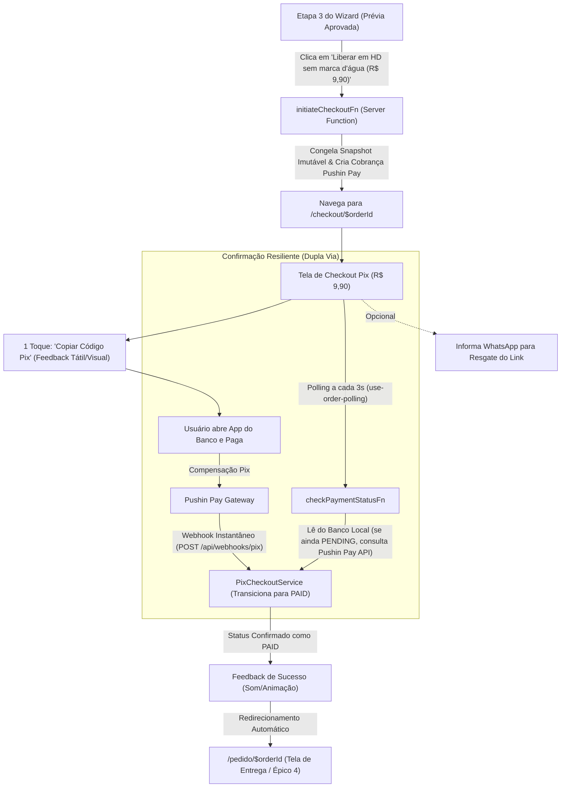

# Spec: Checkout Pix Dinâmico via Pushin Pay (`PixCheckout`)

- **Slug**: `epico-3-checkout-pix`
- **Status**: `ready-for-agent`

---

## Problem Statement

Após preencher o Briefing da Oferta e validar o Card Publicitário gerado pela Inteligência Artificial na prévia gratuita protegida por marca d'água (Épico 1 e Épico 2), o microempresário deseja liberar e baixar os arquivos finais em alta resolução (Feed 1080×1350 e Story 1080×1920) sem marca d'água.

Entretanto, donos de pequenos negócios (supermercados, barbearias, salões, pizzarias e restaurantes) operam primariamente via celular, frequentemente em ambientes com distrações e conexões móveis oscilantes. Formulários tradicionais de checkout com cadastros longos, senhas ou preenchimento obrigatório de CPF geram alto atrito, desconfiança e taxas severas de abandono de carrinho.

Do ponto de vista de produto e negócio:
1. **Zero Fricção de Conversão**: A conversão deve ocorrer em **1 clique** a partir da aprovação da prévia, sem exigir criação de conta, senha ou digitação obrigatória de CPF.
2. **Pagamento Instantâneo via Pix Dinâmico**: O sistema deve apresentar imediatamente o código Pix Copia e Cola (com cópia em um toque) e o QR Code visual, com valor fixo de **R$ 9,90** e expiração controlada (30 minutos).
3. **Detecção e Redirecionamento em Tempo Real**: Assim que o microempresário confirmar o pagamento no aplicativo do seu banco, o sistema deve detectar a compensação em menos de 3 segundos (sem exigir recarga manual de página) e transicionar imediatamente para a tela de entrega do pedido (`/pedido/$orderId`).
4. **Resiliência e Recuperação Segura**: Se o microempresário fechar a aba acidentalmente durante a transferência bancária, deve haver um mecanismo opcional e não intrusivo para resgate do link via WhatsApp, além de proteção contra webhooks duplicados (idempotência estrita) e instabilidade de rede móvel (reconciliação ativa).

---

## Solution

O Épico 3 implementa o fluxo completo de **Checkout Pix Dinâmico** do OfertaPronta, integrando a gateway **Pushin Pay** a uma máquina de estados segura e a uma interface mobile-first de altíssima conversão.

### 1. Jornada do Microempresário (Mobile-First UX)



### 2. Componentes da Solução

1. **Geração Instantânea e Snapshot Congelado (`Frozen Snapshot`)**:
   - Ao clicar em "Liberar em HD sem marca d'água (R$ 9,90)", o backend cria o `Order` gravando um snapshot imutável com todos os dados da campanha, imagens de entrada e URL da prévia com marca d'água, associado a um `draftId`.
   - O preço de R$ 9,90 (990 centavos) é autoritativo do servidor e imutável.
2. **Integração Pushin Pay (`PushinPayService`)**:
   - Módulo profundo no backend que emite a cobrança Pix Cash-In via API REST com autenticação Bearer Token (`PUSHIN_PAY_TOKEN`).
   - Retorna o `txId`, o código EMV Copia e Cola e o QR Code em Base64.
   - Fornece consulta ativa de status de transação para reconciliação atômica.
3. **Máquina de Estados & Webhook Idempotente (`PixCheckoutService`)**:
   - Transições de estado estritas:
     - `Order.status`: `PENDING` -> `PAID` | `EXPIRED` | `CANCELLED`
     - `PaymentCharge.status`: `PENDING` -> `PAID` | `EXPIRED`
   - Endpoint HTTP em `src/routes/api/webhooks.pix.ts` que processa a notificação e delega ao serviço.
   - Idempotência absoluta: requisições duplicadas para transações já pagas retornam `200 OK` sem mutações redundantes.
4. **Interface de Checkout Mobile-First (`/checkout/$orderId`)**:
   - Resumo claro: valor R$ 9,90, miniatura da arte com marca d'água e título da oferta.
   - Botão em destaque "Copiar Código Pix" com microinteração de cópia bem-sucedida.
   - Card retrátil/acessível com o QR Code visual.
   - Indicador pulsante de espera com cronômetro regressivo de 30 minutos.
   - Campo opcional: *"Receber link por WhatsApp caso feche o navegador"* (pré-preenchido com o WhatsApp do rascunho, se informado).
   - Botão de fallback: *"Já paguei? Verificar agora"*.
5. **Tratamento de Expiração e Reemissão**:
   - Se o prazo de 30 minutos expirar sem pagamento, o status da cobrança passa para `EXPIRED`.
   - A tela de checkout substitui o QR Code por um aviso claro e o botão *"Gerar Novo Código Pix"*, mantendo o mesmo pedido e snapshot.

---

## User Stories

### Happy Paths

1. **Como microempresário visualizando a prévia do meu card**, quero clicar em *"Liberar em HD sem marca d'água (R$ 9,90)"* e ser levado instantaneamente à tela de pagamento Pix sem preencher nenhum formulário cadastral ou informar CPF.
2. **Como microempresário no celular**, quero tocar no botão *"Copiar Código Pix"* e ver a indicação imediata de que o código foi copiado para a área de transferência, para colar no meu app de banco sem erros de digitação.
3. **Como microempresário no computador**, quero ver o QR Code Pix nítido na tela para poder escanear com a câmera do celular no aplicativo do meu banco.
4. **Como microempresário aguardando a compensação**, quero ver um indicador visual animado (*"Aguardando confirmação do banco..."*) e ser redirecionado automaticamente para a tela do pedido assim que o pagamento for concluído, sem precisar recarregar a página.
5. **Como microempresário precavido**, quero poder digitar ou confirmar meu número de WhatsApp na tela de checkout, para receber o link direto da arte caso a bateria do meu celular acabe ou a aba feche acidentalmente.

### Edge Cases & Regras de Negócio

6. **Como microempresário cuja conexão oscilou após o pagamento**, quando o webhook da Pushin Pay sofrer atraso de entrega pela operadora, quero que a checagem ativa do sistema (polling ou botão *"Já paguei / Verificar agora"*) consulte a API da Pushin Pay e libere meu pedido imediatamente.
7. **Como sistema de pagamento**, quando o webhook da Pushin Pay enviar notificações repetidas para o mesmo pagamento, devo processar de forma idempotente, registrando o `paidAt` na primeira vez e ignorando eventos duplicados com retorno HTTP 200.
8. **Como microempresário que demorou mais de 30 minutos para pagar**, se o código Pix expirar, quero ver um aviso amigável na tela informando que o código venceu e um botão *"Gerar Novo Código Pix"* para criar uma nova cobrança válida para o mesmo card sem perder o trabalho.
9. **Como sistema**, quando um pagamento for confirmado, devo garantir que o valor pago recebido da Pushin Pay seja exatamente igual a 990 centavos (`R$ 9,90`), rejeitando qualquer valor divergente para proteger contra fraudes de manipulação de parâmetros.
10. **Como microempresário que já pagou o pedido**, se eu tentar acessar novamente a URL `/checkout/$orderId`, devo ser redirecionado automaticamente para `/pedido/$orderId`, prevenindo qualquer tentativa de pagamento duplo.
11. **Como microempresário abrindo o checkout em múltiplas abas simultâneas**, o sistema deve sincronizar o mesmo estado do pedido via polling, garantindo que o primeiro evento de confirmação atualize ambas as abas para o status `PAID`.

---

## Implementation Decisions

### 1. Módulos Profundos e Arquitetura

```
src/
├── config/
│   └── server-env.ts            # PUSHIN_PAY_TOKEN, PUSHIN_PAY_WEBHOOK_URL, PUSHIN_PAY_WEBHOOK_SECRET
│
├── features/checkout/
│   ├── components/              # Componentes de UI mobile-first
│   │   ├── order-summary-card.tsx
│   │   ├── pix-copia-cola-card.tsx
│   │   ├── pix-qr-code-card.tsx
│   │   ├── order-whatsapp-recovery-card.tsx
│   │   └── payment-polling-indicator.tsx
│   ├── hooks/
│   │   ├── use-pix-checkout.ts
│   │   └── use-order-polling.ts
│   ├── views/
│   │   └── checkout-view.tsx
│   ├── data/
│   │   ├── checkout.schemas.ts
│   │   └── checkout.types.ts
│   └── server/                  # [SERVER-ONLY]
│       ├── index.ts             # Ponto único de export público
│       ├── functions/
│       │   └── checkout.functions.ts # Server Functions RPC (initiate, getDetails, poll, updateWhatsapp)
│       └── services/
│           ├── pushin-pay.service.ts # Gateway Pushin Pay (Cash-In + Consulta)
│           └── pix-checkout.service.ts # Máquina de estados, Frozen Snapshot, Webhook
│
├── routes/
│   ├── checkout.$orderId.tsx    # Rota TanStack Start da tela de checkout
│   └── api/
│       └── webhooks.pix.ts      # createAPIFileRoute fino para webhook Pushin Pay
```

### 2. Modelo de Dados e Schema Drizzle (`src/server/db/schema/orders.ts`)

Ajustes necessários no schema Drizzle:
1. `orders`:
   - Adicionar `draftId: text("draft_id").references(() => drafts.id)` para vincular diretamente o pedido ao rascunho.
   - Adicionar `aiRegenerationCount: integer("ai_regeneration_count").notNull().default(0)` para gerenciar a cota de até 3 regenerações do Épico 4.
2. `payment_charges`:
   - Já possui todos os campos necessários: `orderId`, `txId`, `status`, `qrCodeImageUrl`, `copiaECola`, `amountCents` (default 990), `expiresAt`, `paidAt`, `rawPayload`.

### 3. Interface Pública dos Módulos Profundos

#### `PushinPayService` (`src/features/checkout/server/services/pushin-pay.service.ts`)
```typescript
export interface CreatePixChargeInput {
  valueCents: number; // fixo em 990
  webhookUrl?: string;
}

export interface PixChargeResult {
  txId: string;
  copiaECola: string;
  qrCodeBase64: string;
  expiresAt: Date;
  status: string;
}

export interface PushinPayService {
  createCashInCharge(input: CreatePixChargeInput): Promise<PixChargeResult>;
  getTransactionStatus(txId: string): Promise<{ status: "paid" | "created" | "expired" | "canceled"; paidAt?: Date; valueCents: number }>;
}
```

#### `PixCheckoutService` (`src/features/checkout/server/services/pix-checkout.service.ts`)
```typescript
export interface InitiateCheckoutInput {
  draftId: string;
  customerWhatsapp?: string;
  customerEmail?: string;
}

export interface CheckoutDetailsResult {
  orderId: string;
  draftId: string;
  status: "PENDING" | "PAID" | "EXPIRED" | "CANCELLED";
  amountCents: number;
  customerWhatsapp?: string;
  frozenSnapshot: Record<string, unknown>;
  charge: {
    txId: string;
    copiaECola: string;
    qrCodeBase64: string;
    expiresAt: string; // ISO
    status: string;
  } | null;
}

export interface WebhookPayload {
  id: string; // txId
  status: string; // "paid", etc.
  value: number; // centavos
  paid_at?: string;
}

export interface PixCheckoutService {
  initiateCheckout(input: InitiateCheckoutInput): Promise<{ orderId: string }>;
  getCheckoutDetails(orderId: string): Promise<CheckoutDetailsResult>;
  checkPaymentStatus(orderId: string): Promise<{ status: string; isPaid: boolean }>;
  handleWebhookPayment(payload: WebhookPayload, secretHeader?: string): Promise<{ processed: boolean; orderId?: string }>;
  updateCustomerWhatsapp(orderId: string, whatsapp: string): Promise<void>;
  regenerateExpiredCharge(orderId: string): Promise<CheckoutDetailsResult>;
}
```

### 4. Fronteira RPC com Server Functions (`src/features/checkout/server/functions/checkout.functions.ts`)

- `initiateCheckoutFn`: recebe `{ draftId, customerWhatsapp? }`, valida com Zod, congela o snapshot, cria a cobrança na Pushin Pay e retorna `{ orderId }`.
- `getOrderCheckoutDetailsFn`: recebe `{ orderId }`, retorna todos os dados necessários para a renderização do checkout.
- `checkPaymentStatusFn`: recebe `{ orderId }`, consulta o status local no banco e, caso permaneça `PENDING`, efetua verificação ativa pontual na Pushin Pay.
- `updateOrderWhatsappFn`: recebe `{ orderId, whatsapp }` e atualiza o contato de recuperação.
- `regenerateExpiredChargeFn`: recebe `{ orderId }` e gera uma nova cobrança se a anterior estiver vencida.

---

## Testing Decisions

1. **Testes de Módulo Profundo (`PushinPayService`)**:
   - Testar chamadas simuladas de criação de cobrança com retorno estruturado de QR Code e Copia e Cola.
   - Testar tratamento de erros da API externa (timeout, status 401/500).
   - Testar com fake in-memory / mock isolado sem chamadas reais para a rede.
2. **Testes de Máquina de Estados e Banco (`PixCheckoutService`)**:
   - Criação de pedido com `frozenSnapshot` imutável.
   - Transição `PENDING` -> `PAID` com gravação do timestamp `paidAt`.
   - Idempotência: envio de múltiplos webhooks para a mesma transação não gera duplicidade nem erro 500.
   - Proteção de valor: rejeição de webhooks com valor diferente de 990 centavos.
   - Reemissão de cobrança expirada para o mesmo pedido.
3. **Testes de Webhook Route (`src/routes/api/webhooks.pix.ts`)**:
   - Validação de entrada Zod e status code HTTP 200 em caso de sucesso ou idempotência.
4. **Testes de Frontend & Hooks**:
   - `use-order-polling.ts`: teste do ciclo de polling via TanStack Query e disparo do callback `onPaymentConfirmed`.
   - `pix-copia-cola-card.tsx`: teste do clique de cópia no clipboard com mensagem de sucesso.
   - `checkout-view.tsx`: renderização dos estados `PENDING`, `PAID` e `EXPIRED`.

---

## Out of Scope

- Pagamento via Cartão de Crédito ou Boleto Bancário (o foco MVP é 100% Pix dinâmico de R$ 9,90).
- Criação de contas de usuário com e-mail/senha ou OAuth (fluxo sem cadastro).
- Planos de assinatura ou pacotes de créditos múltiplos (previstos apenas para a Fase 3).
- Emissão automatizada de Notas Fiscais eletrônicas (fora do escopo deste épico).
- Download definitivo dos arquivos finais de alta resolução (pertence ao Épico 4 — Tela de Entrega & Regeneração).

---

## Further Notes

- Alinhado com o documento de pesquisa [`docs/research/epico-3-pix-providers.md`](../research/epico-3-pix-providers.md).
- Conformidade estrita com o vocabulário de domínio em [`GLOSSARY.md`](../../GLOSSARY.md) (`Merchant`, `Ad Card`, `Offer Brief`, `Frozen Snapshot`, `Order`, `Payment Charge`).
- Conformidade estrita com as regras do [`AGENTS.md`](../../AGENTS.md) (Deep Modules, Server Functions RPC com Zod, zero server leaks, UI acessível mobile-first).
