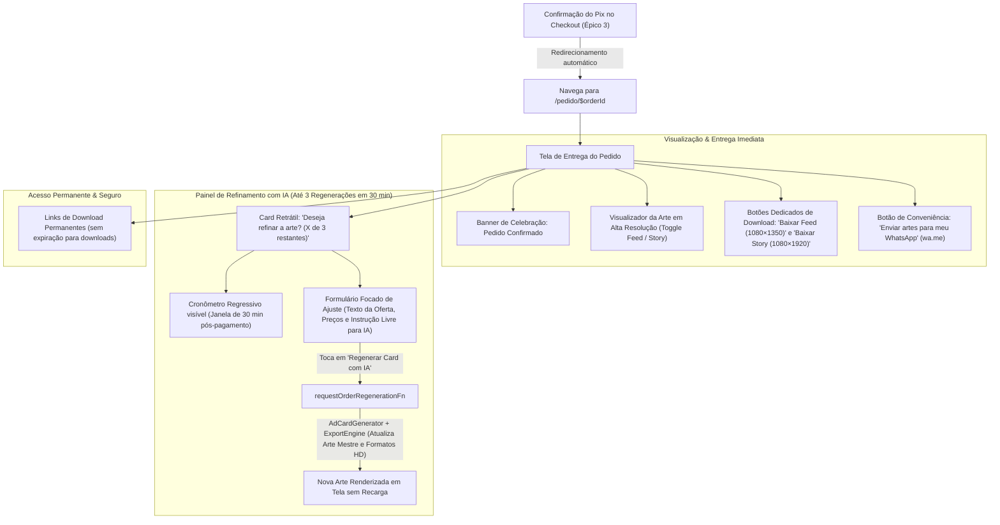

# Spec: Entrega em Alta Resolução sem Marca d'Água & Regeneração IA Pós-Compra (`DeliveryEngine`)

- **Slug**: `epico-4-entrega-e-regeneracao`
- **Status**: `ready-for-agent`

---

## Problem Statement

Após ter preenchido o Briefing da Oferta (Épico 1), validado a arte gerada pela IA na prévia gratuita protegida por marca d'água (Épico 2) e realizado o pagamento de R$ 9,90 via Pix dinâmico (Épico 3), o microempresário chega ao momento crucial da sua jornada no OfertaPronta: **o recebimento imediato e definitivo da sua campanha finalizada pronta para publicação**.

Entretanto, pequenos comerciantes e prestadores de serviços locais (donos de supermercado, salões de beleza, barbearias, pizzarias, hamburguerias e restaurantes) operam em um contexto com desafios específicos:
1. **Frustração por Espera ou Discrepância Visual**: O cliente pagou por *aquela* arte específica que ele visualizou e aprovou na prévia. Se o sistema regerasse a arte do zero pós-pagamento, o modelo de IA criaria uma variação diferente, frustrando a expectativa do comprador. A entrega deve disponibilizar instantaneamente a exata arte aprovada em alta resolução sem marca d'água.
2. **Dificuldade de Download e Acesso Permanente em Dispositivos Móveis**: Comerciantes frequentemente precisam salvar as artes na hora ou reencontrar o link dias ou semanas depois para reutilizar em anúncios. Os links de download devem ser **permanentes (sem expiração de prazo)**, permitindo que o microempresário acesse e baixe suas artes quando quiser.
3. **Necessidade de Ajustes Rápidos Pós-Compra sem Nova Cobrança**: É frequente o microempresário notar um detalhe que deseja refinar após pagar (ex.: *"gostaria que o preço ficasse ainda mais em destaque"*, *"esqueci de colocar que aceitamos cartões"*, *"quero testar um fundo um pouco mais escuro"*). Ele tem direito a até 3 regenerações/ajustes por IA incluídas no seu pedido, mas isso precisa ocorrer sob regras claras de prazo (janela de 30 minutos pós-pagamento) e escopo focado para proteger a viabilidade econômica do produto.
4. **Conveniência de Envio Direto para WhatsApp**: No celular, o comerciante quer ter certeza de que não perderá o acesso caso a aba feche. Um botão direto "Enviar artes para meu WhatsApp" via link `wa.me` garante que ele guarde o link da campanha na sua própria conversa do WhatsApp com 1 toque.

---

## Solution

O Épico 4 implementa a experiência completa de **Entrega e Regeneração de Campanhas** do OfertaPronta, materializada na rota `/pedido/$orderId` e sustentada pelo módulo profundo `DeliveryEngine`.

### 1. Jornada do Microempresário (Mobile-First UX)



### 2. Componentes da Solução

1. **Persistência da Arte Mestre Limpa (`Clean Master Art`)**:
   - Resolução definitiva do gargalo identificado pelo Codebase Researcher: durante a geração da prévia no Épico 2, o buffer puro retornado pelo Gemini é preservado no servidor (`cleanMasterImageDataUrl` no rascunho e snapshot do pedido).
   - Ao confirmar o pagamento Pix, o `DeliveryEngine` processa imediatamente os formatos oficiais definitivos:
     - **Instagram Feed**: 1080 × 1350 (4:5) em PNG de alta definição.
     - **Instagram Story / WhatsApp**: 1080 × 1920 (9:16) em PNG de alta definição com composição harmônica centrada.
   - Zero tempo de espera ou recálculo redundante no momento da aprovação do Pix. O cliente recebe a arte aprovada na prévia.

2. **Módulo Profundo `DeliveryEngine` (`src/features/delivery/server/services/delivery.service.ts`)**:
   - Valida a elegibilidade do pedido (`order.status === "PAID"`). Pedidos pendentes ou expirados têm acesso negado a arquivos sem marca d'água.
   - Registra e atualiza a entidade `deliveryExports` no PostgreSQL.
   - **Retenção Permanente de Downloads**: Os arquivos finais não expiram, ficando permanentemente acessíveis ao comerciante via rota `/pedido/$orderId` e endpoint de download.
   - Fornece URLs de visualização e endpoints binários de download seguro com headers de `Content-Disposition`.
   - Rastreia métricas de entrega: `downloadCount` e `lastDownloadedAt`.

3. **Motor de Regeneração com IA Pós-Compra (`src/features/delivery/server/services/post-payment-regeneration.service.ts`)**:
   - **Regra de Cota**: Exatamente até 3 regenerações por pedido pago (`aiRegenerationCount < 3`).
   - **Regra de Janela de Tempo**: Disponível exclusivamente dentro dos primeiros **30 minutos corridos** após a compensação do Pix (`paidAt + 30 min`). Após 30 minutos, o painel de regeneração entra em estado expirado de forma graciosa, preservando os botões de download dos arquivos existentes permanentemente.
   - **Escopo do Refinamento**: O microempresário pode refinar textos da oferta, preços promocionais e adicionar instruções livres para a IA (ex.: *"destaque mais a data de validade"*, *"coloque um tom mais premium no fundo"*), mantendo as fotos originais do produto e referência já enviadas.
   - **Atualização Atômica**: Cada regeneração consome 1 crédito de cota, recalcula a arte mestre limpa e os formatos Feed e Story, e atualiza o histórico do pedido.

4. **Interface de Entrega Mobile-First (`/pedido/$orderId`)**:
   - **Design Emocional**: Feedback de celebração (*"Pagamento confirmado! Seu card publicitário está pronto para brilhar"*).
   - **Alternador de Formatos (Feed vs Story)**: Abas suaves permitindo pré-visualizar a arte final exatamente como ficará no Feed (4:5) ou no Story (9:16).
   - **Downloads Claros em Alta Resolução**: Botões individuais de download em PNG HD ("Baixar Feed (1080×1350)" e "Baixar Story (1080×1920)").
   - **Atalho de Envio para WhatsApp**: Botão de conveniência *"Enviar artes para meu WhatsApp"* que abre o WhatsApp (`wa.me`) com mensagem pronta contendo o link do pedido, permitindo salvar a campanha na conversa do comerciante em 1 toque.

---

## User Stories

### Happy Paths

1. **Como microempresário que acabou de pagar o Pix**, quero ser direcionado instantaneamente para a tela do meu pedido (`/pedido/$orderId`) e visualizar imediatamente meu Card Publicitário em alta resolução sem nenhuma marca d'água.
2. **Como microempresário no celular**, quero tocar em *"Enviar artes para meu WhatsApp"* e ter uma mensagem pré-preenchida no WhatsApp com o link direto da minha campanha pronta, para guardar e acessar quando quiser.
3. **Como microempresário visualizando o card entregue**, quero poder alternar entre as abas *"Feed (1080×1350)"* e *"Story (1080×1920)"* para verificar como a composição visual se adapta a cada proporção antes de baixar.
4. **Como microempresário no computador ou celular**, quero poder clicar em *"Baixar Feed (1080×1350)"* e *"Baixar Story (1080×1920)"* para salvar diretamente os arquivos PNG nítidos no meu aparelho.
5. **Como microempresário que precisa de um pequeno ajuste**, quero poder abrir o painel de refinamento em até 30 minutos pós-compra, alterar o preço ou pedir para a IA destacar um elemento, e gerar uma nova versão sem pagar nada a mais.
6. **Como microempresário que solicitou um ajuste**, quero ver a contagem da minha cota atualizada em tempo real (ex.: *"Você ainda tem 2 de 3 ajustes disponíveis"*) e a nova arte refletida na tela imediatamente.
7. **Como microempresário que precisa da arte semanas depois**, quero poder acessar novamente a URL `/pedido/$orderId` a qualquer momento e baixar minhas imagens sem bloqueio de prazo de expiração.

### Edge Cases, Falhas e Segurança

8. **Como sistema de segurança**, se um usuário tentar acessar `/pedido/$orderId` para um pedido que ainda está com status `PENDING`, devo bloquear a exibição dos arquivos sem marca d'água e redirecioná-lo para a tela de checkout (`/checkout/$orderId`).
9. **Como sistema de segurança**, se um usuário tentar acessar `/pedido/$orderId` com um identificador de pedido inexistente ou malformatado, devo apresentar uma tela clara de pedido não encontrado com opção de criar uma nova oferta.
10. **Como microempresário cuja janela de 30 minutos expirou**, se eu tentar solicitar uma regeneração após 30 minutos do pagamento, devo visualizar uma mensagem cordial informando que o prazo de ajustes foi concluído, mantendo os botões de download permanente das artes totalmente disponíveis.
11. **Como microempresário que já utilizou as 3 regenerações**, se eu atingir a cota máxima de 3 ajustes, o painel de regeneração deve ser desativado com uma mensagem clara de cota preenchida, sem impedir os downloads das versões finais geradas.
12. **Como sistema resiliente**, se a chamada à API Gemini falhar durante uma tentativa de regeneração pós-compra, a transação não deve debitar a cota de regeneração do usuário, e deve exibir um alerta de erro amigável permitindo tentar novamente.

---

## Implementation Decisions

### 1. Módulos Profundos e Arquitetura

```
src/
├── features/delivery/
│   ├── components/                     # Componentes visuais mobile-first
│   │   ├── delivery-header-status.tsx  # Mensagem de celebração e status do pedido
│   │   ├── ad-card-delivery-preview.tsx# Visualizador com tabs Feed (4:5) / Story (9:16)
│   │   ├── download-actions-card.tsx   # Botões claros de download direto em PNG HD
│   │   ├── order-whatsapp-share-card.tsx# Botão de conveniência "Enviar artes para meu WhatsApp" (wa.me)
│   │   ├── ai-regeneration-panel.tsx   # Painel com cota restante (X de 3) e formulário de ajuste
│   │   └── regeneration-countdown-timer.tsx # Cronômetro regressivo da janela de 30 minutos
│   ├── hooks/
│   │   ├── use-delivery-order.ts       # Hook TanStack Query para dados do pedido pago
│   │   └── use-card-regeneration.ts    # Mutation hook para solicitar nova versão do card
│   ├── views/
│   │   ├── order-delivery-view.tsx     # View orquestradora da tela de entrega
│   │   └── index.ts
│   ├── data/
│   │   ├── delivery.schemas.ts         # Schemas Zod de entrada e saída (delivery/regeneration)
│   │   └── delivery.types.ts           # Tipos de domínio e DTOs
│   └── server/                         # [SERVER-ONLY]
│       ├── index.ts                    # Ponto único de export público
│       ├── functions/
│       │   └── delivery.functions.ts   # Server Functions RPC (getOrderDeliveryDetails, requestRegeneration)
│       └── services/
│           ├── delivery.service.ts     # Liberação de arquivos limpos, retenção permanente e Drizzle exports
│           └── post-payment-regeneration.service.ts # Orquestração de até 3 regenerações Gemini + Sharp
│
├── routes/
│   ├── pedido.$orderId.tsx             # Rota TanStack Start da tela de entrega
│   └── api/
│       └── delivery.download.ts        # Endpoint binário com stream/download seguro de PNGs
```

### 2. Modelo de Dados e Schema Drizzle (`src/server/db/schema/`)

1. **`drafts` (`src/server/db/schema/promotions.ts`)**:
   - Adicionar coluna opcional: `cleanMasterImageDataUrl: text("clean_master_image_data_url")`
   - Preserva o buffer limpo gerado pela IA no servidor antes da aplicação de marca d'água na prévia.

2. **`orders` (`src/server/db/schema/orders.ts`)**:
   - Adicionar coluna opcional: `cleanMasterImageDataUrl: text("clean_master_image_data_url")`
   - `aiRegenerationCount: integer("ai_regeneration_count").notNull().default(0)` (já existente)
   - `paidAt: timestamp("paid_at", { withTimezone: true })` (já existente)

3. **`deliveryExports` (`src/server/db/schema/delivery.ts`)**:
   - `id: uuid("id").defaultRandom().primaryKey()`
   - `orderId: uuid("order_id").notNull().references(() => orders.id)`
   - `feedUrl: text("feed_url").notNull()`
   - `storyUrl: text("story_url").notNull()`
   - `expiresAt: timestamp("expires_at", { withTimezone: true })` (tornar opcional ou sentinela permanente para refletir downloads sem expiração)
   - `downloadCount: integer("download_count").notNull().default(0)`
   - `lastDownloadedAt: timestamp("last_downloaded_at", { withTimezone: true })`

### 3. Interface Pública dos Módulos Profundos

#### `DeliveryService` (`src/features/delivery/server/services/delivery.service.ts`)
```typescript
export interface DeliveryDetailsResult {
  orderId: string;
  status: "PAID";
  offerTitle: string;
  businessName: string;
  businessSegment: string;
  paidAt: string; // ISO
  regenerationWindowEndsAt: string; // ISO (paidAt + 30 min)
  canRegenerate: boolean;
  regenerationsUsed: number;
  maxRegenerations: number; // fixo em 3
  remainingRegenerations: number;
  feedCardUrl: string;
  storyCardUrl: string;
  downloadCount: number;
  customerWhatsapp?: string;
}

export interface DeliveryService {
  ensureDeliveryExports(orderId: string): Promise<DeliveryDetailsResult>;
  getDeliveryDetails(orderId: string): Promise<DeliveryDetailsResult>;
  recordDownload(orderId: string, format: "feed" | "story"): Promise<{ success: boolean }>;
  getExportBinary(orderId: string, format: "feed" | "story"): Promise<{ buffer: Buffer; contentType: string; filename: string }>;
}
```

#### `PostPaymentRegenerationService` (`src/features/delivery/server/services/post-payment-regeneration.service.ts`)
```typescript
export interface RegenerationInput {
  orderId: string;
  offerTitle?: string;
  promoPrice?: string;
  originalPrice?: string;
  callToAction?: string;
  customAdjustmentPrompt?: string; // instrução descritiva para a IA
}

export interface PostPaymentRegenerationService {
  regenerateOrderCard(input: RegenerationInput): Promise<DeliveryDetailsResult>;
}
```

### 4. Fronteira RPC com Server Functions (`src/features/delivery/server/functions/delivery.functions.ts`)

- `getOrderDeliveryDetailsFn`: recebe `{ orderId: string }`, valida com Zod, assegura existência e status `PAID`, processa os formatos finais caso ainda não gerados, e retorna o DTO `DeliveryDetailsResult`.
- `requestCardRegenerationFn`: recebe `{ orderId, offerTitle?, promoPrice?, originalPrice?, callToAction?, customAdjustmentPrompt? }`, valida cotas (`< 3`) e janela de tempo (`<= 30 min`), executa nova síntese no Gemini mantendo fotos originais, reformata via `ExportEngine`, atualiza banco e retorna o DTO atualizado.
- `recordCardDownloadFn`: recebe `{ orderId, format: "feed" | "story" }` e registra o incremento de downloads para métricas de conversão e entrega.

---

## Testing Decisions

1. **Testes do Módulo Profundo `DeliveryService` (`delivery.service.test.ts`)**:
   - Rejeição estrita de pedidos não pagos (`PENDING`, `EXPIRED`, `CANCELLED`) com erro de autorização.
   - Geração determinística dos exports Feed (1080×1350) e Story (1080×1920) em alta resolução sem marca d'água a partir da arte mestre limpa.
   - Idempotência: chamadas subsequentes a `ensureDeliveryExports` reutilizam os arquivos gerados sem reprocessamento.
   - Rastreamento correto de `downloadCount` e `lastDownloadedAt`.
   - Garantia de acesso permanente aos downloads (sem bloqueio por expiração de tempo).

2. **Testes do Módulo Profundo `PostPaymentRegenerationService` (`post-payment-regeneration.service.test.ts`)**:
   - Limite de cota: sucesso nas primeiras 3 tentativas; rejeição com código de erro `REGENERATION_QUOTA_EXCEEDED` na 4ª tentativa.
   - Limite de tempo: rejeição com código de erro `REGENERATION_WINDOW_EXPIRED` quando `Date.now() > paidAt + 30m`.
   - Preservação da imagem do produto: garantia de que a síntese de IA reutiliza a foto de produto original do rascunho com as novas instruções.
   - Resiliência: falha na API Gemini não decrementa a cota restante do pedido.

3. **Testes de Fronteira e Isolamento (`server-isolation.test.ts`)**:
   - Verificação estrita de que nenhum código de backend (`sharp`, `@resvg/resvg-js`, `@google/genai`, `drizzle-orm`) vaza para módulos de frontend ou hooks.
   - Schemas Zod cobrem 100% das Server Functions de entrada e saída.

4. **Testes de Componentes e UI (`order-delivery-view.test.tsx` e `ai-regeneration-panel.test.tsx`)**:
   - Renderização dos estados: carregamento, sucesso com tabs Feed/Story, cota de regeneração ativa, cota esgotada e janela de 30 minutos expirada.
   - Download direto em PNG: valida disparo de download dos arquivos em alta resolução.
   - Atalho WhatsApp: valida link `wa.me` com mensagem estruturada contendo a URL permanente do pedido.
   - Microinterações mobile-first: acessibilidade dos botões de toque (touch targets ≥ 44px) e layout fluido sem overflow horizontal (360px a 430px).

---

## Out of Scope

- Editor gráfico manual no navegador com arrastar e soltar (drag-and-drop / Canva-like): o OfertaPronta foca 100% na geração inteligente e automatizada por IA sem esforço manual.
- Envio automático de mensagens por bots oficiais de WhatsApp Business API (o compartilhamento é disparado pelo próprio usuário via link direto `wa.me`).
- Pacotes de créditos recorrentes ou assinaturas de múltiplos cards (pertence à Fase 3 do Roadmap).
- Alteração ou substituição completa da foto do produto enviado durante as regenerações pós-compra (para evitar que um mesmo pedido de R$ 9,90 seja utilizado para anunciar um produto totalmente novo).

---

## Further Notes

- Alinhado com as diretrizes de produto e negócio em [`PRD.md`](../../PRD.md) (Seções 3, 5, 6 e 10).
- Vocabulário estritamente em conformidade com [`GLOSSARY.md`](../../GLOSSARY.md) (`Merchant`, `Ad Card`, `Offer Brief`, `Frozen Snapshot`, `Order`, `Export`).
- Arquitetura alinhada com [`AGENTS.md`](../../AGENTS.md) (Deep Modules, Server Functions RPC com Zod, Zero Server Leaks, Mobile-First).
