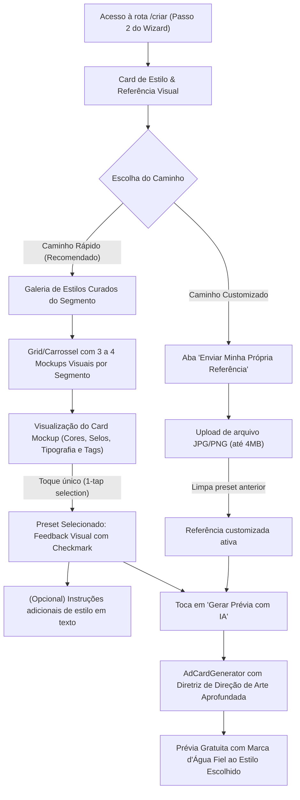

# Spec: Galeria de Estilos Visuais e Referências por Segmento (`StylePresetGallery`)

- **Slug**: `epico-5-galeria-estilos`
- **Status**: `ready-for-agent`

---

## Problem Statement

Microempresários de comércio local e serviços (supermercados, açougues, hortifrútis, salões de beleza, barbearias, pizzarias, hamburguerias e restaurantes) precisam criar cards publicitários diariamente para Instagram e WhatsApp. No entanto, na etapa de definição da identidade estética do anúncio (Épico 1), eles enfrentam duas barreiras críticas que prejudicam a conversão de entrada e aumentam o tempo até a prévia:

1. **Insegurança Visual por Falta de Amostras Concretas**: O seletor de estilos existente exibe apenas botões de texto com uma pequena bolinha colorida (ex.: _"Feira Fresca & Saudável"_, _"Barber Club Vintage & Couro"_). O comerciante não consegue visualizar previamente a composição gráfica, contraste, iluminação ou formato do anúncio final, gerando desconfiança sobre o que a IA irá entregar.
2. **Fricção de Upload de Referência Própria no Celular**: Pedir para o microempresário encontrar e fazer upload de uma "Imagem de Referência" na galeria do celular impõe alto atrito cognitivo. Mais de 80% dos comerciantes locais não possuem prints ou referências de design salvas no smartphone.
3. **Direcionamento Estético Rasgado na IA**: O prompt do `AdCardGenerator` atualmente recebe apenas uma linha genérica de descrição do preset (ex.: _"Estilo visual selecionado: Super Encarte Amarelo & Vermelho"_). Sem instruções profundas de paleta de cores, tipografia publicitária, iluminação de estúdio e composição geométrica, a IA oscila na qualidade estética e na aderência aos códigos visuais consagrados de cada nicho comercial.

O objetivo do Épico 5 é resolver essas fricções oferecendo uma **Galeria de Estilos Visuais Curados por Segmento**, com amostras visuais ricas selecionáveis em 1 toque no celular, integrada a um mecanismo de **Diretriz de Direção de Arte de Agência** injetado diretamente no motor multimodal Gemini.

---

## Solution

O Épico 5 entrega a **Galeria de Estilos Visuais e Referências por Segmento** (`StylePresetGallery`), elevando a experiência de criação na rota `/criar` e a qualidade final dos Cards Publicitários gerados por IA.

### 1. Jornada do Microempresário (Mobile-First UX)



### 2. Componentes da Solução

1. **Módulo Profundo `StylePresetsCatalog` (`src/features/promotions/data/style-presets-catalog.ts`)**:
   - Catálogo canônico isomórfico com 3 a 4 estilos visuais profissionais curados para cada um dos 6 segmentos oficiais (24 estilos no total).
   - Cada estilo contém:
     - `id`: identificador canônico kebab-case imutável (ex.: `market-discount`, `barber-vintage`, `pizza-rustic-wood`).
     - `segment`: segmento comercial ao qual pertence.
     - `label`: título comercial direto e atraente para o microempresário.
     - `description`: explicação curta em linguagem simples sobre o clima do anúncio.
     - `tags`: badges rápidas de características (ex.: `["Amarelo & Vermelho", "Super Desconto", "Varejo Agressivo"]`).
     - `previewBadgeColor` e `accentColor`: cores para acentos visuais de UI.
     - `mockup`: especificação declarativa de renderização vetorial/CSS (variante de layout, selos, gradientes, tipografia).
     - `artDirection`: diretriz de agência estruturada contendo paleta exata, composição gráfica, iluminação e atmosfera.
   - Ponto de acesso limpo via funções puras:
     - `getSegmentPresets(segment: BusinessSegment): CuratedStylePreset[]`
     - `getPresetById(segment: BusinessSegment, presetId: string): CuratedStylePreset | undefined`
     - `resolveArtDirectionDirective(segment: BusinessSegment, presetId?: string | null): string`

2. **Miniaturas de Mockup Vetoriais Locais (`StyleMockupThumbnail`)**:
   - Renderização visual instantânea via componentes React/SVG estilizados no próprio bundle da aplicação.
   - Zero dependência de URLs remotas, zero requisições HTTP adicionais, 100% resiliente a falhas de rede e instantâneo no 3G/4G.
   - Variações estilísticas fieis ao nicho:
     - `retail-burst`: fundo amarelo/vermelho com estrelas de promoção e faixas de oferta agressiva.
     - `fresh-organic`: tons verdes folha, acentos de madeira clara e selos de frescor natural.
     - `dark-luxury`: fundo escuro profundo, texturas sutis e iluminação dourada/cinematográfica.
     - `rustic-wood`: texturas quentes amadeiradas, tons de fogo e forno a lenha.
     - `clean-minimal`: linhas limpas, espaços arejados e tipografia editorial sofisticada.
     - `neon-urban`: fundo grafite escuro com brilhos neon de impacto moderno.

3. **Componente Visual `StylePresetGallery` (`src/features/promotions/components/style-preset-gallery.tsx`)**:
   - Substitui o antigo `StylePresetsCard` por uma galeria visual rica e moderna.
   - **Alternância Clara (Abas/Tabs)**:
     - Aba _"Galeria de Estilos (Prontos)"_: grid responsivo com cartões visuais selecionáveis em 1 toque.
     - Aba _"Enviar Arte Própria"_: uploader de imagem de referência tradicional para quem tem arquivo próprio.
   - **Exclusividade Mútua**: Selecionar um estilo da galeria limpa o upload manual de referência e vice-versa, garantindo que o Gemini receba um direcionamento unificado e coerente sem conflitos estéticos.
   - **Ergonomia Mobile-First**: Touch targets generosos (≥ 44px), anéis de seleção vibrantes (`ring-2 ring-primary`), badges de destaque e botão discreto para visualização expandida de detalhes.
   - Mantém campo expansível de _"Instruções extras de estilo para a IA (opcional)"_ para ajustes refinados (ex.: _"Quero fundo mais escuro com fumaça"_).

4. **Injeção de Direção de Arte de Agência no `AdCardGenerator`**:
   - A função `buildPromptText` no backend substitui a descrição genérica por uma seção estruturada de Direção de Arte:
     ```text
     --- DIRETRIZ DE DIREÇÃO DE ARTE PROFISSIONAL: "${preset.label}" ---
     - Paleta de Cores: ${preset.artDirection.palette}
     - Composição e Layout: ${preset.artDirection.composition}
     - Iluminação e Texturas: ${preset.artDirection.lighting}
     - Atmosfera Visual: ${preset.artDirection.atmosphere}
     ```
   - Garante que o Gemini gere cards com identidade gráfica profissional de agência sem gastar tokens de imagem adicionais nem adicionar latência à API.

---

## User Stories

### Happy Paths

1. **Como microempresário no celular preenchendo o briefing**, quero visualizar cartões visuais ilustrativos com amostras gráficas dos estilos do meu segmento, para entender de imediato como meu Card Publicitário vai ficar.
2. **Como microempresário que não tem fotos de referência no celular**, quero tocar em um estilo pré-curado da galeria (ex.: _"Super Encarte Amarelo & Vermelho"_ ou _"Barber Club Retrô"_) e ter meu estilo definido com apenas 1 toque.
3. **Como microempresário explorando a galeria**, quero ver tags descritivas em cada estilo (ex.: _"Urgência"_, _"Alto Desconto"_, _"Sofisticado"_, _"Clean"_) para escolher rapidamente a opção ideal para a minha oferta.
4. **Como microempresário que já possui uma referência visual que adora**, quero poder alternar para a aba _"Enviar Arte Própria"_ e carregar meu arquivo JPG/PNG sem ser forçado a usar os estilos da galeria.
5. **Como microempresário que escolheu um estilo pronto mas quer um toque pessoal**, quero poder digitar uma instrução adicional (ex.: _"Quero com luz de fim de tarde"_) para complementar a direção de arte do preset selecionado.
6. **Como microempresário gerando a prévia**, quero que o Card Publicitário gerado pela IA reflita com fidelidade as cores, iluminação e clima do estilo selecionado na galeria.

### Casos de Borda e Erros

7. **Como comerciante trocando de segmento comercial**, se eu voltar ao Passo 1 e alterar o segmento de _"Supermercado"_ para _"Pizzaria"_, a galeria deve atualizar automaticamente os estilos disponíveis para o novo segmento e redefinir a seleção para o primeiro estilo padrão daquele segmento.
8. **Como comerciante que havia enviado uma foto de referência própria e depois tocou em um estilo da galeria**, o sistema deve ativar o preset selecionado e limpar a imagem de referência anterior, evitando enviar insumos contraditórios para a IA.
9. **Como comerciante sem conexão estável de internet no celular**, quero que todas as miniaturas visuais dos estilos carreguem instantaneamente sem depender de downloads externos de imagens pesadas.
10. **Como sistema backend**, se um rascunho for submetido com um `stylePresetId` inválido ou descontinuado, devo aplicar graciosamente o estilo padrão do segmento sem interromper ou falhar a geração da prévia.

---

## Implementation Decisions

### 1. Estrutura do Módulo Profundo `StylePresetsCatalog`

O catálogo é implementado em `src/features/promotions/data/style-presets-catalog.ts`, com a seguinte assinatura canônica:

```typescript
export interface StyleMockupSpec {
  layoutVariant:
    | "retail-burst"
    | "fresh-organic"
    | "dark-luxury"
    | "rustic-wood"
    | "clean-minimal"
    | "neon-urban";
  badgeText: string;
  bgColor: string;
  textColor: string;
  accentColor: string;
}

export interface CuratedStylePreset {
  id: string;
  segment: BusinessSegment;
  label: string;
  description: string;
  tags: string[];
  previewBadgeColor: string;
  accentColor: string;
  mockup: StyleMockupSpec;
  artDirection: {
    palette: string;
    composition: string;
    lighting: string;
    atmosphere: string;
  };
}
```

### 2. Catálogo de 24 Estilos Visuais Curados (4 por Segmento)

- **Supermercado & Hortifrúti**:
  1. `market-discount`: _"Super Encarte Amarelo & Vermelho"_ (Varejo de grande economia, alto contraste, selos explosivos).
  2. `market-fresh`: _"Feira & Hortifrúti Natural"_ (Verde folha, acentos de madeira, foco em frescor e procedência).
  3. `market-premium`: _"Empório Gourmet & Carnes Nobres"_ (Fundo escuro, tábua de madeira, iluminação cinematográfica dourada).
  4. `market-daily`: _"Ofertas do Dia & Sacolão"_ (Laranja e amarelo vibrante, layout direto para preço unitário e quilo).

- **Salão de Beleza & Barbearia**:
  1. `barber-vintage`: _"Barber Club Retrô & Couro"_ (Amadeirado escuro, iluminação quente, estilo navalha clássico).
  2. `salon-glamour`: _"Glamour Rose Gold & Editorial"_ (Rose gold, tons pastéis, acabamento limpo e elegante).
  3. `beauty-clean`: _"Clean Estética & Spa"_ (Branco perolado, menta suave, sensação de pureza e bem-estar).
  4. `barber-modern`: _"Urban Fade & Neon Barber"_ (Cinza chumbo com acentos neon azul/roxo e atmosfera jovem).

- **Pizzaria**:
  1. `pizza-rustic-wood`: _"Forno a Lenha Rústico"_ (Madeira escura, chamas ao fundo, queijo derretido e texturas rústicas).
  2. `pizza-artisan-craft`: _"Forneria Artesanal Italiana"_ (Toalha xadrez suave, manjericão fresco, azeite e elegância clássica).
  3. `pizza-neon-night`: _"Delivery Noturno Quente"_ (Fundo preto com iluminação âmbar vibrante e alto apetite).
  4. `pizza-promo-combo`: _"Super Combo & Borda Recheada"_ (Composição dinâmica com destaque conjunto para pizza e refrigerante).

- **Hamburgueria**:
  1. `burger-dark-bold`: _"Dark Burger & Fumaça"_ (Fundo carvão dramático, fumaça quente, queijo cheddar derretido).
  2. `burger-smash-fire`: _"Smash na Chapa & Fogo"_ (Tons de brasa, luz lateral valorizando a crostinha caramelizada).
  3. `burger-urban-pop`: _"Street Food Pop & Grafite"_ (Amarelo e vermelho diner americano com tipografia impactante).
  4. `burger-artisan-wood`: _"Gourmet na Tábua Artesanal"_ (Tábua de corte rústica, molhos e acompanhamentos integrados).

- **Restaurante & Marmitaria**:
  1. `restaurant-homestyle`: _"Comidinha Caseira & Aconchego"_ (Panela de ferro, aroma de fazenda, acolhimento familiar).
  2. `restaurant-buffet`: _"Prato Feito Executivo Farto"_ (Composição vibrante com arroz, feijão brilhante, carne e salada colorida).
  3. `restaurant-gourmet`: _"Bistrô & Empratado Fino"_ (Louça clara, apresentação delicada e iluminação difusa de restaurante conceituado).
  4. `restaurant-delivery`: _"Marmita Express do Dia"_ (Visual comercial limpo e prático para entrega rápida no almoço).

- **Comércio & Serviços Locais**:
  1. `retail-vibrant`: _"Varejo Dinâmico & Amigável"_ (Azul e amarelo convidativo para lojas de bairro, pet shops e variedades).
  2. `retail-dynamic`: _"Liquidação & Black Week"_ (Faixas de impacto, contraste preto e amarelo com urgência de compra).
  3. `retail-clean-modern`: _"Moderno & Tecnológico"_ (Geometrias limpas, tons neutros e tipografia tecnológica para óticas e informática).
  4. `retail-service-pro`: _"Serviço Profissional & Confiança"_ (Azul profundo e branco, layout institucional com selo de garantia).

### 3. Renderização Vetorial Local via `StyleMockupThumbnail`

As miniaturas não utilizam requisições de rede. Cada variante de `StyleMockupSpec.layoutVariant` é desenhada via SVG e Tailwind CSS, exibindo:

- Um mini-card em proporção 4:5.
- Gradiente de fundo característico do estilo.
- Selo/badge ilustrativo com texto do nicho (`"SUPER OFERTA"`, `"GOURMET"`, `"RETRÔ"`, `"NATURAL"`, etc.).
- Elementos gráficos abstratos (estrelas de varejo, faixas de promoção, linhas de elegância ou textura rústica).
- Bloco visual de preço simulado para representar o layout final do anúncio.

### 4. Decisão de Compatibilidade e Migração

- O schema Drizzle e Zod já utilizam `stylePresetId: string`. Não é necessária alteração estrutural no banco de dados.
- O arquivo `offer-brief.schema.ts` mantém os tipos existentes, exportando o novo catálogo de estilos de `style-presets-catalog.ts` para evitar duplicações.
- Se o usuário selecionar um estilo da galeria e já houver `referenceImageDataUrl` preenchido, o hook `useOfferBriefDraft` limpa automaticamente `referenceImageDataUrl`.
- Se o usuário fizer upload de uma imagem de referência na aba correspondente, `stylePresetId` é limpo (`undefined`).

---

## Testing Decisions

### 1. Superfície de Teste Pública (Deep Module Seams)

- **Catálogo de Estilos (`style-presets-catalog.test.ts`)**:
  - Testar cobertura de todos os 6 segmentos comerciais.
  - Verificar que cada segmento possui 4 estilos curados completos (id, label, tags, mockup e artDirection).
  - Garantir unicidade dos `id` de estilos em todo o catálogo.
  - Testar fallback gracioso da função `resolveArtDirectionDirective` para presets inexistentes ou indefinidos.

- **Renderização e Interação da Galeria (`style-preset-gallery.test.tsx`)**:
  - Testar renderização de todos os estilos para o segmento selecionado.
  - Testar seleção em 1 toque (disparo de `onStylePresetChange` com o `id` correto).
  - Testar alternância para a aba de upload próprio e limpeza mútua de estado.
  - Testar acessibilidade: atributos `aria-pressed`, `role="tab"` e conformidade móvel com touch targets ≥ 44px.

- **Injeção de Prompt no `AdCardGenerator` (`ai-card-generator.service.test.ts`)**:
  - Verificar que ao passar um `stylePresetId` válido, o prompt gerado contém a seção `--- DIRETRIZ DE DIREÇÃO DE ARTE PROFISSIONAL ---` com paleta, composição e iluminação do preset.
  - Verificar que quando nenhum preset for selecionado, o prompt mantém o comportamento padrão de segmento sem quebras.

---

## Out of Scope

- Geração de thumbnails por IA sob demanda (YAGNI — os mockups vetoriais locais são infinitamente mais rápidos, leves e determinísticos).
- Upload de pacotes de estilos personalizados criados pelo usuário (Fase 3 — Brand Kit).
- Editor visual WYSIWYG de drag-and-drop de elementos do card.
- Filtros de foto estilo Instagram (preto e branco, sépia) pós-geração (o controle permanece na síntese do Gemini).

---

## Further Notes

- Alinhado com o [PRD.md](file:///home/luis/repositories/OfertaPronta/PRD.md) v2.0 (Seção 5, P0: Catálogo de Estilos Visuais).
- Alinhado com o [GLOSSARY.md](file:///home/luis/repositories/OfertaPronta/GLOSSARY.md) atualizado com os termos canônicos `Style Preset Gallery` e `Art Direction Directive`.
- Alinhado com [ADR 0001](file:///home/luis/repositories/OfertaPronta/docs/adr/0001-deep-modules-and-tanstack-start-architecture.md) (Módulos Profundos e Isolamento Isomórfico) e [ADR 0002](file:///home/luis/repositories/OfertaPronta/docs/adr/0002-dual-image-mode-and-gemini-imagen.md) (Entradas Visuais Flexíveis).
