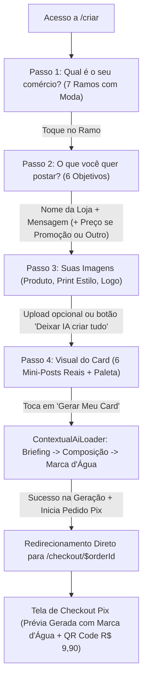

# Spec: Redesign do Fluxo de Criação em Micro-Passos (`MicroStepCreationFlow`)

- **Slug**: `epico-6-redesign-criacao-micro-passos`
- **Status**: `ready-for-agent`

---

## Problem Statement

Microempresários de comércio local e serviços (lojistas de moda, donos de supermercado, cabeleireiros, barbeiros, donos de pizzaria, hamburgueria e restaurantes) precisam criar cards publicitários com rapidez para Instagram e WhatsApp. No entanto, o fluxo de criação anterior apresentava fricções críticas que sobrecarregavam a experiência móvel e derrubavam a taxa de conversão:

1. **Sobrecarga Cognitiva no Formulário Vertical Antigo**: O Passo 2 anterior concentrava mais de 8 campos simultâneos (dados cadastrais, títulos, preços obrigatórios, uploads e estilos) em uma única tela longa. No celular, o usuário perdia o contexto, precisava rolar a tela repetidamente e desistia antes de gerar o card.
2. **Rigidez de Preço Obrigatório em Anúncios Não-Promocionais**: O formulário exigia obrigatoriamente um "Preço Promocional", mesmo quando o comerciante desejava divulgar uma **Nova Coleção**, um **Aviso de Feriado**, uma **Inauguração** ou um post institucional. Isso bloqueava a geração ou forçava o preenchimento de valores artificiais (como "R$ 0,00").
3. **Ausência do Segmento de Moda & Roupas**: O nicho de vestuário, boutiques e lojas de roupas é um dos maiores demandantes de posts diários nas redes sociais, mas não existia no catálogo canônico de segmentos.
4. **Falta de Diferenciação dos Insumos Visuais**: O usuário não compreendia claramente a diferença entre a foto do seu produto e uma imagem de referência visual, e não havia campo para inserir a **Logomarca da Loja**, essencial para fixação de marca no comércio local.
5. **Insegurança Visual na Escolha do Estilo**: Os seletores de estilo anteriores usavam apenas pequenos botões de texto ou miniaturas abstratas que não demonstravam como o anúncio ficaria com o nome e produto reais da sua loja.
6. **Ergonomia Móvel e Navegação Quebrada**: A ausência de uma barra de ação fixa no rodapé forçava o usuário a rolar longas distâncias para encontrar o botão de avançar, gerando frustração em viewports móveis (360px a 430px).

A Variação A validada no protótipo (`src/features/promotions/components/prototype/`) resolveu essas dores com aprovação entusiasmada nos testes com usuários. O objetivo deste épico é transformar essa solução no fluxo oficial de criação da plataforma.

---

## Solution

O Épico 6 implementa oficialmente o **Fluxo de Criação de Card em Micro-Passos** (`MicroStepCreationFlow`), reorganizando a experiência em 4 micro-etapas focadas e guiadas, seguidas pela geração da prévia com marca d'água e redirecionamento direto para a tela de checkout Pix com o card exibido ao lado do QR Code.

### 1. Jornada do Microempresário (Mobile-First UX)



### 2. Detalhamento dos Micro-Passos

#### Passo 1 — Ramo do Comércio (`Step1Segment`)
- O comerciante seleciona o ramo de atividade da sua loja entre **7 segmentos comerciais oficiais** (arquitetura extensível para novos ramos e exemplos futuros):
  1. **Moda & Roupas** (`fashion`) — *Oficializado no sistema*.
  2. **Supermercado & Feira** (`supermarket`).
  3. **Pizzaria** (`pizzeria`).
  4. **Hamburgueria** (`burger-shop`).
  5. **Salão & Barbearia** (`beauty-salon`).
  6. **Restaurante & Marmitex** (`restaurant`).
  7. **Outros Comércios** (`local-retail`).
- Grid móvel 2 colunas com cards táteis, ícones expressivos e indicador de seleção ativo.
- Ao trocar de segmento, redefine automaticamente o estilo padrão para a primeira opção do catálogo daquele segmento.

#### Passo 2 — O Anúncio & Objetivo (`Step2Offer`)
- O comerciante escolhe o **Objetivo do Card (`cardIntent`)** entre 6 opções:
  1. **Promoção / Preço** (`promo`): destaque de produto com preço e desconto.
  2. **Novidade / Coleção** (`new-arrival`): chegada de mercadoria, coleção ou prato novo.
  3. **Data Comemorativa** (`special-date`): Dia dos Pais, Mães, Natal, Aniversário.
  4. **Inauguração / Evento** (`announcement`): inauguração, reinauguração ou evento especial.
  5. **Horário / Aviso** (`schedule`): horário de feriado, mudança de endereço ou comunicado.
  6. **Outro (Digitar)** (`custom`): campo aberto para o usuário digitar livremente o objetivo (`customIntentText`).
- **Campos de Entrada**:
  - **Nome da sua Loja**: texto obrigatório com placeholder personalizado pelo segmento (ex.: *"Boutique Bella Flor"*).
  - **Mensagem Principal / Item**: texto obrigatório com placeholder dinâmico baseado no objetivo selecionado (ex.: *"Vestido Midi Canelado"* ou *"Neste feriado abriremos das 8h às 14h"*).
  - **Preço da Promoção**:
    - **Obrigatório** apenas quando o objetivo for `promo`.
    - **Opcional com botão** `+ Adicionar preço neste card` apenas quando o objetivo for `custom` (Outro).
    - **Completamente oculto (sem botão de adição)** nos demais 4 objetivos (`new-arrival`, `special-date`, `announcement`, `schedule`), garantindo que cards de novidade, datas comemorativas, avisos e horários sejam 100% institucionais e limpos de preços.

#### Passo 3 — Suas Imagens (`Step3VisualAssets`)
- Três cartões de upload totalmente opcionais, com pré-visualização instantânea e botão de exclusão:
  1. **Foto do Produto ou Local** (`productImageDataUrl`): foto real da roupa, prato, bebida ou ambiente da loja.
  2. **Print de Card para Copiar Estilo** (`referenceImageDataUrl`): print de referência visual para a IA replicar formato, cores e estética.
  3. **Sua Logo** (`logoImageDataUrl`): arquivo de imagem da logomarca da loja com preview em modo `contain` para aplicar como assinatura da marca no card.
- Botão rápido de rodapé: *"Não tenho imagens agora — Deixar a IA criar tudo"*, permitindo pular com 1 toque diretamente para o Passo 4.

#### Passo 4 — Visual do Card & Paleta (`Step4StyleAndPalette`)
- **Aviso de Print Ativo**: se o usuário enviou um print de referência no Passo 3, exibe um alerta de confirmação: *"Print de Referência Ativo! A IA vai seguir o formato do print que você enviou"*.
- **Grade 2x3 de Mini-Posts Interativos**: 6 estilos visuais curados para o segmento ativo, renderizados com layout realista e **interpolando os dados reais digitados pelo comerciante** (Nome da Loja, Mensagem e Preço real).
- **Paleta de Cores da Marca (Opcional)**:
  - Chips de seleção rápida de cores com swatches visuais (`QUICK_BRAND_PALETTES`: Vermelho & Amarelo, Azul & Branco, Preto & Dourado, Verde & Creme, Rosa & Claro, Laranja & Escuro).
  - Campo de texto para cor personalizada da loja (ex.: *"Azul royal e amarelo"*).

#### Rodapé Fixo Mobile-First (`CreationFixedFooter`)
- Barra fixada na base da viewport (`fixed bottom-0 left-0 right-0 z-40 bg-background/95 backdrop-blur-md border-t border-border p-3.5`).
- Botão "Voltar" (largura 1/3) visível nos passos 2, 3 e 4.
- Botão "Continuar" (largura 2/3 no passo 2 e 3, largura total no passo 1) com validação dinâmica:
  - Desabilitado no Passo 2 se Nome da Loja ou Mensagem estiverem vazios; se o objetivo for `promo` e o Preço estiver vazio; ou se em `custom` o texto do objetivo estiver em branco.
- No Passo 4, o botão se transforma em **"Gerar Meu Card"** com ícone de varinha mágica.

#### Geração de Card e Redirecionamento Direto para Checkout Pix
- Ao clicar em "Gerar Meu Card", o sistema:
  1. Salva atomicamente o rascunho com todos os campos novos (`cardIntent`, `customIntentText`, `logoImageDataUrl`, `stylePresetId`, `customStyleInstructions`).
  2. Abre o modal `ContextualAiLoader` com as 3 fases animadas (*"Lendo o briefing..."*, *"Compondo a arte visual com IA..."*, *"Aplicando marca d'água de proteção..."*).
  3. O backend executa o `AdCardGenerator` com prompt multimodal enriquecido (incluindo logotipo, objetivo e preço condicional) e aplica marca d'água via Sharp (`ExportEngine`).
  4. Com a prévia pronta, chama `initiateCheckoutFn` para congelar o snapshot imutável (`frozenSnapshot`) e emitir a cobrança Pix na Pushin Pay.
  5. **Redireciona diretamente para a rota `/checkout/$orderId`**, onde a tela de checkout exibe em destaque o Card Publicitário gerado com marca d'água ao lado do QR Code Pix, código Copia e Cola e contador de expiração.
  6. Caso o comerciante deseje alterar os dados ou fotos, a tela de checkout dispõe do botão de retorno para `/criar` com o rascunho preservado.

---

## User Stories

### Happy Paths

1. **Como comerciante de moda**, quero selecionar o ramo *"Moda & Roupas"* no Passo 1, para que a IA sugira vitrines, paletas e estilos apropriados para vestuário e coleções.
2. **Como comerciante divulgando uma promoção relâmpago**, quero selecionar o objetivo *"Promoção / Preço"* no Passo 2 e preencher o preço do produto, para que o anúncio tenha destaque visual expressivo no preço promocional.
3. **Como comerciante postando um aviso de feriado ou horário especial**, quero selecionar o objetivo *"Horário / Aviso"* sem campo de preço na tela, para que o card seja gerado de forma puramente informativa e sem valores monetários.
4. **Como comerciante anunciando uma nova coleção**, quero selecionar *"Novidade / Coleção"* sem campo de preço visível, garantindo foco editorial na mensagem e nas fotos das roupas.
5. **Como comerciante com uma necessidade específica**, quero escolher *"Outro (Digitar)"* e descrever meu próprio objetivo (ex.: *"Vaga de Atendente"*), podendo opcionalmente adicionar um preço se julgar necessário.
6. **Como comerciante que possui a foto do produto e a logo da sua loja**, quero enviar ambos no Passo 3, para que a IA componha o produto na cena e posicione a logo como assinatura da marca.
7. **Como comerciante que não tem nenhuma imagem salva no celular**, quero tocar em *"Não tenho imagens agora — Deixar a IA criar tudo"*, para avançar instantaneamente para o Passo 4 sem atrito.
8. **Como comerciante no Passo 4**, quero ver 6 mini-cards com o nome da minha loja e meu produto já aplicados na arte, para ter certeza de qual estilo visual combina melhor com o meu negócio.
9. **Como comerciante com identidade visual definida**, quero escolher uma paleta de cores rápida (ex.: *"Preto & Dourado"*) ou digitar a cor da minha loja, para que a IA harmonize o anúncio com as cores da minha marca.
10. **Como comerciante gerando o card**, quero tocar em *"Gerar Meu Card"*, aguardar a síntese no loader e ser direcionado diretamente para a tela de pagamento Pix com o meu card gerado em destaque ao lado do QR Code.

### Casos de Borda e Erros

11. **Como comerciante navegando no celular**, se eu tentar avançar no Passo 2 sem preencher o nome da loja ou a mensagem principal, o botão de avançar deve permanecer desabilitado para impedir rascunhos incompletos.
12. **Como comerciante selecionando "Promoção" no Passo 2**, se o campo de preço estiver em branco, o botão de avançar deve permanecer desabilitado. Se eu trocar para "Novidade", o campo de preço deve sumir e o botão deve se habilitar imediatamente.
13. **Como comerciante trocando de ramo no Passo 1 após ter selecionado um estilo no Passo 4**, o sistema deve redefinir o estilo selecionado para o primeiro estilo do novo catálogo, evitando referenciar IDs de estilo de outros segmentos.
14. **Como comerciante enviando um logotipo com fundo transparente (PNG)**, a IA deve incorporar o logo de forma nítida e sem distorcer as proporções da marca.
15. **Como comerciante gerando o card**, se a IA retornar erro temporário (timeout, rate limit ou safety filter), o sistema não consome cota, mantém o comerciante no Passo 4 e exibe alerta com botão de tentar novamente.
16. **Como sistema backend**, ao criar o pedido (`orders`), o snapshot imutável (`frozenSnapshot`) deve armazenar obrigatoriamente `cardIntent`, `customIntentText` e `logoImageDataUrl` junto aos demais parâmetros da oferta.

---

## Implementation Decisions

### 1. Evolução do Modelo de Dados e Schemas Zod

#### 1.1 Oficialização do Segmento `fashion` em `BUSINESS_SEGMENTS`
O array canônico de segmentos em `src/features/promotions/data/offer-brief.schema.ts` é expandido para 7 segmentos:
```typescript
export const BUSINESS_SEGMENTS = [
  "fashion",
  "supermarket",
  "beauty-salon",
  "pizzeria",
  "burger-shop",
  "restaurant",
  "local-retail",
] as const;

export type BusinessSegment = (typeof BUSINESS_SEGMENTS)[number];
```

#### 1.2 Novos Tipos e Enums de Objetivos de Card (`cardIntent`)
```typescript
export const CARD_INTENTS = [
  "promo",
  "new-arrival",
  "special-date",
  "announcement",
  "schedule",
  "custom",
] as const;

export type CardIntent = (typeof CARD_INTENTS)[number];
```

#### 1.3 Atualização dos Schemas Zod de Draft e Briefing
No arquivo `src/features/promotions/data/offer-brief.schema.ts`:
- Adicionar `cardIntent: z.enum(CARD_INTENTS).default("promo")`.
- Adicionar `customIntentText: z.string().trim().optional()`.
- Adicionar `logoImageDataUrl: imageDataUrlSchema.optional().nullable()`.
- Tornar `promoPrice` opcional no schema base, validando obrigatoriedade condicionalmente:
  - Se `cardIntent === "promo"`, `promoPrice` é obrigatório (mínimo 1 caractere).
  - Se `cardIntent === "custom"`, `customIntentText` é obrigatório.
  - Para os outros 4 objetivos (`new-arrival`, `special-date`, `announcement`, `schedule`), `promoPrice` é opcional e não exibido na interface.

#### 1.4 Atualização da Tabela Drizzle `drafts` (`src/server/db/schema/promotions.ts`)
Adicionar as colunas:
- `cardIntent: text("card_intent").notNull().default("promo")`
- `customIntentText: text("custom_intent_text")`
- `logoImageDataUrl: text("logo_image_data_url")`

#### 1.5 Atualização do Snapshot Imutável (`orders.frozenSnapshot`)
Em `src/features/checkout/server/services/pix-checkout.service.ts`:
- O método `buildFrozenSnapshot` deve incluir:
  - `cardIntent: draft.cardIntent`
  - `customIntentText: draft.customIntentText`
  - `logoImageDataUrl: draft.logoImageDataUrl`

---

### 2. Integração com o Motor Multimodal Gemini (`ai-card-generator.service.ts`)

A função `buildMultimodalPromptParts` e `buildPromptText` em `src/features/promotions/server/services/ai-card-generator.service.ts` é estendida para:

1. **Suporte a Logotipo da Loja (`logoImageDataUrl`)**:
   - Quando presente, injeta como `InlineDataPart`:
     ```text
     LOGOTIPO DA LOJA FORNECIDO: Incorpore fielmente este logotipo no anúncio (posicionado no topo, canto superior ou no rodapé do card). Preserve rigorosamente suas cores, formato e legibilidade sem distorções.
     ```
2. **Diretriz de Objetivo do Anúncio (`cardIntent`)**:
   - `promo`: *"Foco absoluto em promoção agressiva, economia e destaque chamativo para o preço promocional."*
   - `new-arrival`: *"Foco em novidade, sofisticação e apresentação de novo produto ou coleção ('Chegou Novidade!', 'Nova Coleção')."*
   - `special-date`: *"Foco em atmosfera temática e emotiva da data comemorativa anunciada."*
   - `announcement`: *"Foco em clareza institucional, impacto visual de inauguração/evento e destaque para a chamada."*
   - `schedule`: *"Foco em legibilidade máxima da mensagem informativa de horário/funcionamento."*
   - `custom`: *"Foco na mensagem personalizada informada pelo cliente: [customIntentText]."*
3. **Comportamento quando não houver Preço**:
   - Se `promoPrice` estiver vazio ou não aplicável, a instrução de preço não gera "R$ 0,00" nem inventa valores; a IA é instruída expressamente: *"ESTE É UM CARD INSTITUCIONAL / INFORMATIVO: Não exiba nenhum preço ou valor monetário na arte gráfica."*

---

### 3. Consolidação do Catálogo Isomórfico Extensível (`src/features/promotions/data/creation-catalog.ts`)

O catálogo de segmentos, estilos visuais, mini-posts e paletas rápidas validado no protótipo é promovido para a camada oficial de dados:
- Contém os 7 segmentos comerciais com metadados, ícones, placeholders e exemplos por objetivo.
- Projetado com estrutura desacoplada para permitir que novos ramos e exemplos sejam adicionados futuramente com zero refatoração estrutural.
- Cada segmento contém 6 estilos visuais completos com paletas de cores, badges e layout types (`bold-offer`, `clean-frame`, `dark-premium`, `vibrant-pop`).
- Exporta a constante `QUICK_BRAND_PALETTES` com as 6 combinações de cores mais populares do varejo brasileiro.

---

### 4. Arquitetura de Componentes do Wizard & Redirecionamento Direto ao Checkout

A pasta `src/features/promotions/components/` é estruturada com módulos concisos:

- `offer-creation-wizard.tsx`: componente orquestrador central do fluxo (substitui o antigo `offer-brief-wizard.tsx` como componente padrão na rota `/criar`).
  - Gerencia o estado dos 4 micro-passos.
  - Conecta o hook `useOfferBriefDraft` aos passos.
  - Orquestra o modal `ContextualAiLoader`.
  - Ao concluir a geração do card com sucesso, aciona o checkout Pix (`initiateCheckoutFn`) e redireciona diretamente para `/checkout/$orderId`.
- `wizard/step1-segment-select.tsx`: seleção dos 7 ramos de comércio.
- `wizard/step2-offer-details.tsx`: 6 objetivos de anúncio, nome da loja, mensagem principal e preço estritamente visível apenas em `promo` e `custom`.
- `wizard/step3-visual-assets.tsx`: uploads opcionais de produto, referência e logo + botão rápido de pular.
- `wizard/step4-style-and-palette.tsx`: grade 2x3 de mini-posts interativos + seletor de paleta de marca.
- `wizard/style-mini-post-card.tsx`: cartão visual de mini-post com interpolação dinâmica dos dados do comerciante.
- `wizard/photo-option-card.tsx`: cartão de upload tátil com suporte a preview `contain` (logo) ou `cover` (produto).
- `wizard/creation-fixed-footer.tsx`: rodapé fixo mobile-first com botões "Voltar" e "Continuar / Gerar Meu Card".
- Atualização em `src/features/checkout/components/order-summary-card.tsx` e tela de checkout para exibir a prévia gerada com marca d'água com destaque visual refinado ao lado do QR Code Pix.

---

## Testing Decisions

### 1. Superfície de Testes Públicos (Deep Modules Seams)

1. **Schemas Zod (`offer-brief.schema.test.ts`)**:
   - Validar inclusão do segmento `fashion`.
   - Validar que `cardIntent === "promo"` rejeita rascunhos sem `promoPrice`.
   - Validar que `cardIntent !== "promo"` aceita rascunhos sem `promoPrice`.
   - Validar que `cardIntent === "custom"` rejeita rascunhos sem `customIntentText`.
   - Validar formatos aceitos de `logoImageDataUrl` (JPEG, PNG, WebP até 4MB).
2. **Serviço de Banco de Dados (`drafts.service.test.ts`)**:
   - Validar persistência atômica e recuperação dos novos campos (`cardIntent`, `customIntentText`, `logoImageDataUrl`).
3. **Sintetizador Gemini (`ai-card-generator.service.test.ts`)**:
   - Validar inclusão do logotipo como imagem inline e diretriz de preservação da marca no prompt.
   - Validar injeção do objetivo do card e ausência de textos de preço quando `promoPrice` for omitido.
4. **Checkout e Snapshot Imutável (`pix-checkout.service.test.ts`)**:
   - Validar que o `frozenSnapshot` do pedido gravado no banco contém `cardIntent`, `customIntentText` e `logoImageDataUrl`.
5. **Componentes e UX do Wizard (`offer-creation-wizard.test.tsx`)**:
   - Renderização inicial no Passo 1 com seleção de ramo.
   - Transição para o Passo 2 com validação de campos obrigatórios (botão avançar desabilitado até preencher nome e mensagem).
   - Ocultação estrita do campo de preço nos 4 objetivos (`new-arrival`, `special-date`, `announcement`, `schedule`).
   - Navegação pelo rodapé fixo móvel e preservação de estado ao voltar.
   - Disparo da geração de prévia com ativação do `ContextualAiLoader` e redirecionamento direto para a tela de checkout Pix.

---

## Out of Scope

- Editor gráfico de arrastar e soltar (drag & drop) estilo Canva (YAGNI — foco é automação 100% IA em menos de 90s).
- Encartes multiprodutos com dezenas de itens na mesma arte (previsto para Fase 3).
- Cadastro de usuário com e-mail/senha (regra de ouro do produto: zero login prévio).
- Geração de logotipo por IA (o usuário envia o dele ou a IA cria o card sem logo).

---

## Further Notes

- Alinhado com o [PRD.md](file:///home/luis/repositories/OfertaPronta/PRD.md) v2.0 (Seção 3 — Fluxo Principal e Seção 5 — Escopo Funcional).
- Alinhado com o [GLOSSARY.md](file:///home/luis/repositories/OfertaPronta/GLOSSARY.md) (termos Merchant, Business Segment, Offer Brief, Ad Card, Style Preset e Frozen Snapshot).
- Respeita o design system mobile-first auditado por `./.agents/scripts/check_shadcn_usage.py`.
